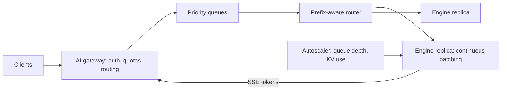

# MD-22 — LLM Inference Serving and GPU Batching

> [!abstract] What this is
> How to serve a large language model to many users at once on expensive GPUs: a gateway that queues and routes requests, an inference engine (vLLM, SGLang, TensorRT-LLM) that runs **continuous batching** over a **paged KV cache**, **prefix caching** so shared prompt prefixes aren't recomputed, and an autoscaler that adds GPU replicas from queue depth rather than CPU.
>
> The defining trade-off is **latency per user vs throughput per GPU**: time to first token (TTFT) and time per output token (TPOT) get worse as batches grow, while cost per token gets better. Everything in this block is about choosing a point on that curve per traffic class. The model-level depth (quantisation, VRAM maths, disaggregated prefill/decode) lives in the Agentic notes; this MD is the system around it.

---

## 1. What It Solves and Where It Appears

- An LLM request is not a normal request: it runs for seconds, its cost depends on prompt and output length, and GPU memory (the KV cache) rather than CPU limits how many can run at once.
- Naive serving (one request at a time, or static batches) leaves GPUs idle and fragments memory. vLLM's launch reported up to 24× higher throughput than plain Hugging Face Transformers; paging the KV cache in fixed blocks cuts wasted memory from 60–80% to a few percent.
- AI system design prompts now appear in general SWE loops (for example, "design a batch inference API for a GPU cluster").

| Problem | Use |
|---|---|
| LLM inference platform (#A4) | The whole problem |
| ChatGPT-like assistant (#A3) | Streaming tokens, per-user quotas, model routing |
| Support chatbot on a third-party LLM (#A1) | Gateway, fallbacks, caching; the engine belongs to the provider |
| AI gateway (#A7) | Routing, quotas, cost attribution across providers and self-hosted models |
| Batch inference API | Offline queue, maximum batch size, cheap GPUs |

---

## 2. Knobs

| Knob | Options | What it trades |
|---|---|---|
| Max batch size / tokens in flight | small → large | TTFT/TPOT vs throughput |
| Scheduling | FCFS, priority classes, shortest-prompt-first | Fairness vs latency for interactive traffic |
| Chunked prefill | on/off, chunk size | Smooth TPOT for running requests vs TTFT for long prompts |
| Prefix caching | on/off | Memory vs recompute for shared system prompts and chat history |
| Prefill/decode disaggregation | same GPUs, separate pools | Simplicity vs better utilisation at scale |
| Quantisation | FP16/BF16, FP8, INT4 | Quality vs memory and speed |
| Model routing | one model, small → large cascade | Cost vs answer quality |
| Autoscaling signal | queue depth, KV cache utilisation, TTFT | Responsiveness vs GPU cost (GPUs take minutes to start) |

---

## 3. Evolution of the Block

### Step 0 — Call a hosted API

- Use a provider's API behind your gateway. You own quotas, retries, fallbacks, caching and cost tracking ([[MD-02 - Traffic Shaper Rate Limiter and Waiting Room]], [[MD-09 - Multi-Lane Priority Queue Retry and Vendor Failover Hub]]). Right for most products.

### Step 1 — Self-host with an inference engine

- **Trigger:** cost at volume, data residency, a fine-tuned or open model.
- **Change:** vLLM/SGLang replicas behind a load balancer that routes by queue length, not round robin. Stream tokens over SSE ([[MD-01 - Stateful Connection and Realtime Push Mesh]]).

### Step 2 — Continuous batching and paged KV cache

- **Trigger:** GPU utilisation low, latency high under load.
- **Change:** the engine schedules at the **iteration** level: every decoding step, finished sequences leave the batch and waiting ones join, instead of waiting for a whole batch to finish. The KV cache is stored in fixed-size blocks (PagedAttention), so many sequences of different lengths share memory without fragmentation.

### Step 3 — Prefix caching and prefix-aware routing

- **Trigger:** every request repeats a long system prompt or the same conversation history.
- **Change:** cache KV blocks for shared prefixes; route requests with the same prefix (same tenant, same conversation) to the same replica so the cache hits.

### Step 4 — Traffic classes and admission control

- **Trigger:** batch jobs and interactive chat compete; spikes push TTFT past targets.
- **Change:** separate queues and priorities (interactive first, batch fills spare capacity), per-tenant token budgets, admission control that rejects or queues when KV cache is full, and a smaller fallback model when the large one is saturated.

### Step 5 — Disaggregation and multi-model fleets

- **Trigger:** large scale, long prompts.
- **Change:** separate prefill GPUs (compute-heavy) from decode GPUs (memory-bandwidth-heavy) and transfer KV between them; route across model sizes and regions. Details: [[13 - GPU Serving and Disaggregated KV Cache]].



---

## 4. Core Mechanics

### Two phases of a request

- **Prefill:** process the whole prompt at once, compute-bound; determines TTFT.
- **Decode:** generate one token per step per sequence, memory-bandwidth-bound; determines TPOT.
- Continuous batching interleaves many sequences' decode steps; chunked prefill splits long prompts into pieces so they don't stall everyone else's decode.

### KV cache memory (rough)

```
KV bytes per token ≈ 2 (K and V) × layers × kv_heads × head_dim × bytes_per_value
Example 8B-class model with grouped-query attention, FP16:
  2 × 32 × 8 × 128 × 2 B ≈ 131 KB per token
  A 4k-token conversation ≈ 0.5 GB of KV cache
  80 GB GPU − ~16 GB weights ≈ 60 GB for KV → ~120 such conversations in flight
```

- This is why concurrency is limited by memory, and why prefix caching and quantised KV matter.

### Gateway responsibilities

- Auth, per-tenant quotas in tokens and money (reserve estimated tokens, reconcile actual).
- Routing: model choice per request type; fallback provider or model on errors/overload.
- Caching: exact-match response cache for repeated prompts; semantic caching only where staleness is acceptable.
- Streaming: SSE to the client; cancel generation when the client disconnects (otherwise you pay for tokens nobody reads).
- Observability: tokens in/out, TTFT, TPOT, cost per tenant, errors per provider.

### Autoscaling

- Scale on queue depth, KV cache utilisation and TTFT, not CPU.
- GPUs and model weights take minutes to come up: keep warm headroom, pre-scale for known events, and shed or downgrade (smaller model) during spikes.

---

## 5. Decision Tables

| Option | Pick when |
|---|---|
| Hosted API (OpenAI, Anthropic, Gemini, Indian providers) | Most products; fastest to ship |
| Self-hosted open model on vLLM/SGLang | Volume makes it cheaper, residency, fine-tuned models |
| Batch API / offline queue | Non-interactive jobs; maximise batch size and use cheaper capacity |

| Latency target | Engine setting |
|---|---|
| Interactive chat (TTFT < ~1 s) | Smaller max batch, chunked prefill, priority queue |
| Batch summarisation | Large batches, long queues, preemptible GPUs |

---

## 6. Numbers to Know

| Thing | Number |
|---|---|
| vLLM vs naive serving | up to 24× throughput at launch (2023); typical modern stacks 3–5× over naive loops |
| PagedAttention | KV memory waste from ~60–80% down to under ~4% |
| Interactive targets | TTFT under ~1 s; TPOT ~20–50 ms (≈ 20–50 tokens/s per user) |
| KV per token | ~100 KB–1 MB depending on model size and precision |
| GPU cold start | minutes (node + weights load) |

---

## 7. Failure Modes

| Failure | What happens | Detect | Fix |
|---|---|---|---|
| KV cache full | Requests preempted or rejected, TTFT spikes | KV utilisation, preemptions | Admission control, shorter max context, quantised KV, more replicas |
| Long prompts stall others | TPOT spikes for everyone | TPOT p99 | Chunked prefill, separate queue for long-context requests |
| Round-robin routing | Uneven queues, prefix cache misses | Per-replica queue skew | Least-queue + prefix-aware routing |
| Provider outage / 429s | Chat fails | Error rate per provider | Fallback provider or model, retries with backoff, quotas |
| Client disconnects, generation continues | Wasted GPU | Tokens generated vs delivered | Propagate cancellation to the engine |
| Cost blow-up from one tenant | Bill spike | Cost per tenant | Token and spend budgets per tenant |

---

## 8. Twist Cards

- **"Design a batch inference API for a GPU cluster."**
    + Async jobs: submit file → queue → workers run the engine with large batches on cheaper capacity → results to object storage → webhook. Priority lower than interactive; jobs are resumable per item.
- **"Ten thousand users share the same 3,000-token system prompt."**
    + Prefix caching plus routing those requests to replicas that already hold the prefix.
- **"Keep cost per conversation under a budget."**
    + Route easy queries to a small model, cache, cap output tokens, trim history with summaries, and enforce per-tenant budgets at the gateway.
- **"Traffic triples during an event and GPUs take 10 minutes to start."**
    + Pre-scale, queue with honest wait times, downgrade to a smaller model, and protect interactive traffic by pausing batch work.

---

## 9. Operations and Cost

- **Watch:** TTFT and TPOT percentiles per model and class, queue depth and wait, KV cache utilisation and preemptions, tokens/s per GPU, prefix-cache hit rate, cost per 1k tokens per tenant, provider error rates.
- **Cost:** GPU hours dominate. Throughput per GPU (batching, prefix caching, quantisation) and model routing are the main levers.

---

## 10. Say It in One Minute

> "Requests go through an AI gateway that handles auth, per-tenant token budgets, routing and fallbacks, and streams tokens over SSE. Self-hosted models run on vLLM-style engines with continuous batching, so sequences join and leave the batch every step, and a paged KV cache so memory isn't fragmented; GPU memory for KV, not CPU, limits concurrency. Shared prompts hit a prefix cache, and the router sends same-prefix requests to the same replica. Interactive and batch traffic have separate priorities, autoscaling follows queue depth and KV utilisation with warm headroom because GPUs start slowly, and a smaller model is the overload fallback."

---

## Sources

- Spheron, *LLM Serving Optimization: Continuous Batching, PagedAttention, and Chunked Prefill on H100* (2026): 3–5× over naive loops. https://www.spheron.network/blog/llm-serving-optimization-continuous-batching-paged-attention/
- *How LLM Inference Serving Works* (2026): vLLM's launch claim of up to 24× over Hugging Face Transformers. https://ragmehta.substack.com/p/how-llm-inference-serving-works-kv
- Latitude, *Real-time LLMs: Optimizing latency in streaming* (2026): PagedAttention cuts KV waste from 60–80% to under 4%. https://latitude.so/blog/real-time-llms-optimizing-latency-streaming
- vLLM blog, *Serving GLM-5.2 on 24 NVIDIA B300 GPUs* (2026): TPOT SLAs with prefill/decode disaggregation. https://vllm.ai/blog/2026-07-23-glm-5.2-nvfp4-b300-pd
- Exponent/Aced, *System Design Interview Guide 2026*: LLM prompts in general SWE loops, batch inference API at Anthropic. https://www.tryexponent.com/blog/system-design-interview-guide

## Related Notes

- [[12 - Mini Designs]]
- [[13 - GPU Serving and Disaggregated KV Cache]]
- [[14 - Quantization Decoding and VRAM Math]]
- [[12 - LLM Cost and Latency Economics]]
- [[10 - AI Gateway Security and Guardrails]]
- [[MD-01 - Stateful Connection and Realtime Push Mesh]]
- [[MD-02 - Traffic Shaper Rate Limiter and Waiting Room]]
- [[MD-09 - Multi-Lane Priority Queue Retry and Vendor Failover Hub]]
