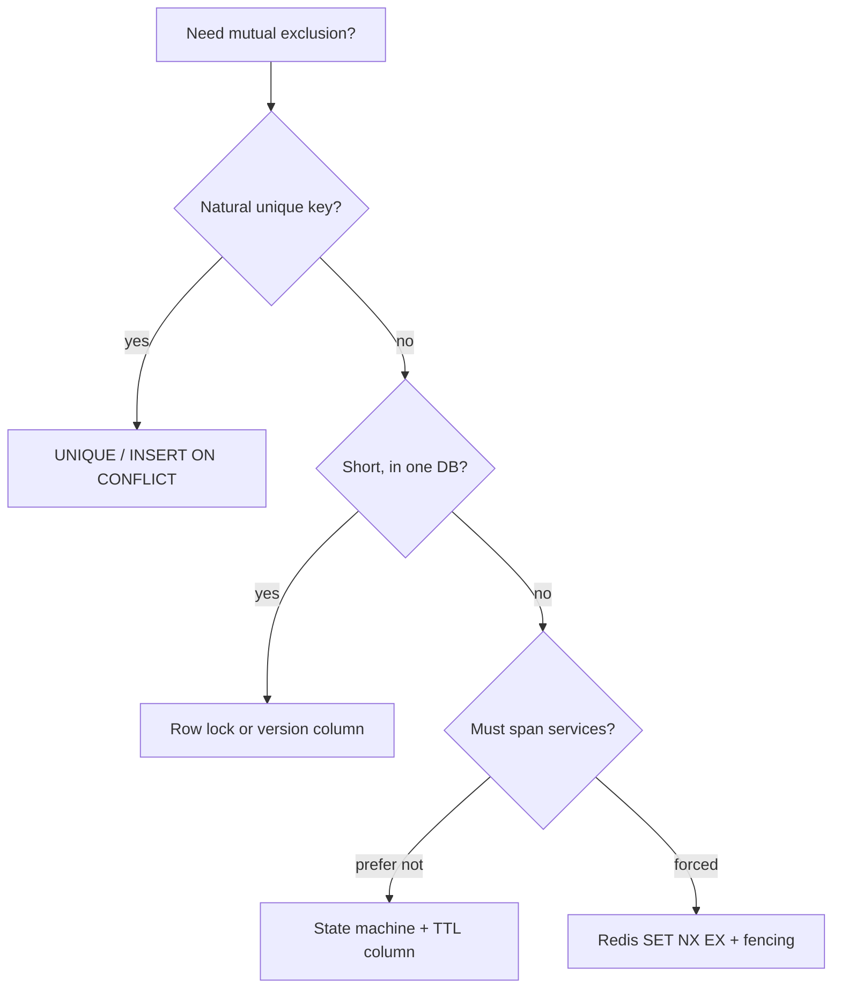
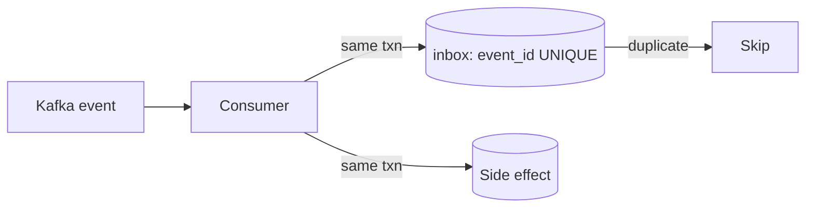

# Coordination and Concurrency

> [!abstract] What this is
> "Don't let two people take the same seat, run the same job, or decrement the same stock." That's this note: locking, leasing, "only one winner," and database concurrency.
>
> The key decision: a **distributed lock is the last tool**, not the first. Prefer a DB constraint or a row state.

---

## Why It Exists

Any time two requests can act on the same thing at once, something has to decide who wins. Two users click the last seat. Two cron boxes both think it's time for the nightly bill run. Two browser tabs read `qty=5` and both write `4`. Without a rule, you double-sell, double-run or lose updates.

This note is about mutual exclusion, not geography. Geo-radius and "nearby users" are queries and live in [[09 - Storage Search and Geo]].

---

## The Decision Tree

Most concurrency problems are solved by the database you already have. Walk down this tree and stop at the first option that fits; say it out loud in the interview.



1. **Unique constraint.** Two inserts of the same `seat_id` into a booking table: one fails. This *is* a lock. Use it.
2. **Optimistic version.** `UPDATE … WHERE id=? AND version=3`. The lost update dies. Default for stock and profiles.
3. **Pessimistic row lock.** `SELECT FOR UPDATE` in a transaction. Hold it for **milliseconds**, not while the user stares at a payment page.
4. **DB state + TTL.** `status='held', hold_until=now()+10m`. A sweeper releases expired holds. Booking, ride offers, OTPs.
5. **Redis lock.** Only when the critical section isn't inside one database: a cron across boxes, a cache stampede, "exactly one worker."

> [!warning] "I'll take a Redis lock for 10 minutes while they pay" is how you strand inventory when the process dies and you forgot expiry, or how you **double-sell** when expiry fires and the old holder still writes. See fencing below.

---

## Database Concurrency

The basics are in [[05 - Databases]]. These are the pieces that actually get follow-up questions, each with its app-level fix. MVCC, WAL and isolation depth are in [[05 - Databases/README]]; this section is the recipe. If they only poke, "Postgres uses MVCC so readers don't block writers" is still the one sentence.

**Lost update.** Two tabs read `qty=5`, both write `4`. Fix it with an atomic update `qty = qty - 1 WHERE qty > 0`, a `version` compare-and-set, or `FOR UPDATE`.

**`SELECT FOR UPDATE`.** Pessimistic: nobody else can take that row until you `COMMIT`. It can **deadlock** if transaction A locks seat 1 then seat 2 while B locks 2 then 1. Fix: always lock in **sorted ID order**, and keep the transaction tiny.

**`SKIP LOCKED`.** The job-queue trick. Workers run `SELECT … FOR UPDATE SKIP LOCKED LIMIT 1`, so locked rows are skipped instead of waited on. This is how many pollers share one `jobs` table without Redis. Name it when asked "how do workers not steal the same job."

**Write skew.** One example is enough. Under snapshot isolation, two doctors both see "on-call count = 1" and both go off duty. Each update is valid on its own, but the invariant "at least one on call" dies. Fix: **Serializable** isolation, or an explicit constraint or lock on the invariant. SSI internals won't be examined.

**Advisory locks.** Postgres `pg_advisory_lock` gives app-level locks inside the DB. Rare in HLD; prefer a row you can see.

**Hot row.** Everyone updates the same counter, so the row lock *is* the bottleneck. Fix: shard the counter, use Redis `INCR`, or append events and sum them.

---

## Optimistic vs Pessimistic

Both stop lost updates. The difference is whether you assume a conflict and wait up front, or assume none and retry if you were wrong.

| | Optimistic (version / CAS) | Pessimistic (`FOR UPDATE`) |
|---|---|---|
| Conflict | Rare | Likely (same seat) |
| Hold time | None until the write | Duration of the transaction |
| On failure | Retry the transaction | Wait, or deadlock |
| Pick when | Profiles, likes: low contention | Booking the last seat: high contention |

CAS is the same idea in Redis: `WATCH`, or a Lua script that says "read tokens, write only if still N."

---

## Distributed Lock: The Recipe

When the critical section really does span machines and no single DB row can guard it, a Redis lock is the practical tool. It's three parts, and each one prevents a specific bug.

```
SET lock:job:nightly <token> NX EX 30
# do work
# release only if value still == token  (Lua: if get==token then del)
```

- **`NX`**: only one winner.
- **`EX`**: if you die, the lock dies. No expiry means locked forever.
- **Token**: a random UUID. Never `DEL lock` blindly, or you delete the *next* holder's lock.

| Use | Lock? | Why |
|---|---|---|
| Leader for a cron | Yes | No DB row naturally guards it |
| Cache stampede (one refill) | Yes | Short, and losing it is harmless |
| "Only one indexer on this shard" | Yes | Cross-machine work |
| Checkout / seat booking | **No** | Use the seat row: constraint, version or hold state |

### What they will poke

Every lock recipe gets the same follow-ups. These are the answers.

| Failure | What happens | Mitigation |
|---|---|---|
| Process dies | Lock would be held forever | TTL frees it. Sweeper / `hold_until` if it's inventory |
| Work longer than TTL | Lock expires, **two holders** | Renew with a heartbeat, *or* shorter work, *or* fencing |
| Clock skew | Holders disagree on expiry | Redis TTL runs on the **server**. Don't use app clocks for expiry |
| Two Redis nodes (split) | Two lock services → two winners | Don't run "two independent Redis" as the lock |
| Deadlock | Two holders wait on each other | Lock keys in sorted order, same as the DB |

### Fencing tokens

This is the one extra idea worth adding. Each time you acquire the lock you also get a **monotonic number** (a ZooKeeper zxid, or `INCR fence`). The storage layer **rejects writes carrying an older fence**. So even if a paused holder's lock expired and it still thinks it's the leader, its writes bounce.

Redis `SET NX EX` **alone has no fencing**. That's why people call Redlock slippery and treat ZooKeeper/etcd locks as the ones that are correct.

> [!tip] "Redis lock with a TTL for the cron. For money I wouldn't trust it; I'd put a version or fence on the row so a late holder can't commit."

**Redlock** is a multi-Redis majority lock. Name-drop it as "controversial, I won't use it for payments." Don't implement it.

**ZooKeeper / etcd / Consul** give an ephemeral node plus a watch, which is a lock with built-in liveness. It's "someone else's Raft." Use them when the lock *is* the product (leader election for a primary), not for a seat. How consensus makes these correct is in [[17 - Consistency Time and Consensus]].

---

## Lease vs Lock

A **lease** is a lock that is *expected* to be renewed: "You may be the leader for 10 s; heartbeat or lose it." Kubernetes leader election, the Kafka partition leader, and "this worker owns shard 7" all work this way.

It's the same TTL idea. The extra word is **renew**, and the extra rule is: if you can't renew, you **stop writing**.

| Tool | Lifetime | Pick when |
|---|---|---|
| **Lock** | One critical section, then release | Short, one-off work (a cron run, a cache refill) |
| **Lease** | Ongoing ownership, renewed by heartbeat | A role held for a long time (leader, shard owner) |

---

## Semaphore

A lock allows one holder; a semaphore allows **at most N**. "At most 20 thumbnail workers" is a semaphore. In Redis, increment a counter with a cap, or hand out a list of tokens.

A gateway concurrency limit is a semaphore, not a rate limit. A rate limit counts requests per unit of time; a concurrency limit counts requests in flight right now.

| Control | Limits | Pick when |
|---|---|---|
| **Lock** | 1 holder | Exactly one actor |
| **Semaphore** | N concurrent holders | Protect a resource with fixed capacity |
| **Rate limit** | Requests per time window | Abuse control, fair use |

---

## Single-Flight (Request Coalescing)

When 100 requests miss the same cache key at once, single-flight lets **one** go to the DB while the others wait for its result. It's the stampede fix in [[06 - Caching]]. It's in the same family as a lock, but its lifetime is exactly one fetch.

---

## Leader Election for Cron and Schedulers

"The nightly bill run must run once" is a leader-election problem, but it rarely needs real consensus. The options below go cheapest first; pick the first one that fits. Not Raft on the whiteboard.

| Option | How | Pick when |
|---|---|---|
| 1. Cloud scheduler | It hits **one** HTTP endpoint; the provider elects for you | Available on your platform. Cheapest |
| 2. `jobs` table + `SKIP LOCKED` | Workers claim rows | You already have a DB and many jobs |
| 3. Redis lock around the job | `SET NX EX` + token | Single job, Redis already present |
| 4. ZooKeeper / etcd | Ephemeral node, lease | You already run the cluster |

---

## Inbox (Pair with Outbox)

[[07 - Async Messaging]] covers the **outbox**: commit to the DB and publish in one step. The inbox is its twin on the consumer side.

The consumer writes the `event_id` into an `inbox` table **in the same transaction** as the side effect. If Kafka delivers the event twice, the second insert hits a unique violation and the consumer skips it. That's idempotency you can point at.



---

## What This Note Doesn't Cover

Geo-radius, user search radius and geohash neighbours are in [[09 - Storage Search and Geo]]. Consensus internals, clocks and TrueTime are in [[17 - Consistency Time and Consensus]]. CRDTs are in [[10 - Distributed Building Blocks]]. The Redlock paper, the write-skew catalogue and 2PL proofs are in [[15 - Out of Scope]].

---

## Failure Modes

| Failure | What happens | Mitigation |
|---|---|---|
| **Lost update** | Two writers overwrite each other | Atomic `UPDATE … WHERE`, version CAS, or `FOR UPDATE` |
| **Deadlock** | Two transactions each wait for the other's row | Lock in sorted ID order; keep transactions tiny |
| **Long-held row lock** | A lock held during payment blocks everyone | Use a hold state with `hold_until`, not a lock |
| **Write skew** | Each update valid, invariant broken | Serializable, or a constraint/lock on the invariant |
| **Hot row** | One counter row serialises all writers | Shard the counter, Redis `INCR`, or append and sum |
| **Stranded lock** | Holder dies with no expiry | Always `EX`; sweeper for DB holds |
| **Two holders** | Work outlives the TTL, or a paused holder resumes | Renew the lease; fencing tokens checked by storage |
| **Wrong-holder release** | Blind `DEL` removes someone else's lock | Token + compare-and-delete in Lua |
| **Duplicate event** | Consumer applies the side effect twice | Inbox table with unique `event_id` |

---

## Interview Lines

> [!tip] Say it like this
> - "A distributed lock is my last tool. First a unique constraint, then a version column, then a hold state with a TTL."
> - "Seats are guarded by the seat row, not by Redis. `hold_until` plus a sweeper releases abandoned holds."
> - "Workers claim jobs with `FOR UPDATE SKIP LOCKED`, so nobody steals the same job and I don't need Redis."
> - "Redis lock is `SET NX EX` with a random token, and release is compare-and-delete."
> - "For money I add a fencing token on the row, so a late lock holder can't commit."
> - "Consumers dedupe with an inbox table in the same transaction as the side effect."

## Related Notes

- [[05 - Databases]]
- [[06 - Caching]]
- [[07 - Async Messaging]]
- [[08 - Reliability]]
- [[10 - Distributed Building Blocks]]
- [[12 - Mini Designs]] — booking, ride offer TTL
- [[17 - Consistency Time and Consensus]]
