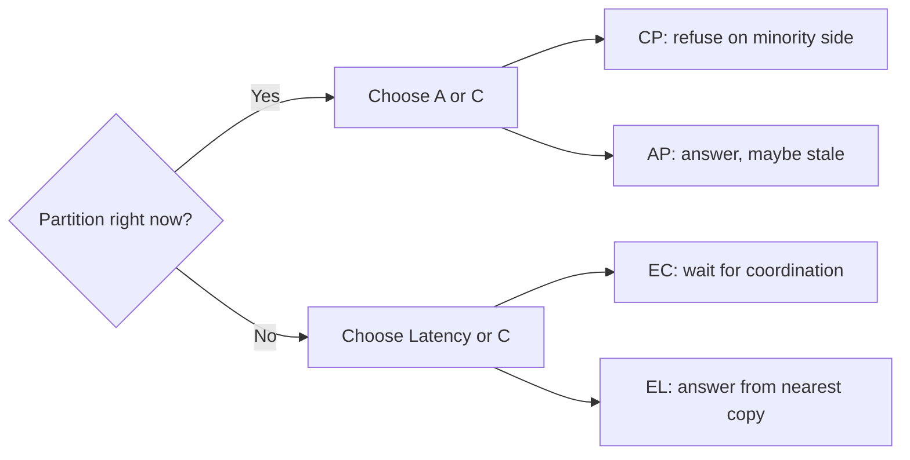
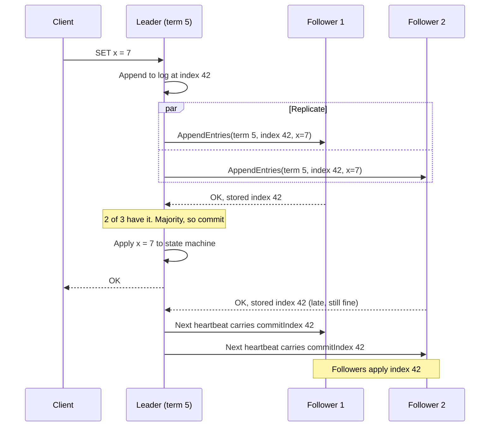
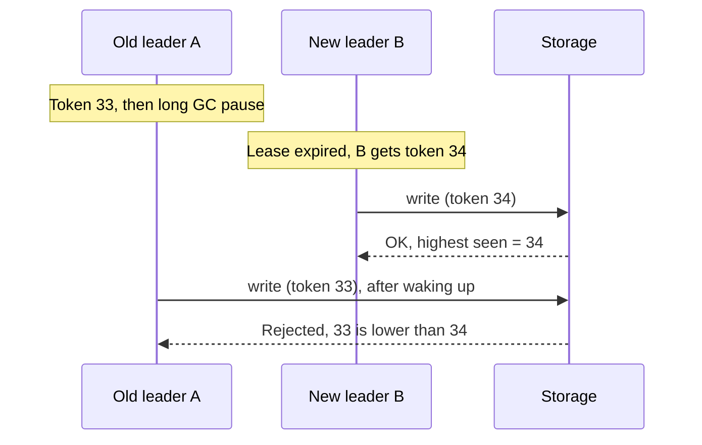

# Consistency, Time and Consensus

> [!abstract] What this is
> The theory under every "what does a reader see after a write?" question. It covers the ladder of consistency models, what CAP and PACELC actually say, why you can't trust wall clocks to order events, and how a cluster agrees on one leader and one log.
>
> The decision it helps you make: **how much coordination each data path needs**, and what that coordination costs in latency and availability.

---

## Why It Exists

On one machine, "the latest value" is obvious. There is one copy, one clock, and one order of events. The moment you add a replica, all three break. Two copies can disagree. Two clocks can disagree. Two nodes can each believe they are the leader.

Every replicated system picks an answer to those problems, whether it says so or not. Postgres with async replicas, Cassandra, DynamoDB and Spanner all made different choices. Knowing the vocabulary lets you say *which* guarantee a path needs, instead of saying "strong consistency" for everything and paying for it everywhere. [[02 - Fundamentals]] gives the short version; this note is the depth behind it.

---

## The Consistency Ladder

A consistency model is a promise about **what a reader is allowed to observe**. Stronger models forbid more surprising results, and each step up costs more coordination between replicas. Think of it as a ladder: the top rung behaves like a single machine, the bottom rung only promises that replicas agree once writes stop.

| Model                  | What a reader can observe                                                                                                                          | Example                                                                                                    | Cost                                                                                                | Pick when                                                                                         |
| ---------------------- | -------------------------------------------------------------------------------------------------------------------------------------------------- | ---------------------------------------------------------------------------------------------------------- | --------------------------------------------------------------------------------------------------- | ------------------------------------------------------------------------------------------------- |
| **Linearizable**       | The system behaves like one copy. Once a write returns, every read that *starts later* sees it, from any client.                                   | A seat booked by Alice is instantly unavailable to Bob, anywhere.                                          | Every write (and often every read) coordinates with a majority. Minority side of a partition stops. | Locks, leader election, unique usernames, inventory decrements                                    |
| **Sequential**         | Everyone sees all operations in the **same order**, and each client's own operations stay in the order it made them. That order may lag real time. | ZooKeeper: all clients agree on the order of updates, but a follower you read from may be slightly behind. | Still a global order, but reads can be served locally.                                              | Config and coordination data where "same order for everyone" matters more than "latest right now" |
| **Causal**             | If B depends on A (B was written after reading A), nobody sees B without A. Unrelated writes may appear in different orders to different readers.  | A reply never shows up before the comment it answers.                                                      | Track dependencies (e.g. with version vectors). No global order needed.                             | Comments, chat threads, collaborative apps                                                        |
| **Session guarantees** | Promises scoped to **one client's session**, not the whole system. See below.                                                                      | You edit your profile and see the edit on refresh, even if others don't yet.                               | Sticky routing, or reading from the primary after a write, or carrying a version token.             | Most user-facing CRUD on top of async replicas                                                    |
| **Eventual**           | If writes stop, replicas converge. Until then any replica may return any recent value, including going backwards.                                  | A like count shows 41, then 43, then 42.                                                                   | Cheapest. Any replica can answer.                                                                   | Counters, feeds, search indexes, analytics                                                        |

Under eventual consistency, a system uses multiple database replicas to handle high traffic, but these replicas sync their data with each other asynchronously in the background. The temporary decrease (or "going backwards") happens because consecutive read requests from the same user can be routed to completely different replicas that are currently out of sync with each other.

For example, imagine a post has 41 likes, and two more users click "Like" in different parts of the world:

- **Write 1:** Processed by Replica A.
- **Write 2:** Processed by Replica B.

If you are rapidly refreshing your screen to watch the count go up, your requests are being load-balanced across the system:

1. **First Read (Returns 43):** Your request hits Replica B. Replica B just received a background sync from Replica A, so it knows about both new likes and displays **43**.
2. **Second Read (Returns 42):** You hit refresh a second later. This time, the load balancer routes your request to a third server, Replica C. Replica C is slightly lagging. It has received the sync for Write 1, but the network packet containing Write 2 hasn't arrived yet. Because any replica is allowed to answer a query with its current local state, Replica C calculates the total and returns **42**.

### The four session guarantees

Session guarantees are the practical middle of the ladder. Users rarely notice that *other* people see stale data. They always notice when *their own* view is weird. These four fix the weird cases for one session.

| Guarantee               | Promise                                              | What it prevents                                              | Typical fix                                                                                                           |
| ----------------------- | ---------------------------------------------------- | ------------------------------------------------------------- | --------------------------------------------------------------------------------------------------------------------- |
| **Read-your-writes**    | You always see your own writes                       | "I saved it and it vanished"                                  | Read from the primary for a few seconds after a write, or pass the write's version and wait for a replica that has it |
| **Monotonic reads**     | Once you've seen a value, you never see an older one | Refresh shows a comment, next refresh doesn't                 | Pin the session to one replica                                                                                        |
| **Monotonic writes**    | Your writes are applied in the order you made them   | "Set name = A" then "set name = B" lands as A                 | Route a session's writes through one leader, or sequence them                                                         |
| **Writes-follow-reads** | A write you make after reading X is ordered after X  | Your reply is replicated somewhere the original comment isn't | Attach the version you read to the write                                                                              |

### Transaction isolation is a different axis

Isolation levels (read committed, snapshot, serializable) describe how **multi-row transactions** interleave. The ladder above describes how **single operations on replicated data** appear. They get mixed up because both use the word "consistency." The strongest combination, serializable *and* linearizable, is called **strict serializability**. Spanner offers it. Isolation itself lives in [[05 - Databases]].

---

## CAP, Stated Correctly

CAP is often quoted as "pick two of three," which is misleading. The accurate version is narrower and more useful.

- **C** means **linearizability**, not "the data is valid" (that's the C in ACID, a different thing).
- **A** means every request to a non-failed node gets a non-error answer.
- **P** means the network drops or delays messages between nodes.

The theorem says: **while a partition is happening**, a node that can't reach the others must either refuse the request (keep C, lose A) or answer with possibly stale data (keep A, lose C). When the network is healthy, CAP says nothing at all. And since you can't opt out of partitions in a multi-node system, the only real choice is CP or AP *during* one.

### PACELC: the part that matters every day

Partitions are rare. Latency is constant. PACELC adds the everyday trade-off: if **P**artitioned, choose **A** or **C**; **E**lse, choose **L**atency or **C**onsistency. Waiting for a majority to confirm a write is slower than answering from one node, even on a perfect network.

| System | Partition (P → A or C) | Normal (E → L or C) | Notes |
|---|---|---|---|
| **Postgres, single primary** | PC: only the primary accepts writes, so the side without it can't write | EC if you read the primary; EL if you read async replicas | The model depends on *where you send reads* |
| **Cassandra** | PA by default | EL by default | Tunable per query: `QUORUM` reads and writes move it toward C, at the cost of latency |
| **DynamoDB** | PA for default reads | EL by default; strongly consistent reads available on request, at higher read cost | Global tables replicate across regions asynchronously with last-writer-wins by default |
| **Spanner** | PC: a Paxos group without a majority stops | EC: every write waits for a majority and commit-wait | Google runs a private network so reliable that partitions are rare, which is why it feels "CA" in practice |

Not strictly. The "else" C is the same idea but used more loosely.

PC/PA (the "if Partition" half) reuses CAP's C, so it's about linearizability. During a partition, do you refuse requests (PC) or keep answering with possibly stale data (PA)?
EC/EL (the "Else" half) is about replica consistency as a spectrum. Abadi, who coined PACELC, was pointing at something different: even with a healthy network, keeping replicas in agreement means coordination. You either wait for other replicas, through synchronous replication or a quorum, or you answer from the nearest copy immediately. So EC means "pay latency so reads reflect the latest write", and EL means "answer fast and accept that a replica may be behind".
That's why the else-C is a dial, not a yes/no:

Read the primary vs a replica: the same Postgres setup can be EC for one query and EL for the next.
Cassandra: QUORUM leans EC, ONE is EL. Even QUORUM isn't linearizable; the quorum caveats in 17 explain why.
DynamoDB: a strongly consistent read leans EC, the default eventually consistent read is EL.
So you could say the C in CAP is the strict endpoint, and the else-C asks how close to that endpoint you pay latency to get. Choosing EC usually buys "read the latest acknowledged write". That's often stronger than eventual but not always fully linearizable, depending on the system.

**My question to the above content :** 

The asymmetry is in the definitions, not in what systems do. Nothing gets stricter during a partition. A system offers one guarantee all the time, and the two halves of PACELC ask two different questions about it.

Why CAP uses linearizability. CAP is a proof, and a proof needs a precise property to prove impossible. It picked linearizability because that's the guarantee a partition actually breaks:

Linearizable systems must have every read see the latest write. When two sides can't talk, one side has to stop answering (lose A) or risk answering wrong (lose C).
Weaker models like causal or eventual can keep serving on both sides of a partition and still keep their promise.
So CAP isn't saying partitions demand something tougher. It's saying linearizability is the property that can't survive a partition with availability intact. If your system never promised it, CAP says nothing new about you.

Why the "else" half is looser. PACELC adds an engineering observation, not a theorem: coordination costs latency even when nothing is broken. That's true for whatever level of agreement you want between replicas, so Abadi used "consistency" broadly, meaning how much you wait for other replicas before answering.

Read it as one guarantee seen in two situations. For a system that promises linearizable reads:

Healthy network: it must wait for coordination on every request. That's EC, and it pays latency.
Partition: it must refuse requests on the minority side. That's PC, and it loses availability.
A system that promises only eventual consistency:

Healthy network: it answers from the nearest copy. That's EL, and it's fast.
Partition: it keeps answering on both sides. That's PA, and it stays available.
So PC/EC and PA/EL usually go together. The P half is the extreme version of the same trade-off: when coordination is slow, you pay latency; when it's impossible, you pay availability.

The mixed cases come from systems whose guarantee sits between the two ends, or that can be tuned per query. Cassandra at QUORUM waits for coordination in normal operation (EC-ish). During a partition, a coordinator that can't reach a quorum fails the request, while a request at ONE still succeeds. Same system, behaving differently depending on the guarantee each request asked for.

> [!warning] Don't label a whole product CP or AP. A booking system can be CP for the seat row and AP for the "people viewing this" counter. Consistency is chosen per path.

---

## Time and Clocks

Ordering events sounds like a job for timestamps. It isn't, because every machine has its own clock and they don't agree. This section explains why, and what systems use instead.

### Why physical clocks lie

A server's clock is a quartz crystal that drifts depending on temperature and hardware. **NTP** corrects it by asking time servers, but NTP itself is limited by network delay, so clocks on different machines are always off by some amount (usually milliseconds, sometimes much more when NTP is misconfigured or unreachable). Worse, a clock can **jump backwards** when NTP corrects it, and a VM or a GC pause can freeze a process while real time moves on.

So "event A has timestamp 10:00:00.005 and B has 10:00:00.003, therefore B happened first" is not safe across machines. If you use wall-clock timestamps to pick a winner between two writes, the machine with the fast clock silently wins.

### Happened-before

Leslie Lamport's idea was to stop asking "what time was it?" and ask "could A have influenced B?" Event A **happened before** B if they're on the same node and A came first, or A is sending a message that B receives, or there's a chain of those. If neither happened before the other, the two events are **concurrent**: no information flowed between them, so no order is "correct."

### Logical and hybrid clocks

Each of these clocks captures some or all of happened-before, with different costs.

| Clock | How it works | What it gives you | Limitation | Pick when |
|---|---|---|---|---|
| **Physical (NTP)** | Read the system time | Human-readable timestamps | Skew and backward jumps; unsafe for ordering across nodes | Logs, TTLs, anything where "roughly" is fine |
| **Lamport clock** | One counter per node. Increment on each event; on receiving a message, set counter to `max(local, received) + 1` | A **total order** consistent with happened-before (break ties by node id) | If A → B then `L(A) < L(B)`, but `L(A) < L(B)` does **not** mean A → B. It **can't detect concurrency** | You need one agreed order and don't care which concurrent write "wins" |
| **Vector clock** | One counter **per node**, carried on every value. Compare element by element | **Detects concurrency**: if neither vector is ≤ the other, the writes conflict | Size grows with the number of nodes (or clients) that write | Multi-writer stores that must surface conflicts instead of losing them (Dynamo-style, Riak) |
| **Hybrid logical clock (HLC)** | Physical time plus a small logical counter. Stays close to wall time but never goes backwards and respects happened-before | Timestamps that look like real time *and* order causally related events correctly | Still relies on bounded clock skew for cross-node guarantees | Databases that want time-based MVCC snapshots without special hardware (CockroachDB, YugabyteDB) |
| **TrueTime** | GPS and atomic clocks in each data centre; the API returns an **interval** `[earliest, latest]` guaranteed to contain true time | Globally meaningful timestamps with a known error bound | Needs Google's hardware; every commit pays a small wait | Spanner, or cloud services built on the same idea |

In a distributed system, individual computers cannot rely on their physical hardware clocks because clock drift and network delays make standard timestamps unreliable. Logical clocks solve this by tracking the sequence of events based on cause and effect rather than actual seconds.

### Lamport Clocks

A Lamport clock is a simple, single-number counter that each machine maintains to track the order of events.

- Every time a machine performs an internal action, it adds 1 to its counter.
- When Machine A sends a message to Machine B, it attaches its current counter (e.g., `5`).
- When Machine B receives the message, it looks at A's counter, compares it to its own, and updates its clock to be strictly greater than the higher of the two. If B's clock is `3` and it receives A's `5`, B jumps its own clock to `6`.

**The limitation:** Lamport clocks guarantee that if Event X caused Event Y, Event X will have a lower number. However, this does not work in reverse. If you look at a log and see Event X happened at `clock 4` and Event Z happened at `clock 7`, you cannot prove that X caused Z. They might have happened completely independently on disconnected servers.

### Vector Clocks

A vector clock fixes the blind spots of Lamport clocks by definitively tracking true cause-and-effect (causality). Instead of a single number, each machine keeps an array (a vector) of counters representing the known state of _every_ machine in the system.

- If there are three machines (A, B, and C), Machine A's clock might look like `[A:2, B:0, C:1]`. This means A knows it has done 2 actions itself, and it has received updates indicating C has done 1 action.
- When A sends a message to B, it sends this entire scoreboard.
- When B receives the message, it increments its own slot, and then takes the maximum value for every other slot by comparing its local scoreboard against the incoming one.

**The advantage:** By looking at two vector arrays, you can definitively tell if events happened concurrently or if one influenced the other. If one array has higher or equal numbers across every single slot compared to another array, the system knows one event directly followed the other. If the arrays have conflicting higher numbers (e.g., A is `[2,0,0]` but B is `[0,2,0]`), the system knows those actions happened concurrently without either machine knowing about the other's work, which is exactly how databases like DynamoDB detect write conflicts.

### TrueTime and commit-wait, at intuition level

Spanner wants this property: if transaction T1 commits before T2 starts (in real time), T1's timestamp is smaller. With skewed clocks you can't guarantee that. TrueTime makes the uncertainty explicit instead of hiding it.

When a transaction commits, Spanner picks a timestamp `s` at the top of the current uncertainty interval, then **waits until TrueTime's `earliest` is past `s`** before making the write visible. After the wait, every clock in the world is guaranteed to read later than `s`, so any transaction that starts afterwards gets a bigger timestamp. The cost is a pause on each commit about as long as the clock uncertainty, which is why Google invests in keeping that uncertainty small.

---

## Consensus Quorums Gossip Time

The vocabulary of distributed systems often overlaps because every tool is attempting to solve the exact same problem: making multiple independent computers act as a single reliable machine. The core difference between these concepts is simply **how strict** the coordination needs to be.

Here is a definitive breakdown of the core mechanisms, what they actually are, and how they relate to one another.

### 1. Consensus (The Algorithm for Absolute Truth)

- **What it is:** A rigid, step-by-step algorithm (like Raft or Paxos) used to guarantee that every single computer in a cluster agrees on the exact same state and the exact same order of events.
- **How it works:** It typically elects a single "Leader." Every write operation must pass through this leader. The leader proposes the change, waits for a majority of followers to say "yes," and only then commits the write.
- **The Core Differentiator:** Consensus prevents disagreement from ever happening in the first place. If a server gets disconnected and cannot reach the leader, it simply refuses to serve the user rather than risk serving stale data.
- **When it is used:** Strict consistency scenarios. Financial ledgers, distributed locks, or core system metadata (e.g., Spanner, ZooKeeper, etcd).

### 2. Quorum (The Mathematical Configuration)

- **What it is:** Quorum is not an algorithm; it is a mathematical threshold. It is a configuration setting used primarily in "leaderless" databases where there is no dictator, and any server can accept a write.
- **How it works:** It relies on the formula `Reads + Writes > Total Nodes`. If you have 5 nodes, you might configure your system so that every write must be acknowledged by 3 nodes, and every read must check 3 nodes. Because $3 + 3 = 6$ (which is greater than your 5 nodes), the math guarantees that your read group and your write group will always overlap by at least one node. That overlapping node will have the freshest data.
- **The Core Differentiator:** While consensus forces all nodes to agree on a single timeline, quorum allows the cluster to be messy. It accepts that some nodes will be out of sync, relying on the mathematical overlap to find the truth at the exact moment you query it.
- **When it is used:** High-availability NoSQL databases (e.g., Cassandra, DynamoDB) where you want the system to stay online and accept traffic even if multiple servers have crashed.

### 3. Gossip Protocol (The Background Rumor Mill)

- **What it is:** A peer-to-peer communication method where nodes randomly whisper state changes to their neighbors in the background.
- **How it works:** Node A tells Node B about a new user. A second later, Node A tells Node C, and Node B tells Node D. The data spreads exponentially like a virus until every node knows about the new user.
- **The Core Differentiator:** Consensus coordinates data _before_ a write succeeds. Gossip syncs data _after_ the fact. It is the engine that drives "eventual consistency," cleaning up the mess left behind by quorum-based systems to ensure the lagging nodes eventually catch up.
- **When it is used:** Cluster membership (knowing who is alive or dead) and background data replication in caching layers or AP databases (e.g., Redis Cluster, Cassandra).

### 4. Logical Clocks (The Tie-Breaker)

- **What it is:** Data structures (like Vector Clocks or Lamport Clocks) used to mathematically track which event caused another.
- **How it works:** Because leaderless systems allow multiple users to write to different servers at the exact same millisecond, you cannot rely on a single leader to say "Write A happened before Write B." Logical clocks attach an array of counters to the data so the system can untangle the timeline later.
- **The Core Differentiator:** Consensus avoids conflicts by forcing everything into a single-file line. Logical clocks are used when you explicitly choose _not_ to use consensus, allowing parallel writes and figuring out the correct order retroactively.
- **When it is used:** Conflict resolution in active-active, globally distributed leaderless databases (e.g., DynamoDB, Riak).

### The Mental Model Summary

|**Concept**|**What it fundamentally is**|**The Real-World Analogy**|
|---|---|---|
|**Consensus**|An Algorithm (Raft/Paxos)|A strict boardroom meeting. Nothing happens until the chairman (leader) holds a formal vote and officially records the decision.|
|**Quorum**|A Mathematical Threshold|Asking 3 out of 5 friends for the time. As long as you ask a majority, you know you aren't relying entirely on the one friend with a broken watch.|
|**Gossip**|A Communication Style|A rumor at a party. You don't make an announcement on a microphone (consensus); you just tell two people, and trust they will tell everyone else.|
|**Logical Clocks**|A Data Structure|Version numbers on a Google Doc, allowing you to merge two paragraphs that were typed at the exact same time by different people.|

### Consensus Clarifications

Consensus algorithms wait for a majority rather than every node because requiring unanimous agreement would cause the entire database to freeze if even a single server crashed or experienced a temporary network blip. By requiring only a majority (e.g., 3 out of 5 nodes), the system remains highly available and can continue accepting writes even if the remaining minority is dead, lagging, or completely disconnected.

**The Overlap Guarantee**

The mathematical rule behind the majority vote is that any two majorities out of a specific group will always overlap by at least one node. If a write is confirmed by Nodes A, B, and C, and the next operation requires a majority, that new group is mathematically forced to include at least A, B, or C. Because the consensus protocol ensures the new majority is aware of the previous write, the latest committed data can never be lost.

**Preventing Stale Reads**

If a write is confirmed by the majority, the lagging minority nodes will temporarily hold outdated data. Strong consistency is maintained despite this because of how strict consensus architectures handle incoming read requests:

- **Leader-Only Reads:** In a standard Raft implementation, clients do not read from random followers. All strongly consistent reads are routed directly to the elected Leader, who is mathematically guaranteed to hold the most up-to-date state.
- **Leadership Verification:** To ensure the Leader has not been secretly cut off from the network (a "zombie leader" scenario), it will briefly ping a majority of followers to confirm it is still the acknowledged leader before returning the read data to the client.
- **Index-Aware Follower Reads:** If an architecture explicitly allows clients to read from followers to reduce the Leader's CPU load, the follower does not blindly return its local data. It first asks the Leader for the latest "commit index." If the Leader says the latest operation is #50, and the follower is only on #48, the follower pauses the client's read request, waits for the background replication to catch up to #50, and only then returns the strictly consistent data.

---

## Consensus

Consensus is the problem of getting several nodes to **agree on one value**, and keep agreeing, even when some of them crash or messages are delayed. In practice the "value" is usually a **log**: an ordered list of commands. If every node applies the same log in the same order, they all end up with the same state. That's called a replicated state machine, and it's how you get linearizable storage out of unreliable machines.

You need consensus whenever "two of them" would be a disaster: two leaders, two owners of a lock, two different orders of the same writes.

While leader election is one of the most famous applications of consensus algorithms like Raft and Paxos, it is just a stepping stone; the primary goal of consensus is to agree on the **exact sequence of operations or data changes** across the entire cluster.

Leader election simply solves the "who is allowed to dictate the changes" problem. Once a leader is elected, the consensus protocol is continuously used to agree on a variety of critical system values:

- **The Replicated Log (State Machine Replication):** This is the core engine of a distributed database. The nodes must agree on the exact order of every incoming write or state change. If User A buys the last ticket and User B tries to buy it a millisecond later, consensus ensures every single node in the cluster agrees that A's transaction happened first.
- **Cluster Configuration:** The cluster must agree on its own membership. If a server crashes or a new one is added to scale capacity, consensus ensures all nodes agree on exactly when that change happened so the cluster knows how many active nodes are required to form a majority vote for future decisions.
- **Distributed Locks:** When a tool like ZooKeeper or etcd issues a lock (and its associated fencing token), the cluster uses consensus to permanently agree on which specific microservice currently holds that lock. This ensures a network partition cannot accidentally hand the same lock to two different servers.
- **Feature Flags and Metadata:** Highly available systems often use consensus clusters to store mission-critical metadata, routing tables, or global feature flags where reading a stale value could crash a downstream system.

Ultimately, consensus is a generalized tool for making sure a distributed group of independent computers acts like a single, highly reliable machine. Agreeing on a leader just makes agreeing on everything else much faster.

### Raft, at concept level

Raft was designed to be easier to understand than Paxos. It has a few moving parts, and each one fits in a sentence.

- **Roles.** Each node is a **follower**, a **candidate**, or the **leader**. Only the leader accepts writes.
- **Terms.** Time is split into numbered **terms**. Each term has at most one leader. A node that sees a higher term immediately steps down to follower. The term number is an **epoch**, and it's what stops an old leader from doing damage.
- **Log replication.** The leader appends each write to its log and sends it to followers (`AppendEntries`). An entry is **committed** once a **majority** has stored it. Only committed entries are applied and acknowledged to the client.
- **Heartbeats.** The leader sends regular empty `AppendEntries` so followers know it's alive.
- **Leader election.** If a follower hears nothing for its **election timeout**, it becomes a candidate, increments the term, and asks for votes. Each node votes once per term, and only for a candidate whose log is at least as up to date as its own. A majority of votes wins.
- **Randomised timeouts.** Each node picks a random timeout, so usually one node times out first and wins before others even start. Without randomness, nodes would keep splitting the vote.

The diagram shows one write committing on a 3-node cluster. The leader doesn't need both followers; one ack plus itself is a majority.

### Why 2f + 1 nodes tolerate f failures

The whole design rests on one fact: **any two majorities overlap in at least one node**. A write is only committed after a majority stores it. A new leader needs votes from a majority. So at least one voter in every election has every committed entry, and Raft's voting rule refuses leaders with stale logs. Committed data can't be lost by an election.

To stay live with `f` nodes down, the remaining nodes must still form a majority. That needs `2f + 1` nodes in total.

| Cluster size | Majority | Failures tolerated | Pick when |
|---|---|---|---|
| 3 | 2 | 1 | Default for etcd, ZooKeeper, a Raft group |
| 4 | 3 | 1 | Never. Same tolerance as 3, more nodes to coordinate |
| 5 | 3 | 2 | You want to survive one planned and one unplanned outage at the same time |
| 7 | 4 | 3 | Rare. Every write waits on more nodes |

Even-sized clusters buy nothing, and bigger clusters make every write slower because the leader waits on more replicas.

### Paxos

**Paxos** is the older algorithm (Lamport) that solves the same problem with the same majority-overlap idea. Multi-Paxos, the practical form, also ends up with a stable leader and a replicated log. Raft is roughly "Multi-Paxos with the decisions made for you." In an interview, treat them as equivalent: "a majority-based consensus protocol." Proofs and membership changes are in [[15 - Out of Scope]].

### Where you meet consensus in practice

You almost never implement consensus. You rent it.

| System | Uses consensus for | Pick when |
|---|---|---|
| **etcd** (Raft) | Kubernetes cluster state, config, leases | Small, critical metadata; leader election for your own services |
| **ZooKeeper** (ZAB, Paxos-like) | Locks, leader election, config for Hadoop-era systems | You're already in that ecosystem |
| **Kafka KRaft** (Raft) | Cluster metadata and controller election, replacing ZooKeeper | Running modern Kafka; nothing extra to deploy |
| **CockroachDB** (Raft per range), **Spanner** (Paxos per split) | Every row write, sharded into many small consensus groups | You need SQL with linearizable writes across nodes or regions |

> [!tip] Consensus is for **small, critical** state. Store "who is the leader of shard 7" in etcd; store the shard's data in the database. Putting high-volume data through a consensus cluster is how you make it slow.

---

## Quorums in Depth

Leaderless stores like Cassandra and Dynamo-style systems don't run consensus. Any replica accepts writes, and correctness comes from **quorums** instead. The short version is in [[10 - Distributed Building Blocks]]; here's the reasoning behind it and where it breaks.

Each key lives on `N` replicas. A write is acknowledged once `W` replicas confirm it. A read asks `R` replicas and takes the newest version it sees. If `R + W > N`, the set of nodes you read from and the set that took the last write **must share at least one node**, so the read sees that write.

| Setting (N = 3) | Behaviour | Pick when |
|---|---|---|
| `W=2, R=2` | Reads overlap writes; tolerates one node down for both | Balanced default |
| `W=3, R=1` | Fast reads; a write fails if any node is down | Read-heavy, writes can wait or retry |
| `W=1, R=3` | Fast writes; reads fail if any node is down | Write-heavy ingestion |
| `W=1, R=1` | `R + W = N`, no overlap. Stale reads are normal | Eventual consistency is explicitly fine |

### Why R + W > N is not linearizable on its own

Overlap sounds like "always the latest," but several real behaviours break that.

- **Sloppy quorums.** When the usual replicas are unreachable, some systems accept the write on *other* nodes and forward it later (**hinted handoff**). The write "met W" on nodes a normal read won't ask, so the overlap guarantee is gone until handoff finishes.
- **Concurrent writes.** Two clients write the same key at once. Replicas may receive them in different orders. If conflicts are resolved by **last-write-wins** on timestamps, one write is silently dropped, and clock skew picks which.
- **A write in flight.** A read that overlaps a write may see the new value on one replica, and a read a moment later may hit two replicas that don't have it yet and return the old value. Values going "backwards" violates linearizability. Read repair done *before* returning fixes this, at a latency cost.
- **Partial failures.** A write that reached one replica but not `W` is reported as failed, yet isn't rolled back. Later reads may return it anyway.

So quorums give you "probably fresh" reads with tunable latency. If a path needs "definitely the latest," put it on a leader-based store with consensus.

---

## Split-Brain and Fencing

**Split-brain** is when two nodes both believe they are the leader and both accept writes. The data diverges, and merging it later is painful or impossible. It's the failure that consensus and leases exist to prevent, and it still happens when those are misused.

How two leaders happen:

- The network partitions. The old leader is cut off but still running, and the other side elects a new one.
- The leader freezes in a long GC pause or VM migration. Its lease expires, a new leader takes over, and then the old one wakes up and carries on writing, unaware.
- A failover script promotes a replica without first confirming the old primary is really dead.

Electing only on the majority side stops two leaders from being *elected* in the same term. It doesn't stop a stale leader from *acting*. For that you need fencing.

### Fencing tokens and epochs

Every time leadership or a lock is granted, the grantor hands out a **number that only goes up**: a fencing token, epoch, or term. The leader attaches it to every write. The **storage** remembers the highest token it has seen and **rejects anything lower**.

The key point is that the **resource** does the checking. The old leader can't be trusted to notice it's stale, because the whole problem is that it doesn't know.

When the resource can't check tokens (a shared disk, a legacy system), the blunt alternative is **STONITH**, "shoot the other node in the head": before the new leader starts, it forcibly powers off or cuts the old one from the network. Lock and lease recipes that pair with this live in [[14 - Coordination and Concurrency]].

---

## Multi-Region Data

Going multi-region multiplies every problem above, because the network between regions is slow and partitions are more likely. The first decision is how many regions accept writes.

| Topology | How it works | Cost | Pick when |
|---|---|---|---|
| **Active-passive** | One region takes all writes; others hold async replicas and serve reads. Failover promotes a replica | Writes from far-away users pay cross-region latency. Failover loses writes that hadn't replicated yet | Default. Most systems, including most payment systems |
| **Active-active, home region** | Every region takes writes, but each key (user, tenant, account) has **one home region** that owns its writes | Routing layer must know each key's home; moving a key is a migration | Global user base where each user mostly touches their own data |
| **Active-active, any region** | Any region writes any key; changes replicate asynchronously | Conflicts are guaranteed and must be resolved | Availability matters more than a single answer, and data can be merged |
| **Multi-region consensus** | Every write commits via a majority of regions (Spanner, CockroachDB multi-region) | Every write pays at least a round trip to the nearest majority of regions | Global data that must be linearizable, and you accept slower writes |

### Resolving conflicts when two regions write the same key

If you pick active-active on the same keys, you must decide what happens when both sides change the same thing. The options differ in how much data they keep.

| Strategy | How it works | Cost | Pick when |
|---|---|---|---|
| **Last-write-wins (LWW)** | Keep the version with the highest timestamp | **Silently discards** the other write; skewed clocks decide the winner | The value is a whole replacement and losing an update is acceptable (a "last seen" time) |
| **App-level merge** | Store both versions (siblings) and let the application merge on read | Every reader must handle conflicts; merge logic is domain code | Shopping carts, documents, where a human-meaningful merge exists |
| **CRDTs** | Data types whose merges always converge (counters, sets, registers). See [[10 - Distributed Building Blocks]] | Only works for data that fits a CRDT shape; metadata grows | Counters, presence, collaborative editing |
| **Single writer per key** | Avoid conflicts: route every write for a key to its home region | Cross-region latency for users away from home | Money, inventory, anything where "merge" makes no sense |

> [!example] Why cross-region consensus is slow
> If regions are in Virginia, Oregon and Ireland, a write from Virginia commits once one other region confirms. That's a round trip to Oregon or Ireland, tens of milliseconds, on **every** write, before any disk or processing time. Within one region the same step is a millisecond or two. That gap is why most designs keep strongly consistent writes inside one region and replicate outward.

---

## Failure Modes

| Failure | What happens | Mitigation |
|---|---|---|
| **Split-brain** | Two leaders accept writes; data diverges | Majority-only elections, fencing tokens checked by storage, STONITH where tokens can't be checked |
| **LWW data loss** | Concurrent writes to one key; one silently disappears | Single writer per key, version checks (compare-and-set), or keep siblings and merge |
| **Clock skew ordering** | Wall-clock timestamps order events wrongly across nodes | Logical or hybrid clocks for ordering; never rely on NTP for correctness |
| **Stale read after write** | User saves and then sees old data from a lagging replica | Read-your-writes: read the primary briefly after a write, or wait for a replica at the write's version |
| **Lost writes on failover** | Async replica promoted before it received the latest writes | Synchronous replication to at least one replica for critical data; accept and document the loss window otherwise |
| **Consensus cluster loses majority** | etcd or ZooKeeper with 2 of 3 nodes down stops accepting writes; things that depend on it stall | Spread members across availability zones; 5 nodes if you must survive two failures; don't put hot-path data in it |
| **Even-sized cluster** | 4 nodes tolerate the same 1 failure as 3, and a 2-2 split has no majority | Always use an odd number of voters |
| **Sloppy quorum surprise** | Reads miss writes that landed on fallback nodes | Strict quorums for paths that need freshness, or accept eventual consistency explicitly |

---

## Interview Lines

> [!tip] Say it like this
> - "CAP only bites during a partition. Day to day the real trade-off is PACELC: latency against consistency."
> - "The C in CAP is linearizability. I need it for the seat row, not for the view counter."
> - "I won't order events by wall clock across machines. Clocks skew, so I'd use a version number or a hybrid logical clock."
> - "Three-node Raft: a write commits once two nodes have it, and any two majorities overlap, so an election can't lose a committed write."
> - "A stale leader is stopped by a fencing token the storage checks, not by hoping the old leader notices."
> - "Multi-region, I'd give each user a home region so writes for one key have a single writer and there's nothing to merge."

## Related Notes

- [[02 - Fundamentals]]
- [[05 - Databases]]
- [[08 - Reliability]]
- [[10 - Distributed Building Blocks]]
- [[14 - Coordination and Concurrency]]
- [[15 - Out of Scope]]
