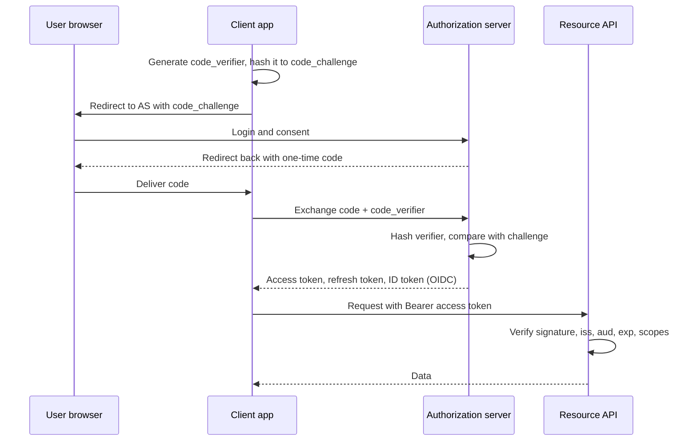
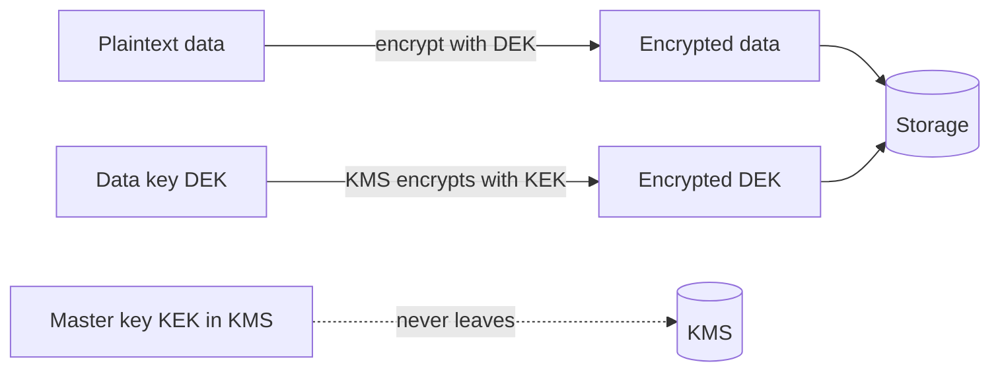
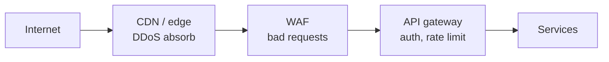

# Security

> [!abstract] What this is
> Security in a design round is not cryptography. It's a handful of placement decisions: **who proves identity and how**, **where permission checks live**, **how data is encrypted and who holds the keys**, **how tenants are kept apart**, and **what stops abuse at the edge**.
>
> Defaults when nothing forces otherwise: TLS everywhere, OAuth2/OIDC via a managed identity provider, short-lived access tokens, coarse checks at the gateway and fine-grained checks in the service, secrets in a secret manager, and a KMS for encryption keys.

---

## Why It Exists

Every box on your diagram is either a door or holds something worth stealing. A design that scales beautifully but lets user A read user B's invoices has failed, and interviewers for SDE-2/SDE-3 roles expect you to show where that line is enforced without being asked.

The goal isn't to list every attack. It's to make a few decisions explicit: which component authenticates, which authorises, where the keys live, and what happens when something leaks. [[03 - Networking and APIs]] and [[11 - Services and Observability]] have the one-line versions; this note is the depth behind them.

---

## Authentication: Proving Who You Are

**Authentication** (AuthN) answers "who is this?" **Authorization** (AuthZ) answers "what are they allowed to do?" They're separate steps, done in that order, and often by different components. This section is AuthN.

### Sessions vs JWT

For human users of your own app, the first choice is where the logged-in state lives. A **session** keeps it on the server; a **JWT** (JSON Web Token) puts a signed copy of it in the client's hands.

| | Server-side session | JWT (signed token) |
|---|---|---|
| What the client holds | A random session id in a cookie | A signed token containing claims (user id, roles, expiry) |
| What the server does per request | Look up the id in Redis or the DB | Verify the signature locally; no lookup |
| Revocation | Instant: delete the session | **Hard.** A valid token stays valid until it expires |
| Scaling | Needs a shared session store | Stateless; any service with the public key can verify |
| Pick when | One web app, you want instant logout and simple security | Many services must verify identity without calling a central store |

The **revocation problem** is the real cost of JWTs. If a token is stolen or a user is banned, the token still works until `exp`. The standard answer is **short-lived access tokens** (minutes) plus a longer-lived **refresh token** that's stored server-side and can be revoked. The client trades the refresh token for a new access token when the old one expires, so a ban takes effect within one access-token lifetime. **Refresh token rotation** (issue a new refresh token on each use, invalidate the old one) also lets you detect theft: if an old refresh token is reused, someone copied it.

> [!warning] Common JWT mistakes
> - **Accepting `alg: none`** or letting the token choose its own algorithm. Pin the expected algorithm on the server.
> - **Not validating `aud`, `iss` and `exp`.** Without `aud`, a token issued for another service is accepted by yours. Without `iss`, any issuer is trusted. Without `exp`, tokens never die.
> - **Putting secrets in the payload.** A JWT is signed, not encrypted. The payload is base64 and anyone holding the token can read it.
> - **Storing it where page scripts can read it** (e.g. `localStorage`) in an app exposed to XSS. An `HttpOnly` cookie can't be read by scripts.

### OAuth2 and OIDC

**OAuth2** is a protocol for **delegated authorization**: a user lets an app act on their behalf at some API, without handing the app their password. The app gets an **access token** from an **authorization server** (Google, Okta, Auth0, Cognito, or your own). **OIDC** (OpenID Connect) is a thin layer on top that adds **identity**: alongside the access token, it returns an **ID token**, a JWT that says who the user is. "Log in with Google" is OIDC.

The two tokens have different audiences. The **ID token** is for the client app, to learn who logged in. The **access token** is for the API, to decide what the caller may do. Sending an ID token to an API as if it were an access token is a common mistake.

### Authorization code + PKCE

This is the flow for any user-facing app, including mobile and single-page apps. The browser only ever sees a short-lived **code**, and the code is useless without a secret the app generated at the start. That secret is **PKCE** (Proof Key for Code Exchange): the app sends a hash of a random `code_verifier` up front, then proves it holds the original when trading the code. An attacker who intercepts the code can't redeem it.

### Machine identity

Services calling services don't have a user to log in. They need their own identity, and the right tool depends on who the caller is.

| Mechanism | How it works | Weakness | Pick when |
|---|---|---|---|
| **OAuth2 client credentials** | The service authenticates to the authorization server with its own id and secret, gets a scoped access token | Secret must be stored and rotated | Service-to-service across teams or companies, where you want scopes and central audit |
| **API keys** | A long random string sent in a header; server looks it up | It's a password that never expires unless you rotate it; easily leaked in logs | Public APIs for external developers; pair with per-key [[08 - Reliability\|rate limiting]] |
| **mTLS** | Both sides present certificates during the TLS handshake, so each proves its identity | Certificate issuance and rotation need tooling | Internal service-to-service, usually handled by a service mesh ([[04 - Load Balancing CDN and Gateway]]) |

---

## Authorization: What You're Allowed to Do

Once you know who the caller is, you decide whether they can do *this action on this resource*. The models differ in what the decision is based on.

| Model | Decision based on | Example | Weakness | Pick when |
|---|---|---|---|---|
| **RBAC** (role-based) | The user's roles | "Admins can delete projects" | Roles multiply ("admin-for-EU-billing") when rules depend on context | Internal tools, admin panels, a handful of fixed roles |
| **ABAC** (attribute-based) | Attributes of user, resource and context | "Managers can approve expenses under their cost centre, during business hours" | Rules get hard to reason about and audit | Rules depend on data like department, region, amount, or time |
| **ReBAC** (relationship-based) | A graph of relationships between users and objects | "You can edit this doc because you're in a group that owns the folder it's in" | Needs a dedicated service to store and query the graph fast | Sharing models: docs, folders, repos, anything with "share with" |

**ReBAC** is the idea behind Google's **Zanzibar** paper, which describes the system behind Drive and YouTube permissions. Permissions are stored as tuples like `doc:42#editor@user:alice` and `folder:7#owner@group:eng`, and a check walks the graph. Open-source systems built on the same idea include **SpiceDB** and **OpenFGA**. [[08 - Resource Sharing ACL]] is a worked design.

### Where checks live

Put checks in two layers, because each layer knows different things.

- **Gateway: coarse checks.** Is the token valid? Is this caller allowed to call this route at all? Is the scope right? The gateway has the token but not the data.
- **Service: fine-grained checks.** Can *this* user edit *this* invoice? Only the service that owns the invoice knows who owns it. This check can't be skipped just because the gateway passed the request.

A **policy engine** such as **OPA** (Open Policy Agent) lets you write rules as code, separate from the service, and evaluate them locally with a sidecar or library. That keeps policies consistent and auditable across many services.

> [!danger] The classic breach is **IDOR** (insecure direct object reference): `GET /invoices/1234` checks that you're logged in but not that invoice 1234 is yours. Change the number, read someone else's data. Every read and write by id needs an ownership or permission check in the service.

---

## Data Protection

Data needs protecting in two states: moving across a network, and sitting on disk. The mechanisms are different, and the hard part of the second is managing keys.

### In transit and at rest

**TLS in transit** means every connection is encrypted: user to edge, edge to services, services to databases. Terminating TLS at the gateway and running plain HTTP inside the VPC is common; "TLS everywhere" (or mTLS via a mesh) is the stricter answer when internal traffic is in scope.

**Encryption at rest** means data on disk (database volumes, S3 objects, backups) is encrypted. Cloud providers make this a checkbox. It protects against stolen disks and misplaced backups, **not** against someone who has valid database credentials, because the database decrypts transparently for anyone allowed to query it.

### KMS and envelope encryption

You don't encrypt terabytes with a key that lives inside a KMS (key management service), because every byte would need a network call. **Envelope encryption** splits the job in two:

1. Generate a random **data key** (DEK) locally and encrypt the data with it.
2. Ask the KMS to encrypt the data key with a **master key** (KEK) that never leaves the KMS.
3. Store the encrypted data and the **encrypted data key** side by side. Throw away the plaintext data key.
4. To read: send the encrypted data key to the KMS, get the plaintext data key back (if you're authorised), decrypt the data.

This gives you fast local encryption, a central place to control and audit who can decrypt (the KMS), and cheap **key rotation**: rotating the master key only means re-encrypting the small data keys, not the data itself. Rotating data keys is for when you suspect one leaked.

### Secrets management

Database passwords, API keys and signing keys belong in a **secret manager**: HashiCorp **Vault**, AWS Secrets Manager, GCP Secret Manager, Azure Key Vault. Services fetch them at startup or runtime using their own identity, access is logged, and rotation doesn't need a redeploy. Vault can also issue **dynamic secrets**: short-lived database credentials created per service and revoked automatically.

| Where secrets live | Risk | Pick when |
|---|---|---|
| Hard-coded in source | Leaked to everyone with repo access, forever in git history | Never |
| `.env` file committed to git | Same as above | Never |
| Env vars injected at deploy from a secret manager | Visible to anything that can read the process environment | Acceptable default for many platforms |
| Fetched from a secret manager at runtime | Needs the manager to be available at startup | Preferred; supports rotation and audit |

---

## Multi-Tenant Isolation

In a SaaS product, one customer (a **tenant**) must never see another's data. How strongly you separate them trades cost against blast radius.

| Model | How it works | Cost | Pick when |
|---|---|---|---|
| **Silo** | Each tenant gets its own database, or even its own stack | Expensive; many deployments to manage | Large enterprise tenants, strict compliance, contractual isolation |
| **Pool** | All tenants share tables; every row has a `tenant_id` | One bug in a query leaks across tenants; noisy neighbours | Many small tenants; the default for most SaaS |
| **Bridge** (hybrid) | Shared app tier, separate schema or database per tenant; or pool for small tenants and silo for big ones | Routing layer must map tenant to storage | Mixed customer sizes; a path to move big tenants out later |

In the pool model, isolation depends on **every query carrying `tenant_id`**. Make that hard to forget: derive the tenant from the authenticated token (never from a request parameter), enforce it in a shared data-access layer, and back it with **row-level security** (RLS) in the database, e.g. a Postgres policy that filters rows by a session variable set per request. Then a missing `WHERE` clause returns nothing instead of everything.

Shared infrastructure also means one tenant's traffic spike can slow everyone. Per-tenant rate limits, quotas and bulkheads are covered in [[08 - Reliability]].

> [!warning] Caches and search indexes are part of the tenant boundary too. A cache key of `invoice:1234` without the tenant id, or a search index queried without a tenant filter, leaks data even when the database is perfectly isolated.

---

## Abuse and Edge Protection

Most attacks arrive through the front door, so most defences sit at the edge, before traffic reaches your services. Each layer filters a different kind of bad traffic.

| Layer | Stops | Pick when |
|---|---|---|
| **DDoS mitigation at CDN / edge** | Volumetric floods, absorbed across the provider's global network (Cloudflare, AWS Shield, CloudFront) | Any public endpoint. You can't out-provision a flood from your own region |
| **WAF** (web application firewall) | Known attack patterns: SQL injection strings, bad bots by signature, malformed requests; IP and geo blocks | Public web apps and APIs; managed rule sets are a sensible default |
| **Rate limiting** | One client or key sending too much, credential stuffing, scraping. Details in [[08 - Reliability]] | Every public API, per user / key / IP |
| **Bot protection** | Automated signups, scalping, credential stuffing that looks like normal traffic: CAPTCHA, device fingerprinting, behaviour scoring | Login, signup, checkout, ticket and flash-sale flows |

A WAF is a filter, not a fix. It catches common patterns cheaply, but the service still has to validate its own input.

---

## Web Basics at System Level

Three browser-era topics come up in design rounds because they shape how you issue tokens and cookies. Each one is easy to state wrong.

### CORS

The browser's **same-origin policy** stops a script on `evil.com` from reading responses from `api.yourbank.com`. **CORS** (cross-origin resource sharing) is how your API *relaxes* that rule for origins you trust, via headers like `Access-Control-Allow-Origin`. It protects **users' browsers** from other sites reading your responses with the user's credentials. It does **not** protect your API: `curl` and servers ignore CORS entirely. Never use `Allow-Origin: *` together with credentials; browsers refuse that combination anyway, and reflecting any origin back defeats the point.

### CSRF

Browsers attach cookies automatically to every request to a site, even when the request is triggered by a different site. So a form on `evil.com` that posts to `yourbank.com/transfer` arrives **with the victim's session cookie**. That's **CSRF** (cross-site request forgery). Defences: `SameSite=Lax` or `Strict` on session cookies, a **CSRF token** that the attacker's page can't read, and checking the `Origin` header on state-changing requests. Tokens sent in an `Authorization` header aren't attached automatically, so bearer-token APIs aren't exposed to CSRF in the same way. That's one reason teams pick them, but it moves the risk to XSS stealing the token.

### Input validation and injection

**Injection** happens when user input is treated as code: SQL, shell commands, HTML. The fixes are old and reliable. Use **parameterised queries**, never string-concatenated SQL. Validate input at the boundary against an allow-list (type, length, format). **Encode output** for its context so user text rendered in HTML can't become a script (XSS). Treat anything from outside, including headers, file names and webhook payloads, as untrusted.

---

## Compliance-Shaped Constraints

Regulations like GDPR, HIPAA and PCI DSS show up in design rounds as **constraints on data flow**, not legal detail. Each one changes what you store and where.

**PII and data minimisation.** The safest personal data is data you never collected. Store only what the feature needs, keep PII in a small number of clearly owned stores, and keep it out of logs, analytics events and URLs. Pseudonymise (replace names with ids) in downstream systems.

**Right to deletion.** Deleting a user's row is easy. The hard part is everywhere else their data went: read replicas, caches, search indexes, the data warehouse, Kafka topics, log archives, and **backups**. Two patterns help. Keep a registry of every store that holds personal data, and drive deletion through an event every store consumes. And for backups you can't edit, use **crypto-shredding**: encrypt each user's data with a per-user key, and delete the key. The data in old backups becomes unreadable.

**PCI: don't store card numbers.** Holding raw card numbers puts your whole system in PCI scope. Instead, the card form posts directly to the payment provider (Stripe, Adyen, Braintree), which returns a **token**. You store the token and charge against it. Your servers never see the card number.

**Audit logs.** Record who did what, to which resource, when, and from where, for every sensitive action: permission changes, data exports, admin access. Make them **append-only** and store them separately from the application database, so an attacker (or an admin) who compromises the app can't quietly edit history. Observability plumbing is in [[11 - Services and Observability]].

| Constraint | Design consequence | Pick when |
|---|---|---|
| Data minimisation | Fewer stores hold PII; logs are scrubbed | Always |
| Right to deletion | Deletion event fan-out; crypto-shredding for backups | Any product with users in regulated regions |
| PCI | Tokenise through the payment provider | Any time you take card payments |
| Audit logging | Append-only, separate store, retained per policy | Admin actions, financial data, health data, B2B customers who will ask |

---

## Failure Modes

| Failure | What happens | Mitigation |
|---|---|---|
| **Stolen JWT** | Attacker uses it until expiry; logout doesn't help | Short access-token lifetime, revocable refresh tokens with rotation, `HttpOnly` cookies |
| **IDOR** | Changing an id in the URL returns another user's data | Ownership check in the service on every by-id access, not just at the gateway |
| **Cross-tenant leak** | A query, cache key or index lookup misses `tenant_id` | Tenant from token only, shared data layer, row-level security, tenant in every cache key |
| **Secret in git** | Credentials exposed to anyone with repo history | Secret manager, pre-commit secret scanning, rotate immediately on leak |
| **Leaked KMS or master key access** | Every data key it wraps can be decrypted | Least-privilege IAM on KMS, audit decrypt calls, separate keys per service or tenant |
| **DDoS** | Origin saturated, site down | CDN / edge absorption, WAF, rate limits, never expose the origin IP directly |
| **Credential stuffing** | Leaked passwords from other sites used at scale on your login | Rate limit per account and IP, bot detection, MFA, breached-password checks |
| **Incomplete deletion** | "Deleted" user's data still in backups, warehouse or search | Deletion registry and event fan-out; crypto-shredding |

---

## Interview Lines

> [!tip] Say it like this
> - "The gateway checks the token and scope; the service checks that this user owns this invoice. Both layers, because only the service knows the owner."
> - "Access tokens live for minutes, refresh tokens are revocable server-side. That's how I get logout on top of stateless JWTs."
> - "Authorization code with PKCE for users, client credentials or mTLS for service-to-service."
> - "Envelope encryption: the data key encrypts the data, KMS encrypts the data key, so rotating the master key never touches the data."
> - "Tenant id comes from the token, never from the request, and row-level security backs it up."
> - "We never see card numbers. The payment provider tokenises them, so we stay out of most of PCI scope."

## Related Notes

- [[03 - Networking and APIs]]
- [[04 - Load Balancing CDN and Gateway]]
- [[08 - Reliability]]
- [[11 - Services and Observability]]
- [[08 - Resource Sharing ACL]]
