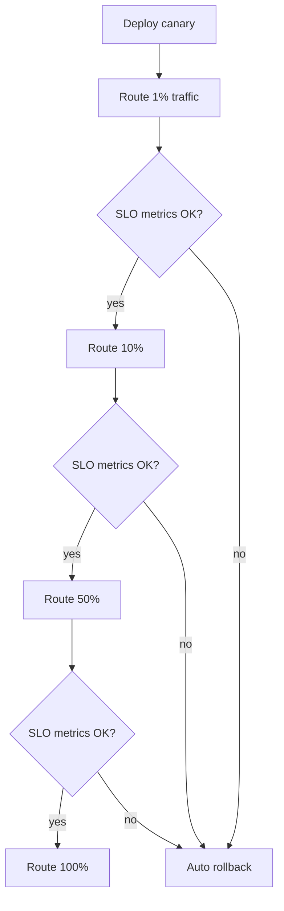

# Deployment and Infrastructure

> [!abstract] What this is
> Everything between "the code works on my laptop" and "the code is serving real traffic without anyone noticing a change." It covers where code runs, how it scales, how a new version replaces the old one, and how you change schemas and config without downtime.
>
> Defaults when nothing forces otherwise: containers on Kubernetes, horizontal autoscaling, canary deploys with automated rollback, feature flags for risky changes, and expand–migrate–contract for every schema change.

---

## Why It Exists

Most outages are not caused by hardware dying. They are caused by **change**: a new build, a config push, a schema migration. A design that looks perfect on the whiteboard still has to be shipped many times a day by real people, and every ship is a chance to break it.

So this topic answers three questions an interviewer will eventually ask. **Where does this run and how does it grow when traffic grows?** **How do you roll out a new version safely?** **How do you change the database or an API while old and new code are both live?** A strong answer to each shows you've operated systems, not just drawn them.

---

## Compute Options

The first decision is what unit you deploy. Moving down the list, you give up control and gain convenience: the provider takes on more of the operations work, and you accept their limits in return.

| Option | Cold start | Cost model | Ops burden | Pick when |
|---|---|---|---|---|
| **VMs** (EC2, GCE) | Minutes to boot a new one | Pay per instance-hour, busy or idle | High: OS patching, images, scaling groups | Special hardware, licensed software, or workloads that don't fit containers |
| **Containers** (Kubernetes, ECS) | Seconds, if the image is already on the node | Pay for the nodes underneath | Medium: you run or rent a cluster | The default for long-running services at scale |
| **Serverless functions** (Lambda, Cloud Functions) | Noticeable on the first request after idle | Pay per invocation and duration | Low: no servers to manage | Spiky or low traffic, event glue, cron-style jobs |
| **Managed PaaS** (App Engine, Heroku, Cloud Run) | Seconds; some scale to zero | Pay per instance or per request | Low: push code, platform runs it | Small teams, standard web apps, speed of delivery over control |

Serverless has real limits worth naming: maximum execution time, limited local state, and connection storms when thousands of function instances each open a database connection. The usual fix for the last one is a connection pooler or proxy in front of the database.

> [!tip] In an interview, "stateless services in containers behind a load balancer, autoscaled horizontally" is the safe default. Only reach for serverless when the traffic shape is genuinely spiky or event-driven.

---

## Kubernetes Concepts

You don't need to know how Kubernetes works inside. You do need its vocabulary, because interviewers use it as shorthand for "how does your service actually run." Each term below maps to a job you'd otherwise do by hand.

| Concept | What it is | Why you care |
|---|---|---|
| **Pod** | One or more containers scheduled together on one node, sharing network | The smallest thing that runs. Usually one app container per pod. |
| **Deployment** | Declares "I want N replicas of this pod, on this image version" | Kubernetes keeps N running and does rolling updates for you |
| **Service** | A stable virtual IP and DNS name in front of a changing set of pods | Callers don't need to know which pods exist right now |
| **Ingress** | HTTP routing from outside the cluster to services, by host or path | The entry point, often backed by a load balancer. See [[04 - Load Balancing CDN and Gateway]]. |
| **ConfigMap / Secret** | Key-value config and sensitive values injected as env vars or files | Same image runs in every environment; only config differs |

### Requests vs limits

Every container declares how much CPU and memory it needs. The two numbers mean different things, and mixing them up causes confusing outages.

- **Request** is what the scheduler reserves. A pod is placed only on a node with that much spare capacity.
- **Limit** is the hard ceiling. Going over the CPU limit gets the container **throttled** (slower). Going over the memory limit gets it **killed** (OOMKilled) and restarted.

Setting requests too low packs too many pods on a node and they fight. Setting memory limits too tight produces restart loops under load.

### Probes

Kubernetes asks each pod two questions. **Liveness**: "are you stuck?" If not, restart it. **Readiness**: "can you take traffic right now?" If not, remove it from the service's endpoints, but don't kill it. A pod that is warming a cache or waiting for a dependency should fail readiness, not liveness. The drain-on-deploy story lives in [[08 - Reliability]].

> [!warning] A liveness probe that checks the database will restart every pod when the database blips, turning a small outage into a restart storm. Liveness should check only the process itself.

### Node scaling vs pod scaling

There are two layers of scaling. The **pod autoscaler** adds more replicas of your service. The **cluster autoscaler** adds more machines when pods can't be scheduled because the nodes are full. Pod scaling is fast; node scaling waits for a VM to boot, so a sudden spike can leave new pods "pending" until nodes arrive.

---

## Autoscaling

Autoscaling means the system adds and removes capacity based on a signal instead of a human. The choice that matters most is **which signal**.

### Horizontal vs vertical

**Horizontal** scaling adds more copies. It needs the service to be stateless, but it has no ceiling and survives the loss of one copy. **Vertical** scaling gives one copy more CPU or memory. It's simple and works for stateful things like a database primary, but it hits a hardware ceiling and usually needs a restart.

### Picking the signal

| Signal | Good for | Weakness | Pick when |
|---|---|---|---|
| **CPU utilisation** | CPU-bound request handlers | Misleading for I/O-bound services that wait on the DB | The service really is CPU-bound |
| **Request rate / concurrency** | Web and API tiers | Needs a known per-pod capacity to target | Latency-sensitive services where you've load-tested one pod |
| **Queue depth / consumer lag** | Background workers | None for workers; it measures the actual backlog | Anything consuming from Kafka, SQS, or a job queue |
| **Custom business metric** | Special cases | You must build and trust the metric | Nothing standard captures the load |

For workers, **queue lag is the right signal**. A worker waiting on a slow downstream shows low CPU while the backlog grows, so a CPU-based scaler would do nothing exactly when you need more workers. Lag tells you directly how far behind you are.

### Cooldowns and flapping

If the scaler reacts instantly in both directions, it adds pods, load per pod drops, it removes pods, load rises, and it adds them again. This is **flapping**. The fix is a **cooldown** or stabilisation window: scale up quickly, scale down slowly, and only after the signal has stayed low for a while.

### Scale-up lag means you still need headroom

Autoscaling is not instant. The metric has to be collected, the scaler has to decide, the pod has to start and warm up, and sometimes a node has to boot first. A traffic spike that arrives faster than that chain will hit the capacity you already have. So you still run with **headroom** (spare capacity above normal peak), and for known events like a sale or a launch you **pre-scale** ahead of time.

### Scale to zero

Scaling to zero replicas when idle saves money, which is why serverless and some PaaS platforms offer it. The cost is a cold start for the first request after idle. It suits internal tools and batch triggers, not a user-facing API with a latency target.

---

## Deploy Strategies

A deploy strategy decides how the new version replaces the old one, and how fast you can go back if it's broken. They trade risk against cost and complexity.

| Strategy | How it works | Risk | Extra cost | Rollback speed | Pick when |
|---|---|---|---|---|---|
| **Recreate** | Stop all old, start all new | Downtime during the switch | None | Slow: redeploy the old version | Dev environments, or when two versions can't run at once |
| **Rolling** | Replace pods a few at a time | A bad version reaches everyone gradually | Small surge capacity | Medium: roll back the same way | Default for most stateless services |
| **Blue-green** | Run a full new stack (green) beside the old (blue), then flip traffic | Low; the switch is all at once but reversible | Double capacity during the switch | Fast: flip back | Need instant rollback, and can afford two stacks |
| **Canary** | Send a small slice of traffic to the new version, watch metrics, then widen | Lowest; only a slice sees a bad build | Small | Fast: route the slice back | Default for high-traffic user-facing services |
| **Shadow / mirroring** | Copy live traffic to the new version; discard its responses | None to users | Full duplicate load on the new version | Nothing to roll back | Testing a rewrite or new engine against real traffic |

Rolling and canary both mean **two versions run at the same time**. That's why the compatibility rules in the zero-downtime section below are not optional.

### Canary with automated rollback

A canary is only safe if something is actually watching it. The rollout tool compares the canary's error rate and latency to the baseline, or to the service's **SLO**, at each step. If the canary is worse, the tool rolls back without waiting for a human. SLOs and the metrics behind them are in [[11 - Services and Observability]].

Shadow traffic has one gotcha: the mirrored requests must not cause side effects. A shadowed "charge card" call that actually charges the card is a real incident. Mirror reads freely; mirror writes only against a sandbox.

---

## Feature Flags

A feature flag is a runtime switch in the code that turns a behaviour on or off without a new deploy. Its main job is to **decouple deploy from release**: the code ships dark, and turning it on is a separate, reversible decision.

- **Kill switch.** A flag that disables a risky path instantly, such as a new recommendation call. Flipping a flag is faster than any rollback.
- **Gradual rollout.** Turn the feature on for 1% of users, then 10%, then everyone. Hash the user ID so the same user sees a consistent experience.
- **Targeting.** Enable for internal staff, one region, or one customer first.

The cost is **flag debt**. Every flag doubles the code paths, and old flags nobody remembers become a source of bugs. Treat flags as temporary: give each one an owner and a removal date, and delete it once the rollout is done.

> [!tip] Canary tests the new *binary*; a feature flag tests the new *behaviour*. Big changes usually use both.

---

## Zero-Downtime Changes

During a rolling or canary deploy, old and new code are live together. Old consumers read what new producers write, and the reverse. Every change to an API, a table, or a message has to be safe with both versions present. These are concepts you apply inside any design, not design questions of their own.

### Backward-compatible APIs

The safe rule is **additive only**. Add new optional fields and new endpoints; don't rename, remove, or change the meaning of existing ones. Pair that with the **tolerant reader** rule: clients ignore fields they don't recognise and don't fail on missing optional ones. When a breaking change is unavoidable, version the API and run both versions until old clients are gone. More on API design in [[03 - Networking and APIs]].

### Expand–migrate–contract for schemas

You can't rename a column in one step, because the moment you do, the old app version still running breaks. Instead you split the change into steps, each safe with the versions live at that moment.

**Worked example: rename `users.name` to `users.full_name`.**

| Step | Database change | App change | Safe because |
|---|---|---|---|
| 1. Expand | Add nullable `full_name` | None | Old code ignores the new column |
| 2. Dual-write | None | Deploy v2: writes both `name` and `full_name`, reads `name` | Old and new versions both keep `name` correct |
| 3. Backfill | Copy `name` into `full_name` for old rows, in batches | None | New writes are already dual-written |
| 4. Switch reads | None | Deploy v3: reads `full_name`, still writes both | Rollback to v2 is safe; both columns are populated |
| 5. Stop old writes | None | Deploy v4: writes only `full_name` | No running version reads `name` any more |
| 6. Contract | Drop `name` | None | Nothing references it |

Each step can be rolled back on its own. The price is several deploys over days instead of one migration, and that's the correct trade.

### Backfills

A backfill rewrites existing rows, often millions of them. Running it as one giant `UPDATE` holds locks, bloats the transaction log, and floods replicas with lag. Instead, process in **small batches** keyed by primary-key range, **throttle** between batches, watch replica lag and pause if it grows, and make the job **resumable** from the last completed key.

### Online DDL

Some schema changes, like adding an index or changing a column type, can lock a large table for a long time in older database versions. Tools exist to avoid that:

- **gh-ost** and **pt-online-schema-change** (MySQL) build a shadow copy of the table with the new schema, keep it in sync, then swap it in with a brief rename.
- **`CREATE INDEX CONCURRENTLY`** (Postgres) builds an index without blocking writes. It's slower and can't run inside a transaction.

Database details live in [[05 - Databases]].

> [!warning] Even an "instant" `ALTER TABLE` needs a brief exclusive lock. If a long-running query holds the table, the `ALTER` waits, and every new query queues behind it. Set a short lock timeout on migrations so they fail and retry instead of stalling the table.

### Message and event schemas

Events in a queue can outlive the code that wrote them, so producers and consumers must stay compatible across versions too. The same additive rules apply, usually enforced by a schema registry. See [[07 - Async Messaging]].

---

## Config and Secrets

Config is everything that changes between environments or over time without a code change: URLs, timeouts, pool sizes, flag defaults. Handling it badly is a common way to break production with no code change at all.

- **Config as code.** Keep config in version control, reviewed like code, with a history you can revert.
- **Environment separation.** One image, many environments. Dev, staging, and prod differ only in injected config, and prod config is never reachable from dev.
- **Runtime reload.** Some values, like log levels or rate limits, are worth changing without a restart. Services watch a config store and reload safely, validating before applying.
- **Staged rollout of config.** Push config changes to one cell or region first, just like code. A config push is a deploy.

Secrets such as passwords, API keys, and certificates never go in the image or the repo. They come from a secret manager at runtime and are rotated. Details in [[18 - Security]].

---

## Capacity Planning

Capacity planning answers "how much do we need, and when do we run out?" Autoscaling handles minute-to-minute changes; planning makes sure the ceiling of that scaling, and the things that don't autoscale like databases, are high enough.

- **Plan for peak, not average.** Traffic has daily and seasonal peaks. The system has to survive the peak, so size for it and treat the average as the cost baseline.
- **Keep headroom.** Run below full utilisation so you can absorb a spike, lose a zone, and still meet the latency target while the autoscaler catches up.
- **Know one unit's capacity.** Load-test a single pod to find the throughput where latency starts to climb. Total capacity is then that number times the pod count, minus headroom.
- **Load test the whole path.** The bottleneck is often not the service you're testing but the database or a downstream behind it.

Latency rises sharply as utilisation approaches 100%, because requests start queueing behind each other. That's why headroom matters; the queueing intuition is in [[02 - Fundamentals]], and back-of-envelope numbers are in [[16 - Estimation and Decision Cheat Sheet]].

---

## Failure Modes

Most rows below have the same root cause: a change reached everything at once, or nothing was watching it.

| Failure | What happens | Mitigation |
|---|---|---|
| **Bad deploy** | New version errors or is slow; users see it | Canary with automated rollback on SLO metrics; keep the previous image ready |
| **Schema change locks a table** | An `ALTER` or index build blocks writes; requests pile up and time out | Online DDL tools, `CREATE INDEX CONCURRENTLY`, a short lock timeout, run off-peak |
| **Incompatible schema or API change** | Old pods still running crash on the new format during the rollout | Expand–migrate–contract; additive-only changes; tolerant readers |
| **Autoscaler too slow for a spike** | Traffic arrives faster than pods and nodes start; latency and errors climb | Headroom, pre-scaling before known events, load shedding in [[08 - Reliability]] |
| **Autoscaler flapping** | Pods added and removed in a loop; constant cold caches and churn | Stabilisation window; scale down slowly |
| **Config push breaks all regions at once** | A bad value goes everywhere simultaneously; no healthy region to fail over to | Stage config like code: one region or cell first, validate, then widen |
| **Wrong liveness probe** | A dependency blip makes every pod fail liveness; mass restarts | Liveness checks the process only; dependencies go in readiness |
| **Backfill overloads the primary** | Replica lag climbs, reads go stale, primary slows | Batch, throttle, pause on lag, run resumable jobs |
| **Stale feature flag** | Old flag flipped by accident re-enables dead code | Owners and expiry dates on flags; delete after rollout |

---

## Interview Lines

> [!tip] Say it like this
> - "Stateless services in containers, horizontally autoscaled. Workers scale on queue lag, not CPU."
> - "Autoscaling isn't instant, so I keep headroom and pre-scale before known peaks."
> - "I ship with a canary that rolls back automatically if error rate or latency breaks the SLO."
> - "Feature flags decouple deploy from release, and a kill switch is faster than any rollback."
> - "Old and new code run together during a deploy, so every schema change is expand, migrate, contract."
> - "A config push is a deploy. It goes to one region first."

## Related Notes

- [[02 - Fundamentals]]
- [[03 - Networking and APIs]]
- [[04 - Load Balancing CDN and Gateway]]
- [[05 - Databases]]
- [[07 - Async Messaging]]
- [[08 - Reliability]]
- [[11 - Services and Observability]]
- [[16 - Estimation and Decision Cheat Sheet]]
- [[18 - Security]]
