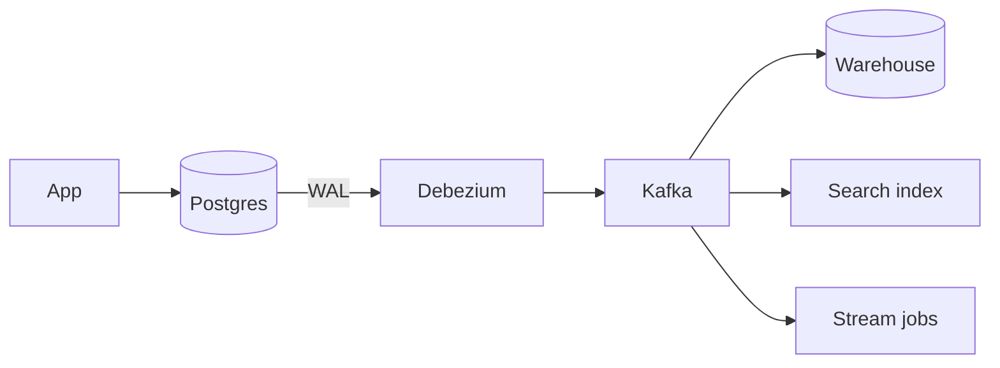
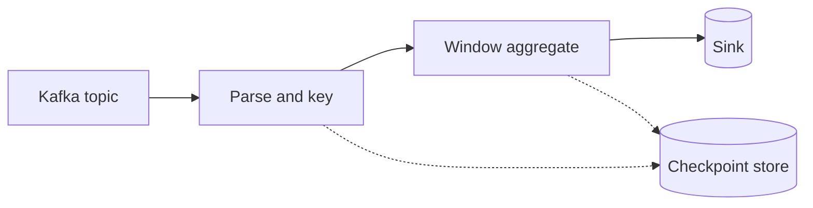
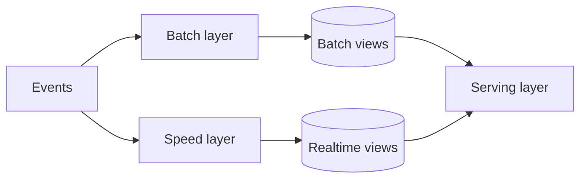
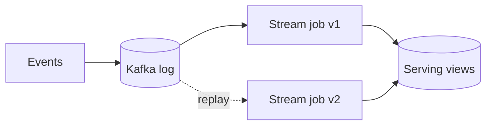

# Data Processing and Analytics

> [!abstract] What this is
> The side of a system that answers questions *about* the data rather than serving individual requests: dashboards, reports, metrics, aggregates, trends. The key decision is how data gets from the transactional database into an analytics store, and whether you process it in **batch**, as a **stream**, or both.
>
> Defaults when nothing forces otherwise: CDC from the OLTP database into Kafka, a columnar warehouse or lakehouse for queries, Spark or SQL jobs for batch, Flink for real-time aggregates, and idempotent jobs that can be re-run safely.

---

## Why It Exists

The database that serves your app is built to read and write a few rows at a time, very quickly, for many users at once. Analytics asks a completely different kind of question: "total revenue per country last quarter" touches millions of rows but only a few columns.

Running that question on the production primary scans huge amounts of data, fills the buffer cache with rows no user needs, and competes for CPU and I/O with real user traffic. The app slows down because someone opened a dashboard. So analytics gets its own copy of the data, in its own store, shaped for scanning. Most of this topic is about building and maintaining that copy correctly.

---

## OLTP vs OLAP

**OLTP** (online transaction processing) is the app's workload: short transactions, point lookups by key, frequent small writes. **OLAP** (online analytical processing) is the analyst's workload: long read-only queries that scan and aggregate large ranges. They want different storage layouts, so one engine rarely does both well.

| | OLTP | OLAP |
|---|---|---|
| Typical query | "Get order 123", "insert this payment" | "Sum revenue by region by month" |
| Rows touched | A few | Millions to billions |
| Columns touched | Most of the row | A few out of many |
| Writes | Constant small writes, updates in place | Bulk loads, mostly append |
| Storage layout | Row-oriented | Column-oriented |
| Examples | Postgres, MySQL | ClickHouse, BigQuery, Redshift, Snowflake |
| Pick when | Serving the product | Reporting, dashboards, ad hoc analysis |

A read replica of the OLTP database is a reasonable first step for light reporting, since it keeps load off the primary. It is still row-oriented, so large aggregates remain slow, and heavy queries can make the replica lag. See [[05 - Databases]].

### Row vs columnar storage

The storage layout is why OLAP engines are so much faster at scans. Take an `orders` table with columns `id`, `user_id`, `country`, `amount`, `created_at`.

A **row store** keeps each row together on disk:

```
[1, 42, IN, 300, 2026-09-01] [2, 17, US, 120, 2026-09-01] [3, 42, IN, 80, 2026-09-02] ...
```

A **column store** keeps each column together:

```
id:         1, 2, 3, ...
user_id:    42, 17, 42, ...
country:    IN, US, IN, ...
amount:     300, 120, 80, ...
created_at: 2026-09-01, 2026-09-01, 2026-09-02, ...
```

For `SELECT country, SUM(amount) FROM orders GROUP BY country`, the row store has to read every column of every row, then throw most of it away. The column store reads only the `country` and `amount` files, which is two of five columns.

Columns also **compress** far better. A column holds values of one type, often repeated or sorted. `country` has only a few distinct values, so it can be stored as a small dictionary plus codes, or as run lengths like "IN × 5,000, US × 3,000." Less data on disk means less to read, and scans get faster again.

The trade-off: updating or fetching one whole row means touching every column file. That's why column stores are poor at OLTP.

---

## Warehouse vs Lake vs Lakehouse

Once you have a separate analytics copy, the next choice is how structured it is. The difference comes down to **when the schema is enforced**.

- **Schema-on-write**: data must fit a defined table schema when it's loaded. Queries are fast and reliable, but new sources need modelling first.
- **Schema-on-read**: raw files are stored as they arrive, and structure is applied when someone queries them. Loading is flexible and cheap, but quality is up to the reader.

| | Data warehouse | Data lake | Lakehouse |
|---|---|---|---|
| Schema | On write | On read | On write, over lake storage |
| Storage | Managed by the warehouse | Files in object storage (S3, GCS) | Files in object storage |
| Formats | Internal columnar | Parquet, JSON, CSV, Avro | Parquet with a table format: **Iceberg**, **Delta Lake**, Hudi |
| Transactions and updates | Yes | No; files are just files | Yes, via the table format's metadata |
| Cost | Higher per TB | Cheapest storage | Close to lake storage cost |
| Pick when | BI and SQL on clean, modelled data | Raw archive, ML training data, unknown future use | You want lake cost and flexibility with warehouse-like tables |

**Parquet** is the columnar file format underneath most lakes. **Iceberg** and **Delta** add a metadata layer on top of Parquet files that gives you atomic commits, schema evolution, and time travel (query the table as it was yesterday). That metadata layer is what turns "a folder of files" into "a table." Object storage itself is covered in [[09 - Storage Search and Geo]].

---

## Getting Data Out of OLTP

The analytics store is only as good as the pipeline that fills it. Two choices matter: where transformation happens, and how changes are captured.

### ETL vs ELT

**ETL** (extract, transform, load) cleans and reshapes the data in a separate processing step, then loads the finished result into the warehouse. **ELT** (extract, load, transform) loads raw data first and transforms it inside the warehouse with SQL. ELT has become the common default because warehouses are now cheap and powerful enough to do the transformation themselves, and keeping the raw data means you can re-transform it later when the logic changes. ETL still fits when data must be cleaned or masked before it lands, such as removing personal data.

### Batch dumps vs CDC

| Approach | How it works | Freshness | Load on source | Pick when |
|---|---|---|---|---|
| **Full dump** | Export the whole table on a schedule | Hours to a day | Heavy during the dump | Small tables, or a one-time initial load |
| **Incremental query** | `WHERE updated_at > last_run` | Minutes to hours | Moderate | Tables with reliable `updated_at`; deletes not needed |
| **CDC** (change data capture) | Read the database's replication log and stream every change | Seconds | Low; reads the log, not the tables | The default for anything serious |

Incremental queries miss **deletes** (a deleted row has no `updated_at` to find) and miss changes made without touching `updated_at`. CDC avoids both. **Debezium** is the common tool: it reads the Postgres WAL or the MySQL binlog, the same log the database uses for replication, and publishes each insert, update, and delete as an event to Kafka. Downstream, the warehouse, the search index, and the cache can all consume that stream.



CDC is the same idea as the outbox pattern in [[10 - Distributed Building Blocks]], and the Kafka side is in [[07 - Async Messaging]].

---

## Batch Processing

Batch processing runs a job over a large, bounded set of data, like "all of yesterday's events," and produces a result. It's simple to reason about because the input doesn't change while the job runs.

### The MapReduce idea

MapReduce is the pattern underneath almost every batch engine. **Map**: each worker reads a chunk of input and emits key-value pairs, such as `(country, amount)`. **Shuffle**: all pairs with the same key are sent to the same worker. **Reduce**: each worker combines the values for its keys, such as summing amounts per country. Because each step works on independent chunks, the job spreads across many machines.

### Spark at concept level

**Spark** is the common batch engine today. It improves on MapReduce by planning the whole job as a **DAG** (directed acyclic graph) of steps and keeping intermediate data in memory where it can, instead of writing to disk after every step.

- Data is split into **partitions**, and each partition is processed by one task in parallel.
- Steps like `filter` and `map` work on each partition independently. They are cheap.
- Steps like `groupBy`, `join`, and `distinct` need all rows with the same key in one place, which forces a **shuffle**: every worker sends data over the network to every other worker.

**The shuffle is the expensive part.** It costs network, disk, and memory, and it's where skew hurts most. Optimising a Spark job is mostly about shuffling less: filter early, pre-aggregate before a join, and broadcast a small table to every worker instead of shuffling a big one.

### Scheduling

Batch jobs depend on each other: load raw data, then build daily aggregates, then refresh the dashboard tables. **Airflow** is the standard scheduler. It models the pipeline as a DAG of tasks with dependencies, runs them on a schedule, retries failures, and lets you re-run a past date.

### Idempotent re-runs

Jobs fail halfway and get re-run. Upstream data gets corrected and the job runs again. A job that appends its output will double-count on every re-run. So batch jobs should be **idempotent**: running the job for a given date twice gives the same result as running it once.

The usual technique is **partition overwrite**. Output is partitioned by date, and a run for `2026-09-28` atomically replaces the whole `2026-09-28` partition instead of appending to it. Re-running is then always safe.

> [!tip] "Every job writes a whole date partition and overwrites it" is the one sentence that makes batch pipelines safe to retry and backfill.

---

## Stream Processing

Stream processing handles an **unbounded** input: events keep arriving and the job never finishes. It gives results in seconds instead of hours, at the cost of dealing with time, ordering, and state while the data is still moving.

### Event time vs processing time

**Event time** is when something actually happened, stamped by the device or service that produced it. **Processing time** is when the stream job sees it. They differ because of network delay, retries, and phones that were offline for an hour. If you count "clicks per minute" by processing time, a burst of delayed events lands in the wrong minute. Correct analytics groups by **event time**.

### Windows

An unbounded stream has no "end" to aggregate over, so you aggregate over **windows** of time.

| Window | Shape | Example | Pick when |
|---|---|---|---|
| **Tumbling** | Fixed size, no overlap, back to back | Orders per 1-minute bucket | Regular reports and counters |
| **Sliding (hopping)** | Fixed size, overlapping, advances by a step | Last 5 minutes, updated every 1 minute | Moving averages, rolling alerts |
| **Session** | Variable size, closes after a gap of inactivity | One user's activity until 30 minutes idle | User sessions, engagement analysis |

### Watermarks and late data

If you group by event time, when is a window "done"? An event for 10:00–10:01 could still arrive at 10:05. A **watermark** is the job's estimate of how far event time has progressed: "I believe I've now seen everything up to 10:02." When the watermark passes the end of a window, the window closes and emits its result.

Events that arrive after the watermark are **late**. You choose what to do with them: drop them, send them to a side output for later correction, or keep windows open for an **allowed lateness** period and emit an updated result. A longer wait means more complete results but higher latency.

### State and checkpoints

Counting per window, deduplicating by ID, or joining two streams all need the job to remember things. That memory is **state**, kept locally by each operator and partitioned by key. To survive a crash, the engine periodically takes a **checkpoint**: a consistent snapshot of all operator state plus the input offsets it corresponds to. After a failure, the job restores the last checkpoint and replays input from those offsets.

### Exactly-once, at intuition level

Because a restored job replays some input, events are processed more than once internally. "Exactly-once" means the *effect* is as if each event counted once. Engines get there by making state and input offsets move together atomically in the checkpoint, and by writing output either transactionally (Kafka transactions commit output together with the offsets) or idempotently (upserts keyed by a stable ID). The guarantee holds inside the pipeline; an external side effect like sending an email still needs its own idempotency.



| Engine | Model | Pick when |
|---|---|---|
| **Flink** | True per-event streaming, strong event-time and state support | Low-latency, stateful, event-time-correct pipelines |
| **Kafka Streams** | A library inside your service; state backed by Kafka topics | Input and output are both Kafka and you don't want a separate cluster |
| **Spark Structured Streaming** | Micro-batches over the Spark engine | You already run Spark and seconds of latency is fine |

---

## Lambda vs Kappa

When you need both fresh and correct results, there are two classic architectures. The question is whether batch and streaming are two separate code paths or one.

### Lambda

Lambda runs two pipelines side by side. A **batch layer** periodically recomputes accurate results over all data. A **speed layer** processes the stream for fresh but approximate results covering the gap since the last batch. A serving layer merges the two.



### Kappa

Kappa uses **one** streaming pipeline for everything. The event log (usually Kafka with long retention) is the source of truth. To fix a bug or change the logic, you start a new version of the stream job, replay the log from the beginning, and switch readers over when it catches up.



| | Lambda | Kappa |
|---|---|---|
| Code paths | Two: batch and stream, which must agree | One |
| Reprocessing | Rerun the batch job | Replay the log through a new stream job |
| Main cost | Keeping two implementations consistent | Long log retention and a fast enough replay |
| Pick when | Heavy historical recomputation, or the stream engine can't handle the full logic | Streaming engine handles the logic and the log can be kept long enough |

Many real systems land in between: a stream for fresh numbers plus a nightly batch that overwrites the day's partitions as the final truth.

---

## Approximate Analytics at Scale

Some questions are expensive to answer exactly but cheap to answer within a small, known error. At large scale, "about 1.2 million unique visitors" is as useful as the exact number and costs a tiny fraction of the memory.

| Technique | Answers | Idea | Pick when |
|---|---|---|---|
| **HyperLogLog** | "How many distinct items?" | Hash each item and track the longest run of leading zeros; small fixed memory per counter, and counters merge | Unique visitors, distinct users per day, across shards |
| **Count-Min Sketch** | "About how often did X occur?" | A few hash rows of counters; take the minimum. Can overcount, never undercounts | Heavy hitters, top-K trending items |
| **Sampling** | Any aggregate | Process a random subset and scale up | Exploratory queries, dashboards where a trend is enough |

Redis offers HyperLogLog directly (`PFADD`, `PFCOUNT`), and many warehouses provide approximate distinct-count functions. Details of the structures are in [[10 - Distributed Building Blocks]].

> [!warning] Never use approximate counts for money, billing, or anything a user will reconcile. Use them for dashboards and ranking.

---

## Data Quality and Correctness

A pipeline that runs without errors can still produce wrong numbers. Most analytics bugs are silent: the dashboard looks fine and is quietly off. These practices keep it honest.

- **Deduplication.** Producers retry and brokers redeliver, so events arrive more than once. Give every event a stable unique ID at the source and dedup on it, either in the stream job's state within a time window or with a `MERGE` / upsert in the warehouse.
- **Schema evolution.** Sources change: a field is added, renamed, or changes type. Use formats with explicit schemas (Avro, Protobuf, Parquet), a schema registry that rejects incompatible changes, and additive-only evolution, the same rules as in [[07 - Async Messaging]].
- **Backfills and reprocessing.** When logic changes or bad data is found, you re-run history. Idempotent, partition-overwriting jobs make this safe; throttle the backfill so it doesn't starve daily jobs.
- **Data contracts.** An explicit agreement between the team that produces data and the teams that consume it: schema, meaning of each field, freshness, and who's on call. It turns "someone renamed a column and broke finance's report" into a failed check before the change ships.
- **Quality checks.** Automated assertions on each run: row counts within an expected range, no nulls in key columns, totals reconciling with the source. A failed check blocks downstream jobs instead of publishing wrong numbers.

---

## Failure Modes

| Failure | What happens | Mitigation |
|---|---|---|
| **Late events** | Events arrive after their window closed; counts are too low | Group by event time, use watermarks with allowed lateness, route late events to a correction path |
| **Duplicate events double-counting** | Retries or redelivery count the same event twice | Stable event IDs and dedup; exactly-once sinks or idempotent upserts |
| **Skewed partition / hot key in shuffle** | One key (a huge customer, a null key) sends most data to one task; the job waits on a single straggler | Salt the hot key and aggregate in two stages, broadcast small tables, filter nulls before the join |
| **Backfill overwhelming the warehouse** | Reprocessing months of data starves daily jobs and dashboards | Run in date batches, throttle, use a separate compute pool, schedule off-peak |
| **Schema drift** | A source field changes type or disappears; jobs fail, or worse, load nulls silently | Schema registry with compatibility checks, data contracts, quality checks that fail loudly |
| **Analytics on the OLTP primary** | Heavy query slows the app for real users | Move analytics to a replica at minimum, a warehouse by default, fed by CDC |
| **Non-idempotent job re-run** | Appending output on retry doubles the day's numbers | Partition overwrite or `MERGE` by key |
| **Stream job state loss** | Crash without a recent checkpoint; state rebuilt wrong or not at all | Regular checkpoints to durable storage; keep input retained long enough to replay |

---

## Interview Lines

> [!tip] Say it like this
> - "Analytics never runs on the OLTP primary. I stream changes out with CDC through Kafka into a columnar store."
> - "Columnar storage reads only the columns a query needs and compresses them well, which is why scans are fast."
> - "Batch jobs overwrite whole date partitions, so re-runs and backfills are always safe."
> - "In a streaming job I group by event time and use watermarks to decide when a window is done."
> - "The shuffle is the expensive part of a Spark job, and a hot key there turns into one slow straggler."
> - "For unique counts on a dashboard I'd use HyperLogLog; for billing I'd count exactly."

## Related Notes

- [[05 - Databases]]
- [[07 - Async Messaging]]
- [[09 - Storage Search and Geo]]
- [[10 - Distributed Building Blocks]]
