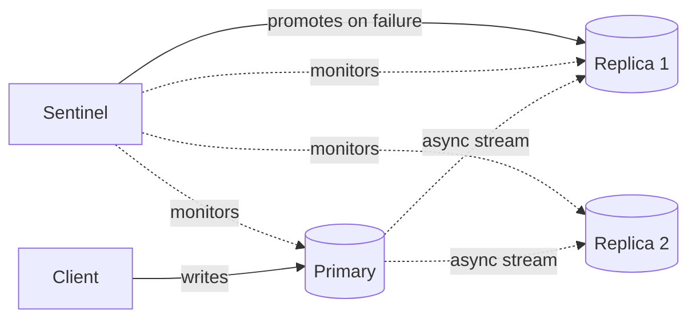
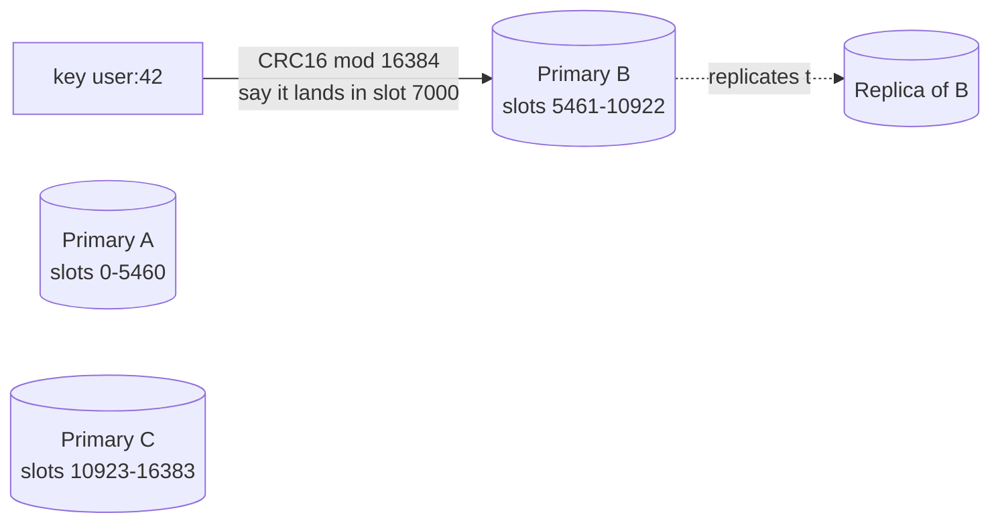

# Redis

> [!abstract] What this is
> Redis is an in-memory data structure server, not just a cache. The caching *pattern* (cache-aside, TTL, invalidation) is covered in [[06 - Caching]]; this note is Redis **itself** — its data types, how it persists and replicates, how it shards, and the other jobs it does: locks, rate limits, leaderboards, queues and pub/sub.
>
> The decision this note helps with is **which Redis data type or mechanism fits a given job**, and what you lose by using Redis instead of a database for that job.

---

## Why It Exists

Memcached proved that an in-memory key-value store makes reads fast. Redis took that idea and added two things Memcached never had: **data structures** richer than a blob, and **persistence**, so it stopped being "just a cache" and became something people also build counters, locks, queues and leaderboards on top of. Every one of those uses leans on the same core fact: Redis is **single-threaded for command execution**, so each command runs to completion without another command interleaving. That single fact is why `INCR`, `SET NX`, and a Lua script all double as safe coordination primitives, not just a store.

---

## Data Types and What They're Actually For

A command cheat sheet doesn't teach anything. What matters is which real feature each type implements.

| Type | Shape | Real feature it implements |
|---|---|---|
| **String** | Bytes, or a counter | `GET`/`SET` cache value; `INCR`/`DECR` for counters and rate limits |
| **Hash** | Field → value map, like one row | A cached object (`user:42` → `{name, email, plan}`) without round-tripping JSON |
| **List** | Ordered, push/pop both ends | A simple **queue** (`LPUSH` + `BRPOP`), or a capped recent-activity feed |
| **Set** | Unordered, unique members | Tag membership, "has this user already acted" dedupe, set intersection for "friends in common" |
| **Sorted set (ZSET)** | Unique members with a score, kept in order | **Leaderboards** (`ZADD`, `ZREVRANGE`), **delayed queues** (score = ready time, pop when score ≤ now), rate-limit windows |
| **Stream** | Append-only log with consumer groups | A small Kafka-shaped log inside Redis: replayable, grouped consumers |
| **Bitmap** | A string treated as a bit array | Compact daily-active-user tracking (one bit per user id) |
| **HyperLogLog** | Probabilistic set | Approximate unique counts in a few KB. See [[10 - Distributed Building Blocks]] |
| **Geo** | Sorted set under the hood, geohash-encoded | `GEOADD`/`GEORADIUS` for "drivers near me". See [[09 - Storage Search and Geo]] |

> [!tip] Name the structure, not the tool. "I'll cache the leaderboard" is vague. "A sorted set keyed by contest id, score is the player's points, `ZREVRANGE 0 9` for top 10" is a design.

---

## Beyond Caching: What Else Redis Does

These are the jobs that come up in interviews as "oh, and we'll also use Redis for X," each leaning on a different primitive.

### Distributed lock

`SET key token NX EX 30` sets the key only if it doesn't exist, with an expiry, in one atomic command. Whoever's `SET` succeeds holds the lock until it expires or releases it. The release must check the token first (a small Lua script: get, compare, delete) so a process doesn't delete a lock it no longer owns after its TTL already expired and someone else acquired it. Depth, including why this still isn't safe for money without a fencing token: [[14 - Coordination and Concurrency]].

### Rate limiting

`INCR` plus `EXPIRE` on a key per user per window is a fixed-window counter. A sorted set with timestamps as scores gives a sliding window: add the current timestamp, trim everything older than the window, count what's left. Full algorithm comparison: [[08 - Reliability]].

### Pub/sub

`PUBLISH`/`SUBSCRIBE` is fire-and-forget: a message delivered to zero subscribers is simply gone, nothing is stored. It's the right tool for fanning a WebSocket event out to whichever app server happens to hold that connection right now, and the wrong tool for anything that needs to survive a disconnected subscriber. Redis **Streams** (above) is the alternative when delivery must be durable and replayable.

### Session store

Session data is small, read on every request, and fine to lose, which is exactly cache-shaped. This is the one job Redis does that overlaps directly with [[06 - Caching]]; the difference is sessions are usually the primary store for that data, not a copy of something in a database.

### Queues: lists vs Streams

A list makes a simple queue: producers `LPUSH`, workers `BRPOP`. The catch is that `BRPOP` removes the job the moment it's handed out. If the worker crashes before finishing, the job is gone. `BLMOVE` fixes that by atomically moving the job onto a per-worker "processing" list, so a sweeper can put it back if the worker dies.

**Streams** are the more complete answer. `XADD` appends an entry with an ID. A **consumer group** (`XREADGROUP`) splits entries across workers, and every delivered entry stays in the group's **pending entries list** until the worker sends `XACK`. Entries that a dead worker never acked can be reassigned with `XAUTOCLAIM`. Trim old entries with `MAXLEN` so the stream doesn't grow forever.

| Option | Survives a worker crash | Replay | Pick when |
|---|---|---|---|
| List + `BRPOP` | No | No | Losing an occasional job is fine |
| List + `BLMOVE` to a processing list | Yes, with a sweeper | No | A simple job queue on a Redis you already run |
| **Stream + consumer group** | Yes (pending list + `XACK`) | Yes, until trimmed | A small-to-medium durable queue with acks |
| Kafka / SQS | Yes | Kafka yes, SQS no | High volume, long retention, or many independent consumers |

A stream is one key, so it lives on **one node**. Its throughput and size are capped by that node's memory and CPU. That's why Streams make a good small work queue and a poor Kafka replacement. Comparison: [[07 - Async Messaging]].

---

## The Single Thread: Atomicity and What Blocks It

Redis runs commands one at a time on a single thread. That gives you atomicity for free, and it also means one slow command stalls every other client.

### Doing several things atomically

A single command is always atomic. For more than one command there are four tools, and they differ in whether the logic can react to the values it reads.

| Tool | Atomic | Can branch on what it read | Pick when |
|---|---|---|---|
| **Pipelining** | No; it only saves round trips | No | Sending many independent commands quickly |
| **`MULTI` / `EXEC`** | Yes, the queued commands run together | No. Commands are queued blind, and there's no rollback if one fails | A batch of writes that must not interleave with other clients |
| **`WATCH` + `MULTI`** | Optimistic: `EXEC` aborts if a watched key changed | Yes, by retrying | Compare-and-set with low contention |
| **Lua script / Function** (`EVAL`, `FCALL`) | Yes, the whole script runs without interruption | Yes | Check-then-act: release a lock only if the token matches, a token-bucket rate limiter |

### What blocks the server

Anything that does `O(N)` work on a large `N` holds the thread for the whole duration. The usual offenders:

- **`KEYS *`** walks every key. On a production instance with millions of keys it freezes Redis. Use **`SCAN`**, which iterates in small batches.
- **Big keys**, such as `HGETALL` on a hash with a million fields or `SMEMBERS` on a huge set. Use `HSCAN` / `SSCAN`, or split the key.
- **Deleting a huge key** with `DEL` frees its memory synchronously. **`UNLINK`** frees it in a background thread.
- **Long Lua scripts.** A script is atomic precisely because nothing else runs until it finishes, so keep scripts short.
- **`FLUSHALL`** / **`FLUSHDB`** without the `ASYNC` option.

> [!warning] Many teams rename or disable `KEYS` and `FLUSHALL` in production config, because one accidental call takes the whole instance down for everyone.

---

## Memory and Eviction

Everything Redis holds must fit in RAM. `maxmemory` caps how much it uses, and `maxmemory-policy` decides what happens at the cap. The right policy depends on whether this Redis is a cache, a store, or both.

| Policy | At the cap | Pick when |
|---|---|---|
| **`allkeys-lru`** / **`allkeys-lfu`** | Evict any key, least recently / least frequently used first | Pure cache: every key can be rebuilt |
| **`volatile-lru`** / **`volatile-ttl`** | Evict only keys that have a TTL | Mixed use: cached data has TTLs, while locks, leaderboards and counters without a TTL are never evicted |
| **`noeviction`** | Reject writes with an out-of-memory error | Redis is the primary store for something, like a queue or a leaderboard. Failing loudly beats silently losing data |

LRU vs LFU themselves are explained in [[06 - Caching]]. The Redis-specific point is that one instance used for both caching and coordination needs a `volatile-*` policy, or a burst of cache writes can evict your locks.

---

## Persistence

Redis lives in memory, but it can write to disk so a restart doesn't start empty.

| Mode | How it works | Loses on crash | Pick when |
|---|---|---|---|
| **None** | Memory only | Everything | Pure cache that can be rebuilt from the source of truth |
| **RDB** (snapshot) | Periodically dumps the whole dataset to a file | Everything since the last snapshot (minutes) | Fast restarts; some loss is acceptable |
| **AOF** (append-only file) | Logs every write; replays the log on restart | About one second, with `fsync` every second | Redis holds data you'd rather not lose, like counters or a queue |
| **RDB + AOF** | Both | About one second | Faster restart than AOF alone, with AOF's durability |

> [!warning] Even with AOF, Redis is not a database of record. If losing the data costs money, the source of truth belongs in a database, and Redis holds a copy or a short-lived primary for disposable state.

Both RDB snapshots and AOF rewrites work by **forking** the Redis process and letting the child write the file. Parent and child share memory pages until the parent modifies one, at which point that page is copied (**copy-on-write**). On a write-heavy instance during a long snapshot, the copied pages can add up to a large fraction of the dataset. Leave free RAM for that, or the kernel can kill Redis mid-snapshot. Running persistence only on a replica keeps the primary out of it. Forking a very large process also takes time and can cause a visible latency blip.

---

## Replication

A Redis **primary** streams its writes to one or more **replicas**. Replicas serve reads and can take over if the primary dies.

**Redis Sentinel** watches the primary and promotes a replica when it disappears. Run at least **three** Sentinel processes on separate machines. A failover only happens when a quorum of them agree the primary is down, so one Sentinel with a bad network link can't trigger it alone.

Replication is **asynchronous**: a write acknowledged to the client can still be lost if the primary dies before a replica receives it. Two settings narrow that window without closing it.

| Setting | What it does | Limit |
|---|---|---|
| `WAIT numreplicas timeout` | The client blocks until that many replicas have acknowledged its earlier writes | Not consensus. A failover can still promote a replica that missed the write |
| `min-replicas-to-write` + `min-replicas-max-lag` | The primary refuses writes unless enough replicas are connected and recently caught up | Bounds split-brain damage: an old primary cut off from its replicas stops accepting writes instead of collecting writes that will be thrown away |

So Redis trades durability for speed, consistent with treating it as a cache or a rebuildable store rather than a system of record. Split-brain and fencing in general: [[17 - Consistency Time and Consensus]].

---

## Redis Cluster (Sharding)

One Redis process eventually runs out of memory or single-core throughput. **Redis Cluster** splits data across several primaries using **16,384 hash slots**. Every key maps to a slot with `CRC16(key) mod 16384`, and each primary owns a range of slots. Adding a node migrates slots, not every individual key, and each primary can have its own replicas for failover.

Clients cache the slot-to-node map and send each command straight to the primary that owns the key's slot. If the map is stale because a slot moved, the node replies `MOVED` with the new owner and the client updates its map. During a migration in progress, a node may reply `ASK`, a one-time redirect. Cluster nodes track each other with gossip, and a failed primary's replica is promoted in its place.

Two consequences come up constantly:

- **Multi-key commands** (`MGET`, transactions, Lua scripts) only work if every key involved is in the **same slot**. **Hash tags** force that: `{user:42}:cart` and `{user:42}:profile` hash only the part inside the braces, so related keys land together on purpose.
- **A hot key stays on one shard.** Sharding spreads *many* keys across nodes; it does nothing for one key that gets a disproportionate share of traffic. See Failure Modes.

---

## Redis vs Memcached

| | Redis | Memcached |
|---|---|---|
| Data types | Strings, hashes, lists, sets, sorted sets, bitmaps, streams | Opaque blobs |
| Persistence | Optional (RDB / AOF) | None |
| Replication | Built in | None |
| Threading | Single-threaded command execution (newer versions multi-thread I/O only) | Multi-threaded |
| Pick when | Cache **plus** locks, counters, leaderboards, pub/sub, a small queue | You need only a simple, high-throughput blob cache and nothing else |

Memcached's multi-threading can win raw throughput for the simplest possible job: get a blob by key, nothing more. The moment you need a second feature, that advantage stops mattering.

---

## Failure Modes

| Failure | What happens | Mitigation |
|---|---|---|
| **Stampede** | A hot key expires; thousands of requests miss at once and hammer the source of truth | One request refreshes (lock via `SET NX`), jittered TTLs, serve stale while refilling. See [[06 - Caching]] |
| **Hot key** | One key takes a huge share of traffic and saturates its node, even inside a cluster | In-process cache in front, replicate the key, or split it across several keys |
| **Hot shard** | One Redis Cluster node takes disproportionate load from several busy keys | Rebalance slots or redesign the key |
| **Lock held past its TTL** | The process holding a lock is paused (GC, swap) past the TTL; another process acquires the same lock; both now think they're exclusive | Fencing token checked by whatever the lock protects, not just the lock itself. See [[14 - Coordination and Concurrency]] |
| **Primary failover** | Writes acknowledged just before the primary died, but not yet replicated, are lost | Accept it for a cache; for anything that must survive, that data shouldn't live only in Redis |
| **Cross-slot command** | `MGET` or a transaction spans two slots on different nodes; the command is rejected | Hash tags to force related keys onto one slot |
| **Pub/sub subscriber offline** | Messages published while nobody is listening are gone, not queued | Use Streams or a real queue when delivery must survive a disconnect |
| **Flush on deploy** | Clearing the whole cache sends every request to the source of truth at once | Never flush-all in production; warm the cache or let keys expire naturally |
| **Blocking command** | `KEYS *`, a huge `DEL` or a long Lua script holds the single thread; every client stalls | `SCAN`, `UNLINK`, short scripts; disable `KEYS` in production |
| **Big key** | One key holds megabytes; commands on it are slow, cluster memory is uneven, slot migration stalls | Split the key into buckets |
| **Fork memory spike** | Copy-on-write during RDB/AOF rewrite pushes memory over the limit; Redis is killed | Leave RAM headroom; persist on a replica |
| **Memory full with `noeviction`** | Writes fail with an out-of-memory error | Intended when Redis is a store; alert on memory well before the cap |
| **Locks evicted under memory pressure** | `allkeys-lru` evicts a lock key; two holders | `volatile-*` policy, or a separate instance for coordination |
| **Job lost from a list queue** | Worker crashes after `BRPOP`; the job is gone | `BLMOVE` to a processing list, or a Stream with `XACK` |
| **Sentinel split-brain** | An isolated old primary accepts writes that are discarded after failover | `min-replicas-to-write`; three or more Sentinels |

---

## Interview Lines

> [!tip] Say it like this
> - "Redis is single-threaded for commands, so `SET NX EX` and `INCR` are atomic for free — that's what makes them safe locks and counters, not just fast ones."
> - "A sorted set gives me a leaderboard and a delayed queue from the same primitive: score as rank, or score as ready-time."
> - "Replication is asynchronous, so a Redis failover can lose the last few writes. Fine for a cache, not fine for money."
> - "Cluster shards by hash slot, 16,384 of them. Hash tags force related keys into the same slot so multi-key commands still work."
> - "Pub/sub is fire-and-forget. If a subscriber can be offline and still needs the message later, that's a Stream or a real queue, not pub/sub."
> - "Check-then-act goes in a Lua script, because `MULTI` can't branch on what it reads."
> - "`KEYS *` freezes the whole instance. I'd use `SCAN`, and `UNLINK` for big deletes."
> - "If the same Redis holds cache and locks, I'd set `volatile-lru` so cache pressure can't evict a lock."

## Related Notes

- [[06 - Caching]]
- [[08 - Reliability]]
- [[09 - Storage Search and Geo]]
- [[10 - Distributed Building Blocks]]
- [[14 - Coordination and Concurrency]]
- [[07 - Async Messaging]]
