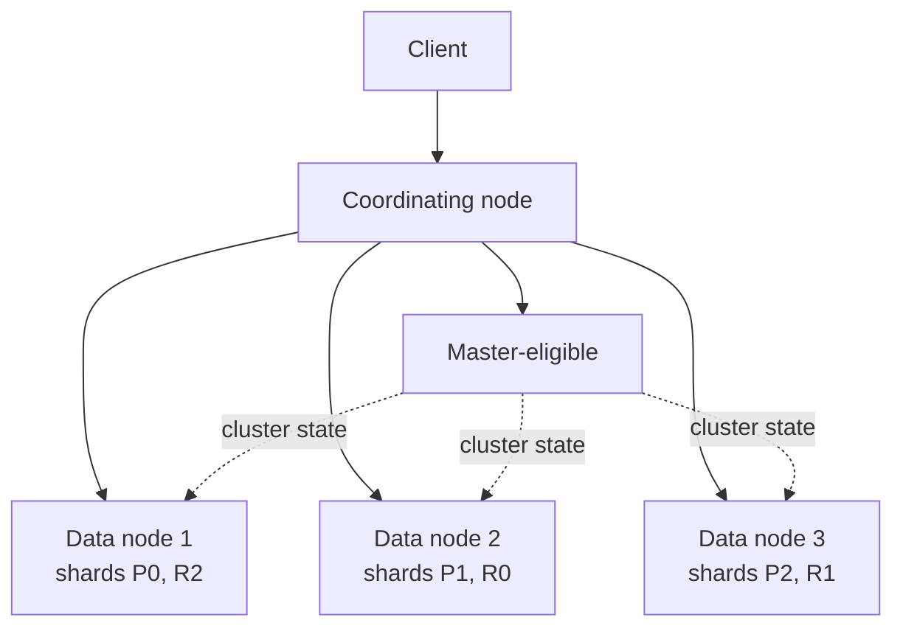
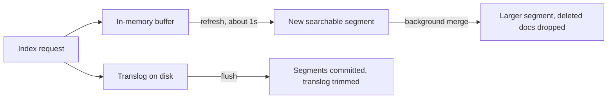

# Elasticsearch

> [!abstract] What this is
> Elasticsearch (and its open-source fork OpenSearch) is the specific tool behind "search index" in most designs. [[09 - Storage Search and Geo]] covers the *theory*: inverted indexes, BM25, analyzers, vector search. This note is Elasticsearch **as a system**: how a cluster is laid out, how a mapping is defined, what the queries actually look like, how writes get in, and how a cluster degrades.
>
> The decision this note helps with is **how to configure and operate** an ES index once you've already decided you need one.

---

## Why It Exists

Deciding "I need an inverted index" is only step one. Elasticsearch is a distributed system with its own cluster topology, its own schema concept (a **mapping**, not a SQL schema), and its own query language. Interviewers who've actually run it will probe past "BM25 ranks results" into "how many shards, and what happens when one node dies." This note is for that layer.

---

## Cluster Topology

An Elasticsearch cluster is a set of **nodes**. Each node can take on one or more roles, and in production they're usually split up so a slow query can't starve the cluster's ability to stay alive.

| Node role | Job | Why it's separated at scale |
|---|---|---|
| **Master-eligible** | Manages cluster state: which indices exist, where shards live, which nodes are up | Needs to stay responsive even if data nodes are under heavy query load |
| **Data** | Stores shards, executes queries and indexing against them | Where the actual CPU/disk/memory load lands |
| **Ingest** | Runs ingest pipelines (transform documents before indexing) | Keeps transform CPU off the nodes serving queries |
| **Coordinating only** | Routes requests, fans out to data nodes, merges results | A dedicated "front door" so clients don't hit data nodes directly |

A small cluster collapses all four roles onto the same nodes. A production cluster typically runs **3 dedicated master-eligible nodes** (an odd number, for the same majority-vote reason as Raft — see [[17 - Consistency Time and Consensus]]) and scales data nodes separately based on data volume and query load.



---

## Index, Mapping, and Shards

An **index** is roughly a table. A **mapping** is roughly a schema: it declares each field's type and how it should be analyzed. Unlike SQL, a mapping can be partially inferred automatically (**dynamic mapping**), which is convenient in a demo and a common source of production surprises, like a field typed as text when you needed it as keyword for exact matching and aggregation.

```json
PUT /products
{
  "settings": { "number_of_shards": 3, "number_of_replicas": 1 },
  "mappings": {
    "properties": {
      "name":        { "type": "text" },
      "category":    { "type": "keyword" },
      "price_cents": { "type": "long" },
      "created_at":  { "type": "date" }
    }
  }
}
```

| Field type | Matches on | Example |
|---|---|---|
| **text** | Analyzed tokens; partial, fuzzy, relevance-ranked | `name`, `description` |
| **keyword** | Exact value only, not tokenized | `status`, `category`, used for filters and aggregations |
| **long / double** | Numeric range queries, sums, averages | `price_cents` |
| **date** | Range queries, date-math | `created_at` |
| **nested** | An array of sub-objects queried independently of each other | Line items in an order, each with its own price and quantity |

> [!warning] A single field often needs **both** representations: `name` as `text` for search, and `name.keyword` as a `keyword` sub-field for exact matching, sorting, and aggregating. Mapping this once at index-creation time is far cheaper than realizing you need it after the index already has data.

**Shards** are set at index creation and are expensive to change, because a document's shard is computed from a hash of its routing value modulo the number of primary shards. Changing that number would move almost every document. Too few shards and you can't spread the index across nodes or parallelise a query; too many and the per-shard overhead (each shard is a full Lucene index with its own memory, file handles and cluster-state entry) adds up for no benefit. A commonly cited starting point is shards in the range of **tens of gigabytes** each; treat that as a rough guide and size from your own data and query load. If you got it wrong, you don't resize in place: you build a new index and switch to it with an alias (below). The primary/replica split itself is covered in [[09 - Storage Search and Geo]].

### Routing

By default the routing value is the document's `_id`, so documents scatter across all shards and every search asks every shard. A custom **routing** value, such as `tenant_id`, puts all of one tenant's documents on the same shard, and a search that passes the same routing value hits **one** shard instead of all of them. The cost is skew: one huge tenant becomes one hot shard.

---

## Querying

The **Query DSL** is a JSON body, not SQL. The two query types that come up constantly are a text match and a structured filter, and the difference between them matters for both correctness and performance.

```json
GET /products/_search
{
  "query": {
    "bool": {
      "must":   [{ "match": { "name": "running shoes" } }],
      "filter": [{ "term":  { "category": "footwear" } },
                 { "range": { "price_cents": { "lte": 10000 } } }]
    }
  }
}
```

- **`must`** clauses contribute to the relevance **score** (BM25 — see [[09 - Storage Search and Geo]]) and are analyzed the same way the field was indexed.
- **`filter`** clauses are yes/no, contribute **nothing** to the score, and are cached far more aggressively by Elasticsearch internally. Anything that's a hard constraint rather than a relevance signal — status, tenant id, a price ceiling — belongs in `filter`, not `must`.

**Aggregations** are the analytics side: "average price per category" or "count of orders per day" computed across all matching documents, not just the returned page. Sorting and aggregating read **doc values**, a column-oriented on-disk structure that `keyword`, numeric and date fields have by default. `text` fields don't have doc values, so aggregating on them needs `fielddata`, an in-heap structure that's disabled by default because it can exhaust memory, and it would aggregate individual tokens anyway, which is rarely what you want. That's the mechanical reason `category` above is a `keyword`.

### Pagination

A search runs in two phases, **query then fetch**. The coordinating node asks every shard for its top `from + size` matches (ids and scores only), merges those lists, then fetches the full documents for the final page. Page 1 asks each shard for 10 results; page 1,000 asks each shard for 10,000 and throws away all but 10. That's why deep pagination gets expensive, and why `from + size` is capped at **10,000** by default (`index.max_result_window`).

| Method | How it works | Pick when |
|---|---|---|
| `from` + `size` | Skip `from` results, return `size` | The first few pages of a UI |
| **`search_after` + point in time (PIT)** | Pass the sort values of the last hit; a PIT freezes a consistent view of the index | Infinite scroll and deep pages |
| Scroll | Server-side cursor over a snapshot | Legacy bulk export; PIT + `search_after` is now the recommended replacement |

Many products simply don't offer page 500. "Showing the top 1,000 results" is a legitimate product decision.

---

## Getting Data In

### Single document and `_bulk`

Indexing one document (`PUT /products/_doc/42`) is fine for a trickle of writes. Indexing many is not: it's one HTTP round trip per document, and at any real ingest rate that overhead dominates. The **`_bulk`** API batches many index/update/delete operations into a single request, which is the only way to feed Elasticsearch at meaningful write volume.

### Refresh interval and near-real-time

A newly indexed document isn't searchable immediately — it's buffered until the next **refresh**, which happens automatically about once a second by default. This is the mechanic behind "near-real-time" search, already covered in [[09 - Storage Search and Geo]]; the operational knob worth naming is that `refresh_interval` can be stretched out (or disabled during a big bulk load) to trade search latency for indexing throughput, then set back afterward.

### Feeding it from the source of truth

Same rule as the parent note: Elasticsearch is a copy, kept warm asynchronously via CDC or an outbox, never a synchronous second write alongside the primary database. See [[09 - Storage Search and Geo]] and [[07 - Async Messaging]].

---

## Updates, Segments and Durability

Each shard is a **Lucene index** made of immutable files called **segments**. Immutability is what makes search fast and caching easy, and it also explains how writes and updates behave.



- A write goes into an in-memory buffer **and** the **translog**, an append-only log that's fsynced before the write is acknowledged (the default, `index.translog.durability: request`). That's what lets an acknowledged write survive a crash.
- A **refresh** turns the buffer into a new searchable segment. That's the near-real-time delay.
- A **flush** makes the segments durable on disk and trims the translog.
- Because segments can't be edited, an **update** marks the old version deleted and indexes a whole new copy. Background **merges** combine small segments and finally drop the deleted documents.

The design consequence: a document updated every second (a live view counter, a stock level) creates a constant stream of deletes and merges. Keep fast-changing values out of the search document, or batch their updates.

### Concurrency and out-of-order sync

Every write gets a sequence number and a primary term. Passing `if_seq_no` and `if_primary_term` makes an update fail if someone else changed the document first, which is optimistic locking. When the index is fed by CDC from a database, use **external versioning** instead (`version_type=external` with the source row's version or update timestamp), so a delayed or replayed event can't overwrite a newer version.

> [!warning] Elasticsearch is not a source of truth. There are no multi-document transactions, and a replica can briefly lag its primary. Everything in it should be rebuildable from the database.

---

## Aliases and Zero-Downtime Reindexing

You can't change a field's type, an analyzer, or the primary shard count of an existing index. The answer is always to build a new index and switch to it, and **aliases** make the switch invisible to clients.

1. Clients only ever query the alias `products`, which points at `products_v3`.
2. Create `products_v4` with the new mapping or shard count.
3. Fill it, with the `_reindex` API from the old index or a fresh backfill from the source database.
4. Catch up the writes that happened during the copy, either by writing to both indices during the transition or by replaying CDC from a recorded position.
5. Swap the alias to `products_v4` in one atomic call. Rolling back is swapping it back.

---

## Time-Based Indices for Logs and Events

Logs, metrics and events are append-only and mostly read while recent. Keeping them in one ever-growing index makes deleting old data expensive, because a delete-by-query has to find and mark every old document. Instead, write to a sequence of indices (`logs-2026.09.29`, ...) behind an alias or a **data stream**, and **roll over** to a new index by age or size.

**Index lifecycle management (ILM)** then moves indices through phases: **hot** (fast nodes, being written), **warm** (read-only, cheaper nodes), **cold** (rarely queried), and **delete**. Dropping a whole old index is instant. This is the pattern behind the ELK logging stack in [[11 - Services and Observability]].

---

## Cluster Health and What Breaks

Cluster health is reported as a traffic light, and knowing what each color actually means (not just "red is bad") is the kind of detail that separates "used it" from "operated it."

| Status | Meaning | What it means for traffic |
|---|---|---|
| **Green** | Every primary and every replica shard is allocated | Fully healthy |
| **Yellow** | Every primary is allocated, but at least one replica is not (commonly: one node is down) | Reads and writes still work; you're one more failure away from losing data for that shard |
| **Red** | At least one **primary** shard is unallocated | Queries touching that shard fail outright, or return partial/incomplete results depending on client settings |

| Failure | What happens | Mitigation |
|---|---|---|
| **Node loss, replicas present** | Cluster goes yellow; a replica is promoted to primary for the affected shards | This is replication doing its job. No action needed beyond replacing the node |
| **Node loss, no replicas** (`number_of_replicas: 0`) | Cluster goes red for any shard that lived only on that node; data for it may be gone | Always run at least one replica for anything that matters |
| **Oversharded index** | Thousands of tiny shards, each with fixed per-shard overhead, eating memory and slowing cluster-state updates | Fewer, larger shards; reindex into a better-sized index |
| **Mapping explosion** | Dynamic mapping creates a new field for every slightly different document shape, blowing past the field-count limit | Disable dynamic mapping in production (`"dynamic": "strict"`), or route unexpected fields into a single catch-all |
| **Hot node** | Uneven shard allocation puts too much data or query load on one node | Shard allocation awareness, or rebalance manually |
| **Full disk on a data node** | Elasticsearch blocks writes to protect itself (a disk watermark trips) | Alert well before the watermark; scale storage or delete old indices (e.g. time-based log indices) |
| **Big bulk load with default refresh** | Constant refreshing during a bulk load slows the load itself | Widen or disable `refresh_interval` during the load, restore it after |
| **Deep pagination** | Requests past 10,000 results are rejected, and deep pages eat heap on every shard | `search_after` with a point in time |
| **Mapping change needed** | A field's type can't be changed on a live index | New index, reindex, swap the alias |
| **Update-heavy documents** | Constant delete-and-reindex causes merge churn and slow indexing | Keep fast-changing values out of the search document; batch updates |
| **Out-of-order CDC event** | A late event overwrites a newer version of the document | External versioning with the source row's version |
| **Deleting old logs with delete-by-query** | Slow and expensive; deleted docs linger until merges | Time-based indices with rollover; drop whole indices |
| **Huge tenant with custom routing** | All its documents on one shard; that shard is hot | Route only small tenants by id, or give big tenants their own index |

---

## Interview Lines

> [!tip] Say it like this
> - "The data model is a mapping, not a SQL schema, and I'd map `name` as text for search and `name.keyword` as a sub-field for exact match and aggregation."
> - "Filters don't score and are cached; anything that's a hard constraint — tenant, status, price range — goes in `filter`, not `must`."
> - "Shard count is set at index creation and expensive to change, so I'd size it for the data's growth, not today's size, and reindex into a new index if I got it wrong."
> - "Yellow means a replica is missing but the primaries are fine, so traffic still works. Red means a primary itself is gone and queries against it fail."
> - "High-volume writes go through `_bulk`, not one document at a time, and I'd widen the refresh interval during a big load."
> - "Mapping and shard-count changes mean a new index: reindex, then swap the alias atomically."
> - "Deep pages use `search_after` with a point in time, not `from` and `size`."
> - "Segments are immutable, so an update is a delete plus a reindex. I keep fast-changing counters out of the search document."
> - "When CDC feeds the index, I use external versioning so a replayed event can't overwrite newer data."

## Related Notes

- [[09 - Storage Search and Geo]]
- [[17 - Consistency Time and Consensus]]
- [[07 - Async Messaging]]
- [[20 - Data Processing and Analytics]]
- [[11 - Services and Observability]]
