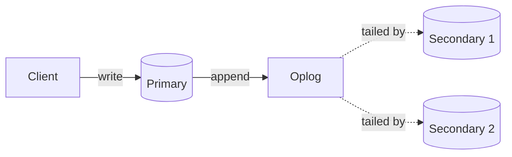
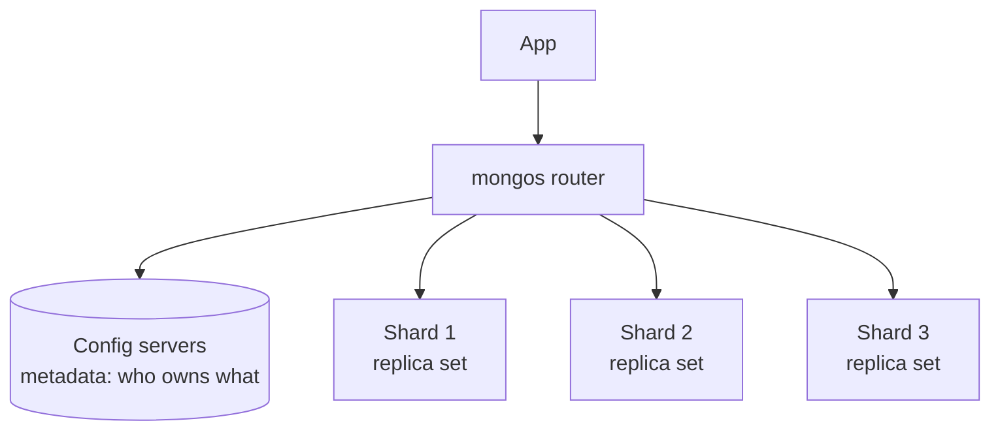

# MongoDB

> [!abstract] What this is
> MongoDB is the specific tool behind "document store" in most designs. [[05 - Databases/07 - Data Modelling]] covers the *decision*: when a document fits better than a relational table, and how to design around the aggregate. This note is MongoDB **as a system**: how a replica set elects a primary and recovers, how sharding actually splits data, and the write/read tuning knobs that stand in for the quorum knobs in [[17 - Consistency Time and Consensus]].
>
> The decision this note helps with is **how to configure and operate** MongoDB once you've already decided a document model fits.

---

## Why It Exists

"MongoDB scales" explains nothing on its own. What interviewers listen for is whether you know *how*: that it replicates through an election process with real failover behaviour, that sharding is a deliberate choice of key with real consequences, and that "durable" is a setting you choose per write, not a given. This note is that layer.

---

## The Document Model, Briefly

A MongoDB **document** is a BSON object (binary JSON, with extra types like dates and binary data), and a **collection** is a set of documents, roughly a table with no fixed columns. Two documents in the same collection can have different fields entirely; nothing stops that. The modelling question — whether to **embed** a sub-object inside its parent or **reference** it by id in another collection — is the same aggregate-boundary question `07 - Data Modelling` already covers: embed when you always read the whole thing together, reference when you need to query the sub-object on its own or it grows unboundedly (comments on a popular post embedded inside the post document is a classic way to hit the 16 MB document size limit).

---

## Replica Sets

A MongoDB **replica set** is the unit of replication and failover: one **primary** that accepts writes, and several **secondaries** that replicate from it. It is conceptually the same shape as a Raft group, and that similarity is worth saying out loud.

### The oplog

Every write the primary accepts is appended to its **oplog** (operations log), a capped collection that's really just a replicated write-ahead log. Secondaries continuously tail the primary's oplog and apply the same operations in the same order, which is how they stay in sync asynchronously by default.

The oplog is a **fixed-size** collection, so it only holds a window of recent history: hours to days, depending on its size and the write rate. A secondary that's down longer than that window can't catch up by tailing. It needs a full **initial sync**, copying the whole dataset. Monitor replication lag and the oplog window, and size the oplog for your longest expected outage or maintenance.

### Change streams

Applications can subscribe to changes too. **Change streams** expose inserts, updates and deletes on a collection or database, built on the oplog. Each event carries a **resume token**, so a consumer that restarts continues where it left off. This is MongoDB's built-in CDC, and the usual way to keep a search index, a cache or a Kafka topic in sync without dual writes ([[07 - Async Messaging]], [[22 - Elasticsearch]]).

### Elections

If the primary stops responding (by default members wait about **10 seconds** of missed heartbeats, `electionTimeoutMillis`), a secondary calls an **election**. The winner needs votes from a **majority** of voting members. Since MongoDB 3.2 the replication protocol is based on Raft: elections have numbered **terms**, each member votes once per term, and a candidate whose oplog is behind the voter's is refused ([[17 - Consistency Time and Consensus]]). So the most up-to-date secondary wins.

Writes are unavailable until the new primary is elected, usually a matter of seconds. Modern drivers enable **retryable writes** by default: a write that hit the old primary mid-failover is retried once against the new one, and the server recognises the retry by its session and transaction number, so it isn't applied twice.

**Arbiters** vote but hold no data. They make up an odd number of voters cheaply, but they weaken durability. With a primary, a secondary and an arbiter, losing the secondary leaves one data-bearing node, so `w: "majority"` writes can't be acknowledged. Prefer three data-bearing members.

### Rollback

An old primary that was cut off may hold writes that never reached a majority. When it rejoins, those writes conflict with the new primary's history, so it **rolls them back**: it undoes them and saves them to rollback files for a human to inspect. This is the concrete mechanism behind "a `w: 1` write can be lost on failover." Writes acknowledged with `w: "majority"` are never rolled back.

### Write and read tuning

Two settings decide how much durability and consistency a given operation asks for, independent of each other, which is why both have to be stated to describe a write's actual guarantee.

| Write concern | Primary acknowledges after | Pick when |
|---|---|---|
| `w: "majority"` (the default since MongoDB 5.0, for most deployments) | A majority of data-bearing voting members have it | The write must survive a failover. It can never be rolled back |
| `w: 1` (the default before 5.0) | Only the primary has it | Lower latency, and losing the write on failover is acceptable |
| `w: 0` | No acknowledgement at all | Almost never; you can't tell if it failed |

Adding `j: true` also waits for the write to reach the on-disk journal, not just memory.

| Read preference | Reads from | Trade-off |
|---|---|---|
| `primary` (default) | Always the primary | Strongly consistent with the latest write |
| `secondary` | Any secondary | Offloads read traffic; can be stale (replication lag) |
| `secondaryPreferred` | Secondary if available, else primary | Balance, with a fallback |

**Read preference** only chooses *which node* answers. **Read concern** chooses *which version of the data* you're willing to see, and it's the setting people forget.

| Read concern | Returns | Pick when |
|---|---|---|
| `local` (default) | The node's latest data, even if it isn't majority-committed and could later be rolled back | Most reads, where a rare rolled-back value is acceptable |
| `majority` | Only data a majority has acknowledged, so it can't be rolled back | Reads that drive decisions, like money or inventory checks |
| `linearizable` | Reflects every majority-acknowledged write that completed before the read started. Primary only, slower | Rare reads that must see the latest value, such as checking who holds a lock |
| `snapshot` | A consistent point-in-time view across documents | Inside multi-document transactions |

For read-your-writes while reading from secondaries, use a **causally consistent session**. The driver passes along the cluster time of your last write, and a secondary waits until it has caught up to that point before answering. `w: "majority"` plus `majority` reads in a causal session is how MongoDB provides the session guarantees from [[17 - Consistency Time and Consensus]].

---

## Sharding

A single replica set eventually can't hold the data or the write volume. **Sharded clusters** split a collection's documents across several **shards** (each shard is itself a replica set) by a chosen **shard key**.

A **mongos** router sits in front and uses the **config servers**' metadata to send each query only to the shard(s) that could hold the relevant documents, so the application doesn't need to know which shard owns which data.

### Shard key strategies

The shard key decides how documents are distributed, and a bad choice reproduces the exact hot-partition problem covered generically in [[05 - Databases/09 - Sharding]].

| Strategy | How it distributes | Risk | Pick when |
|---|---|---|---|
| **Ranged** | Documents with nearby key values land on the same shard | A monotonically increasing key (like a timestamp or auto-incrementing id) sends all new writes to one shard | Range queries on the key are common and need to stay fast |
| **Hashed** | The key is hashed first, so nearby values scatter across shards | Range queries on the original key now have to fan out to every shard | Writes must spread evenly; range scans on that key are rare |

The classic mistake is sharding by `created_at` or an auto-incrementing `_id`: every new document is "the newest," so every write lands on whichever shard currently owns the top of the range, and the other shards sit idle. A hashed key, or a compound key that starts with something high-cardinality like `user_id`, avoids this.

### Targeted vs scatter-gather queries

`mongos` can only send a query to one shard if the query includes the shard key (or a prefix of it). A query on any other field is **scatter-gather**: it goes to every shard and the results are merged. That's fine occasionally. But if the hot query doesn't include the shard key, every shard works on every request, and adding shards doesn't help. Pick the shard key from the most frequent query, the same rule as Cassandra partition keys in [[24 - Cassandra and DynamoDB]].

Two related constraints. A **unique index** on a sharded collection must start with the shard key, because no single shard can check uniqueness across the others. And the shard key used to be permanent; since 5.0, `reshardCollection` can change it, but it rewrites the whole collection, so treat it as a rare and heavy operation.

### Chunks and balancing

Within a shard key's range, MongoDB divides data into **chunks**, each a contiguous range of key values. The **balancer** migrates chunks between shards in the background to keep data roughly even as the dataset grows or a shard key's distribution turns out uneven in practice. If too many documents share one shard-key value, their chunk can't be split and becomes a **jumbo chunk** the balancer can't move. That's the sign of a low-cardinality key.

---

## Indexes

MongoDB indexes work much like relational indexes conceptually (B-tree based; see [[05 - Databases/02 - Indexing]] for the structure), with two document-shaped additions worth naming.

- **Compound indexes** follow the same leftmost-prefix rule as SQL composite indexes: an index on `{user_id: 1, created_at: -1}` serves queries filtering on `user_id` alone or on both, not on `created_at` alone.
- **Multikey indexes** are created automatically when the indexed field is an array; MongoDB indexes each array element separately, which is how "find documents where `tags` contains X" works without a separate join table.
- **ESR rule** for compound index field order: **E**quality fields first, then **S**ort fields, then **R**ange fields. `{status: 1, created_at: -1, price: 1}` serves "status is open, newest first, price in a range."
- **TTL indexes** delete documents automatically some time after a date field. Useful for sessions, tokens and short-lived logs.

Use `explain()` to confirm a query uses an index (`IXSCAN`) rather than scanning the collection (`COLLSCAN`).

A missing index on a filtered field means a **collection scan**, exactly as a missing index means a table scan in a relational database.

---

## Joins, Aggregation and the Storage Engine

"MongoDB has no joins" is wrong. The **aggregation pipeline** processes documents through stages (`$match`, `$group`, `$sort`, `$project`), and its `$lookup` stage joins another collection. It works, but it's slower than a relational join and harder to use well across shards. If the hot path needs a `$lookup` on every request, either the data is really relational and belongs in Postgres, or the document should embed what it keeps joining.

The storage engine underneath is **WiredTiger**: B-tree based, with document-level concurrency control (writes to different documents don't block each other), compression, and an in-memory cache. Performance falls off sharply once the **working set**, meaning the indexes plus the frequently read documents, no longer fits in that cache.

---

## Transactions

Single-document writes are always atomic. **Multi-document transactions** (across documents or collections, ACID with configurable isolation) exist and work across a sharded cluster, but they cost more: they hold locks and resources for the duration, and span network round trips to every shard involved. The honest framing is the same one used for distributed SQL in [[05 - Databases/10 - Engine Choice]]: available, but every use should be deliberate, not a default replacement for a well-chosen document shape that didn't need one.

---

## Failure Modes

| Failure | What happens | Mitigation |
|---|---|---|
| **Primary failover, `w: 1`** | Recent writes acknowledged by the old primary but not yet replicated are lost | `w: "majority"` for data that must survive a failover |
| **Monotonic shard key** | All new writes land on one shard; others idle | Hashed shard key, or a high-cardinality compound key |
| **Unbounded array growth** | A document (e.g. comments embedded in a post) grows past the 16 MB document limit | Reference instead of embed once the sub-collection is unbounded |
| **Missing index on a common filter** | Full collection scan on every query | Add the index; same discipline as relational indexing |
| **Reading from a lagging secondary** | Stale reads under `secondary` read preference | `primary` or `secondaryPreferred` with a staleness bound, if the data needs freshness |
| **Even number of voting members** | An election can tie with no majority | Odd number of voters; prefer a third data-bearing member over an arbiter |
| **Schema drift with no validation** | Documents in one collection quietly diverge in shape over time | Schema validation rules, or application-level discipline about what each collection's documents look like |
| **Old primary rolls back** | Writes it accepted with `w: 1` during a partition are undone when it rejoins | `w: "majority"`; inspect the rollback files |
| **Secondary falls outside the oplog window** | It can't catch up by tailing and needs a full initial sync | Size the oplog for the longest outage; alert on oplog window and lag |
| **Hot query without the shard key** | Scatter-gather to every shard on every request | Shard key from the most frequent query |
| **Jumbo chunk** | Too many documents share one shard-key value; the chunk can't split or move | Higher-cardinality or compound shard key |
| **Primary-secondary-arbiter with a member down** | Majority writes can't be acknowledged | Three data-bearing members |
| **Working set exceeds the cache** | Reads go to disk; latency jumps | More RAM, better indexes, smaller documents |
| **Stale read with `local` read concern** | A read returns data that's later rolled back | `majority` read concern for decisions |

---

## Interview Lines

> [!tip] Say it like this
> - "A replica set is a primary and secondaries tailing its oplog, with elections on failover — the same majority-vote shape as Raft."
> - "Three separate knobs: write concern for durability (`majority` is the default now), read concern for which version I'm allowed to see, and read preference for which node answers."
> - "A `w: 1` write can be rolled back when the old primary rejoins. A `majority` write can't."
> - "Change streams on the oplog are how I'd keep Elasticsearch in sync, with a resume token so a restart doesn't lose events."
> - "Sharding by a monotonically increasing key sends every new write to one shard. I'd hash the key or shard on something high-cardinality like `user_id`."
> - "Multi-document transactions exist and work across shards, but I wouldn't reach for them by default — a well-chosen document shape usually doesn't need one."

## Related Notes

- [[05 - Databases/07 - Data Modelling]]
- [[05 - Databases/09 - Sharding]]
- [[05 - Databases/10 - Engine Choice]]
- [[05 - Databases/02 - Indexing]]
- [[17 - Consistency Time and Consensus]]
