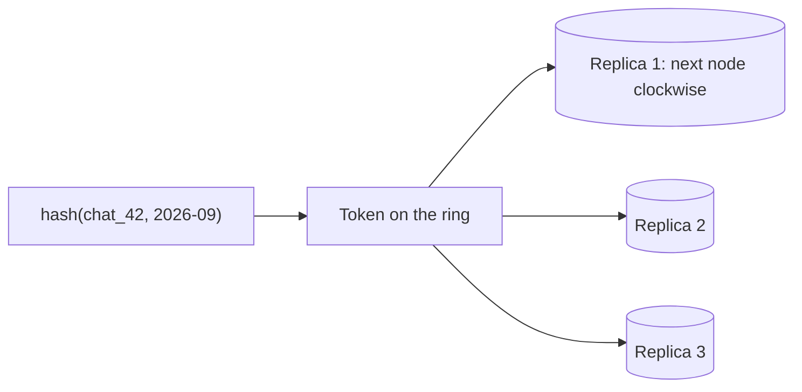
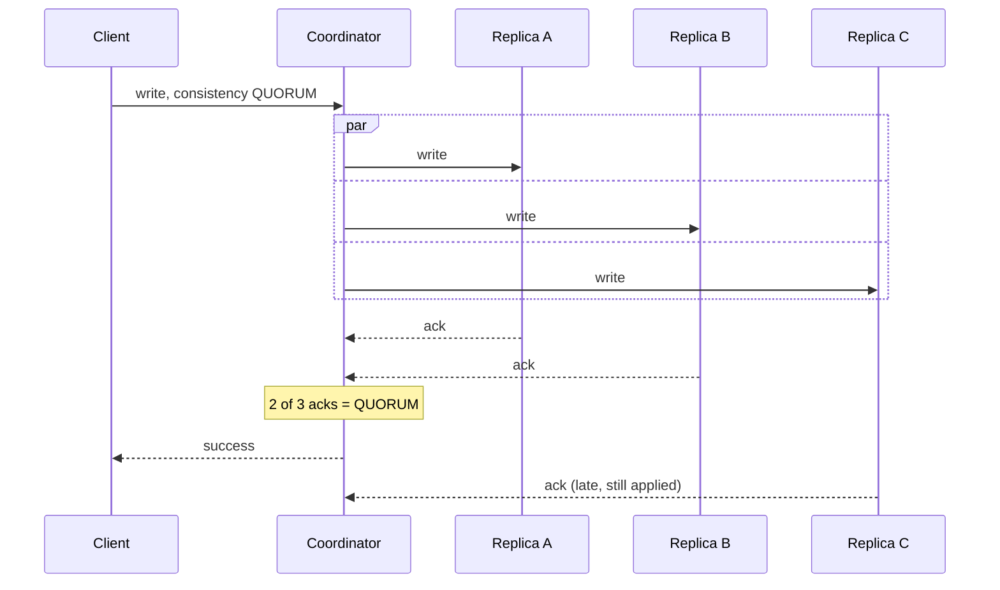
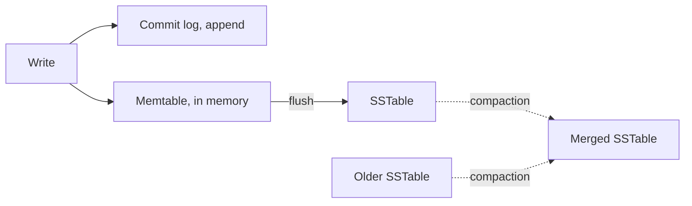
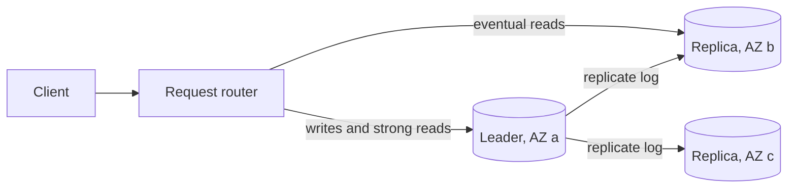

# Cassandra and DynamoDB

> [!abstract] What this is
> Cassandra and DynamoDB are the two tools behind "wide-column" or "key-value at scale" in most designs. They share a data model: a **partition key** decides where an item lives, a **sort key** orders items within it, and there are no joins and no optimizer to rescue a bad key. [[05 - Databases/07 - Data Modelling]] covers that mindset; this note is the machinery under it.
>
> They differ in topology, and the difference matters. **Cassandra is leaderless**: any replica accepts a write. **DynamoDB, despite its name, is not**: each partition has a leader, and writes go through it. The theory both lean on (quorums, gossip, consistent hashing, Merkle-tree repair) lives in [[17 - Consistency Time and Consensus]] and [[10 - Distributed Building Blocks]].

---

## Why It Exists

Both exist for workloads that outgrow a single relational primary: very high write volume, data that's naturally read by one key, and a need to add machines instead of buying a bigger one. "Cassandra is good at writes" is true for concrete reasons: no single leader to funnel through, an append-only storage engine, and a consistency level chosen per request. DynamoDB offers the same data model as a managed service, trading control for zero operations.

The price is the same for both. You design tables around queries you know in advance, and a query you didn't plan for is either impossible or a full scan.

The naming history causes confusion, so it's worth one paragraph. Amazon's 2007 **Dynamo** paper described a leaderless store with sloppy quorums, hinted handoff and vector clocks. **Cassandra** took Dynamo's distribution ideas and combined them with Google Bigtable's storage model (memtables and SSTables). **DynamoDB** is a later AWS service that kept the name and the key-value interface, but it replicates each partition through an elected leader with Multi-Paxos.

---

## The Partition Key Is the Design

A table's primary key has two parts that do completely different jobs.

- The **partition key** decides *which nodes* own an item, by hashing it. Every item with the same partition key lives together on the same replicas.
- The **clustering key** (Cassandra) or **sort key** (DynamoDB) decides the *order* of items **within** one partition.

```
PRIMARY KEY ((chat_id), sent_at)
             ^^^^^^^^  ^^^^^^^
             partition  clustering
```

All messages in one chat land in the same partition, physically sorted by `sent_at`. "The last 50 messages in chat X" is one cheap, sequential read from one place. "Every message this user sent in any chat" can't be answered by this table at all. That needs a second table keyed by `user_id`, written alongside the first. There's no join to fall back on.

### Keep partitions bounded

A partition lives on one set of replicas, so it can't grow forever. A chat that runs for years under `PRIMARY KEY ((chat_id), sent_at)` becomes one enormous partition: slow to read, slow to compact, slow to repair, and stuck on the same few nodes. The fix is a **bucket** in the partition key, so each partition covers a bounded slice:

```
PRIMARY KEY ((chat_id, month), sent_at)
```

Each chat-month is now its own partition. Reading recent messages hits the current month, and older months are only read when someone scrolls back. A common rough guideline for Cassandra is to keep partitions well under about 100 MB. DynamoDB's equivalent limits are in its section below.

---

## Cassandra

### The ring and virtual nodes

The partition key is hashed to a **token**, a position on a **consistent hash ring** ([[10 - Distributed Building Blocks]]). Each node owns ranges of the ring, and a partition's `RF` replicas (the replication factor) are the next `RF` distinct nodes clockwise from its token.

Rather than one big range each, nodes own many small ranges called **virtual nodes** (vnodes). Cassandra 4.0 defaults to 16 per node. Vnodes spread data more evenly, and when a node joins or dies, its load is shared by many peers instead of just its neighbours.



### Leaderless writes

A client can send a request to **any** node. That node becomes the **coordinator** for the request: it forwards the write to all `RF` replicas and replies once enough of them have acknowledged for the chosen consistency level. The other replicas still get the write, and slow or down ones are fixed by repair later. There's no leader to elect and no consensus round before a write is accepted, which is a large part of why writes are fast.



Nodes learn who is alive and who owns what through **gossip**: each node exchanges state with a few random peers every second, and news spreads through the cluster in about `O(log N)` rounds ([[10 - Distributed Building Blocks]]).

### Consistency levels

The consistency level is chosen **per query**. With `RF = 3`, `QUORUM` writes plus `QUORUM` reads overlap (2 + 2 > 3), so a read sees the latest acknowledged write. Why that still isn't linearizable on its own is in [[17 - Consistency Time and Consensus]].

| Level | Waits for | Pick when |
|---|---|---|
| `ONE` / `LOCAL_ONE` | One replica | Fast writes or reads where stale is fine |
| `QUORUM` | A majority of all replicas, across every datacenter | Single region; reads must see recent writes |
| **`LOCAL_QUORUM`** | A majority of replicas **in the local datacenter** | Multi-region: strong-ish within a region without paying cross-region latency on every request |
| `EACH_QUORUM` | A majority in **every** datacenter (writes) | Rare: a write must be durable in all regions before acknowledging |
| `ALL` | Every replica | Almost never; one node down fails the request |

Replication is configured per datacenter (`NetworkTopologyStrategy`), so a keyspace can keep three copies in Mumbai and three in Singapore.

### Conflicts: last write wins

Cassandra doesn't use vector clocks. Every column value carries a **write timestamp**, and when replicas disagree, the highest timestamp wins. Writes are blind upserts, with no read before the write. Two consequences follow. Concurrent updates to the same column silently lose one of them. And timestamps come from the client or the coordinator clock, so clock skew can let an *older* write win ([[17 - Consistency Time and Consensus]] on why wall clocks can't order events).

### Lightweight transactions

When you need compare-and-set, such as "create this username only if nobody has it," Cassandra offers **lightweight transactions**: `INSERT ... IF NOT EXISTS`, `UPDATE ... IF version = 7`. They run **Paxos** among the partition's replicas, which takes several round trips, so they're far slower than a normal write and serialise contention on that partition. Use them for rare uniqueness checks, not the hot write path, and not as the basis for a ledger.

### Write path

Cassandra's storage engine is an **LSM tree** ([[05 - Databases/02 - Indexing]]). A write appends to the **commit log** for durability and updates the in-memory **memtable**. Nothing is read, searched or rewritten in place. When the memtable fills, it's flushed to disk as an immutable **SSTable**, and background **compaction** merges SSTables together.



### Read path

Reads are where the LSM design pays its bill. A read checks the memtable, then every SSTable that might hold the partition. Each SSTable has a **bloom filter** that says "definitely not here" for most files, and a partition index that jumps straight to the right offset in the files that might. The pieces found are merged, newest timestamp winning. The more SSTables a partition is spread across, the slower the read, which is why compaction strategy matters.

### Compaction strategies

| Strategy | How it works | Pick when |
|---|---|---|
| **Size-tiered (STCS)** | Merges SSTables of similar size | Write-heavy with few updates. Needs spare disk during big compactions |
| **Leveled (LCS)** | Keeps levels of non-overlapping SSTables, so a read touches few files | Read-heavy, or rows updated often. Costs more write I/O |
| **Time-window (TWCS)** | Groups SSTables by time window; a whole window is dropped once its TTL passes | Time series with a TTL: metrics, events, sensor data |

### Tombstones and `gc_grace_seconds`

A `DELETE` can't remove data from immutable SSTables, so Cassandra writes a **tombstone**, a marker that says "deleted." Tombstones are only purged by compaction after `gc_grace_seconds` (10 days by default) have passed.

Two problems come from this. First, reads must scan and discard tombstones. A table used as a queue (write, read once, delete) piles them up, read latency climbs, and by default a query that scans 100,000 tombstones fails outright. Model data as write-once-read-many, and prefer TTLs with TWCS over explicit deletes. Second, if a replica was down and missed the delete, and repair doesn't run before `gc_grace_seconds` expires, the tombstone is purged elsewhere while the down replica still holds the old value. Repair then copies the deleted data back. That's called **zombie data**, and it's why full repair must run within `gc_grace_seconds`.

### Repair

Because any replica can accept a write, replicas drift: a dropped message, a node that was down, a timeout. Three mechanisms bring them back in line, none of them consensus.

| Mechanism | When it runs | What it fixes |
|---|---|---|
| **Hinted handoff** | A replica is down during a write; the coordinator stores a hint and replays it when the replica returns (for up to a few hours by default) | Short outages |
| **Read repair** | During a read, replicas that returned older data are updated | Rows that get read |
| **Anti-entropy repair** (`nodetool repair`, Merkle trees) | Scheduled, cluster-wide | Everything else, including rows nobody reads; must run within `gc_grace_seconds` |

**Merkle trees** let two replicas compare a large dataset without shipping it: each builds a tree of hashes, and only branches whose hashes differ are compared further down. See [[10 - Distributed Building Blocks]].

### Second access paths

The reliable answer to a second query pattern is a second table keyed by it, written alongside the first. Built-in secondary indexes query every node, and materialized views have a history of consistency problems. Newer Storage-Attached Indexes (SAI) improve secondary indexing, but a second table is still the default interview answer.

---

## DynamoDB

### Partitions and replication

A DynamoDB table is split into partitions by the hash of the partition key, and each partition is replicated across **three Availability Zones**. One replica is the **leader**, elected with Multi-Paxos. A write goes to the leader, which logs it and replicates it, and the write is acknowledged once a majority of replicas have persisted it.

- **Strongly consistent reads** are served by the leader and see every acknowledged write.
- **Eventually consistent reads**, the default, can be served by any replica, cost half as much, and may be slightly stale.



Because a leader orders every write to its partition, DynamoDB doesn't need last-write-wins, hinted handoff or read repair inside a region. That's the main structural difference from Cassandra.

### Query vs Scan

| Operation | Reads | Cost | Pick when |
|---|---|---|---|
| `GetItem` | One item by its full key | Cheapest | You know the exact key |
| **`Query`** | One partition key, optionally a sort-key range | Pays only for items read | Every hot-path read |
| **`Scan`** | The whole table | Pays for every item read, even ones a filter then drops | Offline exports and backfills, never the request path |

A `FilterExpression` runs **after** items are read, so it saves bandwidth but not cost. If a query only works with a filter over many items, the key design is wrong.

### Capacity and hot partitions

| Capacity mode | How it bills | Pick when |
|---|---|---|
| **On-demand** | Per request; scales automatically | Unpredictable or spiky traffic, new tables |
| **Provisioned** | Reserved read and write units per second, with optional autoscaling | Steady, predictable traffic; cheaper at constant load |

Throughput is also limited **per partition**. AWS documents limits of roughly 3,000 read units and 1,000 write units per second per partition; check current docs. **Adaptive capacity** shifts unused capacity toward busy partitions and can split a partition for heat, but a single extremely hot key is still capped. A viral item or a celebrity user gets **throttled** even when the table as a whole has plenty of room.

The fix is the same idea as hot keys in [[21 - Redis]] and [[06 - Caching]]: spread one logical key over several physical ones. Write to `item_42#0` through `item_42#9`, chosen randomly, and read all ten and merge. This is **write sharding**.

### Secondary indexes: GSI vs LSI

| Index | Partition key | Created | Read consistency | Limit |
|---|---|---|---|---|
| **LSI** (local) | Same as the table, different sort key | Only at table creation | Can be strongly consistent | Caps each partition key's items at 10 GB in total |
| **GSI** (global) | Any attribute | Any time | Always eventually consistent; updated asynchronously | Has its own capacity; a throttled GSI can throttle writes to the base table |

A GSI is effectively a second table that DynamoDB keeps in sync for you: the same "second access path is a second table" rule from [[05 - Databases/07 - Data Modelling]], automated. Each GSI adds write cost, so add one only for an access pattern you actually have.

### Conditional writes and transactions

DynamoDB does what Cassandra mostly can't: correct read-modify-write.

- **Condition expressions** make a write succeed only if a condition holds. `attribute_not_exists(pk)` means create-if-absent. `version = :expected` is optimistic locking: read the item, then write with the version you read, and retry on failure.
- **Transactions** (`TransactWriteItems`, `TransactGetItems`) are ACID across up to 100 items, even in different tables (the limit has grown over time; check current docs). They cost about twice the capacity of normal operations.

That's why DynamoDB can hold balance-like data with care, while plain Cassandra shouldn't.

### Other features worth naming

| Feature | What it does | Pick when |
|---|---|---|
| **TTL** | Deletes expired items in the background, not at the exact second | Sessions, tokens, short-lived data. Filter expired items on read |
| **Streams** | An ordered log of item changes, kept 24 hours | CDC into Lambda, Kafka, Elasticsearch, caches. The same role as change streams in [[23 - MongoDB]] |
| **Global tables** | Multi-region, multi-writer replication; last-writer-wins across regions by default | Low-latency writes in several regions. AWS has added a multi-region strong consistency option; check current docs |
| **DAX** | A write-through in-memory cache in front of the table | Microsecond reads of hot items; eventually consistent reads only |
| **Single-table design** | Several entity types in one table with generic keys like `USER#42` / `ORDER#2026-09-29` | Fetching related entities in one `Query`. Hard to evolve; needs access patterns known up front |

### Limits worth naming

| Limit | Value | Consequence |
|---|---|---|
| Item size | 400 KB | Large payloads go to S3, with a pointer in the item |
| LSI item collection | 10 GB per partition key | Unbounded partitions break LSI tables |
| Transaction size | Up to 100 items | Big batch changes need a different approach |
| Per-partition throughput | About 3,000 reads / 1,000 writes per second | One hot key throttles regardless of table capacity |

> [!warning] AWS limits change over time. The shape matters in an interview (items are small, partitions have a throughput ceiling); confirm exact numbers against current docs before quoting them in a design review.

---

## Cassandra vs DynamoDB

| | Cassandra | DynamoDB |
|---|---|---|
| Topology | Leaderless; any replica takes writes | A leader per partition; writes go through it |
| Operations | You run it (or a managed version: Astra, Amazon Keyspaces) | Fully managed |
| Consistency | Tunable per query: `ONE` to `ALL`, `LOCAL_QUORUM` | Eventual or strongly consistent reads |
| Conflicts | Last-write-wins on cell timestamps | Ordered by the leader within a region; last-writer-wins across global-table regions |
| Compare-and-set | Lightweight transactions (Paxos), slow | Condition expressions and transactions |
| Multi-region | Native multi-datacenter replication | Global tables |
| Second access path | A second table (or SAI) | GSI / LSI |
| Pick when | Very high write volume, control over multi-datacenter layout, or avoiding cloud lock-in | You're on AWS, want zero operations, and know the access patterns |

---

## Failure Modes

| Failure | What happens | Mitigation |
|---|---|---|
| **Low-cardinality or monotonic partition key** | A few partitions take all the traffic | Key on the access pattern; add a bucket or a shard suffix |
| **Unbounded partition** | One partition grows for years; reads, compaction and repair slow down | Time bucket in the partition key, like `(chat_id, month)` |
| **Query without the partition key** | Needs a full scan; Cassandra refuses it without `ALLOW FILTERING`, DynamoDB needs a `Scan` | A second table or GSI keyed by that pattern |
| **Table used as a queue** | Tombstones pile up; reads slow, then fail past the threshold | Model write-once-read-many; TTL with TWCS; a real queue for jobs |
| **Repair not run within `gc_grace_seconds`** | Deleted data reappears from a replica that missed the delete | Scheduled full repair inside the grace period |
| **Concurrent updates under last-write-wins** | One update silently lost; clock skew can pick the older one | Lightweight transactions for rare compare-and-set, or a store with a leader |
| **`QUORUM` across regions** | Every request pays cross-region latency | `LOCAL_QUORUM` |
| **DynamoDB hot partition** | Throttling on one key despite spare table capacity | Write sharding with a suffix; cache hot reads (DAX) |
| **Scan with a filter on the hot path** | Pays for the whole table on every request | `Query` against a key or GSI designed for it |
| **Throttled GSI** | Writes to the base table get throttled too | Provision the GSI for its write load; fewer GSIs |
| **Item over 400 KB** | The write is rejected | Payload in S3, pointer in the item |

---

## Interview Lines

> [!tip] Say it like this
> - "The partition key decides which nodes own the data; the sort key orders it inside the partition. There's no join, so a second query pattern means a second table or a GSI."
> - "I'd bucket the partition key by time, `(chat_id, month)`, so no partition grows forever."
> - "Cassandra is leaderless with last-write-wins timestamps. DynamoDB has a leader per partition, so strongly consistent reads go to the leader."
> - "Multi-region Cassandra uses `LOCAL_QUORUM`, so requests don't wait on another region."
> - "Deletes are tombstones, so a Cassandra table used as a queue slows down, and repair has to run within `gc_grace_seconds` or deleted data comes back."
> - "On DynamoDB, the hot path uses `Query`, never `Scan`, and conditional writes give me optimistic locking."

## Related Notes

- [[05 - Databases/07 - Data Modelling]]
- [[05 - Databases/02 - Indexing]]
- [[05 - Databases/10 - Engine Choice]]
- [[10 - Distributed Building Blocks]]
- [[17 - Consistency Time and Consensus]]
- [[23 - MongoDB]]
- [[21 - Redis]]
- [[06 - Caching]]
- [[22 - Elasticsearch]]
