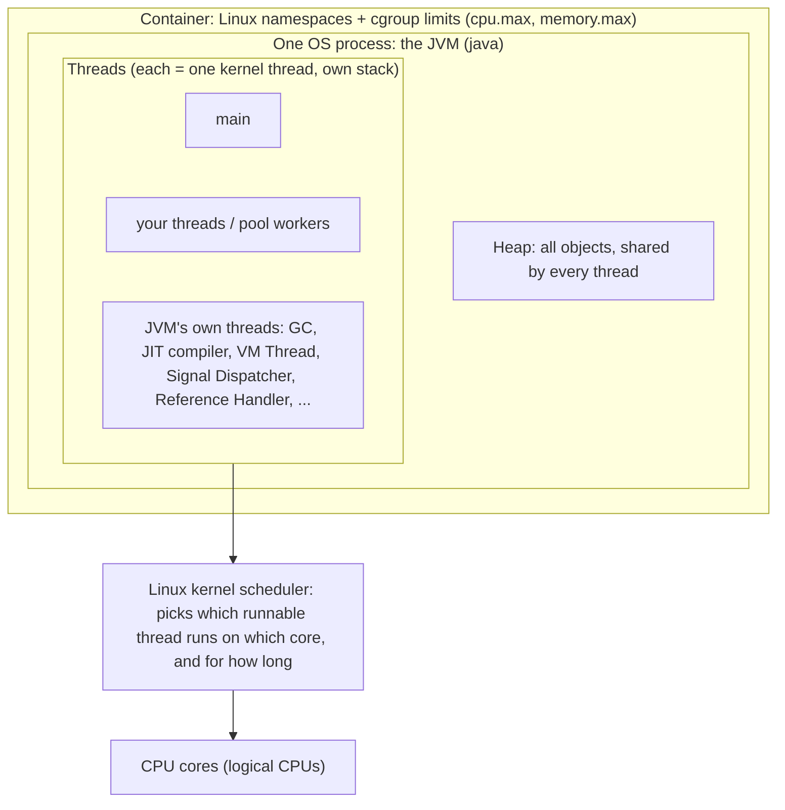
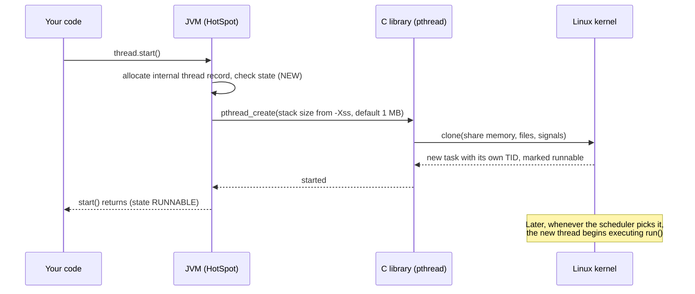

# Processes, the JVM and the OS

> [!abstract] What this is
> The layer underneath every other note in this folder: what actually runs when you type `java -jar app.jar`, who creates threads and who decides when they run, what "blocked" means to the machine, and how a container limits all of it. Java on Linux (HotSpot, the JVM nearly every production service runs); Windows and macOS follow the same model with different system calls.

---

## The Layers in One Picture



Read it bottom up:

- **CPU cores** execute instructions. A core runs one thread at a time (a hyper-threaded core exposes two logical CPUs that share one physical core).
- **The kernel** owns the cores. It keeps every thread on the machine in a list and decides which ones run. Nothing above it can force a thread onto a core.
- **The JVM is an ordinary process.** The kernel doesn't know or care that it runs Java. To the kernel it is one process with many threads, the same as a C++ server.
- **The container** is not a VM. It is that same process with a restricted view of the system (namespaces) and resource limits (cgroups).

---

## Process vs Thread, as the OS Sees Them

| | Process | Thread |
|---|---|---|
| What it is | A running program: an address space plus resources | One line of execution inside a process |
| Owns | Virtual memory (code, heap, mapped files), open files and sockets, PID, user, limits | Registers (including the instruction pointer), its own stack, a thread id, scheduling state |
| Shares with siblings | Nothing by default (separate memory) | Everything of its process: memory, files, sockets |
| Cost to create | Higher: new address space | Lower, but still a kernel object plus a stack |
| Crash impact | Other processes are unaffected | A crash in native code takes the whole process down |

- On Linux both are the same kernel object, a **task**. A process is a group of tasks that share one address space; the "process id" is the id of the first task, and each thread has its own thread id (TID). `ps -eLf` or `top -H` lists them one per line.
- The **scheduler schedules threads, not processes.** A JVM with 300 threads is 300 things competing for cores.

---

## What `java -jar app.jar` Does

1. Your shell (or the container runtime) asks the kernel to start the `java` executable. The kernel creates **one process** with one thread.
2. `java` is a small native launcher. It loads the JVM library (`libjvm.so`) into that same process and calls into it to create the virtual machine: reserve the heap, set up the garbage collector and JIT compiler, load core classes.
3. While starting, the JVM **creates its own threads** (below).
4. The launcher starts a thread to run your `main`, which loads your main class and calls `public static void main(String[])`.
5. Your code creates more threads (`new Thread(...).start()`, an executor, a web server's pool).
6. The process ends when the JVM decides to exit (see *When the JVM Exits*).

So "the JVM" at run time is **one process** containing: the heap, the loaded classes, compiled machine code, and a set of threads, some yours and some the JVM's.

### Threads the JVM runs that you never created

A thread dump of an idle "hello world" already shows a dozen or more:

| Thread name (as in a dump) | Job |
|---|---|
| `main` | Runs your `main` method |
| `GC Thread#0…`, `G1 Conc#0`, `G1 Refine#0` | Garbage collection, some during pauses, some alongside your code |
| `C2 CompilerThread0`, `C1 CompilerThread0` | The JIT: compile hot methods to machine code in the background |
| `VM Thread` | Runs operations that need every Java thread stopped (safepoints, see below) |
| `Reference Handler`, `Finalizer`, `Common-Cleaner` | Process weak/soft/phantom references and cleanup actions |
| `Signal Dispatcher` | Receives OS signals (e.g. the one that prints a thread dump) |
| `Service Thread`, `Notification Thread` | Housekeeping and monitoring events |
| `Attach Listener` | Created on demand when a tool like `jcmd` attaches |

- These compete for the same cores as your threads. The number of GC and JIT threads is derived from the CPU count the JVM sees, which is why container CPU limits matter (below).
- After `main` returns you may see a thread called `DestroyJavaVM`: it waits for the remaining non-daemon threads so the JVM can shut down.

---

## Who Creates a Thread, and Who Runs It

**Creation.** `Thread.start()` is a request that travels down the layers:



- This is the **1:1 model**: every `java.lang.Thread` (a "platform thread") is backed by exactly one kernel thread for its whole life.
- `start()` returning does **not** mean `run()` has begun. It means the kernel now has one more runnable thread to schedule.
- The stack is **virtual memory reserved** at creation (1 MB by default on 64-bit Linux) and only backed by physical memory as it's actually used. Thousands of threads still cost real memory and kernel bookkeeping, which is why we pool them ([[08 - Executors and Thread Pools]]).

**Who controls what:**

| Decision | Made by |
|---|---|
| Whether a thread exists, what code it runs | Your code (directly or through a pool or framework) |
| Mapping a Java thread to a kernel thread, the JVM's own threads, pausing everyone for GC | The JVM |
| Which runnable thread runs on which core, when, and for how long | The kernel scheduler |
| How much CPU and memory the whole process may use | The cgroup (container) limits |

- Your code **cannot** make a thread run now. `setPriority` is a hint that Linux ignores by default for Java threads; `Thread.yield()` is a hint too.
- What your code *can* do is make a thread **not runnable** (wait, sleep, block on a lock or I/O) and wake it up again (`notify`, `unpark`, releasing a lock, data arriving). All of concurrency is built from those two moves.

---

## The Scheduler: How 200 Threads Share 4 Cores

- The kernel keeps a **run queue** per core of threads that are ready to run. A core runs one thread for a short slice (a few milliseconds), then the scheduler may switch to another. Modern Linux uses a fairness-based scheduler (CFS, replaced by EEVDF from kernel 6.6): threads that have had less CPU time recently go first.
- **Preemption:** the switch can happen between *any two machine instructions*, triggered by a timer interrupt. That is the concrete reason `count++` (read, add, write) can be split by another thread ([[02 - Race Conditions and Shared State]]).
- **Context switch:** saving one thread's registers and loading another's. The direct cost is around a microsecond or a few; the indirect cost is larger, because the new thread finds the CPU caches full of the old thread's data. Thousands of switches per second per core are normal; hundreds of thousands mean too many busy threads.
- **Threads on different cores really run at the same time.** Each core has its own caches, so a write on one core isn't instantly seen by another. That is the hardware reason the Java Memory Model and `volatile` exist ([[03 - Java Memory Model]]).

### What "blocked" means to the machine

- When a thread waits (on I/O, `sleep`, `wait`, `park`, or a contended lock), the kernel takes it **off the run queue**. A waiting thread uses **no CPU**, only its memory.
- When the event happens (data arrives on the socket, the timer fires, another thread unparks it), the kernel puts it back on a run queue. It runs again when the scheduler picks it, not instantly.
- Java locks avoid the kernel when they can: an **uncontended** `synchronized` or `ReentrantLock` is a few atomic instructions in user space. Only when a thread must actually wait does the JVM ask the kernel to put it to sleep (on Linux, a `futex`).
- **Java states vs kernel states** do not match one to one:

| Java state (in a thread dump) | What the kernel sees |
|---|---|
| `RUNNABLE` running Java code | Running, or ready in a run queue waiting for a core |
| `RUNNABLE` inside a socket or file read | **Sleeping** in the kernel. Java still says RUNNABLE, because the thread is in native code. A dump full of "RUNNABLE" threads in `socketRead` is a dump of threads waiting on the network. |
| `BLOCKED`, `WAITING`, `TIMED_WAITING` | Sleeping (parked on a futex or timer) |

### Safepoints: when the JVM stops everyone

- Some JVM work needs all Java threads paused at a known point: most GC pauses, deoptimising compiled code, some diagnostics.
- The `VM Thread` requests a **safepoint**; each running Java thread stops at the next check in its code, and the operation runs. Threads already sleeping in the kernel count as stopped.
- This is the "stop-the-world" pause. From your code it looks like every thread froze for a few milliseconds at once.

---

## Cores, Threads and Pool Sizing

- `Runtime.getRuntime().availableProcessors()` is the number of CPUs **the JVM believes it may use**. Inside a container it comes from the CPU limit, not the host's core count.
- **CPU-bound work** (hashing, parsing, compression): about one thread per available CPU. More threads add context switches without adding throughput.
- **I/O-bound work** (calls to a database or another service): threads spend most time waiting off-CPU, so more threads keep the cores busy. Rule of thumb: `threads ≈ CPUs × (1 + wait time / compute time)`. A request that computes 10 ms and waits 90 ms → about 10 threads per CPU.
- The limit on I/O-bound platform threads is memory and kernel overhead, not CPU. That is the problem virtual threads solve ([[15 - Virtual Threads]]): many virtual threads are run by the JVM on a few platform "carrier" threads (by default one per available CPU). The kernel only ever sees the carriers; a virtual thread that blocks is unmounted by the JVM, and its carrier picks up another.

---

## The JVM in a Container

A container is the JVM process with two things applied by the kernel:

- **Namespaces** change what the process can **see**: its own process ids (the JVM is often PID 1), its own network interfaces, its own filesystem. They don't limit resources.
- **Cgroups** limit what the process can **use**. The two that matter:

| Limit | cgroup v2 file | Example | Effect on the JVM |
|---|---|---|---|
| CPU | `cpu.max` (quota per period) | `200000 100000` = 200 ms of CPU every 100 ms = **2 CPUs** | `availableProcessors()` returns 2, so GC, JIT, the common pool and virtual-thread carriers are sized for 2 |
| Memory | `memory.max` | `2G` | The whole process (not just the heap) must stay under it, or the kernel kills it |

### CPU: quota and throttling

- The quota is shared by **all threads of the process together**: yours, GC, JIT. It is not "2 cores reserved"; it is "2 CPUs' worth of time per 100 ms".
- If 8 threads are busy at once, they use the 200 ms of quota in about 25 ms of wall time, and then **every thread is paused** until the next 100 ms period starts. That shows up as latency spikes of tens of milliseconds even though average CPU looks fine.
- This is why oversized pools hurt more in containers, and why the JVM sizing its own threads from the limit matters.

### Memory: what counts against the limit

The kernel counts the process's whole resident memory, which is much more than `-Xmx`:

| Part | Sized by |
|---|---|
| Heap | `-Xmx`, or by default a percentage of the container limit (`-XX:MaxRAMPercentage`, default 25%) |
| Thread stacks | number of threads × stack actually used (up to `-Xss` each) |
| Metaspace | loaded classes |
| Code cache | JIT-compiled code |
| Direct buffers, native libraries | NIO, Netty, compression libraries |
| GC bookkeeping | depends on the collector and heap size |

- Exceed `memory.max` and the kernel's OOM killer ends the process with `SIGKILL`: no Java `OutOfMemoryError`, no stack trace, no shutdown hooks. Kubernetes reports it as `OOMKilled`.
- A Java `OutOfMemoryError`, by contrast, is the JVM itself refusing an allocation (heap full, too many threads, metaspace full) while the process stays alive.
- Thread count is part of this: 2,000 platform threads each touching 200 KB of stack is 400 MB outside the heap.

### Processes inside a container: subprocesses, sidecars, pods

- **A JVM can't contain processes.** It *is* one process. What looks like "more processes" is one of:
    + **Child processes** started with `ProcessBuilder` / `Runtime.exec()` (e.g. `ffmpeg`): separate OS processes with their own PID and memory. The JVM is only their parent and talks to them through pipes, files or sockets.
    + **Several JVMs**: each `java` command is its own process (a forked test JVM, the Gradle daemon).
    + **Several apps in one JVM** (old Tomcat hosting many web apps): separated by class loaders, not processes. One heap, so one leak hurts all.
- **A container isn't a process either.** It's a group of processes sharing namespaces and one cgroup. The runtime (containerd/runc) creates them and starts the entrypoint as **PID 1**; with exec-form `ENTRYPOINT ["java", ...]`, PID 1 is the JVM.
- **Every process PID 1 starts inherits the container.** `kubectl exec` / `docker exec` also adds a process (a shell) into it. So `ffmpeg` is **outside the JVM** (own memory, the heap can't see it) but **inside the container** (same filesystem, network, PID namespace, limits) and a **child of PID 1**.
- A **pod** holds several containers (the app plus a proxy or logging sidecar), each with its own cgroup, sharing one network namespace, so they reach each other on `localhost`.

```
Node (one Linux kernel)
└── Pod (shared network namespace)
    ├── Container "app"     (own cgroup)
    │   PID 1  java               ← JVM: heap + threads (main, GC, JIT, your pools)
    │    └─ PID 27  ffmpeg        ← separate process, same container, child of PID 1
    │         └─ PID 31  helper   ← if ffmpeg exits first, re-parented to PID 1
    └── Container "sidecar" (own cgroup)
        PID 1  envoy
```

What follows for a child like `ffmpeg`:

| Concern | Effect |
|---|---|
| Memory | Not in the heap, not limited by `-Xmx`, but counts toward the container's `memory.max`. Heap 1.5 GB + ffmpeg 800 MB in a 2 GB container gets OOM-killed; the kernel may pick either. |
| CPU | Draws from the same cgroup quota, so a busy child can get the JVM throttled. |
| Lifetime | Child crashes: the JVM sees an exit code from `process.waitFor()`. JVM (PID 1) exits: the container stops and the kernel kills every other process in it. |
| Signals | `SIGTERM` reaches PID 1 only. Pass it on yourself (`process.destroy()` in a shutdown hook). |
| Zombies | A parent must "reap" (collect the exit status of) its dead children. The JVM reaps those it started, but not orphans re-parented to it, which stay as zombies. Fix: a tiny init as PID 1 (`tini`, `docker run --init`) that runs the JVM, forwards signals and reaps. |

- One main process per container is a convention (restarts, health checks and signals all target PID 1), not a kernel rule.

---

## When the JVM Exits

| Trigger | What runs | Typical cause |
|---|---|---|
| Last **non-daemon** thread ends | Shutdown hooks, then exit | `main` returned and no pool is left running |
| `System.exit(n)` | Shutdown hooks, then exit | Application decided to stop |
| `SIGTERM` (or Ctrl-C = `SIGINT`) | Shutdown hooks, then exit | `docker stop`, Kubernetes pod deletion |
| `SIGKILL`, kernel OOM kill | **Nothing**: the process is gone | `kill -9`, container memory limit, grace period expired |
| Native crash | Writes an `hs_err_pid*.log` file | Bug in native code or the JVM |

- **Daemon threads** don't keep the JVM alive; when only daemons remain, the JVM exits and they stop mid-instruction, `finally` blocks not run ([[01 - Threads and Lifecycle]]).
- A forgotten non-daemon thread pool is why "my program printed everything but never exits".
- **Shutdown hooks** (`Runtime.getRuntime().addShutdownHook(thread)`) are threads the JVM starts on exit; graceful shutdown of pools and servers lives there. Kubernetes sends `SIGTERM`, waits the grace period (30 s by default), then `SIGKILL`.
- In a container, start the JVM in exec form (`ENTRYPOINT ["java", "-jar", "app.jar"]`) so it is PID 1 and receives `SIGTERM` itself. Started through `sh -c`, the shell may receive the signal and not forward it, and the JVM is killed without running its hooks.

---

## Seeing It on a Running System

- **List Java processes:** `jcmd` (no arguments) prints each JVM's PID and main class.
- **Thread dump:** `jcmd <pid> Thread.print` (or `jstack <pid>`). Each entry shows the name, Java state and `nid=0x…`, the **kernel thread id in hex**.
- **Which thread is burning CPU:** `top -H -p <pid>` shows per-thread CPU with decimal TIDs. Convert the busy one to hex and find the matching `nid` in the dump: that is the Java stack using the CPU.
- **Thread count of a process:** `ls /proc/<pid>/task | wc -l` or the `Threads:` line in `/proc/<pid>/status`.
- **Container limits as the JVM sees them:** `java -XshowSettings:system -version`, or `java -Xlog:os+container=info -version`.

---

## Interview Lines

> [!tip] Say it like this
> - "A JVM is one OS process. Every platform thread is a kernel thread, so the Linux scheduler decides when my threads run; I only decide whether they exist and when they wait."
> - "`start()` asks the JVM to create a kernel thread and returns; the new thread runs when the scheduler picks it."
> - "The JVM runs its own threads beside mine: GC, JIT compilers, the VM thread for safepoints. They share the same CPU quota."
> - "A blocked or waiting thread is off the run queue and uses no CPU, only memory. That's why I/O-bound pools can be much larger than the core count."
> - "In a container, `availableProcessors()` comes from the CPU quota and the JVM sizes GC and pools from it. If too many threads are busy, the whole process gets throttled until the next period."
> - "The memory limit covers the whole process: heap, thread stacks, metaspace, code cache and direct buffers. Exceed it and the kernel kills the JVM with no `OutOfMemoryError`."

## Related Notes

- [[01 - Threads and Lifecycle]] · [[03 - Java Memory Model]] · [[08 - Executors and Thread Pools]] · [[15 - Virtual Threads]]
- [[LLD/Concurrency/README]]
