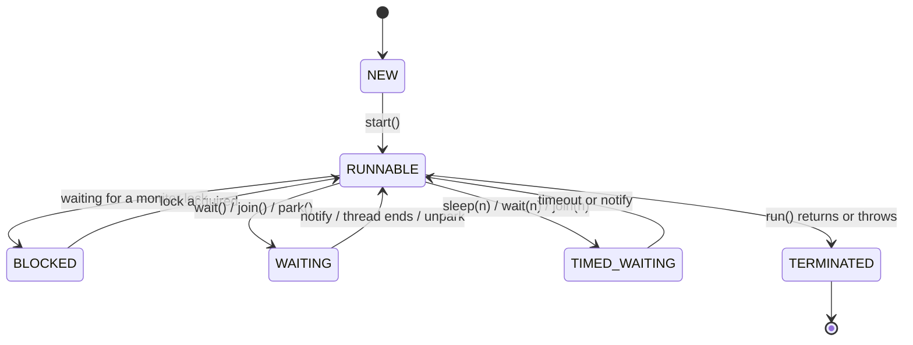

# Threads and Lifecycle

> [!abstract] What this is
> What a thread is in Java, the three ways to hand it work (`Runnable`, `Callable`, a subclass of `Thread`), the states it moves through, and how threads stop each other politely (interruption). Everything else in this folder assumes this vocabulary.
> What the JVM, the OS and the container do underneath is in [[00 - Processes the JVM and the OS]].

---

## What a Thread Is

- A **process** is a running program with its own memory; a **thread** is one line of execution inside it.
- All threads in a JVM **share the heap** (objects, static fields) but each has its **own stack** (local variables, method calls).
    + That split is the whole story of concurrency bugs: locals are private and safe; anything on the heap that two threads can reach is shared and needs care.
- The OS schedules threads onto CPU cores and can **pause any thread between any two instructions**. You never control the interleaving, so correct code must be correct under *every* interleaving.
- Classic ("platform") threads are wrappers around OS threads: about 1 MB of stack each and costly to create, which is why we pool them ([[08 - Executors and Thread Pools]]). Java 21's virtual threads change that cost ([[15 - Virtual Threads]]).

---

## Giving a Thread Work

| Way | Returns a value? | Throws checked exceptions? | Use when |
|---|---|---|---|
| **`Runnable`** (`void run()`) | No | No | Fire-and-forget work |
| **`Callable<V>`** (`V call() throws Exception`) | Yes, via a `Future<V>` | Yes | You need a result or the failure |
| **Subclass `Thread`** and override `run()` | No | No | Almost never; mixes "the work" with "the worker" |

```java
Runnable task = () -> System.out.println("hello from " + Thread.currentThread().getName());
Thread t = new Thread(task, "worker-1");   // name your threads: it shows up in dumps and logs
t.start();                                  // creates a NEW thread that calls task.run()

Callable<Integer> job = () -> 6 * 7;        // returns a value, may throw
ExecutorService pool = Executors.newFixedThreadPool(2);
Future<Integer> f = pool.submit(job);
int answer = f.get();                       // blocks until done; rethrows failure as ExecutionException
pool.shutdown();
```

- Prefer **`Runnable`/`Callable` + an executor** over `new Thread(...)` in real code. Separating the task from the thread that runs it is what lets you pool, schedule and cancel work.

### `start()` vs `run()`

- **`start()`** asks the JVM to create a new thread, which then calls `run()`.
- **Calling `run()` directly** just runs the method **on the current thread** like any other call. No concurrency happens. This is a classic interview trick question.
- `start()` can be called **once**; calling it again throws `IllegalThreadStateException`.

---

## Thread States



| State | Meaning |
|---|---|
| **NEW** | Created, `start()` not called yet |
| **RUNNABLE** | Running, or ready and waiting for a CPU (Java doesn't separate the two) |
| **BLOCKED** | Waiting to enter a `synchronized` block another thread holds |
| **WAITING** | Waiting indefinitely for another thread (`wait()`, `join()`, `LockSupport.park()`) |
| **TIMED_WAITING** | Same, with a timeout (`sleep`, `wait(ms)`, `join(ms)`) |
| **TERMINATED** | `run()` finished, normally or with an exception |

- **BLOCKED vs WAITING** is a favourite question: BLOCKED is involuntary (fighting for a `synchronized` lock); WAITING is voluntary (the thread asked to wait for a signal). A thread waiting on a `ReentrantLock` shows as WAITING, not BLOCKED, because `Lock` uses `park()` under the hood.

---

## Useful Thread Operations

- **`join()`**: the calling thread waits until the target thread finishes. `join(ms)` waits at most that long.
    + `join()` also gives you **visibility**: everything the finished thread wrote is visible after `join()` returns ([[03 - Java Memory Model]]).
- **`Thread.sleep(ms)`**: pauses the current thread. It **does not release any locks** it holds.
- **`Thread.yield()`**: a hint that the thread is willing to give up the CPU. Unreliable; never use it for correctness.
- **Daemon threads** (`t.setDaemon(true)` before `start()`): the JVM exits when only daemon threads remain, killing them mid-work with no `finally` blocks run.
    + Good for background housekeeping you don't mind losing; bad for anything that writes data.
- **Priorities** (`setPriority`): hints to the OS scheduler, often ignored. Never rely on them.
- **Uncaught exceptions**: an exception escaping `run()` kills only that thread, and by default just prints a stack trace. Set `Thread.setDefaultUncaughtExceptionHandler(...)` or handle it inside the task.
    + In a pool, an exception in a `submit()`ted task is **captured in the `Future`** and silently disappears if nobody calls `get()`. A very common "my job silently stopped" bug.

---

## Interruption: Asking a Thread to Stop

- Java has **no safe way to force-kill a thread** (`Thread.stop()` is deprecated and removed because it could leave objects half-updated with locks released).
- Instead, stopping is **cooperative**: you call `t.interrupt()`, which sets the thread's **interrupt flag**. The thread itself decides when to stop.
- What the flag does:
    + If the thread is **blocked** in `sleep`, `wait`, `join`, or a `BlockingQueue` `take`/`put`, that call throws **`InterruptedException`** and **clears the flag**.
    + If the thread is **running**, nothing happens automatically; it must check `Thread.currentThread().isInterrupted()` itself.

```java
class Worker implements Runnable {
    private final BlockingQueue<Job> queue;
    Worker(BlockingQueue<Job> queue) { this.queue = queue; }

    public void run() {
        try {
            while (!Thread.currentThread().isInterrupted()) {   // check in long loops
                Job job = queue.take();                           // blocking: throws if interrupted
                job.process();
            }
        } catch (InterruptedException e) {
            Thread.currentThread().interrupt();                   // restore the flag, then exit
        } finally {
            cleanup();
        }
    }
    private void cleanup() { /* release resources */ }
}
```

### The one rule about `InterruptedException`

> [!warning] Never swallow it
> Catching `InterruptedException` and doing nothing erases the stop request, because throwing it **cleared the flag**. Either:
> - **rethrow it** (declare `throws InterruptedException`) so the caller decides, or
> - **restore the flag** with `Thread.currentThread().interrupt()` and return/exit.
>
> An empty `catch (InterruptedException e) {}` is the single most common concurrency smell in interview code.

- `Thread.interrupted()` (static) **reads and clears** the flag; `isInterrupted()` (instance) only reads it. Mixing them up loses interrupts.
- Executors use interruption for cancellation: `future.cancel(true)` and `pool.shutdownNow()` interrupt running tasks. Tasks that ignore the flag can't be cancelled.

---

## Interview Lines

> [!tip] Say it like this
> - "Threads share the heap and have their own stacks, so locals are safe and anything reachable from two threads needs a guarding strategy."
> - "`run()` is just a method call; `start()` is what creates a thread."
> - "BLOCKED means waiting for a `synchronized` monitor; WAITING means the thread chose to wait for a signal."
> - "Stopping is cooperative: interrupt sets a flag, blocking calls throw `InterruptedException`, and I either rethrow it or restore the flag. I never swallow it."
> - "In real code I submit `Runnable`/`Callable` tasks to an executor rather than creating threads by hand."

## Related Notes

- [[02 - Race Conditions and Shared State]] · [[08 - Executors and Thread Pools]] · [[15 - Virtual Threads]]
- [[LLD/Concurrency/README]]
