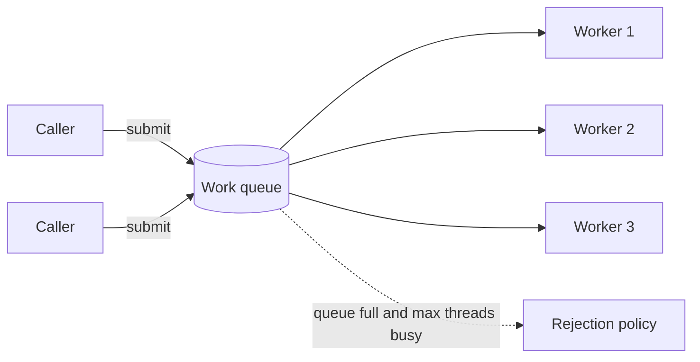

# Executors and Thread Pools

> [!abstract] What this is
> How Java separates **tasks** from the **threads that run them**: `ExecutorService`, the factory pools and their traps, the seven parameters of `ThreadPoolExecutor`, rejection policies, `Future` and cancellation, shutting down properly, and sizing a pool. A thread pool is also an LLD problem in its own right ([[19 - Classic Problems - Components]]).

---

## Why Pools

- Creating a platform thread costs an OS thread and about 1 MB of stack. One thread per task falls over under load.
- A pool keeps a **fixed set of worker threads** pulling tasks from a **queue**: bounded concurrency, reused threads, and one place to control shutdown, naming and error handling.
- Shape: **producers** submit tasks → **work queue** → **workers** run them. It's producer-consumer with `Runnable`s as the items.



---

## The Interfaces

| Type | Gives you |
|---|---|
| `Executor` | `execute(Runnable)` only |
| `ExecutorService` | `submit` (returns `Future`), `invokeAll`, `invokeAny`, `shutdown`, `awaitTermination` |
| `ScheduledExecutorService` | `schedule`, `scheduleAtFixedRate`, `scheduleWithFixedDelay` |

```java
ExecutorService pool = Executors.newFixedThreadPool(4);
Future<Report> f = pool.submit(() -> buildReport(id));   // Callable
try {
    Report r = f.get(2, TimeUnit.SECONDS);                // wait with a timeout
} catch (TimeoutException e) {
    f.cancel(true);                                       // interrupt the running task
} catch (ExecutionException e) {
    Throwable cause = e.getCause();                       // the task's real exception
}
```

### `execute` vs `submit`

- `execute(runnable)`: an exception thrown by the task goes to the thread's **uncaught exception handler** (printed by default).
- `submit(...)`: the exception is **captured in the `Future`**; if nobody calls `get()`, it vanishes silently. Either call `get()`, wrap tasks to log failures, or use `execute` for fire-and-forget.

---

## The Factory Pools and Their Traps

| Factory | What it builds | Trap |
|---|---|---|
| `newFixedThreadPool(n)` | n threads, **unbounded** `LinkedBlockingQueue` | Under overload the queue grows forever → memory and latency explode |
| `newCachedThreadPool()` | 0..∞ threads, `SynchronousQueue`, idle threads die after 60 s | A burst creates **thousands of threads** |
| `newSingleThreadExecutor()` | One thread, unbounded queue | Serial execution; same unbounded queue |
| `newScheduledThreadPool(n)` | Delayed / periodic tasks | A task that throws **stops its future runs silently** |
| `newWorkStealingPool()` | `ForkJoinPool` | For many small CPU tasks ([[14 - Fork Join and Parallel Streams]]) |
| `newVirtualThreadPerTaskExecutor()` (21+) | One virtual thread per task | Unbounded concurrency, so limit downstream access with a semaphore ([[15 - Virtual Threads]]) |

- For production-style code (and interview code where it matters), **build a `ThreadPoolExecutor` directly** with a bounded queue and a chosen rejection policy.

---

## `ThreadPoolExecutor` Parameters

```java
ThreadPoolExecutor pool = new ThreadPoolExecutor(
        4,                                    // corePoolSize
        8,                                    // maximumPoolSize
        30, TimeUnit.SECONDS,                 // keepAliveTime for threads above core
        new ArrayBlockingQueue<>(100),        // bounded work queue
        new NamedThreadFactory("report"),     // thread names, daemon flag, handler
        new ThreadPoolExecutor.CallerRunsPolicy()); // what to do when saturated
```

### How a submitted task is placed (the non-obvious order)

1. Fewer than **core** threads running → **start a new thread** for it.
2. Otherwise → **put it in the queue**.
3. Queue full and fewer than **max** threads → **start a new thread**.
4. Queue full and at max → **reject** it.

- So extra threads above core are created only **after the queue is full**. With an unbounded queue, `maximumPoolSize` is never used. A very common misunderstanding.

### Rejection policies

| Policy | Does | Pick when |
|---|---|---|
| `AbortPolicy` (default) | Throws `RejectedExecutionException` | Caller must know and handle overload |
| `CallerRunsPolicy` | Runs the task on the **submitting** thread | Natural backpressure: the producer slows itself down |
| `DiscardPolicy` | Drops it silently | Losing tasks is fine (rarely) |
| `DiscardOldestPolicy` | Drops the oldest queued task, retries | Only the latest matters (e.g. UI refresh) |
| Custom | Log, meter, push to a fallback | Real systems |

### Thread factory

- Name threads (`report-worker-3`) so thread dumps and logs make sense; set an uncaught exception handler; decide daemon or not.

---

## Shutting Down

```java
pool.shutdown();                                   // stop accepting; finish queued tasks
try {
    if (!pool.awaitTermination(30, TimeUnit.SECONDS)) {
        List<Runnable> dropped = pool.shutdownNow(); // interrupt running tasks, drain queue
        if (!pool.awaitTermination(10, TimeUnit.SECONDS)) log.warn("pool did not stop");
    }
} catch (InterruptedException e) {
    pool.shutdownNow();
    Thread.currentThread().interrupt();
}
```

- `shutdown()` is graceful; `shutdownNow()` interrupts running tasks (which only stop if they honour interruption, see [[01 - Threads and Lifecycle]]) and returns the never-started ones.
- A pool of non-daemon threads that's never shut down **keeps the JVM alive**.
- Since Java 19, `ExecutorService` is `AutoCloseable`: `try (var pool = Executors.newFixedThreadPool(4)) { ... }` waits for tasks on close.

---

## Scheduling

| Method | Timing | Watch out |
|---|---|---|
| `schedule(task, delay)` | Once, after a delay | |
| `scheduleAtFixedRate(task, init, period)` | Start-to-start every `period` | If a run takes longer than `period`, runs bunch up (never overlap) |
| `scheduleWithFixedDelay(task, init, delay)` | End-to-start gap of `delay` | Usually what you want for polling |

- **Catch everything inside periodic tasks.** An exception escaping one run cancels all future runs with no log unless you check the `ScheduledFuture`.

---

## Sizing a Pool

| Workload | Rule of thumb |
|---|---|
| **CPU-bound** (compute, parsing) | ≈ number of cores (`Runtime.getRuntime().availableProcessors()`), maybe + 1 |
| **I/O-bound** (DB, HTTP calls) | cores × (1 + wait time / compute time). With 50 ms waiting per 5 ms of work on 8 cores: 8 × 11 ≈ 88 |
| **Little's law check** | threads needed ≈ arrival rate × time per task. 200 tasks/s × 0.1 s = 20 threads busy on average |

- More threads than the bottleneck can serve just moves the queue. If the DB pool has 20 connections, 200 request threads only makes 180 of them wait.
- **Separate pools per kind of work** (bulkheads): a slow external call shouldn't starve fast tasks. Never run blocking calls on a pool meant for CPU work, such as `ForkJoinPool.commonPool()`.
- **Thread-pool deadlock**: tasks that submit sub-tasks to the **same bounded pool** and wait for them can deadlock once every thread is waiting. Use a different pool, or don't block on sub-tasks.

---

## Interview Lines

> [!tip] Say it like this
> - "I'd build a `ThreadPoolExecutor` with a bounded queue and `CallerRunsPolicy`, because the factory fixed pool has an unbounded queue."
> - "Threads beyond core are only created once the queue is full, so with an unbounded queue max size is meaningless."
> - "`submit` captures exceptions in the `Future`; if nobody calls `get` the failure disappears."
> - "CPU-bound pools are about the core count; I/O-bound pools are larger, sized by wait-to-compute ratio, but capped by whatever downstream resource is scarcest."
> - "Shutdown is `shutdown`, `awaitTermination`, then `shutdownNow`, and tasks must honour interruption to actually stop."

## Related Notes

- [[01 - Threads and Lifecycle]] · [[07 - Concurrent Collections]] · [[11 - CompletableFuture]] · [[19 - Classic Problems - Components]]
- [[LLD/Concurrency/README]]
