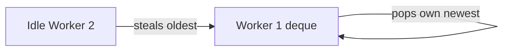

# Fork/Join and Parallel Streams

> [!abstract] What this is
> Java's tools for **splitting one big CPU-bound job** across cores: the `ForkJoinPool` with its work-stealing scheduler, `RecursiveTask` for divide-and-conquer, and parallel streams built on top of it. Knowing when they help, and the common ways they hurt, matters more than the API.

---

## Divide and Conquer on Threads

- Some jobs split naturally: sum an array, sort a list, process a tree. Split the job until pieces are small, solve pieces in parallel, combine results.
- A normal thread pool handles this badly: a task that waits for its subtasks **blocks a pool thread**, and with enough nesting the pool deadlocks waiting on itself.
- `ForkJoinPool` is built for it: a waiting task helps run other work instead of blocking.

---

## Work Stealing

- Each worker thread has its own **double-ended queue** of tasks.
    + A worker pushes subtasks it forks onto **its own** deque and pops from the same end (LIFO, cache-friendly).
    + An idle worker **steals** from the **other end** of a busy worker's deque (the oldest, usually biggest tasks).
- Result: load balances itself without a central queue, and little contention.



---

## `RecursiveTask`

```java
class SumTask extends RecursiveTask<Long> {
    private static final int THRESHOLD = 10_000;
    private final long[] arr; private final int lo, hi;

    SumTask(long[] arr, int lo, int hi) { this.arr = arr; this.lo = lo; this.hi = hi; }

    @Override protected Long compute() {
        if (hi - lo <= THRESHOLD) {                  // small enough: do it directly
            long s = 0;
            for (int i = lo; i < hi; i++) s += arr[i];
            return s;
        }
        int mid = (lo + hi) >>> 1;
        SumTask left = new SumTask(arr, lo, mid);
        left.fork();                                 // run left asynchronously
        long right = new SumTask(arr, mid, hi).compute();   // do right in this thread
        return right + left.join();                  // wait for left (helps run tasks meanwhile)
    }
}

long total = ForkJoinPool.commonPool().invoke(new SumTask(data, 0, data.length));
```

- **`RecursiveTask<V>`** returns a value; **`RecursiveAction`** returns nothing.
- Fork one half, **compute the other in the current thread**, then join. Forking both and joining both wastes the current thread.
- The **threshold** matters: too small and task overhead dominates; too big and cores sit idle. Thousands of elements per leaf is a typical start.

---

## Parallel Streams

- `list.parallelStream()` or `.parallel()` splits the stream with a **`Spliterator`** and runs it on the **common `ForkJoinPool`** (size ≈ number of cores − 1).

```java
long count = orders.parallelStream()
        .filter(o -> o.total() > 1000)
        .count();
```

### When they help

- **CPU-bound** work per element, a **large** number of elements (tens of thousands+), a source that **splits well** (`ArrayList`, arrays, `IntStream.range`), and **stateless, independent** operations.

### When they hurt

| Problem | Why |
|---|---|
| **Blocking I/O inside** (HTTP calls, DB queries) | Ties up the shared common pool, starving every other parallel stream and `CompletableFuture` default in the JVM |
| **Small collections** | Splitting and merging costs more than the work |
| **Poor splitting sources** (`LinkedList`, `Stream.iterate`, I/O streams) | Can't divide evenly |
| **Shared mutable state** in lambdas (`list.add` from `forEach`) | Data races; use `collect` instead |
| **Order-dependent operations** (`findFirst`, `limit`, `sorted`, `forEachOrdered`) | Ordering forces coordination |
| **Boxing** (`Stream<Integer>`) | Allocation dominates; use `IntStream`/`LongStream` |

```java
// Wrong: race on a shared ArrayList
List<Order> big = new ArrayList<>();
orders.parallelStream().filter(Order::isBig).forEach(big::add);

// Right: let the stream combine per-thread results
List<Order> big = orders.parallelStream().filter(Order::isBig).toList();
```

- Measure before and after. The default answer in interviews is "sequential unless I've measured a large CPU-bound workload".
- To keep a parallel stream off the common pool, run it from inside your own pool: `myForkJoinPool.submit(() -> list.parallelStream()...).get()` (works, but relies on implementation behaviour).

---

## The Common Pool Trap

- `ForkJoinPool.commonPool()` is **shared by the whole JVM**: parallel streams, `CompletableFuture.supplyAsync` without an executor, and anything else using it.
- One slow or blocking user starves all the others. For I/O or blocking tasks, always pass a **dedicated executor** ([[08 - Executors and Thread Pools]], [[11 - CompletableFuture]]).

---

## Interview Lines

> [!tip] Say it like this
> - "Fork/join is for splitting a big CPU-bound job; work stealing keeps every core busy without a central queue."
> - "I fork one half and compute the other in the current thread, with a threshold to stop splitting."
> - "Parallel streams only pay off for large, CPU-bound, stateless work on a source that splits well."
> - "I never block inside a parallel stream, because it runs on the JVM-wide common pool."
> - "Collect results instead of adding to a shared list from `forEach`."

## Related Notes

- [[08 - Executors and Thread Pools]] · [[11 - CompletableFuture]] · [[15 - Virtual Threads]]
- [[LLD/Concurrency/README]]
