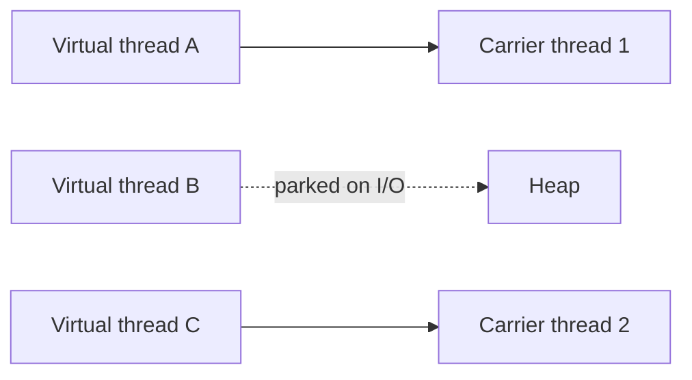

# Virtual Threads

> [!abstract] What this is
> Java 21's lightweight threads: millions of cheap threads scheduled by the JVM onto a few OS threads, so plain **blocking, thread-per-request code scales** again. They change the cost of waiting, not the rules of shared state: locks, races and visibility all still apply.

---

## Why They Exist

- A normal **platform thread** is a wrapper around an OS thread: about 1 MB of stack reserved and an OS scheduler entry. A few thousand is the practical limit ([[01 - Threads and Lifecycle]]).
- Servers spend most of their time **waiting** on I/O. With one platform thread per request, 10,000 concurrent slow requests need 10,000 OS threads, so people moved to thread pools and async callbacks (`CompletableFuture`, reactive), which are harder to write and debug.
- **Virtual threads** make a blocked thread cheap: when one blocks on I/O, the JVM **unmounts** it from its OS carrier thread and runs another. You write simple blocking code; the JVM gets async-level scalability.

---

## How They Work



- Virtual threads run on a small pool of **carrier** (platform) threads, a `ForkJoinPool` sized to the core count.
- When a virtual thread blocks (socket read, `sleep`, `BlockingQueue.take`, `Lock.lock`), its stack is saved to the heap and the carrier picks up another virtual thread. When the I/O completes, it's rescheduled, possibly on a different carrier.
- Stacks start small and grow, so millions of virtual threads fit in memory.

```java
// One virtual thread per task: the executor never runs out of threads
try (ExecutorService exec = Executors.newVirtualThreadPerTaskExecutor()) {
    for (Request r : requests) {
        exec.submit(() -> handle(r));      // blocking calls inside are fine
    }
}   // close() waits for all tasks

Thread.startVirtualThread(() -> doWork());
Thread.ofVirtual().name("worker-", 0).start(task);
```

---

## What Changes and What Doesn't

| Changes | Doesn't change |
|---|---|
| Blocking is cheap; thread-per-request is the simple, scalable default again | Shared mutable state still needs locks, atomics or confinement |
| **Don't pool** virtual threads; create one per task | Races, deadlocks and visibility rules ([[03 - Java Memory Model]]) are identical |
| Thread count stops being the capacity limit | Downstream capacity is still limited: the DB still has ~100 connections |
| Async code written only to avoid blocking threads becomes unnecessary | CPU-bound work gets no faster; there are still only N cores |

---

## The Gotchas

### Unlimited concurrency hits the next bottleneck

- With a fixed pool of 200 threads, at most 200 requests hit the database at once. With virtual threads, 50,000 can. Limit access to scarce resources with a **`Semaphore`** or a bounded connection pool, not with a thread pool ([[10 - Synchronizers]]).

### Pinning

- A virtual thread is **pinned** to its carrier (can't unmount while blocked) when it blocks:
    + inside a **`synchronized`** block or method (in JDK 21–23; fixed in **JDK 24**), or
    + inside a **native** method or foreign call.
- A pinned virtual thread blocks its carrier, and with few carriers, throughput collapses. On older JDKs, prefer **`ReentrantLock`** around blocking calls in hot paths ([[04 - synchronized and Monitors]]). Diagnose with `-Djdk.tracePinnedThreads=full` (older JDKs) or JFR pinning events.

### `ThreadLocal` at scale

- Every virtual thread gets its own copy of every `ThreadLocal`. Caching a heavy object per thread (a parser, a buffer) was cheap with 200 pool threads and is expensive with a million virtual threads.
- **`ScopedValue`** (preview → final in recent JDKs) is the replacement for passing immutable request context down a call tree ([[12 - Confinement and Immutability]]).

### CPU-bound work

- Virtual threads only help with waiting. For CPU-bound work, use a platform-thread pool sized to the cores, or fork/join ([[14 - Fork Join and Parallel Streams]]).

---

## Structured Concurrency (Preview)

- `StructuredTaskScope` treats a group of subtasks as one unit: fork several, join them together, and if one fails the others are **cancelled** automatically. No leaked threads, clear error handling.

```java
try (var scope = new StructuredTaskScope.ShutdownOnFailure()) {
    Subtask<User>   user   = scope.fork(() -> userService.find(id));
    Subtask<Orders> orders = scope.fork(() -> orderService.forUser(id));
    scope.join().throwIfFailed();          // wait for both; propagate first failure
    return new Profile(user.get(), orders.get());
}
```

- The API has changed across previews; know the idea (fan out, join together, cancel on failure) rather than the exact signatures.

---

## When to Use Them

| Workload | Use |
|---|---|
| Many concurrent **I/O-bound** tasks (HTTP handlers, calls to other services, DB queries) | Virtual threads |
| **CPU-bound** computation | Platform pool sized to cores, or fork/join |
| Need to cap access to a resource | Virtual threads + `Semaphore` / bounded pool |
| Existing reactive code that works | No need to rewrite |

---

## Interview Lines

> [!tip] Say it like this
> - "Virtual threads make blocking cheap, so simple thread-per-request code scales; they don't make shared state safe."
> - "I don't pool virtual threads; I create one per task and cap the scarce resource with a semaphore."
> - "Blocking inside `synchronized` pinned the carrier before JDK 24, so I'd use `ReentrantLock` around blocking calls on older JDKs."
> - "They help I/O-bound work only; CPU-bound work still needs a pool sized to the cores."

## Related Notes

- [[01 - Threads and Lifecycle]] · [[08 - Executors and Thread Pools]] · [[10 - Synchronizers]] · [[11 - CompletableFuture]]
- [[LLD/Concurrency/README]]
