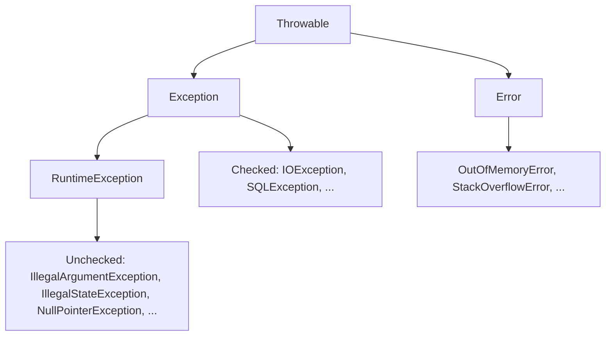

# Exception Handling

> [!abstract] What this is
> How Java's exception hierarchy works, when to use checked vs unchecked exceptions, how to design a domain exception hierarchy, and the rules (wrap with a cause, close resources, don't swallow, don't use exceptions for flow) that make failure paths in LLD code look deliberate instead of accidental.

---

## The Hierarchy



- **`Throwable`** is the root of everything that can be thrown.
- **`Error`**: problems the JVM itself has (out of memory, stack overflow, class loading). Applications should **not** catch these, except perhaps at the very top to log and exit.
- **`Exception`**: problems a program might handle.
    + **Checked** exceptions (everything under `Exception` except `RuntimeException`): the compiler **forces** callers to catch them or declare `throws`.
    + **Unchecked** exceptions (`RuntimeException` and subclasses): no compiler enforcement.

---

## Checked or Unchecked?

- The usual rule: **checked** for conditions a reasonable caller can **recover** from and should be forced to think about; **unchecked** for **programming errors** and for failures the immediate caller can't do anything about.

| Situation | Kind | Example |
|---|---|---|
| Caller passed bad input (a bug in the caller) | Unchecked | `IllegalArgumentException("quantity must be > 0")` |
| Object in the wrong state for the call | Unchecked | `IllegalStateException("order already shipped")` |
| Business rule rejection the caller must handle | Either; often a domain unchecked exception, or a result type | `SeatUnavailableException` |
| External, recoverable failure close to the I/O | Checked at the boundary | `IOException` from a file read |
| Infrastructure failure deep in the stack that only the top level handles | Unchecked (wrap the checked one) | `RepositoryException` wrapping `SQLException` |

- Modern Java code (Spring, most libraries) leans **unchecked**: checked exceptions don't compose with lambdas and streams, and they leak implementation details through every `throws` clause.
- Whatever you choose, be consistent and say why: "Validation and state errors are unchecked; I translate checked I/O exceptions into my own unchecked ones at the boundary."

### Standard exceptions worth reusing

| Exception | Meaning |
|---|---|
| `IllegalArgumentException` | An argument is invalid |
| `IllegalStateException` | The object isn't in a state where this call makes sense |
| `NullPointerException` | A required value was null (from `Objects.requireNonNull`) |
| `UnsupportedOperationException` | This implementation doesn't support the operation |
| `IndexOutOfBoundsException` | Index outside the valid range |
| `ConcurrentModificationException` | Collection changed during iteration |

- Reuse these before inventing your own for generic problems; invent domain exceptions for **domain** failures.

---

## Designing a Domain Exception Hierarchy

- One base exception per module or bounded context, with specific subclasses for failures callers handle differently. Carry the data needed to react, not just a message.

```java
public class BookingException extends RuntimeException {
    public BookingException(String message) { super(message); }
    public BookingException(String message, Throwable cause) { super(message, cause); }
}

public class SeatUnavailableException extends BookingException {
    private final String seatId;
    public SeatUnavailableException(String seatId) {
        super("Seat " + seatId + " is not available");
        this.seatId = seatId;
    }
    public String seatId() { return seatId; }
}

public class PaymentDeclinedException extends BookingException {
    private final String reasonCode;
    public PaymentDeclinedException(String reasonCode) {
        super("Payment declined: " + reasonCode);
        this.reasonCode = reasonCode;
    }
    public String reasonCode() { return reasonCode; }
}
```

- Callers can catch the **specific** type they handle (`SeatUnavailableException` → suggest other seats) or the **base** type for "any booking failure".
- At the API layer, map exceptions to responses in one place (a controller advice / error mapper): `SeatUnavailableException` → 409, validation → 400, unexpected → 500 with a correlation id.
- Don't create an exception class per method or per message; create one per **distinct way of reacting**.

---

## The Rules

### Never lose the cause

```java
try {
    repository.save(order);
} catch (SQLException e) {
    throw new RepositoryException("failed to save order " + order.id(), e);   // keep e as the cause
}
```

- Wrapping **without** the cause (`new RepositoryException(e.getMessage())`) throws away the original stack trace; debugging becomes guesswork.

### Don't swallow exceptions

```java
try { send(email); } catch (Exception e) { }          // the failure vanishes silently
```

- If you catch, you must **handle** (retry, fallback, translate, or log *and* deliberately continue). An empty catch block needs a comment explaining why ignoring is correct.

### Catch narrowly, at the right level

- Catch the specific exceptions you can do something about, **where** you can do something about them. Let the rest propagate.
- Don't catch `Exception` or `Throwable` in the middle of business logic; it also catches bugs (`NullPointerException`) you'd rather see. Catching broadly is fine at **top-level boundaries**: the request handler, a worker loop, a scheduled task, so one failure doesn't kill the thread.
- Don't **log and rethrow** at every layer: the same failure ends up in the logs five times. Either handle it, or wrap and rethrow, and log once where it's finally handled.

### Fail fast at the boundaries

- Validate arguments at the start of public methods and constructors, so bad data is rejected where it enters, not three layers deeper.

```java
public Booking(String showId, List<String> seatIds) {
    this.showId = Objects.requireNonNull(showId, "showId");
    if (seatIds.isEmpty()) throw new IllegalArgumentException("at least one seat required");
    this.seatIds = List.copyOf(seatIds);
}
```

### Don't use exceptions for control flow

- Exceptions are for **exceptional** paths. Throwing to signal "not found" in a hot loop is slow (building stack traces) and hides intent. Use `Optional`, a boolean, or a result type for expected outcomes ([[08 - API and Method Design]]).

### Keep messages useful

- Include the identifiers needed to diagnose (`order 42`, `seat A7`), never secrets or personal data.

---

## Resources: try-with-resources

- Anything implementing **`AutoCloseable`** (streams, connections, locks you wrap, your own resources) can be declared in a `try` header and is **closed automatically**, in reverse order, even if the body throws.

```java
try (Connection conn = dataSource.getConnection();
     PreparedStatement ps = conn.prepareStatement(SQL)) {
    ps.setString(1, id);
    return mapRow(ps.executeQuery());
}   // ps.close(), then conn.close(), always
```

### Suppressed exceptions

- If the body throws **and** `close()` also throws, the body's exception is the one propagated, and the close failure is attached to it as a **suppressed** exception (`e.getSuppressed()`). Nothing is lost, unlike the old `finally` approach where a close failure could replace the real error.

### Making your own resources closeable

```java
public final class PooledConnection implements AutoCloseable {
    private final Connection delegate;
    private final Pool<Connection> pool;
    PooledConnection(Connection c, Pool<Connection> p) { delegate = c; pool = p; }
    @Override public void close() { pool.release(delegate); }     // "close" returns it to the pool
}
```

- This turns "remember to release" into something the language guarantees ([[LLD/Concurrency/19 - Classic Problems - Components]]).

---

## `finally` Pitfalls

- `finally` runs whether the `try` succeeds, throws, or returns. Use it for cleanup that isn't an `AutoCloseable` (unlocking a lock, counting down a latch).

> [!danger] Never `return` or `throw` from `finally`
> ```java
> try {
>     throw new IllegalStateException("real problem");
> } finally {
>     return -1;          // silently discards the exception
> }
> ```
> A `return` (or a new exception) in `finally` **replaces** whatever the `try` threw or returned.

- Exceptions thrown inside `finally` cleanup code can likewise mask the original error; prefer try-with-resources.

---

## Exceptions and Concurrency

- **`InterruptedException`**: never swallow it. Either propagate it, or restore the interrupt flag with `Thread.currentThread().interrupt()` so code higher up knows to stop ([[LLD/Concurrency/01 - Threads and Lifecycle]]).
- **Executors**: an exception in a `submit`ted task is captured in the `Future` and only surfaces from `get()` as an `ExecutionException` (cause = the real exception). With `execute`, it goes to the thread's uncaught handler. A periodic scheduled task that throws **stops running** silently ([[LLD/Concurrency/08 - Executors and Thread Pools]]).
- **`CompletableFuture`**: exceptions travel down the chain wrapped in `CompletionException`; handle them with `exceptionally` or `handle` ([[LLD/Concurrency/11 - CompletableFuture]]).
- **Worker loops** catch `RuntimeException` per task so one bad task doesn't kill the worker thread.

---

## Alternatives to Throwing

| Option | Pick when |
|---|---|
| **`Optional<T>`** return | "Not found" is a normal outcome (`findById`) |
| **Result / Either type** (sealed interface `Success` / `Failure`) | Several expected failure kinds the caller must branch on, and you want the compiler to force handling |
| **Boolean / status return** | Simple yes/no (`tryAcquire`, `offer`) |
| **Exception** | The failure is unexpected, or the immediate caller can't handle it |

```java
sealed interface BookingResult permits Booked, Unavailable, Declined {}
record Booked(String bookingId) implements BookingResult {}
record Unavailable(List<String> seats) implements BookingResult {}
record Declined(String reason) implements BookingResult {}

switch (service.book(request)) {            // exhaustive: compiler checks every case
    case Booked b      -> confirm(b.bookingId());
    case Unavailable u -> suggestAlternatives(u.seats());
    case Declined d    -> showPaymentError(d.reason());
}
```

---

## Interview Lines

> [!tip] Say it like this
> - "Programming errors and invalid state are unchecked; I translate checked infrastructure exceptions at the boundary and always keep the cause."
> - "I have one base exception per module and a subclass for each failure a caller reacts to differently."
> - "Resources go in try-with-resources, so they close even when the body throws, and close failures become suppressed, not lost."
> - "I catch broadly only at top-level boundaries like a request handler or worker loop, and I never swallow `InterruptedException`."
> - "Expected outcomes like 'not found' are an `Optional` or a result type, not an exception."

## Related Notes

- [[08 - API and Method Design]] · [[10 - Logging and Observability]] · [[11 - Idempotency and Retries]]
- [[LLD/Foundations/README]]
