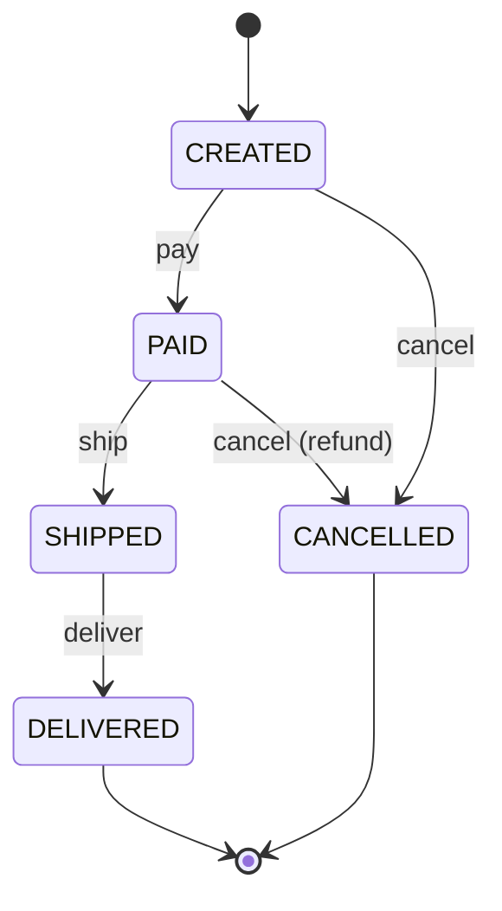

# Enums and State Machines

> [!abstract] What this is
> Half of LLD problems are state machines in disguise: orders, elevators, vending machines, parking spots, payments, tickets. This note covers Java enums with behaviour, modelling allowed transitions so illegal ones are impossible, `EnumMap`/`EnumSet`, and when to move from an enum to the State pattern.

---

## Enums Are Classes

- A Java `enum` is a full class with a fixed set of instances: it can have fields, constructors, methods, and even per-constant behaviour.

```java
public enum VehicleType {
    BIKE(1), CAR(2), TRUCK(4);

    private final int spotUnits;
    VehicleType(int spotUnits) { this.spotUnits = spotUnits; }
    public int spotUnits() { return spotUnits; }
}
```

- Use enums for **closed sets** known at compile time (vehicle types, directions, statuses). If new values arrive at runtime or from configuration, use a class or table instead.
- Enum constants are singletons: compare with `==`, use them in `switch`, and they're safe as map keys.

### Per-constant behaviour

```java
public enum Operation {
    ADD      { long apply(long a, long b) { return a + b; } },
    MULTIPLY { long apply(long a, long b) { return a * b; } };

    abstract long apply(long a, long b);
}
```

- This replaces a `switch` on a type code with polymorphism. For larger behaviour, give each constant a strategy object instead of a body ([[Strategy]]).

---

## Modelling a State Machine

- Every state machine needs three things written down: the **states**, the **events**, and the **allowed transitions**. Anything not allowed must be rejected.



### Option 1: the enum knows its allowed transitions

```java
public enum OrderStatus {
    CREATED, PAID, SHIPPED, DELIVERED, CANCELLED;

    private static final Map<OrderStatus, Set<OrderStatus>> ALLOWED = new EnumMap<>(OrderStatus.class);
    static {
        ALLOWED.put(CREATED,   EnumSet.of(PAID, CANCELLED));
        ALLOWED.put(PAID,      EnumSet.of(SHIPPED, CANCELLED));
        ALLOWED.put(SHIPPED,   EnumSet.of(DELIVERED));
        ALLOWED.put(DELIVERED, EnumSet.noneOf(OrderStatus.class));
        ALLOWED.put(CANCELLED, EnumSet.noneOf(OrderStatus.class));
    }

    public boolean canMoveTo(OrderStatus next) { return ALLOWED.get(this).contains(next); }
}

public final class Order {
    private OrderStatus status = OrderStatus.CREATED;

    public void ship() { transitionTo(OrderStatus.SHIPPED); }
    public void cancel() { transitionTo(OrderStatus.CANCELLED); }

    private void transitionTo(OrderStatus next) {
        if (!status.canMoveTo(next))
            throw new IllegalStateException("cannot move order " + id + " from " + status + " to " + next);
        status = next;
    }
}
```

- The transition table lives in **one place**, illegal moves fail loudly, and the entity exposes **events** (`ship()`, `cancel()`), not a `setStatus()`.

### Option 2: the State pattern

- When each state has substantial, different **behaviour** (a vending machine responds to "insert coin" differently in `Idle`, `HasCoin`, `Dispensing`), give each state its own class implementing a common interface, and let the context delegate to the current state.

```java
interface VendingState {
    VendingState insertCoin(VendingMachine m, Money coin);
    VendingState select(VendingMachine m, String item);
}
```

| Approach | Pick when |
|---|---|
| **Enum + transition table** | States mostly differ in *which moves are allowed*; the behaviour lives in the entity |
| **Enum with per-constant methods** | Small amounts of per-state behaviour |
| **State pattern** (class per state) | Each state behaves very differently, or states have their own data |

---

## `EnumMap` and `EnumSet`

- **`EnumMap<K, V>`**: a map keyed by an enum, backed by an array. Faster and more compact than `HashMap`, iterates in declaration order. Use it for per-type configuration (`EnumMap<VehicleType, PricingStrategy>`) or counts (`EnumMap<SpotType, Integer>`).
- **`EnumSet`**: a set of enum values backed by a bit vector. Use it for flags and allowed-transition sets (`EnumSet.of(PAID, CANCELLED)`), instead of bit-mask integers.

---

## State Machines and Concurrency

- Two threads firing events on the same object at once (two cancel requests, a ship and a cancel) must not both pass the "is this allowed?" check. Make the check-and-transition atomic:
    + In memory: lock the aggregate, or `AtomicReference<Status>.compareAndSet(expected, next)` ([[LLD/Concurrency/06 - Atomics and CAS]]).
    + In a database: `UPDATE orders SET status = 'SHIPPED' WHERE id = ? AND status = 'PAID'` and check the row count.
- Persisted enums: store the **name** (`"PAID"`), not the **ordinal** (`2`); reordering or inserting constants would silently change the meaning of stored ordinals.

---

## Interview Lines

> [!tip] Say it like this
> - "This is a state machine: I list the states, the events and the allowed transitions, and reject everything else."
> - "The transition table lives in the enum; the entity exposes events like `ship()`, never `setStatus()`."
> - "If states behave very differently I switch to the State pattern."
> - "I use `EnumMap` and `EnumSet` for per-type config and allowed-transition sets."
> - "Concurrent events use a compare-and-set on the status, in memory or in the `WHERE` clause."

## Related Notes

- [[03 - Object Modelling]] · [[02 - Immutability and Value Objects]] · [[LLD/Concurrency/06 - Atomics and CAS]]
- [[LLD/Foundations/README]]
