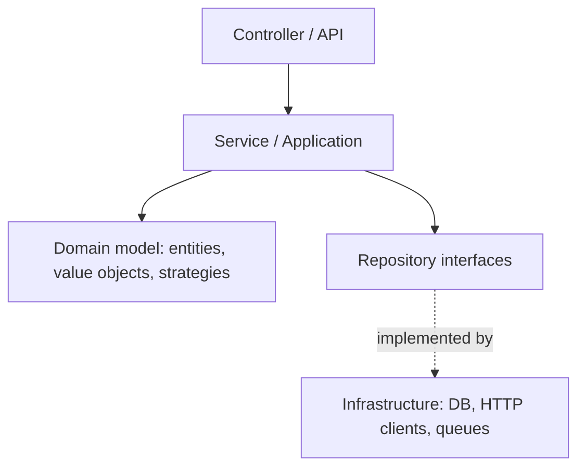

# Dependency Injection and Layering

> [!abstract] What this is
> How to wire an LLD solution so it's testable and easy to extend: depend on interfaces, inject collaborators through constructors, separate controller / service / repository / domain layers, and keep the domain free of framework and infrastructure code. This is what makes the "how would you add X?" and "how would you test this?" follow-ups easy.

---

## Dependency Injection

- A class shouldn't **create** the collaborators it depends on; it should **receive** them. Then the caller (or a framework) decides which implementation to use.

```java
// Hard-wired: can't swap the gateway, can't test without a real payment provider
class BookingService {
    private final PaymentGateway gateway = new StripeGateway();
}

// Injected: any PaymentGateway works, including a fake in tests
class BookingService {
    private final SeatRepository seats;
    private final PaymentGateway gateway;
    private final Clock clock;

    BookingService(SeatRepository seats, PaymentGateway gateway, Clock clock) {
        this.seats = Objects.requireNonNull(seats);
        this.gateway = Objects.requireNonNull(gateway);
        this.clock = Objects.requireNonNull(clock);
    }
}
```

| Style | Pick when |
|---|---|
| **Constructor injection** | Default: dependencies are required, fields can be `final`, the object is complete once built |
| **Setter injection** | Genuinely optional dependencies |
| **Field injection** (`@Autowired` on a field) | Avoid: hides dependencies, can't be `final`, needs reflection to test |

- This is the **Dependency Inversion Principle** in practice: high-level policy (`BookingService`) depends on an abstraction (`PaymentGateway`), and low-level details (`StripeGateway`) implement it.
- Many constructor parameters (6+) is a smell that the class does too much; split it.

### Wiring without a framework

- In an interview there's no Spring. Wire everything in one place, a `main` or an application/composition-root class:

```java
public static void main(String[] args) {
    SeatRepository seats = new InMemorySeatRepository();
    PaymentGateway gateway = new FakePaymentGateway();
    BookingService booking = new BookingService(seats, gateway, Clock.systemUTC());
    BookingController controller = new BookingController(booking);
    controller.handle(new BookRequest("show-1", List.of("A7", "A8")));
}
```

- Spring does the same thing automatically: beans are singletons by default, so **injected services must be stateless or thread-safe** ([[LLD/Concurrency/12 - Confinement and Immutability]]).

---

## Layering



| Layer | Responsibility | Must not |
|---|---|---|
| **Controller / API** | Parse and validate input, call one service method, map results and exceptions to responses | Contain business rules |
| **Service / application** | Orchestrate a use case: load aggregates, call domain methods, persist, publish events; transaction boundary | Hold per-request state in fields |
| **Domain** | Entities, value objects, domain rules and invariants, strategies | Know about HTTP, SQL, frameworks |
| **Repository** (interface) | Load and save aggregates by id | Leak SQL types upward |
| **Infrastructure** | Implementations: JDBC/JPA repositories, payment clients, message producers | Be referenced directly by the domain |

- Dependencies point **inward**: infrastructure depends on domain interfaces, never the other way round (ports and adapters / hexagonal architecture). Swapping an in-memory repository for a database one, or Stripe for Razorpay, touches only infrastructure.
- **DTOs vs domain objects:** the API's request/response classes are separate from domain entities, so changing the API doesn't change the model and vice versa. Map between them at the controller or service edge.
- **Exceptions per layer:** infrastructure exceptions (`SQLException`) are translated into domain or repository exceptions before they reach the service ([[01 - Exception Handling]]).

---

## Extending Without Rewriting

- The payoff of injection plus interfaces is that new requirements become **new classes**, not edits across the codebase (open/closed principle):

| Follow-up | Change |
|---|---|
| "Add a new payment method" | New `PaymentGateway` implementation, wired in `main` |
| "Pricing differs on weekends" | New `PricingStrategy`, chosen by a factory ([[Strategy]], [[Factory Pattern]]) |
| "Send SMS as well as email" | New `NotificationSender`, or a composite sender |
| "Store data in a database" | New repository implementation; services unchanged |

- Saying this explicitly in an interview ("only this class changes") is a strong signal.

---

## Interview Lines

> [!tip] Say it like this
> - "Collaborators come in through the constructor as interfaces, so I can swap implementations and test with fakes."
> - "Without a framework I wire everything in one composition root."
> - "Controllers translate, services orchestrate, entities enforce rules, repositories persist."
> - "Dependencies point inward; the domain doesn't know about SQL or HTTP."
> - "Spring beans are singletons, so services stay stateless."

## Related Notes

- [[03 - Object Modelling]] · [[09 - Testability]] · [[01 - Exception Handling]]
- [[LLD/Foundations/README]]
