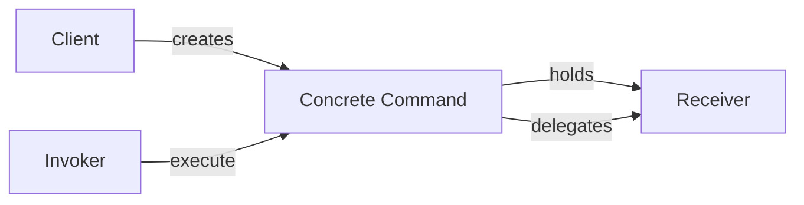
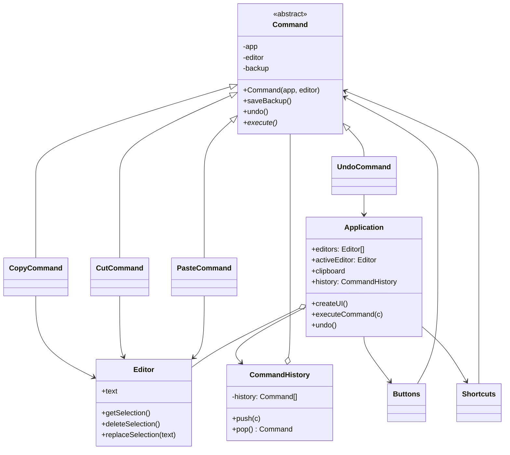
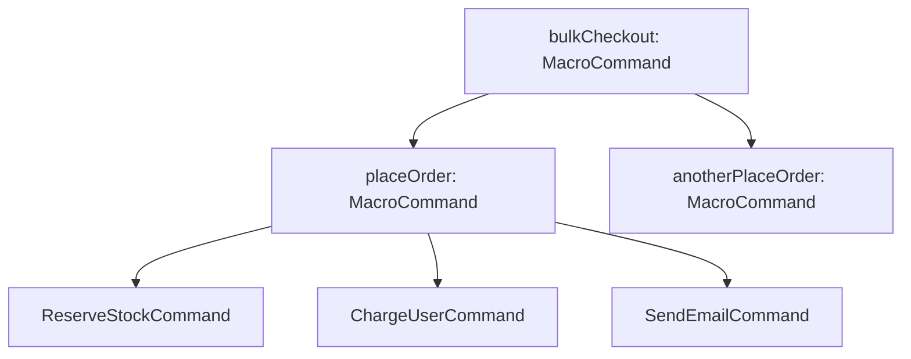

# Command Pattern

> [!abstract] Turn a request into a standalone object that carries everything needed to perform it, so requests can be passed around, queued, scheduled, logged and undone — decoupling whoever triggers an operation from whoever knows how to do it.

**External references:**
- [Refactoring.guru — Command](https://refactoring.guru/design-patterns/command)
- [Refactoring.guru — Command in Java](https://refactoring.guru/design-patterns/command/java/example)

## Part 1 — Core Framework

### Main Purpose

To **encapsulate a request as a standalone object** that contains all the information about the request. This transformation lets you **parameterize methods with different requests**, **delay or queue** a request's execution, and implement **undoable operations**. It completely **decouples the object that invokes the operation from the one that knows how to perform it**.

### Recognition Signal

> [!tip] The cue
> - You are building an **Async Task Queue or Thread Pool** where jobs are **created now but executed later** by a background worker.
> - You need to implement robust **Undo/Redo** functionality or distributed transaction **rollbacks** (Sagas).
> - You want to **decouple the sender of a request** (the UI or an API Controller) **from the business logic** layer that actually processes it.

### How to Implement

1. Define the **command interface**: usually `execute()`, plus `undo()` if operations must be reversible.
2. Identify the **receiver**: the existing class that actually does the work (`PaymentGateway`, `Editor`).
3. Write **concrete commands** that store the receiver and all the parameters at construction time, and whose `execute()` simply **delegates** to the receiver.
4. Write the **invoker** (button, queue, worker, scheduler) that holds commands and calls `execute()` without knowing what they do; keep a **history** if you need undo.
5. The **client** creates the commands, wiring each to its receiver, and hands them to invokers.



### Key Code

You are building a resilient `BackgroundWorker` for an e-commerce platform. When a user clicks "Checkout," you don't want to freeze the API while the system contacts the payment gateway. Instead, you **create a Command, put it on a queue**, and let a worker process it asynchronously. If something fails, you need the ability to **roll back** the command.

```java
// 1. The Command Interface
public interface JobCommand {
    void execute();
    void undo(); // Crucial for distributed rollbacks!
}

// 2. The Receiver (The subsystem that does the actual work)
public class PaymentGateway {
    public void charge(String user, double amount) {
        System.out.println("Processing API call to charge " + user + " $" + amount);
    }
    public void refund(String user, double amount) {
        System.out.println("Processing API call to refund " + user + " $" + amount);
    }
}

// 3. Concrete Command
public class ChargeUserCommand implements JobCommand {
    private PaymentGateway gateway;
    private String user;
    private double amount;

    // The command encapsulates ALL the state needed to execute later
    public ChargeUserCommand(PaymentGateway gateway, String user, double amount) {
        this.gateway = gateway;
        this.user = user;
        this.amount = amount;
    }

    @Override
    public void execute() { gateway.charge(user, amount); }

    @Override
    public void undo() { gateway.refund(user, amount); }
}

// 4. The Invoker (The Queue/Worker)
public class BackgroundWorker {
    private Queue<JobCommand> queue = new LinkedList<>();
    private Stack<JobCommand> history = new Stack<>();

    public void addJob(JobCommand cmd) { queue.add(cmd); }

    public void processJobs() {
        while (!queue.isEmpty()) {
            JobCommand cmd = queue.poll();
            cmd.execute();
            history.push(cmd); // Save to history for potential rollback
        }
    }

    public void rollbackLastJob() {
        if (!history.isEmpty()) {
            System.out.println("Initiating rollback...");
            history.pop().undo();
        }
    }
}

// 5. The Client
public class CheckoutController {
    public static void main(String[] args) {
        PaymentGateway stripe = new PaymentGateway();
        BackgroundWorker worker = new BackgroundWorker();

        // 1. Create the command (Decoupled from execution)
        JobCommand chargeCmd = new ChargeUserCommand(stripe, "akash_dev", 99.99);

        // 2. Hand it to the invoker
        worker.addJob(chargeCmd);

        // 3. Worker processes it later on a separate thread
        worker.processJobs();

        // 4. If a downstream service fails, we can roll back
        worker.rollbackLastJob();
    }
}
```

### Beyond the Basics

The Command pattern effectively **turns a method call into a variable**. By converting execution logic into an object, you can **pass it around, store it in arrays, save it to a database, or serialize it across a network**. It separates the **"What"** from the **"When"** and the **"Who"**.

### Anti-Patterns & When NOT to Use

- **Class Explosion.** Creating a separate concrete Command class for every single tiny operation in your system. If an operation is simple and doesn't need to be queued or undone, **just call the method directly**. Modern languages use **functional interfaces (Lambdas)** to avoid creating hundreds of command classes.
- **Fat Commands.** A Command should generally be a **thin wrapper that delegates to a Receiver** (like the `PaymentGateway`). If your `ChargeUserCommand` contains 500 lines of complex HTTP and database logic, you have **leaked business logic out of the domain layer** and into the orchestration layer.

```java
// Lambdas as lightweight commands when no undo or extra state is needed
Runnable sendReceipt = () -> mailer.sendReceipt(orderId);
executor.submit(sendReceipt);
```

## Part 2 — Architecture Deep Dive

### Worked Example — Undoable Operations in a Text Editor (Refactoring.guru)

Refactoring.guru's main example shows why Command is the natural way to build **undo** and to let **many UI elements trigger the same operation**.



*(Redrawn from Refactoring.guru's "Undoable operations in a text editor" diagram.)*

**The problem it solves.**
- A text editor has **buttons** (toolbar Copy / Cut / Paste), **keyboard shortcuts** (`Ctrl+C`, `Ctrl+X`, `Ctrl+V`) and context-menu items, all triggering the same operations.
- If each button subclass contained the copy logic, the logic would be duplicated across buttons, shortcuts and menus, and the GUI would be welded to the business logic.
- Undo needs every operation to remember **what the text looked like before** it ran.

**The roles in the diagram.**

| Role | Class | Responsibility |
|---|---|---|
| **Senders / invokers** | `Buttons`, `Shortcuts` | Each holds a `Command` and calls `execute()` (through the application) on click or key press; they know nothing about editing |
| **Command (abstract base)** | `Command` | Holds references to the `app` and the target `editor`, and a `backup` of the editor's text; `saveBackup()` stores the text, `undo()` restores it, `execute()` is abstract and **returns whether the command changed the editor's state** |
| **Concrete commands** | `CopyCommand`, `CutCommand`, `PasteCommand`, `UndoCommand` | Each implements `execute()` by calling the editor (or application) |
| **Receiver** | `Editor` | Holds `text`; provides `getSelection()`, `deleteSelection()`, `replaceSelection(text)` |
| **Application (client / context)** | `Application` | Owns all `editors`, the `activeEditor`, the shared `clipboard` and the `history`; `createUI()` wires buttons and shortcuts to commands; `executeCommand(c)` runs a command and records it; `undo()` reverses the last one |
| **History** | `CommandHistory` | A **stack** of executed commands: `push(c)` after a state-changing command, `pop()` on undo |

**How the commands behave.**
- **`CopyCommand`** copies the selection to the app clipboard. It **doesn't change the editor**, so it returns `false` and isn't added to history (there's nothing to undo).
- **`CutCommand`** saves a backup, copies the selection to the clipboard, deletes the selection, and returns `true`, so it's pushed onto history.
- **`PasteCommand`** saves a backup, replaces the selection with the clipboard contents, returns `true`.
- **`UndoCommand`** calls `app.undo()`, which pops the last command from history and calls its `undo()`; it returns `false` itself (undoing isn't something you undo).

```java
// Command base: knows its app and editor, keeps a backup for undo
public abstract class Command {
    protected final Application app;
    protected final Editor editor;
    private String backup;

    protected Command(Application app, Editor editor) {
        this.app = app;
        this.editor = editor;
    }

    protected void saveBackup() { backup = editor.text; }
    public void undo() { editor.text = backup; }

    /** @return true if the editor's state changed (so it must go into history) */
    public abstract boolean execute();
}

public class CopyCommand extends Command {
    public CopyCommand(Application app, Editor editor) { super(app, editor); }
    @Override public boolean execute() {
        app.clipboard = editor.getSelection();
        return false;                       // nothing changed, nothing to undo
    }
}

public class CutCommand extends Command {
    public CutCommand(Application app, Editor editor) { super(app, editor); }
    @Override public boolean execute() {
        saveBackup();
        app.clipboard = editor.getSelection();
        editor.deleteSelection();
        return true;
    }
}

public class PasteCommand extends Command {
    public PasteCommand(Application app, Editor editor) { super(app, editor); }
    @Override public boolean execute() {
        saveBackup();
        editor.replaceSelection(app.clipboard);
        return true;
    }
}

public class UndoCommand extends Command {
    public UndoCommand(Application app, Editor editor) { super(app, editor); }
    @Override public boolean execute() {
        app.undo();
        return false;
    }
}

// History: a simple stack of executed, state-changing commands
public class CommandHistory {
    private final Deque<Command> history = new ArrayDeque<>();
    public void push(Command c) { history.push(c); }
    public Command pop() { return history.poll(); }   // null when empty
}

// Receiver: the editor itself (text-editing primitives only)
public class Editor {
    public String text = "";
    public String getSelection() { /* return selected text */ return ""; }
    public void deleteSelection() { /* remove selected text */ }
    public void replaceSelection(String s) { /* insert s at the selection */ }
}

// Application: wires senders to commands, executes them, owns history
public class Application {
    public String clipboard = "";
    public Editor activeEditor = new Editor();
    private final CommandHistory history = new CommandHistory();

    public void createUI() {
        // The SAME command class is used by a button AND a shortcut
        Runnable copy = () -> executeCommand(new CopyCommand(this, activeEditor));
        // copyButton.setOnClick(copy);   shortcuts.onKeyPress("Ctrl+C", copy);
        Runnable cut   = () -> executeCommand(new CutCommand(this, activeEditor));
        Runnable paste = () -> executeCommand(new PasteCommand(this, activeEditor));
        Runnable undo  = () -> executeCommand(new UndoCommand(this, activeEditor));
    }

    public void executeCommand(Command c) {
        if (c.execute()) history.push(c);   // only state-changing commands are recorded
    }

    public void undo() {
        Command c = history.pop();
        if (c != null) c.undo();
    }
}
```

**What the example teaches.**
- **One command, many triggers:** a button, a shortcut and a menu item all create the same `CopyCommand`; the copy logic exists once.
- **Senders don't know receivers:** buttons just call `execute()`; the command knows which editor and which method.
- **Undo for free from a stack:** because every state-changing operation is an object that saved a backup, undo is "pop and call `undo()`". **Redo** is a second stack: undone commands are pushed onto it and re-executed on redo (and it's cleared when a new command runs).
- **Backup = a simple snapshot:** here the backup is the whole text; for complex state the command would store a **[[Memento]]** instead (see synergy below). The trade-off is memory: storing full snapshots per command is expensive for large documents, so real editors store diffs or reverse operations.

### Pattern Synergy

#### Command + Composite (Macros)

You can create a **`MacroCommand`** that implements the `JobCommand` interface but **internally holds a List of other Commands**. When you call `execute()` on the Macro, it iterates and executes the entire batch ([[Composite]]).

```java
public class MacroCommand implements JobCommand {
    private final List<JobCommand> steps;
    public MacroCommand(List<JobCommand> steps) { this.steps = List.copyOf(steps); }
    public void execute() { steps.forEach(JobCommand::execute); }
    public void undo() {                          // undo in reverse order
        for (int i = steps.size() - 1; i >= 0; i--) steps.get(i).undo();
    }
}
```

**Example — a "Place Order" macro built from smaller commands.** Checkout is really several jobs: reserve stock, charge the card, send a confirmation. Each is its own command; the macro groups them so the worker treats the whole checkout as **one** job, and a rollback undoes all of it.

```java
// Leaf commands (each delegates to its own receiver)
public class ReserveStockCommand implements JobCommand {
    private final Inventory inventory; private final String sku; private final int qty;
    public ReserveStockCommand(Inventory inventory, String sku, int qty) {
        this.inventory = inventory; this.sku = sku; this.qty = qty;
    }
    public void execute() { inventory.reserve(sku, qty); }
    public void undo()    { inventory.release(sku, qty); }
}

public class SendEmailCommand implements JobCommand {
    private final Mailer mailer; private final String user; private final String template;
    public SendEmailCommand(Mailer mailer, String user, String template) {
        this.mailer = mailer; this.user = user; this.template = template;
    }
    public void execute() { mailer.send(user, template); }
    public void undo()    { mailer.send(user, "ORDER_CANCELLED"); }   // compensate: can't unsend
}

// Client: compose leaves (and even other macros) into one command
JobCommand placeOrder = new MacroCommand(List.of(
        new ReserveStockCommand(inventory, "SKU-42", 2),
        new ChargeUserCommand(stripe, "akash_dev", 99.99),
        new SendEmailCommand(mailer, "akash_dev", "ORDER_CONFIRMED")));

worker.addJob(placeOrder);      // the invoker sees ONE JobCommand, not three
worker.processJobs();           // reserve -> charge -> email
worker.rollbackLastJob();       // email-cancel -> refund -> release stock (reverse order)

// Macros nest, because a MacroCommand IS a JobCommand (the Composite part)
JobCommand bulkCheckout = new MacroCommand(List.of(placeOrder, anotherPlaceOrder));
```



- **Why it's Composite:** `MacroCommand` (branch) and the individual commands (leaves) share the `JobCommand` interface, so the invoker, history and rollback code never care whether they hold one command or a tree of them.
- **Partial failure:** if `ChargeUserCommand` throws midway, a robust macro undoes only the steps **already executed**, in reverse:

```java
public void execute() {
    List<JobCommand> done = new ArrayList<>();
    try {
        for (JobCommand step : steps) { step.execute(); done.add(step); }
    } catch (RuntimeException e) {
        for (int i = done.size() - 1; i >= 0; i--) done.get(i).undo();   // compensate what ran
        throw e;
    }
}
```

- This is a tiny in-process **saga**: each step has a compensating `undo()`, and irreversible steps (the email) go last.
- **Same idea in the text editor:** a "Find & Replace All" macro made of many `PasteCommand`s, pushed to history as one entry so a single `Ctrl+Z` undoes the whole replace.

#### Command + Memento

If the `undo()` logic requires **restoring an object to a previous complex state** (rather than just calling a reverse API like `refund`), the Command will use the **[[Memento]]** pattern to save the state of the Receiver before executing.

#### Command + Chain of Responsibility

Handlers in a chain can be implemented as commands, or the request travelling down the chain can itself be a command ([[Chain of Responsibility]]).

#### Command vs Strategy

Both wrap behaviour in an object, but with different intent: a **Command** represents an **operation to perform** (with its parameters, and often undo), which can be queued and logged; a **[[Strategy]]** represents **different ways of doing the same thing**, swapped into a context.

### Real-World Context

This pattern is the foundational concept for **async processing and modern data consistency**:

- **Java `Runnable` and `Callable`:** these are literal implementations of the Command pattern built into the JDK. You wrap your code in a `Runnable` (the command) and hand it to an `ExecutorService` (the invoker) ([[LLD/Concurrency/08 - Executors and Thread Pools]]).
- **CQRS (Command Query Responsibility Segregation):** the "C" in CQRS stands for Command. In this massive enterprise pattern, any request that **mutates data** is encapsulated as a Command object and routed to a dedicated write-database, completely segregating it from read queries.
- **Message Brokers (Kafka / RabbitMQ):** when you publish a JSON message to a queue to be processed by a worker service later, you are implementing a **distributed Command pattern**.

### Advanced Nuances — Idempotency in Distributed Commands

In a system design interview, if you discuss putting Commands onto an asynchronous queue, the interviewer will almost always ask: **"What happens if the worker crashes halfway through and the queue retries the command?"**

The answer is **Idempotency**. In modern distributed systems, every Concrete Command you write **MUST be idempotent**, meaning executing it once has the exact same effect as executing it 100 times. You achieve this by generating a **unique `commandId` (UUID)** when the command is instantiated. The Receiver (e.g. the `PaymentGateway`) must **check its database** to see if it has already processed that `commandId` before proceeding. Mentioning idempotency when discussing the Command pattern is a massive senior-level flex ([[LLD/Foundations/11 - Idempotency and Retries]]).

## Principles Served

- [[01 - Single Responsibility Principle]] — invokers trigger, commands describe one operation, receivers do the work.
- [[02 - Open-Close Principle]] — new operations are new command classes; invokers and receivers don't change.

## Sources

- [Refactoring.guru — Command](https://refactoring.guru/design-patterns/command) (external, primary reference; text-editor example)
