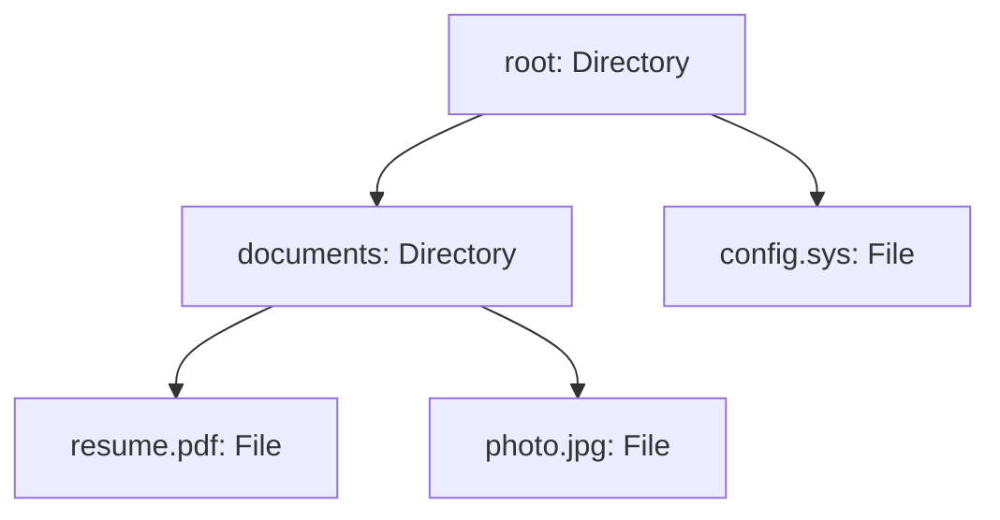

# Composite Pattern

> [!abstract] Compose objects into tree structures for part-whole hierarchies, so clients treat a single object (leaf) and a group of objects (branch) through exactly the same interface — one call on the root cascades down to every leaf.

**External references:**
- [Refactoring.guru — Composite](https://refactoring.guru/design-patterns/composite)
- [Refactoring.guru — Composite in Java](https://refactoring.guru/design-patterns/composite/java/example)

## Part 1 — Core Framework

### Main Purpose

To compose objects into **tree structures** to represent **part-whole hierarchies**. The Composite pattern allows clients to treat **individual objects (leaves)** and **compositions of objects (branches)** completely **uniformly**. You can execute a method on a massive tree, and the pattern automatically delegates it down to the smallest leaf.

### Recognition Signal

> [!tip] The cue
> - You are dealing with **strictly hierarchical data** (e.g. File Systems, Organizational Charts, Nested E-commerce Categories).
> - You find yourself writing massive **recursive `if (object instanceof Group)`** statements to figure out if you need to drill down deeper into a nested structure.
> - You want the client code to be **completely ignorant** of whether it is interacting with a single item or a massive collection of items.

### How to Implement

1. Define the **component interface**: the operations that make sense for both single items and groups (`getSize()`, `getName()`).
2. Write the **leaf**: a simple element that does the real work itself.
3. Write the **composite**: holds a list of child components (leaves or other composites), and implements each operation by **delegating to its children** and combining their results.
4. Decide where child-management methods (`add`/`remove`) live: the transparency vs safety trade-off (Part 2).
5. The **client** builds the tree and then works only through the component interface.

### Key Code

You are designing a File System representation for a cloud storage backend. A user can request the total size of a **File** (a single object) or a **Directory** (a composition containing files and other directories). The client calculating the size shouldn't care which one it is looking at.

```java
// 1. The Component Interface (The unifying contract)
public interface FileSystemNode {
    int getSize();
    String getName();
}

// 2. The Leaf (The individual object)
public class File implements FileSystemNode {
    private String name;
    private int size;

    public File(String name, int size) {
        this.name = name;
        this.size = size;
    }

    @Override
    public int getSize() { return size; }

    @Override
    public String getName() { return name; }
}

// 3. The Composite (The branch that holds children)
public class Directory implements FileSystemNode {
    private String name;
    private List<FileSystemNode> children = new ArrayList<>();

    public Directory(String name) { this.name = name; }

    public void add(FileSystemNode node) { children.add(node); }
    public void remove(FileSystemNode node) { children.remove(node); }

    @Override
    public int getSize() {
        int totalSize = 0;
        // Recursively asks every child for its size, completely agnostic to
        // whether the child is a File or another Directory!
        for (FileSystemNode child : children) {
            totalSize += child.getSize();
        }
        return totalSize;
    }

    @Override
    public String getName() { return name; }
}

// 4. The Client
public class CloudStorageManager {
    public static void main(String[] args) {
        // Build the tree
        Directory root = new Directory("root");
        Directory documents = new Directory("documents");

        File resume = new File("resume.pdf", 500);
        File photo = new File("photo.jpg", 2000);
        File systemConfig = new File("config.sys", 10);

        documents.add(resume);
        documents.add(photo);

        root.add(documents);
        root.add(systemConfig);

        // The client treats the root directory exactly like a single file
        System.out.println("Total Cloud Storage Used: " + root.getSize() + " KB");
    }
}
```



### Beyond the Basics

The true magic of the Composite pattern is **elegant recursion**. Because the `Directory` implements the **exact same interface** as the objects it holds, calling `getSize()` naturally **cascades down the entire tree** until it hits the leaves, summing up the result effortlessly.

### Anti-Patterns & When NOT to Use

- **The Interface Bloat.** Forcing the base `FileSystemNode` interface to include management methods like `add()` and `remove()`. If a `File` is forced to implement `add()`, it has to throw a useless `UnsupportedOperationException`. This violates the **[[04 - Interface Segregation Principle]]**. (See "Advanced Nuances" below.)
- **Forcing a tree onto flat data.** If the data isn't genuinely recursive (a list of items with one optional grouping level), Composite adds indirection for nothing.

## Part 2 — Architecture Deep Dive

### Advanced Nuances — Transparency vs Safety

In system design interviews, demonstrating knowledge of the **"Transparency vs. Safety"** tradeoff is an immediate senior-level signal.

| | Transparency (the GoF approach) | Safety (the modern approach) |
|---|---|---|
| Where `add()`/`remove()` live | In the **base `FileSystemNode` interface** | **Only in the `Directory`** class (as in the code example) |
| Gain | Client code is **completely transparent**: it can treat everything exactly the same | The **compiler prevents** you from adding to a `File` |
| Cost | Sacrifices **safety**: a client might accidentally call `add()` on a Leaf (`File`), crashing the app at runtime | Loses some **transparency**: with only a `FileSystemNode` reference, the client must **downcast** to `Directory` before adding children |

Mentioning this tradeoff to an interviewer proves you don't just memorize code, but **actively evaluate architectural costs**.

#### Why the downcast pushes people toward Transparency

The whole point of Composite is that the **client stays agnostic**: it holds a `FileSystemNode` and never cares whether that's a `File` or a `Directory`. The Safety approach breaks that promise the moment the client wants to **build or modify** the tree:

```java
FileSystemNode node = lookup("documents");      // client only knows the interface

// Safety approach: add() isn't on the interface, so the client must downcast
if (node instanceof Directory dir) {            // client now depends on the concrete class
    dir.add(new File("notes.txt", 20));
}
```

- The client is coupled to the concrete `Directory` class again, and every new composite type (`ZipArchive`, `SharedFolder`) means another `instanceof` branch, which is exactly the `instanceof` mess Composite was supposed to remove.
- So GoF's Transparent approach **deliberately compromises on [[04 - Interface Segregation Principle]]**: it puts `add()`, `remove()` (and often `getChildren()`) on the base interface, so the client never downcasts and treats every node identically. The price is that leaves now carry methods they can't meaningfully support.

```java
public interface FileSystemNode {
    int getSize();
    String getName();
    default void add(FileSystemNode node)    { throw new UnsupportedOperationException(getName() + " is a leaf"); }
    default void remove(FileSystemNode node) { throw new UnsupportedOperationException(getName() + " is a leaf"); }
    default boolean isComposite()            { return false; }   // see workaround 1 below
}

public class Directory implements FileSystemNode {
    private final List<FileSystemNode> children = new ArrayList<>();
    @Override public void add(FileSystemNode node)    { children.add(node); }
    @Override public void remove(FileSystemNode node) { children.remove(node); }
    @Override public boolean isComposite()            { return true; }
    // getSize(), getName() as before
}
```

#### How does the client know when it can call `add()`?

Because the interface treats everything identically, **you cannot know if it's a Leaf or a Composite just by looking at the reference**. If you strictly use the Transparent approach, you handle that uncertainty in one of three ways:

1. **The `isComposite()` workaround.** Add a boolean method like `boolean isComposite()` (or `canHaveChildren()`) to the base Component interface. A Leaf returns `false`, and a Composite returns `true`. You **check this before calling `add()`**, which saves you from downcasting.
    ```java
    if (node.isComposite()) node.add(new File("notes.txt", 20));
    ```
2. **Exception Handling.** You simply call `add()`. If the object happens to be a Leaf, it throws an `UnsupportedOperationException`, and you catch it. This is generally considered **bad practice**, since exceptions shouldn't dictate standard control flow ([[LLD/Foundations/01 - Exception Handling]]), but it is how the pattern is technically structured.
    ```java
    try { node.add(child); }
    catch (UnsupportedOperationException e) { /* it was a leaf */ }
    ```
3. **Contextual Knowledge.** In practice, the client usually only calls `add()` when it is **actively constructing the tree** and already logically knows it is dealing with a container (like a UI Panel) rather than an endpoint (like a Text Label). Building through a [[Builder]] makes this explicit.

> [!tip] The decision rule
> If you find yourself **constantly needing to check** whether a node is a Leaf before adding to it, the Transparent approach is likely the **wrong choice** for your specific use case, and you should switch back to the **Safe approach** (where `add()` lives only in the Composite). Transparency pays off when most code just *uses* the tree uniformly and only a small, context-aware construction step adds children.

### Pattern Synergy

#### Composite + Builder

Constructing a massive tree object by object using `directory.add(file)` is tedious. You almost always use a **Fluent [[Builder]]** to construct Composites cleanly (e.g. HTML or XML builders).

#### Composite + Visitor

If you need to perform an operation across the entire tree (like exporting all node names to XML), but you don't want to clutter the `FileSystemNode` interface with an `export()` method, you use a **[[Visitor]]** to traverse the Composite structure.

#### Composite vs Decorator

Same recursive-composition structure, but a **Decorator is like a Composite with exactly one child** that it *adds* responsibilities to, while a Composite *sums up* results across many children. They cooperate: a Decorator can extend one specific node inside a Composite tree. Full comparison in [[Decorator]].

#### Composite + Chain of Responsibility

Events (like a mouse click in the DOM) **bubble up** a Composite tree: the tree structures the objects, and [[Chain of Responsibility]] decides how the event propagates until a node handles it.

#### Composite + Prototype

Deeply nested composite structures are expensive to rebuild; [[Prototype]] lets you **clone** an assembled tree instead.

### Real-World Context

This is the undisputed king of **UI and hierarchical data rendering**:

- **The HTML DOM (Document Object Model):** every web page is a massive Composite pattern. A `<div>` is a Composite that holds other `<div>`s or `<p>`s. A `<p>` is a Leaf. Calling `element.render()` cascades down the entire page tree.
- **React / UI Components:** when you return `<Container><Button/></Container>`, the framework is mounting a Composite tree of virtual nodes.

## Principles Served

- [[02 - Open-Close Principle]] — new node types (a `SymbolicLink`, a `ZipArchive`) slot into the tree without changing client code.
- [[04 - Interface Segregation Principle]] — the safety variant keeps child-management methods off leaves that can't support them.

## Sources

- [Refactoring.guru — Composite](https://refactoring.guru/design-patterns/composite) (external, primary reference)
