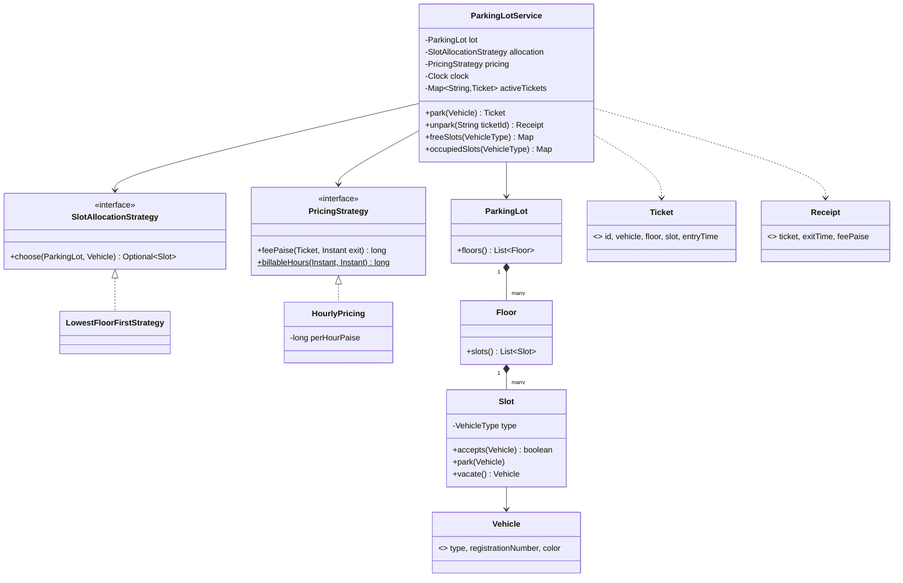
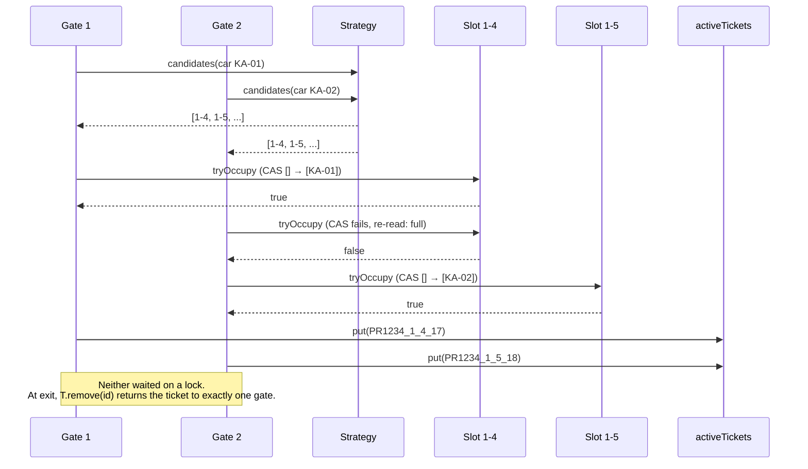
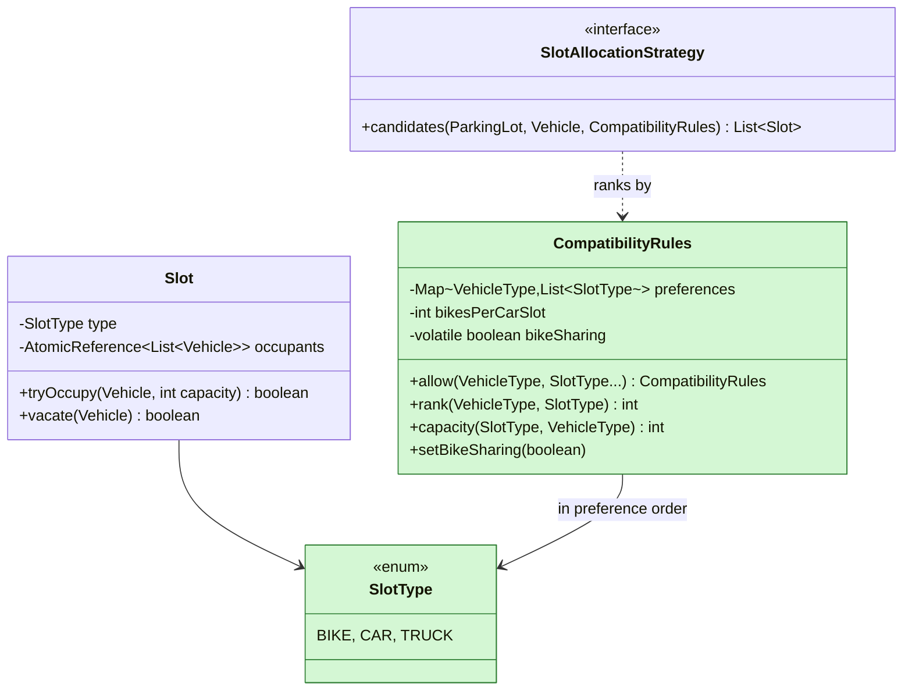
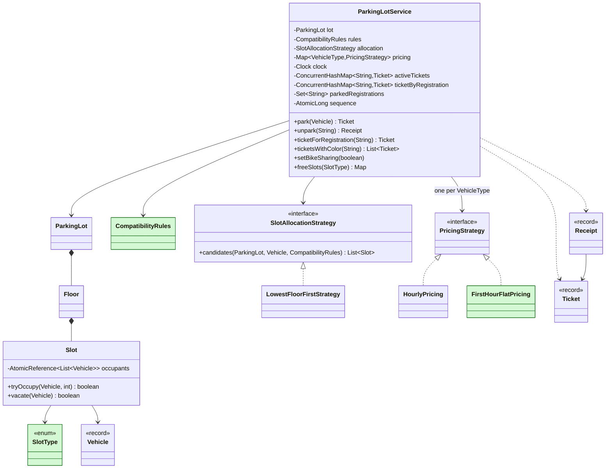

# Parking Lot

> [!abstract] Catalog #1 (P0) · archetype §2 Pluggable Policy · patterns: Strategy (allocation, pricing per vehicle type), rules table for compatibility, CAS for concurrent gates · driver: **CLI plus a Demo**, because the reported machine-coding prompts (workat.tech, Swiggy) define commands and exact output strings.
> The hard part: keep the slot rule in the slot, the workflow in the service and every variation behind an interface, so each follow-up adds a class; then make two gates racing for the last slot unable to double-allocate.

Code: v0 [lld/parkinglot/v0](../Code/src/main/java/lld/parkinglot/v0/) · full [lld/parkinglot/full](../Code/src/main/java/lld/parkinglot/full/) · tests [v0](../Code/src/test/java/lld/parkinglot/v0/ParkingLotServiceV0Test.java), [full](../Code/src/test/java/lld/parkinglot/full/ParkingLotServiceFullTest.java). Snapshots are self-contained: no imports between them.

---

## 1. Clarify Script

| Question | Default (most reported prompts) | If different |
|---|---|---|
| Command-line input or demo `main`? | Commands with exact output (workat.tech, Swiggy) | Demo only: drop `cli/` |
| Vehicle types? | BIKE, CAR, TRUCK | More types: one enum value plus one compatibility line (**E3**) |
| Floor layout? | Same per floor: slot 1 truck, 2–3 bike, rest car | Custom layouts: also asked |
| Who picks the slot? | System: lowest floor, then lowest slot number | Spread or nearest: also asked |
| Fee on exit? | Yes, one hourly rate per started hour | Different scheme per vehicle type → **E1** |
| Several gates at once? | No, one user | Yes → **E2** |
| Can a bike use a car slot? | No, own type only | Yes, and 4 bikes per car slot when busy → **E3** |
| Find a car by plate or colour? | No | Yes, plus lost ticket → **E4** |
| Storage? | In memory only | — |

---

## 2. Requirements

### Functional (V0)

- `create_parking_lot <id> <floors> <slotsPerFloor>`
- `park_vehicle <type> <regNo> <color>` → `Parked vehicle. Ticket ID: PR1234_1_4`, or `Parking Lot Full`.
- `unpark_vehicle <ticketId>` → `Unparked vehicle with Registration Number: … and Color: …` then `Fee: Rs 30.00`, or `Invalid Ticket`.
- `display free_count|free_slots|occupied_slots <type>` → one line per floor.
- Fee: Rs 30 per started hour, minimum one hour.

### Constraints

- Plain Java, in memory, exact output strings, clean messages for bad input, time from an injected `Clock`.

### Out of scope

- Payment methods, cameras, reservations, UI, persistence.

---

## 3. Entities and Responsibilities

A rule lives with the state it's about; workflow lives in the orchestrator.

| Entity | Owns | Must not know about |
|---|---|---|
| `Slot` | "holds at most one vehicle, only of its own type" | tickets, money |
| `Floor` | its ordered slots and the layout | allocation order |
| `ParkingLot` | floors | tickets, pricing |
| `SlotAllocationStrategy` | which free slot to use | issuing tickets |
| `PricingStrategy` | fee for a ticket at an exit time | slots |
| `Ticket`, `Receipt` (records) | where a vehicle is and since when; what it paid | — |
| `ParkingLotService` | the workflow: choose, claim, issue; unpark and bill; queries | parsing, printing |
| `ParkingLotCli`, `Demo` | parsing commands and formatting output | business rules |

---

## 4. Class Design (V0)



---

## 5. V0 — the 90-Minute Build

```
lld/parkinglot/v0/
  model/       VehicleType, Vehicle, Slot, Floor, ParkingLot, Ticket, Receipt
  allocation/  SlotAllocationStrategy, LowestFloorFirstStrategy
  pricing/     PricingStrategy, HourlyPricing
  service/     ParkingLotService
  exception/   DomainException, ValidationException, NotFoundException, ConflictException
  demo/        Demo, ManualClock
  cli/         CommandLineDriver, ParkingLotCli
```

**Type first (10 minutes):** the four exceptions (`ValidationException.require(cond, msg)` keeps guards to one line), `ManualClock` (a `Clock` with `advance(Duration)`), and `CommandLineDriver` (~60 lines: command word → handler, prints a `DomainException` message instead of a stack trace).

**Slot owns its rule:**

```java
public boolean accepts(Vehicle candidate) {
    return isFree() && candidate.type() == type;
}
```

**The service orchestrates:**

```java
public Ticket park(Vehicle vehicle) {
    Slot slot = allocation.choose(lot, vehicle)
            .orElseThrow(() -> new ConflictException("Parking Lot Full"));
    slot.park(vehicle);
    Ticket ticket = Ticket.issue(lot.id(), vehicle, slot, clock.instant());   // PR1234_<floor>_<slot>
    activeTickets.put(ticket.id(), ticket);
    return ticket;
}

public Receipt unpark(String ticketId) {
    Ticket ticket = activeTickets.remove(ticketId);
    if (ticket == null) throw new NotFoundException("Invalid Ticket");
    lot.floor(ticket.floor()).slot(ticket.slot()).vacate();
    Instant exit = clock.instant();
    return new Receipt(ticket, exit, pricing.feePaise(ticket, exit));
}
```

```java
static long billableHours(Instant entry, Instant exit) {          // 0 min -> 1 h, 61 min -> 2 h
    long minutes = Math.max(0, Duration.between(entry, exit).toMinutes());
    return Math.max(1, (minutes + 59) / 60);
}
```

- **Why fee is in V0:** most reported starting prompts include a charge on exit (Hello Interview, PracHub, DesignGurus, Uber). Only the per-type schemes are a follow-up.
- **Why two interfaces already:** allocation order and pricing are the first things reviewers change. Each interface costs two minutes and turns E1 into "add classes".
- **Errors:** `ValidationException` (unknown type, blank plate, non-numeric args), `ConflictException` (`Parking Lot Full`, no lot yet), `NotFoundException` (`Invalid Ticket`).
- **Driver:** `ParkingLotCli` because the prompt's commands are the spec; `Demo` shows the same flow as plain method calls. Both only call the service.
- **Single-threaded on purpose:** one CLI user. Say so; E2 is ready.

---

## 6. Trace

`create_parking_lot PR1234 2 6` → each floor: slot 1 TRUCK, 2–3 BIKE, 4–6 CAR.

| Command | State change | Output |
|---|---|---|
| `park_vehicle CAR KA-01-DB-1234 black` | floor 1: slots 1–3 reject CAR, slot 4 accepts | `Parked vehicle. Ticket ID: PR1234_1_4` |
| `park_vehicle TRUCK KA-02 white` | floor 1 slot 1 | `… PR1234_1_1` |
| `park_vehicle TRUCK KA-03 white` | floor 1 slot 1 taken → floor 2 slot 1 | `… PR1234_2_1` |
| `park_vehicle TRUCK KA-04 white` | no truck slot free | `Parking Lot Full` |
| `advance_minutes 125` | clock +125 min | — |
| `unpark_vehicle PR1234_1_4` | ticket removed, slot freed, 3 started hours | `Unparked … KA-01-DB-1234 …` / `Fee: Rs 90.00` |
| `unpark_vehicle PR1234_1_4` | not active | `Invalid Ticket` |

---

## 7. Evidence

| Follow-up | Reports | Count | Placed as |
|---|---|---|---|
| Multi-floor, typed slots, park/unpark, ticket | workat.tech; Uber SDE2 (LC 5938462, 7896720); Hello Interview; PracHub; DesignGurus; Microsoft SDE2 | 7+ | V0 |
| Fee on exit | Hello Interview; PracHub; DesignGurus (pay at exit panel); Uber L4 Blind (2026) | 4+ | V0 |
| Command format with exact output | workat.tech; Swiggy SDE4 machine coding (LC 1422797) | 2 | V0 driver (CLI) |
| Different pricing per vehicle type / scheme | Hello Interview; PracHub; DesignGurus; Microsoft L61 (Strategy) | 4 | **E1** strong |
| Concurrent gates, two cars race for one spot | Hello Interview (concurrency intro); PracHub (two-gate race); Microsoft SDE2; Uber SDE2 (full capacity) | 4 | **E2** strong |
| Small vehicle in a bigger slot; 4 bikes in a car slot when busy | Uber SDE2 (LC 5938462); PracHub (spot sizes, compatibility); DesignGurus (spot sizes) | 3 | **E3** medium |
| Find by registration / colour; lost ticket | Swiggy SDE4 (Gojek-style queries, LC 1422797); PracHub (lost ticket) | 2 | **E4** medium |
| Switch allocation strategy (spread, nearest) | Microsoft L61 (Strategy/State); Hello Interview | 2 | Also asked |
| Guide a car to its spot | PhonePe (GfG, 1.10 YOE) | 1 | Also asked |
| Display boards | DesignGurus | 1 | Also asked |
| EV slots, payment methods, multiple lots, reservations | guides only | 0–1 | Also asked (judgement) |

---

## 8. Extension Ladder

All four are in [lld/parkinglot/full](../Code/src/main/java/lld/parkinglot/full/).

### E1 — "Price it per vehicle type: bikes ₹10/hour; cars ₹40 for the first hour, then ₹30 per started hour."

- **Evidence:** Hello Interview, PracHub, DesignGurus, Microsoft L61. Confidence **strong**.
- **Added:** `FirstHourFlatPricing`.
- **Edited:** the service takes `Map<VehicleType, PricingStrategy>` instead of one strategy and checks the type has a price **before** claiming a slot, so it never parks a vehicle it can't bill.
- **Pattern:** Strategy chosen by key. A new scheme is a class plus a map entry. Money in paise.
- **No delta diagram:** E1 only adds one implementation of an interface already in V0.
- **Tested:** car 125 min = ₹40 + 2 × ₹30 = ₹100; bike 125 min = 3 × ₹10.

### E2 — "There are several entry and exit gates working at the same time."

- **Evidence:** Hello Interview, PracHub, Microsoft SDE2, Uber SDE2. Confidence **strong**.

| Race | V0 behaviour | Fix in full |
|---|---|---|
| Two gates pick the same free slot | Both park it | `Slot` keeps occupants in an `AtomicReference`; `tryOccupy` is a CAS loop. The loser tries the next candidate. |
| Two exits present one ticket | Both could unpark and bill | `activeTickets` is a `ConcurrentHashMap`; `remove(id)` returns the ticket to exactly one caller. |
| Same plate at two gates | Parked twice | `parkedRegistrations.add(reg)` on a concurrent set is atomic; the second gets `Vehicle already parked`. |
| Ticket id reused with the slot | `PR1234_1_4` issued again | Id carries an `AtomicLong` sequence: `PR1234_1_4_17`. |

- **Added:** nothing new as a class; the change is inside existing ones.
- **Edited:** `Slot` (atomic occupants, `tryOccupy`/`vacate(v)`), `SlotAllocationStrategy` returns an ordered **list of candidates** instead of one slot, `ParkingLotService` (concurrent maps, sequence), `Ticket` id format.

```java
for (Slot slot : allocation.candidates(lot, vehicle, rules)) {
    if (slot.tryOccupy(vehicle, rules.capacity(slot.type(), vehicle.type()))) {   // CAS: one gate wins
        Ticket ticket = new Ticket(lot.id() + "_" + slot.floor() + "_" + slot.number()
                + "_" + sequence.incrementAndGet(), vehicle, slot.floor(), slot.number(),
                slot.type(), clock.instant());
        ticketByRegistration.put(reg, ticket);
        activeTickets.put(ticket.id(), ticket);
        return ticket;
    }
    // lost this slot to another gate: try the next candidate
}
parkedRegistrations.remove(reg);
throw new ConflictException("Parking Lot Full");
```

- **Why not `synchronized park()`:** correct, but every gate waits on one lock. Per-slot CAS lets gates that want different slots never wait. Name both and pick CAS.
- **Tested:** 400 cars from 16 threads into a 10 × 20 lot (cars fit 17 car + 1 truck slot per floor = 180) → exactly 180 parked, 220 `Parking Lot Full`, no slot twice; 8 threads unparking one ticket → one success; 8 gates with one plate → one ticket.

**E2: two gates racing for the same slot**



### E3 — "A bike may park in a car slot if bike slots are full. In busy hours, fit 4 bikes in one car slot."

- **Evidence:** Uber SDE2 (LC 5938462, "4 bikes in one car spot in busy times"), PracHub (spot sizes and compatibility), DesignGurus (spot sizes). Confidence **medium**.
- **The modelling fix:** slot size stops being the vehicle type. `SlotType` (BIKE, CAR, TRUCK) sits next to `VehicleType`.
- **Added:** `SlotType`, `CompatibilityRules` (vehicle type → allowed slot types in preference order; capacity per slot; `bikeSharing` switch).
- **Edited:** `Slot` holds a `SlotType` and a list of occupants (same type only, up to capacity); the strategy ranks by preference, then already-shared slots first (pack bikes, keep whole car slots free), then floor and number; service gets `setBikeSharing`.

```java
public static CompatibilityRules defaults() {
    return new CompatibilityRules(4)                              // bikes per car slot when sharing
            .allow(VehicleType.BIKE, SlotType.BIKE, SlotType.CAR, SlotType.TRUCK)
            .allow(VehicleType.CAR, SlotType.CAR, SlotType.TRUCK)
            .allow(VehicleType.TRUCK, SlotType.TRUCK);
}

public int capacity(SlotType slot, VehicleType vehicle) {
    return bikeSharing && slot == SlotType.CAR && vehicle == VehicleType.BIKE ? bikesPerCarSlot : 1;
}
```

- **Tested:** bike falls back to a car slot; car falls back to the truck slot and never takes a bike slot; truck only uses truck slots; with sharing on, 4 bikes share one car slot and a car can't join it.

**E3 delta** (green = added):



- Edited, not added: `Slot` (slot type, list of occupants), `Floor` (builds slots by `SlotType`), `SlotAllocationStrategy` (receives the rules), `ParkingLotService` (`setBikeSharing`, queries by `SlotType`).

### E4 — "Find a car by registration (the customer lost the ticket). List cars of a colour. Reject a plate that is already inside."

- **Evidence:** Swiggy SDE4 machine coding (LC 1422797, Gojek-style registration and colour queries), PracHub (lost ticket). Confidence **medium**.
- **Added:** `ticketForRegistration(reg)` (`NotFoundException("Vehicle not found")`), `ticketsWithColor(color)` (case-insensitive, ordered by floor and slot); CLI `find_vehicle`, `registrations_by_color`, `slots_by_color`.
- **Edited:** the service keeps `ticketByRegistration` and `parkedRegistrations` alongside `activeTickets`, and clears them on unpark (the set last, so a re-entry can't race the cleanup).
- **Pattern:** secondary index maintained by the orchestrator. No new domain class.
- **No delta diagram:** only service methods and maps are added.
- **Tested:** lookups by plate and colour; duplicate plate rejected; the car can come back after leaving.

### Full version (green = added after V0)



---

## 9. Also Asked

- **Switch the allocation strategy (spread across floors in the morning, nearest at night):** add a `SpreadAcrossFloorsStrategy` implementing `candidates`; make the service's strategy field `volatile` with a setter so all gates see the switch.
- **Guide the car to its spot (PhonePe):** the ticket already has floor and slot; a `Route` lookup from gate to slot (precomputed per floor) returned with the ticket. Mention BFS over a floor grid only if they ask for the algorithm.
- **Display boards per floor:** Observer. Slots publish occupied/freed events; a board keeps per-type counts. Keep the publish outside the CAS loop.
- **EV slots:** one `SlotType.EV_CHARGING` value and `allow(EV_CAR, EV_CHARGING, CAR)` in the rules. Same mechanism as E3.
- **Payment methods (cash, UPI, card):** a `PaymentProcessor` strategy called with the `Receipt` at exit; unpark only completes after payment succeeds, or the ticket moves to a "pending payment" state.
- **Multiple lots:** a `Map<String, ParkingLotService>` keyed by lot id; nothing inside the service changes.
- **Reservations:** a hold on a slot with a TTL, released by a sweeper and checked lazily on read. Same idea as [[MD-04 - High-Contention Reservation and TTL Lease Sweeper]].

---

## 10. Review Cards

- **"Why is pricing not a method on `Vehicle` or a `Car extends Vehicle` subclass?"**
    + Pricing changes for business reasons (malls, festivals, passes) independently of what a car is. One vehicle type can be priced differently in two lots.
- **"Why is `ParkingLotService` not a Singleton?"**
    + Nothing needs global access, and a singleton makes tests share state. The driver creates one and passes it around.
- **"Complexity of `park`?"**
    + O(floors × slots) scan. For thousands of slots, keep per-floor, per-type free sets (`ConcurrentSkipListSet` gives lowest-first); the strategy interface hides the change.
- **"The lot is full but a car leaves while we scan?"**
    + We may say full a moment too early. Acceptable at a gate; say it instead of locking the lot.
- **"Lost ticket and no plate match?"**
    + Charge the daily maximum after manual verification; log for audit.
- **"500 lots across India with an app showing free counts?"**
    + HLD: each lot's service owns its slots, publishes counts as events to a cached read model. [[MD-19 - Baseline Scaling Path]].
- **"How do you test the gate race?"**
    + Many threads started together by a `CountDownLatch`; assert totals and that no slot id appears twice.

---

## 11. Edge Cases and Tests

| Case | Expected | Test |
|---|---|---|
| Lowest floor, lowest slot of the type | `_1_4`, `_1_5`, bike `_1_2`, truck `_1_1`, next truck `_2_1` | v0 `parksInLowestFloorThenLowestSlotOfMatchingType` |
| No slot of that type | `Parking Lot Full` | v0 `rejectsWhenNoSlotOfThatTypeIsFree` |
| 125 min at Rs 30/h; reuse of ticket | Rs 90; `Invalid Ticket` | v0 `unparkBillsPerStartedHourFreesSlotAndTicketCannotBeReused` |
| 0 minutes | one hour | v0 `zeroMinutesStillPaysOneHour` |
| Unknown ticket, blank plate, `BUS`, 0 floors | `NotFound` / `Validation` | v0 `unknownTicketAndBadInput` |
| CLI strings | exactly as the prompt | v0 `cliPrintsPromptFormat`, full `cliPrintsExtensionCommands` |
| Per-type pricing (E1) | car ₹100, bike ₹30 for 125 min | full `e1CarPaysFlatFirstHourThenHourlyAndBikePaysHourly` |
| 400 cars, 16 threads (E2) | 180 parked, 220 full, no slot twice | full `e2ManyGatesNeverHandOutOneSlotTwice` |
| One ticket, 8 exits (E2) | one success | full `e2TwoExitsOnOneTicketBillOnce` |
| One plate, 8 gates (E2) | one ticket | full `e2SamePlateAtTwoGatesParksOnce` |
| Slot reused (E2) | new id; old id invalid | full `e2TicketIdsAreUniqueWhenASlotIsReused` |
| Fallback to larger slot (E3) | bike → car slot, car → truck slot, never smaller | full `e3SmallerVehiclesMayUseLargerSlotsNeverTheReverse`, `e3TruckOnlyUsesTruckSlots` |
| Bike sharing (E3) | 4 bikes in slot 4, car can't join, 5th refused | full `e3BikeSharingPutsFourBikesInOneCarSlotAndNoCarJoins` |
| Lookups (E4) | by plate, by colour; duplicate plate refused | full `e4LookupsByPlateAndColourAndDuplicatePlateRejected` |

Run: `.\mvnw.cmd test` in `LLD/Code`.

---

## 12. Self-Review Rubric

- [ ] Names match the domain (`Slot`, `Floor`, `Ticket`), no `Manager` or `Helper`.
- [ ] Each class has one reason to change (slot rule, layout, allocation, pricing, workflow, driver).
- [ ] E1 and E3 added classes; edits were confined to wiring and the slot.
- [ ] Every user-facing failure is a `DomainException` with the prompt's wording.
- [ ] Concurrency is stated as out of scope (V0) or handled race by race (E2), with tests.
- [ ] The service never reads input or prints; the CLI and the Demo both only call it.

---

## 13. One-Minute Pitch

> "Slots own the rule about what they hold, floors own the layout, the service owns the workflow and active tickets, and two strategies decide which slot to use and what to charge, from an injected clock, money in paise. Per-type pricing is a map of strategies. For many gates, a slot is claimed with a compare-and-set and the strategy returns candidates so the loser tries the next; unpark is a `ConcurrentHashMap.remove`, so one exit wins; ids carry a sequence. Compatibility is a rules table: smaller vehicles may use bigger slots, and in busy mode four bikes share a car slot. A registration index gives lost-ticket lookup and blocks a plate from entering twice."

---

## Sources

- workat.tech, *Design a Parking Lot* machine-coding statement (2022): commands, layout, ticket id. https://workat.tech/machine-coding/practice/design-parking-lot-qm6hwq4wkhp8
- LeetCode Discuss, Uber SDE2 LLD round (post 5938462): multi-floor, car and bike spots, 4 bikes per car spot in busy times. https://leetcode.com/discuss/post/5938462/
- LeetCode Discuss, Uber SDE2 (post 7896720): full capacity, multiple floors. https://leetcode.com/discuss/post/7896720/
- LeetCode Discuss, Swiggy SDE4 machine coding (post 1422797): registration and colour queries. https://leetcode.com/discuss/post/1422797/
- Blind, Uber L4 LLD (2026): design, then implement executable parts.
- GeeksforGeeks, PhonePe interview experience (1.10 YOE): class diagram, then "guide a car to its spot".
- Microsoft SDE2 and L61 LLD reports (LeetCode Discuss): 95% of the code expected; SOLID, State and Strategy.
- Hello Interview, *Parking Lot* LLD breakdown (Dec 2025) and the concurrency intro (two cars, one spot). https://www.hellointerview.com/learn/low-level-design/problem-breakdowns/parking-lot
- PracHub, *Parking Lot Design Interview: Class Model, Pricing, and the Two-Gate Race* (2026): pricing, the race, lost tickets, spot sizes. https://prachub.com/resources/parking-lot-system-design
- DesignGurus, *Grokking the Object Oriented Design Interview*, parking lot: spot sizes, display boards, pay at exit. https://www.designgurus.io/course/grokking-the-object-oriented-design-interview

## Related Notes

- [[LLD/Problems/README|LLD Problems]]
- [[Problem Catalog]]
- [[Strategy]]
- [[06 - Atomics and CAS]]
- [[07 - Concurrent Collections]]
- [[01 - Exception Handling]]
- [[09 - Testability]]
