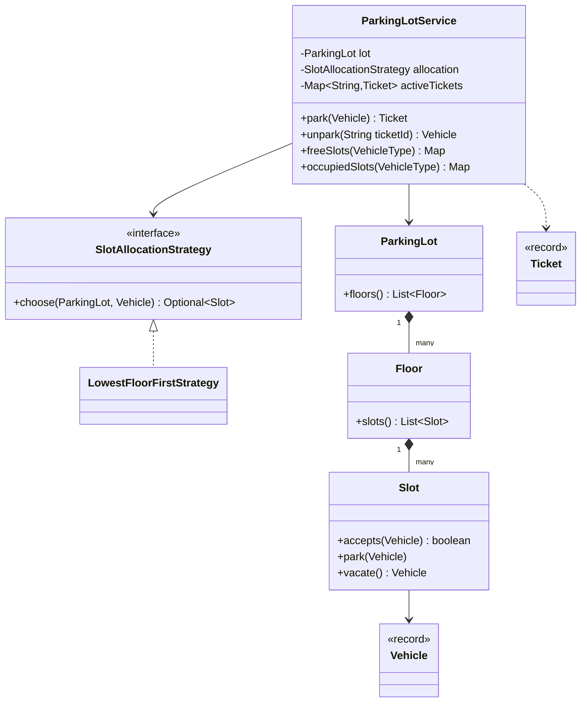

# Parking Lot

> [!abstract] Catalog #1 (P0) · archetype §2 Pluggable Policy · patterns: Strategy (with an `EnumMap` lookup), Singleton-free orchestrator.
> The hard part: keeping **slot rules in the slot, workflow in the service, and every variation (pricing, slot compatibility, allocation order) behind an interface**, so each follow-up adds a class instead of editing one; then making two gates racing for the last slot impossible to double-allocate.

Code: v0 [lld/parkinglot/v0](../Code/src/main/java/lld/parkinglot/v0/) · full [lld/parkinglot/full](../Code/src/main/java/lld/parkinglot/full/) · tests [v0](../Code/src/test/java/lld/parkinglot/v0/ParkingLotServiceV0Test.java), [full](../Code/src/test/java/lld/parkinglot/full/ParkingLotServiceFullTest.java). Each package is self-contained: everything it needs (exceptions, CLI driver, demo clock) is inside it, exactly as you'd have to type it in the round.

---

## 1. Clarify Script

The Indian machine-coding version (workat.tech's widely used statement) is CLI-driven with exact output strings. The LLD-discussion version (Uber, Amazon) is the same model without the CLI. Ask:

| Question | Default (the standard prompt) | If different |
|---|---|---|
| Vehicle types? | TRUCK, BIKE, CAR | EV, handicapped → **E2** |
| Floor layout? | Slot 1 truck, slots 2–3 bike, rest car, same on every floor | Custom layouts → **E2** |
| Who picks the slot? | System: lowest floor, then lowest slot number | Spread load, nearest to lift → **E3** |
| Ticket id format? | `<lotId>_<floor>_<slot>`, e.g. `PR1234_2_5` | Unique per visit → **E4** |
| Pricing? | Not in the base prompt | Hourly / first-hour flat → **E1** |
| Several entry/exit gates at once? | No: one CLI user | Yes → **E4** |
| Storage? | In memory only; no database | — |
| Lost ticket, reservations, payments? | Out of scope | Review cards |

---

## 2. Requirements

### Functional (base prompt)

- `create_parking_lot <id> <floors> <slotsPerFloor>`
- `park_vehicle <type> <regNo> <color>` → `Parked vehicle. Ticket ID: PR1234_1_4`, or `Parking Lot Full`.
- `unpark_vehicle <ticketId>` → `Unparked vehicle with Registration Number: … and Color: …`, or `Invalid Ticket`.
- `display free_count|free_slots|occupied_slots <type>` → one line per floor.

### Constraints

- Plain Java, in-memory, CLI demo, exact output strings, clean errors for bad input.

### Out of scope

- Payments, gates and cameras, reservations, UI.

---

## 3. Entities and Responsibilities

The rule of thumb: a rule lives with the state it's about; workflow lives in the orchestrator.

| Entity | Owns | Must not know about |
|---|---|---|
| `Slot` | "holds at most one vehicle, only of a type it accepts" | tickets, floors' other slots |
| `Floor` | its ordered slots and their layout | allocation order |
| `ParkingLot` | the physical structure (floors) | tickets, pricing |
| `SlotAllocationStrategy` | the order in which slots are tried | parking or ticket issuing |
| `Ticket` (record) | which vehicle is where (and since when, from E1) | — |
| `ParkingLotService` | the workflow: choose → claim → issue ticket; unpark; queries; active tickets | CLI parsing |
| `ParkingLotApp` | parsing commands and formatting output | business rules |

---

## 4. Class Design



---

## 5. V0 — the 90-Minute Build

Package [lld/parkinglot/v0](../Code/src/main/java/lld/parkinglot/v0/), 15 files:

- **Domain (10):** `Vehicle`, `VehicleType`, `Slot`, `Floor`, `ParkingLot`, `Ticket`, `SlotAllocationStrategy`, `LowestFloorFirstStrategy`, `ParkingLotService`, `ParkingLotApp`.
- **Boilerplate you type first (5, ~110 lines):** `DomainException` with `ValidationException` (has a one-line `require` guard), `NotFoundException`, `ConflictException`; and `CommandLineDriver`, a ~60-line loop that maps a command word to a handler and prints a `DomainException`'s message instead of a stack trace. Write these in the first 10 minutes; every later class leans on them.

**Slot owns its rule:**

```java
public boolean accepts(Vehicle candidate) {
    return isFree() && candidate.type() == type;
}

public void park(Vehicle candidate) {
    if (!accepts(candidate)) {
        throw new ConflictException("Slot " + floor + "-" + number + " cannot take " + candidate.type());
    }
    vehicle = candidate;
}
```

**The service orchestrates:**

```java
public Ticket park(Vehicle vehicle) {
    Slot slot = allocation.choose(lot, vehicle)
            .orElseThrow(() -> new ConflictException("Parking Lot Full"));
    slot.park(vehicle);
    Ticket ticket = Ticket.issue(lot.id(), vehicle, slot);     // PR1234_<floor>_<slot>
    activeTickets.put(ticket.id(), ticket);
    return ticket;
}

public Vehicle unpark(String ticketId) {
    Ticket ticket = activeTickets.remove(ticketId);
    if (ticket == null) throw new NotFoundException("Invalid Ticket");
    return lot.floor(ticket.floor()).slot(ticket.slot()).vacate();
}
```

- **Why a strategy already in V0:** the allocation rule is the first thing reviewers change. One interface costs two minutes and makes E3 free.
- **Errors:** `ValidationException` (bad type, blank registration, non-numeric args), `ConflictException` (`Parking Lot Full`, no lot created), `NotFoundException` (`Invalid Ticket`). `CommandLineDriver` catches `DomainException` and prints the message; any other exception is a bug and crashes.
- **Deliberately single-threaded:** the prompt has one CLI user. Say so out loud; E4 is ready.

---

## 6. Trace

`create_parking_lot PR1234 2 6` → each floor: slot 1 TRUCK, 2–3 BIKE, 4–6 CAR.

| Command | State change | Output |
|---|---|---|
| `park_vehicle CAR KA-01-DB-1234 black` | strategy scans floor 1: slots 1–3 reject CAR, slot 4 accepts → occupied | `Parked vehicle. Ticket ID: PR1234_1_4` |
| `park_vehicle TRUCK KA-02 white` | floor 1 slot 1 | `PR1234_1_1` |
| `park_vehicle TRUCK KA-03 white` | floor 1 slot 1 taken → floor 2 slot 1 | `PR1234_2_1` |
| `park_vehicle TRUCK KA-04 white` | no truck slot free | `Parking Lot Full` |
| `unpark_vehicle PR1234_2_2` | not an active ticket | `Invalid Ticket` |
| `display free_count CAR` | — | `No. of free slots for CAR on Floor 1: 2` / `… Floor 2: 3` |

---

## 7. Extension Ladder

All four are in package [lld/parkinglot/full](../Code/src/main/java/lld/parkinglot/full/). The measure of a good V0 is how few existing classes each step edits.

### E1 — "Now charge on exit. Bikes ₹10/hour; cars ₹40 for the first hour, ₹30 per extra started hour."

- **Added:** `PricingStrategy` (interface), `HourlyPricing`, `FirstHourFlatPricing`, `Receipt`; an `EnumMap<VehicleType, PricingStrategy>` passed to the service, with a private `pricingFor(type)` that throws `ValidationException` for an unconfigured type.
- **Edited:** `Ticket` gains `entryTime`; the service takes a `java.time.Clock` and `unpark` returns a `Receipt`.
- **Pattern:** Strategy chosen by key; a new scheme is a new class plus one `put`. Money in **paise** (`long`), never `double`.
- **Demo and tests:** the package has its own `ManualClock` (a `Clock` subclass with `advance(Duration)`), so "parked 125 minutes" needs no sleeping. Production passes `Clock.systemUTC()`.

```java
static long billableHours(Instant entry, Instant exit) {          // 0 min -> 1 h, 61 min -> 2 h
    long minutes = Math.max(0, Duration.between(entry, exit).toMinutes());
    return Math.max(1, (minutes + 59) / 60);
}
// FirstHourFlatPricing: firstHourPaise + (hours - 1) * perExtraHourPaise
```

- The service looks the pricing strategy up **before** claiming a slot, so it never parks a vehicle it can't bill.
- Tested: 125 minutes for a car = ₹40 + 2 × ₹30 = ₹100; 0 minutes still pays one hour.

### E2 — "Add EV charging slots. EVs prefer a charger but can use a normal car slot; normal cars never take chargers. Floors can have different layouts."

- **The modelling fix:** slot type stops being the same thing as vehicle type. Add `SlotType` (TRUCK, BIKE, CAR, EV_CHARGING) next to `VehicleType` (adds EV_CAR).
- **Added:** `CompatibilityRules` (vehicle type → allowed slot types in preference order), `FloorLayout` (slot number → slot type; `standard()` reproduces the prompt).
- **Edited:** `Floor` takes a layout instead of hard-coding it; strategies rank candidates by compatibility preference.

```java
public static CompatibilityRules defaults() {
    return new CompatibilityRules()
            .allow(VehicleType.TRUCK, SlotType.TRUCK)
            .allow(VehicleType.BIKE, SlotType.BIKE)
            .allow(VehicleType.CAR, SlotType.CAR)
            .allow(VehicleType.EV_CAR, SlotType.EV_CHARGING, SlotType.CAR);   // preference order
}
```

- A future "handicapped slot" or "compact car" is one enum value plus one `allow(...)` line.

### E3 — "Mornings, send cars to the emptiest floor to spread ramp traffic; switch back at night."

- **Added:** `SpreadAcrossFloorsStrategy` (ranks by compatibility, then by most free compatible slots on the floor).
- **Edited:** nothing in the domain. The service gets `switchAllocation(...)`; the CLI gets `set_strategy SPREAD|LOWEST_FLOOR`.
- **Interface change made for E4:** strategies return an ordered **list of candidates**, not one slot (see below).

### E4 — "There are 6 entry gates and 4 exit gates working at the same time."

Three races exist in V0, and each gets its own fix:

| Race | V0 behaviour | Fix in full |
|---|---|---|
| Two gates choose the same free slot | Both `park` it; one car is lost | `Slot` holds an `AtomicReference<Vehicle>`; `tryOccupy` is one **CAS**. The loser tries the next candidate from the strategy's list. No lock is held. |
| Two exit gates present the same ticket | Both could unpark | `activeTickets` is a `ConcurrentHashMap`; `remove(id)` returns the ticket to exactly one caller. `vacate(expected)` is also a CAS. |
| Ticket id reused when a slot is reused | `PR1234_1_4` is issued again to the next car, so an old paper ticket could unpark it | Id gets an `AtomicLong` sequence: `PR1234_1_4_17` |

```java
public Ticket park(Vehicle vehicle) {
    pricing.get(vehicle.type());                                   // fail fast
    for (Slot slot : allocation.candidates(lot, vehicle, rules)) {
        if (slot.tryOccupy(vehicle)) {                             // CAS: exactly one gate wins
            Ticket ticket = new Ticket(lot.id() + "_" + slot.floor() + "_" + slot.number()
                    + "_" + ticketSequence.incrementAndGet(), vehicle, slot.floor(), slot.number(),
                    slot.type(), clock.instant());
            activeTickets.put(ticket.id(), ticket);
            return ticket;
        }
        // lost this slot to another gate: try the next candidate
    }
    throw new ConflictException("Parking Lot Full");
}
```

- The strategy reference is `volatile`, so `switchAllocation` is seen by all gates.
- **Why not `synchronized park()`:** correct but serialises every gate through one lock. Per-slot CAS lets gates that want different slots never wait for each other. Say both options and why you chose CAS.
- Tested: 400 cars from 16 threads into 170 car slots → exactly 170 parked, 230 `Parking Lot Full`, no slot handed out twice; 8 threads unparking one ticket → exactly one succeeds.

---

## 8. Review Cards

- **"Why is pricing not a method on `Vehicle` (or a `Car extends Vehicle` subclass)?"**
    + Pricing changes for business reasons (malls, festivals, monthly passes) independently of what a car is. A strategy can change without touching vehicles, and one vehicle type can be priced differently in two lots.
- **"Why is `ParkingLotService` not a Singleton?"**
    + Nothing needs global access, and a singleton makes tests share state. One instance is created by the app and passed where needed.
- **"Complexity of `park`?"**
    + V0 scans slots: O(floors × slots) worst case. For thousands of slots, keep a per-floor, per-type set of free slot numbers (a `TreeSet` gives lowest-first in O(log n)) or a `ConcurrentLinkedQueue` per type; the strategy interface hides the change.
- **"What if the lot is full but a car leaves while we're scanning?"**
    + We may say full a moment too early. That is acceptable at a gate; the driver retries. Say it rather than lock the whole lot.
- **"Lost ticket?"**
    + Look up the active ticket by registration number (add an index map), charge the daily maximum, log it for audit.
- **"Monthly passes / reservations?"**
    + A pass is a pricing strategy (fee 0 while valid); a reservation is a hold on a slot with a TTL, the same idea as [[MD-04 - High-Contention Reservation and TTL Lease Sweeper]] (with a `ScheduledExecutorService` task to release it, and lazy expiry on read so the timer isn't needed for correctness).
- **"How would this scale to 500 lots across India with a mobile app showing free counts?"**
    + That's HLD: per-lot service owns its slots, free counts published as events to a read model, and the app reads counts from a cache. Link: [[MD-19 - Baseline Scaling Path]].
- **"How do you test the gate race?"**
    + Many threads, a `CountDownLatch` to start them together, assertions on totals and on "no slot id appears twice" (see `e4_manyGatesNeverDoubleAllocateASlot`).

---

## 9. Edge Cases and Tests

| Case | Expected | Test |
|---|---|---|
| Lowest floor, lowest slot of the right type | `PR1234_1_4`, then `_1_5`, bike `_1_2`, truck `_1_1`, next truck `_2_1` | v0 `parksInLowestFloorThenLowestSlotOfMatchingType` |
| No slot of that type | `Parking Lot Full` | v0 `rejectsWhenNoSlotOfThatTypeIsFree` |
| Unpark twice / unknown ticket | `Invalid Ticket` | v0 `unparkFreesTheSlot…`, `unknownTicketIsInvalid` |
| Blank registration, type `BUS` | `ValidationException` | v0 `vehicleValidation` |
| CLI output strings | Exactly as in the prompt | v0 `cliPrintsPromptFormat` |
| Fees (E1) | ₹100 for 125 min car; ₹10 for 0 min bike | full `e1_*` |
| EV preference and fallback (E2) | Charger first, then car slot; cars never take chargers | full `e2_*` |
| Spread strategy (E3) | Next car goes to the emptier floor | full `e3_*` |
| Concurrency and ticket reuse (E4) | No double allocation; one unpark per ticket; unique ids | full `e4_*` |

Run: `.\mvnw.cmd test` in `LLD/Code`.

---

## 10. Self-Review Rubric

- [ ] Names match the domain (`Slot`, `Floor`, `Ticket`, not `Manager`, `Helper`).
- [ ] Each class has one reason to change (slot rule, layout, allocation, pricing, workflow, CLI).
- [ ] E1–E3 added classes; edits were confined to constructor wiring and records.
- [ ] Every user-facing failure is a `DomainException` with the prompt's wording.
- [ ] Concurrency is either stated as out of scope (V0) or handled per race (E4), with a test.
- [ ] The demo runs end to end and matches the output format.

---

## 11. One-Minute Pitch

> "Slots own the rule that they hold one vehicle of a compatible type; floors own the layout; the service owns the workflow and active tickets; an allocation strategy decides the order slots are tried. Pricing is a strategy per vehicle type looked up from a registry, money in paise, billed per started hour from an injected clock. EV support separates slot type from vehicle type with a compatibility table in preference order. For many gates, claiming a slot is a compare-and-set, the strategy returns candidates so the loser simply tries the next one, unpark is a `ConcurrentHashMap.remove` so only one exit gate wins, and ticket ids carry a sequence so a reused slot never revives an old ticket."

---

## Sources

- workat.tech, *Design a Parking Lot | Machine Coding Round Questions (SDE I/II)* (2022): the CLI command set, layout (slot 1 truck, 2–3 bikes, rest cars), ticket id format. https://workat.tech/machine-coding/practice/design-parking-lot-qm6hwq4wkhp8
- GitHub solutions quoting the same statement (e.g. ajitzote/parking-lot, yashaswiniyellapu/parkingLot). https://github.com/ajitzote/parking-lot
- Hello Interview, *Parking Lot* LLD breakdown (Dec 2025): clarifying questions; extensions for multi-floor, per-vehicle pricing, concurrent entrances. https://www.hellointerview.com/learn/low-level-design/problem-breakdowns/parking-lot
- PracHub, *Parking Lot Design Interview: Class Model, Pricing, and the Two-Gate Race* (2026): default OOD question at Uber and Amazon; the last-spot race. https://prachub.com/resources/parking-lot-system-design
- PracHub LLD guide (Jun 2026), via [[Problem Catalog]]: parking lot is the most frequent LLD prompt.

## Related Notes

- [[LLD/Problems/README|LLD Problems]]
- [[Problem Catalog]]
- [[Strategy]]
- [[Factory Pattern]]
- [[06 - Atomics and CAS]]
- [[07 - Concurrent Collections]]
- [[01 - Exception Handling]]
- [[09 - Testability]]
