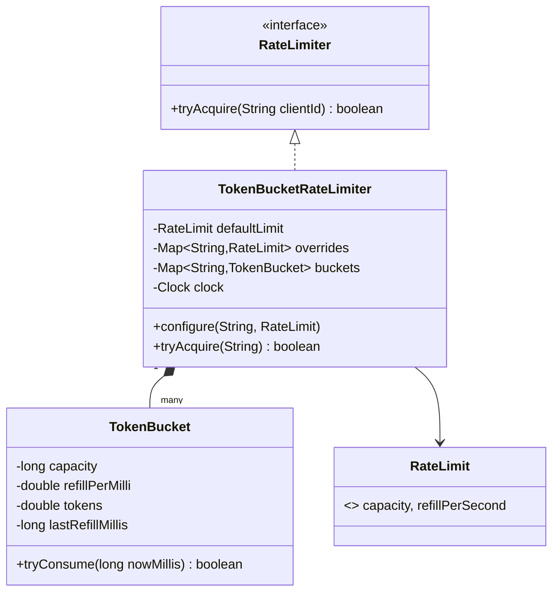

# Rate Limiter

> [!abstract] Catalog #2 (P0) · archetype §7 Concurrency · patterns: Strategy (with an `EnumMap` of factories).
> The hard part: "refill, check, take" must be **one atomic step per client** without one lock for all clients, and when several limits apply to one request, a rejection by any of them must **give back** what the others already took.

Code: v0 [lld/ratelimiter/v0](../Code/src/main/java/lld/ratelimiter/v0/) · full [lld/ratelimiter/full](../Code/src/main/java/lld/ratelimiter/full/) · tests [v0](../Code/src/test/java/lld/ratelimiter/v0/TokenBucketRateLimiterV0Test.java), [full](../Code/src/test/java/lld/ratelimiter/full/RateLimiterServiceFullTest.java). Each package is self-contained: everything it needs (exceptions, CLI driver, demo clock) is inside it, exactly as you'd have to type it in the round.

This is the **in-process** (single JVM) design. The distributed version (Redis Lua, edge waiting room) is HLD: [[MD-02 - Traffic Shaper Rate Limiter and Waiting Room]].

---

## 1. Clarify Script

The typical prompt is deliberately vague: "Design and implement a rate limiter. Configurable limits per user. It must be thread-safe." Drive it:

| Question | Default | If different |
|---|---|---|
| Limit per what? | Per client id | Per endpoint, per client+endpoint, global → **E2** |
| Which algorithm? | Token bucket (allows short bursts) | Strict windows, exact counts → **E1** |
| Same limit for everyone? | Default limit with per-client overrides | Changed at runtime → **E4** |
| Does every call cost 1? | Yes | Bulk APIs, LLM tokens → **E3** |
| What does the caller get back? | Allowed yes/no | Remaining, retry-after for HTTP 429 → **E3** |
| Thread-safe? | Yes, many request threads | — (V0 already is) |
| Distributed across servers? | No, one process | HLD follow-up, review card |
| Memory bound for millions of clients? | Not needed in the demo | Idle eviction → **E4** |

---

## 2. Requirements

### Functional

- `tryAcquire(clientId)` → allowed or rejected.
- Default limit for all clients; per-client override.
- Token bucket: burst up to capacity, refill at a fixed rate.

### Constraints

- Thread-safe under many concurrent callers; different clients must not block each other.
- Time injected (`Clock`) so behaviour is testable; no background thread per client.
- Plain Java, in memory, CLI demo.

### Out of scope

- Distribution across servers, persistence, HTTP layer.

---

## 3. Entities and Responsibilities

| Entity | Owns | Must not know about |
|---|---|---|
| `RateLimit` (record) | capacity and refill rate, validated | clients |
| `TokenBucket` | one client's tokens; refill-check-take atomically | other clients, the map |
| `TokenBucketRateLimiter` | the client → bucket map, defaults and overrides | how a bucket refills |
| `RateLimiter` (interface) | the contract callers depend on | algorithm |
| `RateLimiterApp` | CLI parsing and printing | limiting logic |

---

## 4. Class Design



---

## 5. V0 — the 90-Minute Build

Package [lld/ratelimiter/v0](../Code/src/main/java/lld/ratelimiter/v0/), 9 files:

- **Domain (5):** `RateLimit`, `RateLimiter`, `TokenBucket`, `TokenBucketRateLimiter`, `RateLimiterApp`.
- **Boilerplate you type first (4):** `DomainException` + `ValidationException` (with a `require` guard), `CommandLineDriver` (~60 lines: command word → handler, prints error messages instead of stack traces), and `ManualClock`, a `java.time.Clock` subclass with `advance(Duration)` so the demo and tests can move time. Production passes `Clock.systemUTC()`.

**Lazy refill, one atomic step per bucket:**

```java
synchronized boolean tryConsume(long nowMillis) {
    refill(nowMillis);                 // tokens += elapsed × rate, capped at capacity
    if (tokens >= 1) {
        tokens -= 1;
        return true;
    }
    return false;
}
```

**Exactly one bucket per client, even when its first two requests arrive together:**

```java
public boolean tryAcquire(String clientId) {
    requireClient(clientId);
    long now = clock.millis();                                  // read time once
    TokenBucket bucket = buckets.computeIfAbsent(clientId,
            id -> new TokenBucket(overrides.getOrDefault(id, defaultLimit), now));
    return bucket.tryConsume(now);
}
```

- **Two layers of thread safety:** `ConcurrentHashMap.computeIfAbsent` creates one bucket per client atomically; each bucket's `synchronized` method makes refill-check-take atomic. Different clients use different monitors, so they never contend.
- **Why lazy refill:** no timer per client. Tokens are recomputed from elapsed time when a request arrives, which also makes the bucket a few fields of state.
- **Errors:** `ValidationException` for capacity ≤ 0, refill ≤ 0, blank client id.
- **V0 limitation, stated out loud:** `configure` only affects clients that don't have a bucket yet (E4 fixes it).

---

## 6. Trace

`configure alice 3 1` (burst 3, 1 token/s), clock frozen at 10:00:00.000.

| Time | Command | Tokens before → after | Output |
|---|---|---|---|
| 0 ms | `request alice` | new bucket 3 → 2 | `alice: ALLOWED` |
| 0 ms | `request alice` | 2 → 1 | `ALLOWED` |
| 0 ms | `request alice` | 1 → 0 | `ALLOWED` |
| 0 ms | `request alice` | 0, refill 0 | `REJECTED` |
| +1000 ms | `request alice` | refill 0 + 1 = 1 → 0 | `ALLOWED` |
| +1000 ms | `request alice` | 0 | `REJECTED` |
| +1000 ms | `request bob` | new bucket (default 5) 5 → 4 | `bob: ALLOWED` |

---

## 7. Extension Ladder

All four are in package [lld/ratelimiter/full](../Code/src/main/java/lld/ratelimiter/full/), behind one entry point, `RateLimiterService.evaluate(Request) → Decision`.

### E1 — "Support other algorithms: fixed window, sliding window. Different tiers may use different ones."

- **Added:** `Algorithm` enum, `LimitPolicy(algorithm, permits, window)`, `LimiterState` interface and four implementations: `TokenBucketState`, `FixedWindowState`, `SlidingWindowLogState`, `SlidingWindowCounterState`. An `EnumMap<Algorithm, StateFactory>` filled in the constructor maps each algorithm to its constructor reference (`TokenBucketState::new`).
- **Pattern:** Strategy per key; adding "leaky bucket" is one class and one `put` line.

| Algorithm | State per key | Behaviour | Pick when |
|---|---|---|---|
| Token bucket | tokens + last refill | Bursts up to capacity, then steady rate | Default for APIs and mobile clients |
| Fixed window | count + window start | Can pass 2 × limit across a boundary (tested) | Cheapest; coarse quotas ("1,000 per day") |
| Sliding window log | timestamp per accepted request | Exact; memory grows with the limit | Low limits on valuable actions: OTP sends, password resets |
| Sliding window counter | current + previous count | `previous × (1 − elapsed fraction) + current`; O(1) memory, small approximation | High limits where boundary bursts matter |

### E2 — "Apply several limits at once: 5/second per user, 100/minute per endpoint, and a global cap."

- **Added:** `Scope` (CLIENT, ENDPOINT, CLIENT_ENDPOINT, GLOBAL) turns a request into a counter key; `Rule(name, scope, policy)`; `Request(clientId, endpoint, cost)`.
- **The subtle part, all-or-nothing:** rules are checked in order. If rule 3 rejects, rules 1 and 2 have already taken permits for a request that won't run. Those permits are **refunded**:

```java
if (!outcome[0].allowed()) {
    refundAll(acquired, request.cost(), now);          // give back what earlier rules took
    rejections.computeIfAbsent(rule.name(), r -> new LongAdder()).increment();
    return Decision.reject(rule.name(), outcome[0].retryAfterMillis());
}
acquired.add(key);
```

- Tested: bob is rejected by `per-endpoint` on `/x`, and his `per-user` token comes back, so his next request to `/y` passes.
- The concurrency rule that makes this safe (below) also applies to refunds.

### E3 — "Return remaining quota and when to retry (we'll send HTTP 429 with Retry-After). Some calls cost more than one unit."

- **Added:** `Decision(allowed, rule, remaining, retryAfter)` with `retryAfterSeconds()` for the header; `Request.cost` for weighted calls (bulk APIs, LLM tokens); per-rule rejection counters (`LongAdder`).
- Each algorithm computes its own retry hint: token bucket `ceil((cost − tokens) / rate)`; fixed window = time to window end; sliding log = when enough of the oldest entries expire; sliding counter = when the previous window's weight has decayed enough.
- A request whose cost is larger than a rule's whole limit can never pass, so it's a `ValidationException`, not a 429.
- `acquireOrThrow` wraps it as a `ConflictException` for callers who prefer exceptions; the hot path returns a `Decision` because rejections are normal, not exceptional.

### E4 — "Change a client's limit at runtime (they upgraded). And memory grows forever with millions of clients."

- **Live overrides:** `override(rule, key, policy)` / `clearOverride`. Each state remembers its policy; on the next request, if the effective policy differs, a fresh state is created with the new policy. Simple and predictable; the trade-off (a client's current window resets on upgrade) is stated.
- **Idle eviction:** `evictIdle(Duration)` removes states untouched for that long. `scheduleEviction(executor, every, idle)` runs it periodically on a caller-supplied `ScheduledExecutorService`, catching exceptions inside the task because a periodic task that throws is silently cancelled. A returning client simply gets a fresh, full state.

```java
public ScheduledFuture<?> scheduleEviction(ScheduledExecutorService executor, Duration every, Duration idle) {
    return executor.scheduleAtFixedRate(() -> {
        try {
            evictIdle(idle);
        } catch (RuntimeException e) {
            System.err.println("Idle eviction failed: " + e.getMessage());
        }
    }, every.toMillis(), every.toMillis(), TimeUnit.MILLISECONDS);
}
```

### The concurrency rule behind E1–E4

V0 used a `synchronized` bucket. The full version needs creation, policy swap, acquire, refund and eviction to be atomic with respect to each other for one key, without a lock for all keys. One rule does it:

> A state object is only ever touched inside `ConcurrentHashMap.compute` / `computeIfPresent` for its key.

```java
states.compute(key, (k, state) -> {
    LimiterState s = (state == null || !state.policy().equals(policy))
            ? factories.get(policy.algorithm()).create(policy, now)   // new key, or policy changed (E4)
            : state;
    outcome[0] = s.tryAcquire(request.cost(), now);
    return s;
});
```

- `compute` runs one remapping function at a time per key, so two threads for the same client are serialised and different clients are not.
- Eviction uses `computeIfPresent(key, … → null)`, so a state in use is never removed halfway through a request.
- The functions are short and touch only their own key, as `ConcurrentHashMap` requires.
- Tested: 20 threads × 200 requests across 10 clients, per-user 100 and global 500 → **exactly 500** allowed.

---

## 8. Review Cards

- **"Why not one `synchronized` method on the whole limiter?"**
    + Correct but every client waits on one lock. Per-key atomicity (`synchronized` bucket in V0, `compute` in full) keeps clients independent.
- **"Why not a background thread that refills every bucket every second?"**
    + Millions of buckets × a timer is wasted work and memory. Lazy refill computes the same result on demand.
- **"`System.currentTimeMillis()` vs injected `Clock`?"**
    + The clock is injected so tests are exact and fast (the package's `ManualClock`); time is read once per request so all rules see the same "now". Wall clocks can jump backwards; refill ignores negative elapsed time.
- **"What's the memory per client?"**
    + Token bucket and counters: a few dozen bytes plus the map entry. Sliding log: one entry per accepted request in the window, which is why it's only for small limits.
- **"Make it work across 20 servers."**
    + Counters move to Redis with the check-and-decrement in a Lua script; pods batch tokens locally; fall back to local limits if Redis is down. That's [[MD-02 - Traffic Shaper Rate Limiter and Waiting Room]].
- **"Fail open or fail closed?"**
    + In-process there's nothing to fail. In the distributed version: fail open for normal APIs, closed for costly actions (OTP SMS), local fallback as the default.
- **"Rate limit an LLM endpoint by tokens."**
    + `Request.cost` = estimated tokens; reserve before the call, refund or charge the difference after. Same refund mechanism as E2.
- **"How do you test it?"**
    + A frozen `ManualClock` for exact counts; `advance` for refill and window edges; a latch-started multi-threaded test that asserts exact totals.

---

## 9. Edge Cases and Tests

| Case | Expected | Test |
|---|---|---|
| Burst then reject | capacity allowed, next rejected | v0 `allowsBurstUpToCapacityThenRejects` |
| Refill and cap | +1 token per second, never above capacity | v0 `refillsLazily…` |
| Clients independent; override | separate buckets; VIP gets 3 | v0 `clientsAreIndependentAndOverridesApply` |
| Bad config / blank client | `ValidationException` | v0 `validatesInput`, full `validation` |
| 16 threads, capacity 50, frozen clock | exactly 50 allowed | v0 `concurrentRequestsNeverExceedCapacity` |
| Token bucket retry-after | 334 ms for 3/s | full `tokenBucketRejectsWithRetryAfter…` |
| Fixed-window boundary burst | 4 requests in 2 ms with limit 2/s | full `fixedWindowAllowsBoundaryBurst` |
| Sliding log exactness | retry exactly when the oldest entry leaves | full `slidingWindowLogIsExact` |
| Sliding counter weighting | 5 more fit at half-window | full `slidingWindowCounterWeighsThePreviousWindow` |
| Refund on later rejection | bob's token comes back | full `laterRuleRejectionRefundsEarlierRules` |
| Global cap | 4th client rejected by `global` | full `globalRuleCapsAllClientsTogether` |
| Weighted cost | remaining 6 after cost 4; cost 11 > 10 invalid | full `weightedCostAndRemaining` |
| Live override and clear | 3 allowed, then back to 1 | full `overrideTakesEffectOnNextRequest…` |
| Idle eviction | only the idle key is removed | full `idleStatesAreEvicted` |
| Scheduled eviction | background task clears idle keys | full `scheduledEvictionRunsInTheBackground` |
| Many threads, two rules | exactly 500 allowed | full `concurrentRequestsRespectEveryRuleExactly` |

Run: `.\mvnw.cmd test` in `LLD/Code`.

---

## 10. Self-Review Rubric

- [ ] Time is injected and read once per request.
- [ ] Per-key atomicity, no global lock; the rule ("only inside `compute`") is written in the class Javadoc.
- [ ] New algorithms and scopes are new classes / enum values; the service didn't change.
- [ ] Rejection is a return value on the hot path; misuse is an exception.
- [ ] Multi-rule requests are all-or-nothing (refunds tested).
- [ ] The demo shows allow, reject with retry-after, override and eviction.

---

## 11. One-Minute Pitch

> "Each client has a token bucket with lazy refill: on every request it adds elapsed-time tokens, capped at capacity, then takes one, all in one atomic step for that client. V0 gets that from a `computeIfAbsent` on a ConcurrentHashMap plus a synchronized bucket, so clients never contend. The full version makes algorithms pluggable through a registry: token bucket, fixed window, sliding log, sliding counter. Several rules can apply to one request, by client, endpoint or globally, and if any rejects, permits taken by earlier rules are refunded. It returns remaining quota and retry-after for a 429, supports weighted costs, changes limits at runtime and evicts idle state. Every state is touched only inside `compute` for its key, which keeps create, acquire, refund and evict atomic per key without a global lock."

---

## Sources

- jagadishkoppula/LLD-RateLimiter (GitHub): the typical prompt, "configurable limits per user… thread-safe", deliberately vague. https://github.com/jagadishkoppula/LLD-RateLimiter
- AlgoMonster, *Low-Level Design: Rate Limiter*: cheap deterministic state, per-client independence, safe allow/deny under concurrency. https://algo.monster/courses/lld/lld_rate_limiter
- Dilip Kumar, *Rate limiter system coding exercise* (2026): lazy refilling instead of background threads. https://dilipkumar.medium.com/rate-limiter-system-coding-exercise-cb24574b69e7
- Redis, *Build 5 Rate Limiters with Redis* (2026): sliding window counter as the default, token bucket for bursts, leaky bucket for strict smoothing. https://redis.io/learn/howtos/ratelimiting
- Stripe, *Scaling your API with rate limiters* (2017): several limiters per request. https://stripe.com/blog/rate-limiters
- [[Problem Catalog]]: rate limiter in Atlassian, Uber, Swiggy and Razorpay LLD rounds (2025–26).

## Related Notes

- [[LLD/Problems/README|LLD Problems]]
- [[Problem Catalog]]
- [[MD-02 - Traffic Shaper Rate Limiter and Waiting Room]]
- [[Strategy]]
- [[07 - Concurrent Collections]]
- [[04 - synchronized and Monitors]]
- [[08 - Executors and Thread Pools]]
- [[09 - Testability]]
