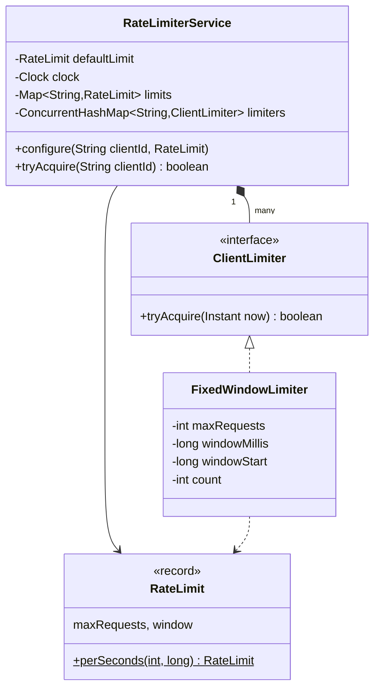
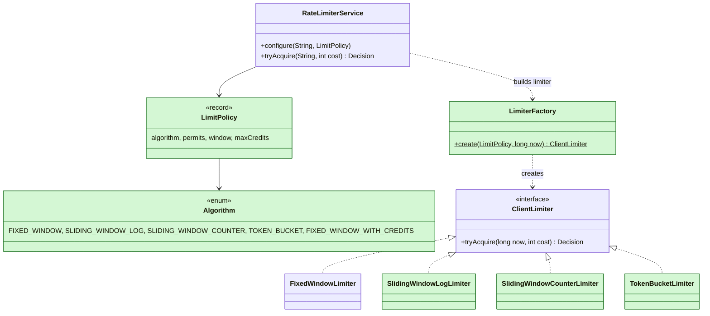
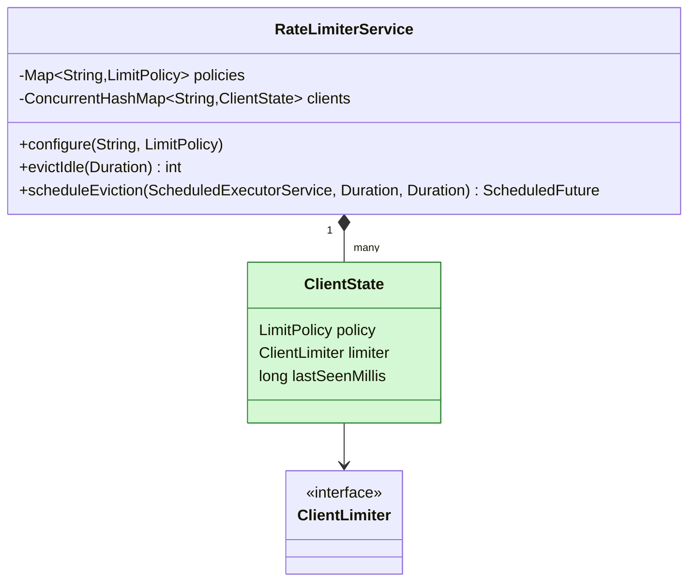
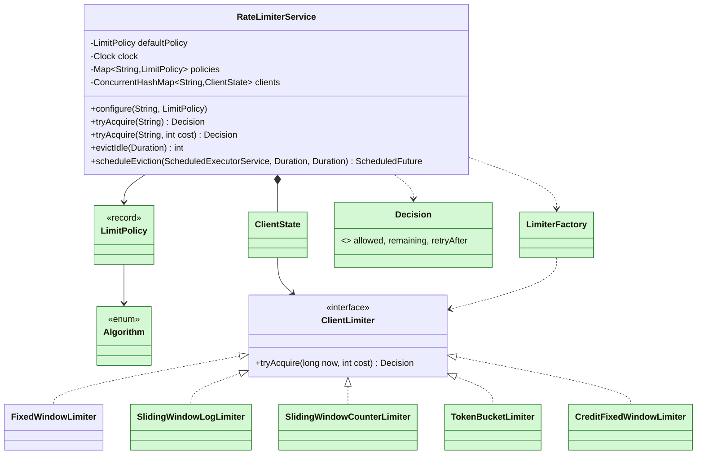

# Rate Limiter

> [!abstract] Catalog #2 (P0) · archetype §7 Concurrency · patterns: Strategy (algorithm per policy, built by a factory), per-key atomicity with `ConcurrentHashMap.compute` · driver: **plain Demo**, because no reported prompt defines a command format; the rounds are discussion plus code.
> The hard part: "check and count" must be one atomic step per client without one lock for all clients, and every algorithm must answer "how long until I can retry".

Code: v0 [lld/ratelimiter/v0](../Code/src/main/java/lld/ratelimiter/v0/) · full [lld/ratelimiter/full](../Code/src/main/java/lld/ratelimiter/full/) · tests [v0](../Code/src/test/java/lld/ratelimiter/v0/RateLimiterServiceV0Test.java), [full](../Code/src/test/java/lld/ratelimiter/full/RateLimiterServiceFullTest.java). Snapshots are self-contained.

This is the in-process (single JVM) design. Distributed limiting is HLD: [[MD-02 - Traffic Shaper Rate Limiter and Waiting Room]].

---

## 1. Clarify Script

The reported prompt is short: "allow X requests in Y seconds per client, configurable, thread-safe, extendable". Drive it:

| Question | Default | If different |
|---|---|---|
| Command-line input or demo `main`? | Demo `main` and tests | Commands: add `cli/` |
| Limit per what? | Per client id | Several rules at once: also asked |
| Algorithm? | Fixed window (simplest correct answer) | Sliding / token bucket → **E1** |
| Same limit for everyone? | Default plus per-client config | Changed on live traffic → **E3** |
| Unused quota? | Lost at the window end | Carries over as credits → **E2** |
| Does every call cost 1? | Yes; caller gets allowed yes/no | Weighted cost, remaining and retry-after → **E4** |
| Thread-safe? | Yes | — (V0 already is) |
| Many servers? | No, one process | Also asked, HLD link |

---

## 2. Requirements

### Functional (V0)

- `tryAcquire(clientId)` → true if allowed.
- At most `maxRequests` per `window` per client; windows aligned to multiples of the window length.
- Default limit; `configure(clientId, limit)` per client.

### Constraints

- Thread-safe; different clients don't block each other.
- Time from an injected `Clock`; no background thread per client.

### Out of scope

- Distribution, persistence, the HTTP layer.

---

## 3. Entities and Responsibilities

| Entity | Owns | Must not know about |
|---|---|---|
| `RateLimit` (record) | max requests and window, validated | clients |
| `ClientLimiter` (interface) | one client's counting state | other clients, the map |
| `FixedWindowLimiter` | window start and count | clocks (gets `now` passed in) |
| `RateLimiterService` | client → limiter map, defaults, config, atomicity | how an algorithm counts |
| `Demo` | a scenario and printing | limiting logic |

---

## 4. Class Design (V0)



---

## 5. V0 — the 90-Minute Build

```
lld/ratelimiter/v0/
  model/       RateLimit
  algorithm/   ClientLimiter, FixedWindowLimiter
  service/     RateLimiterService
  exception/   DomainException, ValidationException
  demo/        Demo, ManualClock
```

**Type first:** `DomainException`, `ValidationException` (with `require`), `ManualClock` (a `Clock` with `advance(Duration)`; production passes `Clock.systemUTC()`). A rejection is a normal `false`, not an exception, so there is no `ConflictException`.

**The algorithm, aligned windows:**

```java
public boolean tryAcquire(Instant now) {
    long millis = now.toEpochMilli();
    long start = millis - Math.floorMod(millis, windowMillis);
    if (start != windowStart) {          // new window: reset
        windowStart = start;
        count = 0;
    }
    if (count < maxRequests) {
        count++;
        return true;
    }
    return false;
}
```

**One atomic step per client:**

```java
public boolean tryAcquire(String clientId) {
    requireClient(clientId);
    Instant now = clock.instant();
    boolean[] allowed = new boolean[1];
    limiters.compute(clientId, (id, limiter) -> {
        ClientLimiter current = limiter != null
                ? limiter
                : new FixedWindowLimiter(limits.getOrDefault(id, defaultLimit));
        allowed[0] = current.tryAcquire(now);
        return current;
    });
    return allowed[0];
}
```

- **Why `compute`:** it runs one remapping function at a time per key. Creation and counting for a client are one step, so two threads can't both see "4 used" and take the 5th permit. Different keys proceed in parallel. The limiter itself has no locks and says so in its Javadoc.
- **Why an interface with one implementation:** "now use a sliding window" is the most reported follow-up (E1). The interface costs one minute.
- **Why fixed window first:** it's the simplest correct answer to "X per Y seconds". Name its weakness (2× the limit across a boundary) before the interviewer does; that's the cue for E1.
- **Errors:** `ValidationException` for `maxRequests ≤ 0`, window under 1 ms, blank client id.
- **V0 limitation, stated:** `configure` resets the client's counter and is meant for setup; live changes are E3.

---

## 6. Trace

Default 5 per 10 s, `premium` configured 10 per 10 s, clock at 10:00:00.000 (a window start).

| Time | Call | State | Result |
|---|---|---|---|
| 0 s | `free` × 7 | window [0,10), count 1…5, then stays 5 | `YYYYYnn` |
| 0 s | `premium` × 12 | own limiter, count 1…10 | `YYYYYYYYYYnn` |
| 9.999 s | `free` | same window, count 5 | n |
| 10 s | `free` × 2 | new window [10,20), count reset → 1, 2 | `YY` |

---

## 7. Evidence

| Follow-up | Reports | Count | Placed as |
|---|---|---|---|
| X requests in Y seconds per client, configurable, thread-safe | Remote [Pass] (LC 3413193); jagadishkoppula (GitHub); Atlassian P4 (LC 2231218, Jun 2022); Atlassian senior (LC 5857882) | 4+ | V0 |
| Other algorithms: fixed vs sliding, token bucket for spikes, trade-offs | Atlassian senior (LC 5857882); Microsoft SE2 (LC 7422741); Remote (LC 3413193, "make it extendable") | 3 | **E1** strong |
| Unused quota carries over as credits; credits drop when over the limit | Atlassian P4 (LC 2231218, Jun 2022); Atlassian P5 (LC 1566225, Oct) | 2 (same company, repeated) | **E2** strong |
| Static vs dynamic config, change limits live | Apple (LC 7910157) | 1 | **E3** medium |
| Memory for many idle clients, eviction | none found | 0 | **E3** judgement |
| Weighted requests `{count, timestamp}`, tokens for AI agents | Rejected-candidate report (LC topic 2491120); G-P SWE2 (LC 8500385, Jun 2026) | 2 | **E4** medium |
| Remaining and retry-after for a 429 | guides; implied by the LLM gateway report | 1 | **E4** judgement |
| Distributed across instances | Product-based LLD (LC 7621464); G-P SWE2 (LC 8500385); Apple ("cache goes down") | 3 | Also asked (HLD) |
| Several rules at once (per user and per endpoint) | Stripe engineering blog | 0 reports | Also asked |

Distributed is frequent, but it is an HLD discussion with no in-process code change, so it lives in Also Asked with a link.

---

## 8. Extension Ladder

All four are in [lld/ratelimiter/full](../Code/src/main/java/lld/ratelimiter/full/). The service's public call becomes `tryAcquire(client[, cost]) → Decision`.

### E1 — "Fixed window lets 2× through at the boundary. Implement a sliding window. What about token bucket for spikes?"

- **Evidence:** Atlassian senior (LC 5857882), Microsoft SE2 (LC 7422741), Remote (LC 3413193). Confidence **strong**.
- **Added:** `Algorithm` enum, `LimitPolicy(algorithm, permits, window, maxCredits)`, `LimiterFactory`, `SlidingWindowLogLimiter`, `SlidingWindowCounterLimiter`, `TokenBucketLimiter`.
- **Edited:** `ClientLimiter` takes `(nowMillis, cost)` and returns a `Decision` (E4 shape, introduced here once); `FixedWindowLimiter` follows; the service builds limiters through the factory.
- **Pattern:** Strategy chosen by the policy; a new algorithm is a class plus one `case`.

| Algorithm | State per client | Behaviour | Pick when |
|---|---|---|---|
| Fixed window | start + count | up to 2× across a boundary (tested) | cheapest; coarse quotas |
| Sliding window log | (time, cost) per accepted request | exact; memory grows with the limit | small limits on costly actions (OTP) |
| Sliding window counter | previous + current count | `previous × overlap + current`; O(1), approximate | high limits, the usual production answer |
| Token bucket | tokens + last refill | bursts up to the bucket, then the average rate | "handle spikes"; API clients |

```java
// sliding window counter
double estimate = previous * (double) (window - elapsed) / window + current;
if (estimate + cost <= permits) { current += cost; return Decision.allow(...); }

// token bucket, lazy refill: no timer thread
tokens = Math.min(capacity, tokens + (now - lastRefill) * tokensPerMilli);
```

- **Tested:** 5 at 9.9 s and 5 at 10.0 s all pass on fixed window; the sliding log refuses the second five and says retry in 9.9 s; the counter allows 5 more at half-window; the token bucket refills one per second.

**E1 delta** (green = added):



- Edited, not added: `ClientLimiter` (signature), `FixedWindowLimiter` (cost, `Decision`), `RateLimiterService` (policies, factory). `RateLimit` is replaced by `LimitPolicy`.

### E2 — "If a client doesn't use its quota, carry the unused part over to later windows, up to a maximum."

- **Evidence:** Atlassian P4 (LC 2231218, Jun 2022) and P5 (LC 1566225), the same follow-up at the same company in two reports. Confidence **strong** (for Atlassian specifically).
- **Added:** `CreditFixedWindowLimiter` and `LimitPolicy.withCredits(permits, window, maxCredits)`.
- **Edited:** nothing else; the algorithm enum already had the value.
- **The rule:** when a window rolls over, credits += unused permits of the last window + permits for each fully idle window, capped at `maxCredits`. A request uses the window's permits first, then credits.

```java
long idleWindows = (start - windowStart) / window - 1;
long earned = (permits - used) + Math.min(idleWindows, maxCredits) * (long) permits;   // no overflow on long gaps
credits = Math.min(maxCredits, credits + earned);
...
if (cost <= (permits - used) + credits) {
    long take = Math.min(cost, permits - used);
    used += take;
    credits -= cost - take;
}
```

- **No delta diagram:** one more implementation of `ClientLimiter`.
- **Tested:** 5 per 10 s, use 2 → next window allows 8; after two idle windows, credits cap at 7 → 12 allowed; `remaining` includes credits.

### E3 — "Change a client's limit while it has traffic. And memory grows with millions of clients."

- **Evidence:** Apple (LC 7910157, static vs dynamic config): **medium**. Idle eviction: no report found, **judgement** (it's the obvious next question once the map is per client).
- **Added:** `evictIdle(Duration)`, `scheduleEviction(ScheduledExecutorService, every, idle)`, `trackedClients()`.
- **Edited:** the service keeps `ClientState(policy, limiter, lastSeen)` per client. `configure` only updates the policy map; the next request sees the policy differs and starts a fresh limiter inside `compute`.

```java
clients.compute(clientId, (id, state) -> {
    ClientState current = state != null && state.policy.equals(policy)
            ? state
            : new ClientState(policy, LimiterFactory.create(policy, now));   // new client or new policy
    current.lastSeenMillis = now;
    result[0] = current.limiter.tryAcquire(now, cost);
    return current;
});

// eviction: computeIfPresent, so a state in use is never removed mid-request
clients.computeIfPresent(id, (key, state) -> state.lastSeenMillis <= cutoff ? null : state);
```

- **Trade-offs to say:** a policy change resets the client's counters (simple; carrying usage across algorithms has no single right answer). Use an idle time of at least the longest window so an evicted client restarts in the state it would be in anyway; credits are lost, which errs on the strict side.
- **Tested:** live switch from 2/10 s fixed to 5-token bucket takes effect on the next request; only idle clients are evicted; the scheduled job clears them on a real scheduler.

**E3 delta** (green = added):



- Edited, not added: `RateLimiterService` (policy check inside `compute`, eviction methods).

**E3: a live policy change racing a request**

```mermaid
sequenceDiagram
    participant A as Admin thread
    participant R as Request thread
    participant P as policies map
    participant C as clients.compute(bob)
    A->>P: put(bob, 5 per 10 s token bucket)
    R->>P: getOrDefault(bob)
    P-->>R: new policy
    R->>C: compute(bob)
    Note over C: state.policy != new policy<br/>→ new TokenBucketLimiter
    C-->>R: Decision(allowed, remaining 4)
    Note over A,R: If R read the policy just before the put, it counts on the old one once;<br/>the next request switches. No request ever sees half of each.
```

### E4 — "Requests have a weight (LLM tokens). Return remaining quota and retry-after so the gateway can send 429."

- **Evidence:** weighted `{count, timestamp}` input (LC topic 2491120); AI agents behind an LLM gateway (G-P SWE2, LC 8500385, Jun 2026): **medium**. `Decision` with retry-after: **judgement**, what a gateway needs.
- **Added:** `Decision(allowed, remaining, retryAfter)`; `tryAcquire(client, cost)`.
- **Edited:** every limiter computes its own retry hint: fixed window = time to window end; sliding log = when enough of the oldest entries expire; counter = when the previous window's weight has decayed enough; token bucket = `ceil((cost − tokens) / rate)`.
- A cost above the whole limit can never pass, so it's a `ValidationException`, not a 429.
- **No delta diagram:** `Decision` was already drawn with E1 (introduced once there to avoid changing the interface twice).
- **Tested:** token bucket 100/min: cost 60 leaves 40; cost 50 refused, retry in 6 s; cost 101 invalid. Fixed window: retry = time to window end.

### Concurrency, across all extensions

> A limiter is only ever touched inside `ConcurrentHashMap.compute` / `computeIfPresent` for its client's key.

- Creation, policy swap, counting and eviction for one client are serialised; different clients aren't.
- The remapping functions are short and touch only their own key, as `ConcurrentHashMap` requires.
- **Tested:** for every algorithm, 1,000 requests from 16 threads with a limit of 100 and a frozen clock → exactly 100 allowed.

### Full version (green = added after V0)



---

## 9. Also Asked

- **Distributed across instances (several reports):** counters in Redis with check-and-count in one Lua script, keyed by client and window; pods may batch permits locally. Details in [[MD-02 - Traffic Shaper Rate Limiter and Waiting Room]].
- **Cache (Redis) goes down (Apple):** fall back to a local in-process limiter at limit ÷ pod count. Fail open for normal APIs, fail closed for costly actions (OTP SMS, payments).
- **Several rules at once (per user, per endpoint, global):** check rules in order; if a later one refuses, refund what earlier ones took, so the request is all-or-nothing. Needs a `refund(cost)` on each limiter.
- **Leaky bucket:** a queue drained at a fixed rate; smooths output instead of refusing bursts. One more `ClientLimiter`.
- **Reserve, then settle (LLM tokens):** acquire the estimated tokens before the call, refund or charge the difference after.

---

## 10. Review Cards

- **"Why not one `synchronized` method on the limiter?"**
    + Correct, but every client waits on one lock. `compute` per key keeps clients independent.
- **"Why not a timer that refills every bucket each second?"**
    + Millions of clients × a timer is wasted work. Lazy refill computes the same answer when a request arrives.
- **"`System.currentTimeMillis()` or an injected `Clock`?"**
    + Injected, so tests are exact and fast; read once per request. Wall clocks can jump back; token refill ignores negative elapsed time.
- **"Memory per client?"**
    + Counters and buckets: a few dozen bytes plus the map entry. Sliding log: one entry per accepted request in the window, so only for small limits.
- **"Why is a refusal a return value and not an exception?"**
    + Refusals are normal traffic on the hot path. Exceptions are for misuse (blank client, cost above the limit).
- **"How do you test it?"**
    + Frozen `ManualClock` for exact counts, `advance` for window edges and refill, a latch-started multi-threaded test asserting exact totals.

---

## 11. Edge Cases and Tests

| Case | Expected | Test |
|---|---|---|
| Limit then reject; reset at the boundary | 3 allowed; refused at 9.999 s; 3 more at 10 s | v0 `allowsUpToLimitThenRejectsUntilNextWindow` |
| Independent clients, own limit | 3, 3, premium 5 | v0 `clientsAreIndependentAndCanHaveTheirOwnLimit` |
| Bad input | `ValidationException` | v0 `rejectsBadInput`, full `rejectsBadPolicies` |
| 1,000 requests, 16 threads, limit 100 | exactly 100 | v0 `concurrentRequestsFromOneClientGetExactlyTheLimit`, full same name per algorithm |
| Boundary burst vs sliding log (E1) | fixed 10 in 100 ms; log refuses, retry 9.9 s | full `e1FixedWindowLetsABurstThroughAtTheBoundarySlidingLogDoesNot` |
| Sliding counter weighting (E1) | refused at weight 1, retry 1 s; 5 at half-window | full `e1SlidingCounterWeightsThePreviousWindow` |
| Token bucket refill (E1) | 10 burst, retry 1 s, refused at 0.5 s, allowed at 1 s | full `e1TokenBucketAllowsBurstThenRefillsAtTheAverageRate` |
| Credits carry over and cap (E2) | 8 next window; 12 after idle windows (cap 7) | full `e2UnusedPermitsCarryOverAndAreCapped` |
| Remaining includes credits (E2) | 4, then 8 | full `e2RemainingIncludesCredits` |
| Live policy change (E3) | next request uses the new policy; others keep default | full `e3ChangingALiveClientsPolicyTakesEffectOnTheNextRequest` |
| Idle eviction, scheduled (E3) | only idle removed; job clears all idle | full `e3EvictsOnlyIdleClients`, `e3ScheduledEvictionRunsOnTheGivenScheduler` |
| Weighted cost and Decision (E4) | remaining 40; retry 6 s; cost 101 invalid | full `e4WeightedRequestsAndDecisionDetails` |
| Fixed window retry-after (E4) | time to window end | full `e4FixedWindowRetryAfterIsTimeToNextWindow` |

Run: `.\mvnw.cmd test` in `LLD/Code`.

---

## 12. Self-Review Rubric

- [ ] Time is injected and read once per request.
- [ ] Per-key atomicity, no global lock; the rule ("only inside `compute`") is in the Javadoc.
- [ ] A new algorithm is a class plus one `case`; the service didn't change.
- [ ] Refusal is a return value; misuse is an exception.
- [ ] Every algorithm returns a sensible retry-after.
- [ ] The demo shows the boundary burst, credits, a live change, a weighted refusal and eviction.

---

## 13. One-Minute Pitch

> "Each client has a limiter, created and used only inside `ConcurrentHashMap.compute` for its key, so check-and-count is atomic per client and clients never contend. V0 is a fixed window aligned to the window length. The full version picks the algorithm from the client's policy: fixed window, sliding log, sliding counter, token bucket with lazy refill, or Atlassian's credits variant where unused permits carry over up to a cap. Policies can change on live traffic, because each state remembers its policy and is rebuilt on mismatch; idle clients are evicted with `computeIfPresent` on a scheduler. Requests carry a cost, and every algorithm returns remaining quota and retry-after for a 429."

---

## Sources

- LeetCode Discuss, Atlassian P4 (post 2231218, Jun 2022): working limiter, then unused quota carries over. https://leetcode.com/discuss/post/2231218/
- LeetCode Discuss, Atlassian P5 (post 1566225, Oct): credits decrease when over the limit. https://leetcode.com/discuss/post/1566225/
- LeetCode Discuss, Atlassian senior (post 5857882): fixed vs sliding window, implement sliding, multithreading. https://leetcode.com/discuss/post/5857882/
- LeetCode Discuss, Remote [Pass] (post 3413193): "X requests in Y seconds", make it extendable. https://leetcode.com/discuss/post/3413193/
- LeetCode Discuss, product-based LLD (post 7621464): distributed, multiple instances. https://leetcode.com/discuss/post/7621464/
- LeetCode Discuss, Microsoft SE2 (post 7422741): algorithm trade-offs, token bucket for spikes. https://leetcode.com/discuss/post/7422741/
- LeetCode Discuss, Apple (post 7910157): static vs dynamic configs, cache goes down. https://leetcode.com/discuss/post/7910157/
- LeetCode Discuss, G-P SWE2 (post 8500385, Jun 2026): thread-safe distributed limiter for AI agents behind an LLM gateway. https://leetcode.com/discuss/post/8500385/
- LeetCode Discuss, rejected-candidate report (topic 2491120): input as `{count, timestamp}`. https://leetcode.com/discuss/post/2491120/
- jagadishkoppula/LLD-RateLimiter (GitHub): configurable per user, thread-safe. https://github.com/jagadishkoppula/LLD-RateLimiter
- Stripe, *Scaling your API with rate limiters* (2017): several limiters per request. https://stripe.com/blog/rate-limiters

## Related Notes

- [[LLD/Problems/README|LLD Problems]]
- [[Problem Catalog]]
- [[MD-02 - Traffic Shaper Rate Limiter and Waiting Room]]
- [[Strategy]]
- [[07 - Concurrent Collections]]
- [[08 - Executors and Thread Pools]]
- [[09 - Testability]]
