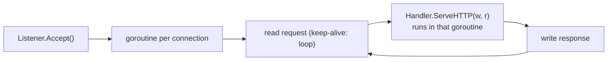

# Go net/http Server Model

> [!abstract] What this is
> The standard library HTTP stack that Gin (and every Go web framework) runs on: the **`Handler` interface**, **one goroutine per connection**, the `http.Server` **timeouts** (none by default), **`ServeMux` routing** with methods and wildcards (1.22), middleware as handler wrappers, request bodies and limits, HTTP/2, and the **`http.Client`** side: `Transport` connection pooling, **closing and draining response bodies**, timeouts, and reusing clients. The decision this helps with: configuring servers and clients safely, which matters more than which framework sits on top.

---

## Why It Matters

- Gin's `Engine` is just an `http.Handler`: server timeouts, connection handling, HTTP/2 and graceful shutdown are `net/http` concerns ([[13 - Go in Containers and Production]]).
- The most common Go HTTP production bugs are client-side: a shared `http.Client` with no timeout, response bodies not closed (connection and goroutine leaks), creating a client per request.

---

## The Server

```go
type Handler interface {
    ServeHTTP(http.ResponseWriter, *http.Request)
}
```



- `Server.Serve` accepts connections and starts **one goroutine per connection**; HTTP/1.1 keep-alive requests on that connection are handled sequentially by it. HTTP/2 (automatic with TLS) multiplexes streams, each handled in its own goroutine.
- Blocking in a handler is fine: the netpoller parks the goroutine on network waits ([[01 - Go Runtime and the GMP Scheduler]]). Concurrency is bounded only by what you bound (DB pools, semaphores, `MaxConnsPerHost` on clients).
- A panic in a handler is recovered by `net/http` (logged, connection closed); panics in goroutines the handler starts are **not** ([[06 - Go Errors and Panics]]).
- `r.Context()` is cancelled when the client disconnects, the request completes, or (HTTP/2) the stream is reset: pass it to everything downstream ([[08 - Go Concurrency Patterns and Context]]).

### Timeouts

| Field | Bounds | Default |
|---|---|---|
| `ReadHeaderTimeout` | Reading request headers (Slowloris protection) | **None** |
| `ReadTimeout` | Reading the whole request including body | None |
| `WriteTimeout` | From end of header read to end of response write | None |
| `IdleTimeout` | Keep-alive idle time between requests | Falls back to `ReadTimeout` |
| `MaxHeaderBytes` | Header size | 1 MB |

- `http.ListenAndServe(addr, h)` uses a zero-value `Server`: **no timeouts**. Always construct `http.Server` yourself.
- `WriteTimeout` covers the whole handler for HTTP/1: streaming endpoints (SSE, downloads) need longer values or per-request control via `http.ResponseController` (`SetWriteDeadline`, `Flush`; 1.20).
- Per-request time limits: `context.WithTimeout(r.Context(), ...)` in the handler or `http.TimeoutHandler`.
- **Request body limits**: `r.Body = http.MaxBytesReader(w, r.Body, 1<<20)` (or a middleware) to stop huge uploads exhausting memory.

### Routing with ServeMux (1.22)

```go
mux := http.NewServeMux()
mux.HandleFunc("GET /orders/{id}", getOrder)           // method + wildcard
mux.HandleFunc("POST /orders", createOrder)
mux.HandleFunc("GET /files/{path...}", serveFile)      // rest of path
mux.Handle("GET /static/", http.StripPrefix("/static/", http.FileServer(http.Dir("web"))))

func getOrder(w http.ResponseWriter, r *http.Request) {
    id := r.PathValue("id")
    ...
}
```

- Since **1.22** patterns include methods and wildcards, with "most specific wins" precedence (conflicting patterns panic at registration). Trailing-slash redirects use 307 since 1.26. Before 1.22 the mux matched only path prefixes, which is why routers like Gin/chi/gorilla were essential.

### Middleware without a framework

```go
func Logging(next http.Handler) http.Handler {
    return http.HandlerFunc(func(w http.ResponseWriter, r *http.Request) {
        start := time.Now()
        rw := &statusRecorder{ResponseWriter: w, status: http.StatusOK}
        next.ServeHTTP(rw, r)
        slog.InfoContext(r.Context(), "request", "method", r.Method, "path", r.URL.Path,
            "status", rw.status, "dur", time.Since(start))
    })
}

handler := Logging(Recover(Auth(mux)))            // outermost first
```

- Wrapping `ResponseWriter` hides optional interfaces (`http.Flusher`, `http.Hijacker`); implement `Unwrap() http.ResponseWriter` so `http.ResponseController` can reach them.

---

## The Client

```go
var pricing = &http.Client{
    Timeout: 5 * time.Second,                       // whole exchange including body read
    Transport: &http.Transport{
        MaxIdleConns:        200,
        MaxIdleConnsPerHost: 50,                    // default is only 2: a bottleneck for busy upstreams
        MaxConnsPerHost:     100,                   // cap concurrent connections to one host
        IdleConnTimeout:     90 * time.Second,
        TLSHandshakeTimeout: 5 * time.Second,
        ResponseHeaderTimeout: 3 * time.Second,
    },
}

func getPrice(ctx context.Context, sku string) (Price, error) {
    req, err := http.NewRequestWithContext(ctx, http.MethodGet, pricingURL+"/"+url.PathEscape(sku), nil)
    if err != nil {
        return Price{}, err
    }
    resp, err := pricing.Do(req)
    if err != nil {
        return Price{}, err
    }
    defer resp.Body.Close()                          // ALWAYS, even on non-2xx
    if resp.StatusCode != http.StatusOK {
        io.Copy(io.Discard, io.LimitReader(resp.Body, 64<<10))   // drain so the connection is reused
        return Price{}, fmt.Errorf("pricing: status %d", resp.StatusCode)
    }
    var p Price
    return p, json.NewDecoder(resp.Body).Decode(&p)
}
```

| Rule | Why |
|---|---|
| **Reuse one `Client`/`Transport`** per upstream (or globally) | The Transport holds the connection pool and TLS sessions; a client per request means new TCP+TLS handshakes and port exhaustion |
| **Never use `http.DefaultClient` in services** | No timeout at all |
| **Always close `resp.Body`** | Otherwise the connection (and a transport goroutine) leaks |
| **Drain before closing** to reuse the connection | Unread bodies force connection close (1.27 auto-drains small remainders on `Close` for HTTP/1) |
| **Context per request** | Cancellation and deadlines propagate; `Client.Timeout` is an upper bound |
| Raise `MaxIdleConnsPerHost` | Default 2 idle connections per host causes connection churn under load |
| Check status codes | `Do` returns `err == nil` for 4xx/5xx |

- Retries, circuit breaking and bulkheads aren't built in: wrap the transport (`RoundTripper` middleware) or use a library, retrying only idempotent requests ([[LLD/Foundations/11 - Idempotency and Retries]]).
- Observability: `otelhttp.NewTransport` for client spans, `httptrace` for connection-level timing.

---

## Failure Modes

| Failure | What happens | Mitigation |
|---|---|---|
| **Server without timeouts** | Slowloris, stuck connections, goroutine buildup | Set `ReadHeaderTimeout`, `ReadTimeout`, `WriteTimeout`, `IdleTimeout` |
| **`http.DefaultClient`** | Requests hang forever on stuck upstreams | Client with `Timeout` + contexts |
| **Response body not closed** | Connection and goroutine leaks, FD exhaustion | `defer resp.Body.Close()` always |
| **Body not drained** | No connection reuse, extra handshakes | Drain (bounded) before close |
| **Client per request** | Port exhaustion (TIME_WAIT), latency | Shared clients |
| **Default `MaxIdleConnsPerHost` (2)** | Connection churn under load | Raise it for busy upstreams |
| **Unlimited request bodies** | Memory exhaustion | `MaxBytesReader` |
| **Goroutines from handlers using `r.Context()` after return** | Cancelled work, or leaks if not cancellable | Detach deliberately (`context.WithoutCancel`) or don't outlive the request |
| **ResponseWriter wrappers hiding Flusher** | Streaming breaks | `Unwrap()` + `http.ResponseController` |

---

## Interview Lines

> [!tip] Say it like this
> - "`net/http` runs one goroutine per connection and calls the handler in it; blocking is fine because network waits park goroutines, not threads."
> - "The zero-value server has no timeouts, so I always set read-header, read, write and idle timeouts, and cap bodies with `MaxBytesReader`."
> - "Since Go 1.22, `ServeMux` supports methods and wildcards like `GET /orders/{id}`, which covers many routing needs without a framework."
> - "On the client side I reuse one client per upstream, set timeouts, always close and drain response bodies, and raise `MaxIdleConnsPerHost` from its default of two."
> - "Every outbound request is built with the incoming request's context, so client disconnects cancel downstream calls."

## Related Notes

- [[02 - Gin Architecture Routing and Context]] · [[03 - Gin Middleware]] · [[06 - Gin Production]] · [[08 - Gin vs Alternatives]]
- [[01 - Go Runtime and the GMP Scheduler]] · [[13 - Go in Containers and Production]] · [[03 - Web Server Models Compared]] · [[Languages/README]]
