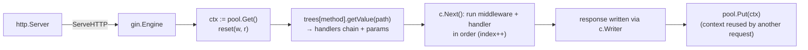

# Gin Architecture Routing and Context

> [!abstract] What this is
> How Gin works inside: the **`Engine`** as an `http.Handler`, the **radix-tree router** (one tree per HTTP method, from httprouter) and its matching rules and conflicts, **route groups**, and the **`*gin.Context`**: what it holds (request, writer, params, handler chain, index, keys, errors), how it's **pooled with `sync.Pool`** and reset per request, and why that makes **using a context after the handler returns or in another goroutine** a bug unless you **`c.Copy()`**. Also `c.Request.Context()` vs `gin.Context` as a `context.Context`. The decision this helps with: writing handlers that are correct under concurrency and routes that don't conflict.

---

## Why It Matters

- Context pooling is Gin's main performance trick and its most dangerous trap: a goroutine that keeps `c` after the handler returns reads another request's data.
- Router conflicts (`/users/:id` vs `/users/new`) and trailing-slash redirects surprise people coming from other frameworks.

---

## Engine and Request Flow



- `gin.New()` creates a bare engine; `gin.Default()` adds **Logger** and **Recovery** middleware.
- `engine.ServeHTTP` gets a `*Context` from a **`sync.Pool`**, resets it with the request and writer, finds the route in the method's tree, runs the handler chain, then **returns the context to the pool**.
- Unmatched routes → 404 handlers (`NoRoute`); wrong method → 405 if `HandleMethodNotAllowed` is enabled (otherwise 404).

---

## The Router

```go
r := gin.New()
r.GET("/orders/:id", getOrder)                 // named parameter: one segment
r.GET("/files/*filepath", serveFile)           // catch-all: rest of the path (includes leading /)
r.POST("/orders", createOrder)

api := r.Group("/api/v1", authMiddleware)      // shared prefix + middleware
{
    api.GET("/me", me)
    admin := api.Group("/admin", requireRole("admin"))
    admin.DELETE("/orders/:id", deleteOrder)
}
```

- **Radix (compressed prefix) tree per method**: lookups cost O(path length), not O(number of routes); static segments, `:param` and `*catchall` nodes. No regex routes.
- **Conflicts**: historically a param and a static segment at the same position conflicted (`/users/:id` vs `/users/new`); modern Gin supports static and param siblings with **static taking priority**, but a catch-all can't coexist with other children at that position. Gin panics at registration on true conflicts: a startup failure, not a runtime surprise.
- **Trailing slashes**: `RedirectTrailingSlash` (default on) redirects `/orders/` to `/orders` (301 for GET, 307 otherwise); `RedirectFixedPath` can fix case. Disable redirects for APIs that shouldn't redirect POSTs.
- **Escaped paths** (1.12 option): route on the raw escaped path so `%2F` inside a parameter isn't treated as a separator.
- `c.Param("id")`, `c.FullPath()` returns the **route template** (`/orders/:id`): use it for metric labels, not the raw path (cardinality) ([[06 - Gin Production]]).

---

## The Context

| Field / method | Purpose |
|---|---|
| `c.Request`, `c.Writer` | The `*http.Request` and a wrapped `ResponseWriter` (tracks status, size, written) |
| `c.Params`, `c.Param()` | Path parameters |
| `c.Query()`, `c.DefaultQuery()`, `c.PostForm()` | Query and form values |
| `c.Bind*` / `c.ShouldBind*` | Decode + validate into structs ([[04 - Gin Binding Validation and Errors]]) |
| `c.JSON`, `c.String`, `c.Data`, `c.Render`, `c.Stream`, `c.SSEvent` | Responses |
| `c.Next()`, `c.Abort*()`, `c.IsAborted()` | Handler chain control ([[03 - Gin Middleware]]) |
| `c.Set`/`c.Get`/`c.MustGet`, `c.Delete` (1.12) | Per-request keys (guarded by a mutex) |
| `c.Error(err)`, `c.Errors`, `c.GetError` (1.12) | Collect errors for middleware to render |
| `c.ClientIP()` | Client address respecting **trusted proxies** ([[06 - Gin Production]]) |
| `c.Copy()` | A **read-only** copy safe to use after the handler returns |

### Pooling and goroutines

```go
func createOrder(c *gin.Context) {
    var req CreateOrder
    if err := c.ShouldBindJSON(&req); err != nil { ... }

    // WRONG: c is returned to the pool when this handler returns; the goroutine may read another request
    go audit(c, req)

    // RIGHT: copy what you need (or use c.Copy()) and a detached context
    cc := c.Copy()
    ctx := context.WithoutCancel(c.Request.Context())     // keep trace values, drop request cancellation
    go func() {
        ctx, cancel := context.WithTimeout(ctx, 5*time.Second)
        defer cancel()
        auditLog.Write(ctx, cc.FullPath(), cc.GetString("user_id"), req)
    }()

    c.JSON(http.StatusCreated, resp)
}
```

- Because contexts are reused, **never keep `*gin.Context` beyond the handler** or share it with goroutines; pass `c.Copy()` or, better, plain values plus a `context.Context`.
- `c.Copy()` copies keys, params and request, but writing a response through a copy is invalid (the original response is gone).
- Background work that must survive the request: `context.WithoutCancel` plus its own timeout, or a real queue ([[08 - Go Concurrency Patterns and Context]]).

### gin.Context vs context.Context

- `*gin.Context` implements `context.Context`. By default its `Done()`/`Deadline()` don't follow the request; with **`engine.ContextWithFallback = true`** they fall back to `c.Request.Context()`.
- Pass **`c.Request.Context()`** (cancelled on client disconnect and request end) to databases and HTTP clients, not `c` itself; it's explicit and avoids the pooling footgun.
- Request-scoped values for downstream code (trace IDs, principal): put them in `c.Request.Context()` (`c.Request = c.Request.WithContext(ctx)`) in middleware, so non-Gin layers can read them.

---

## Failure Modes

| Failure | What happens | Mitigation |
|---|---|---|
| **Using `c` in a goroutine after return** | Data from another request, races, panics | `c.Copy()` or extract values; detached `context.Context` |
| **Passing `c` as the context to DB/HTTP calls** | Cancellation not propagated (unless fallback enabled); pooling risks | `c.Request.Context()` |
| **Route conflicts** | Panic at startup | Restructure paths; static vs param ordering |
| **Unexpected trailing-slash redirects on POST** | Clients get 307/301 | Configure `RedirectTrailingSlash`; consistent paths |
| **Raw path as metric label** | Cardinality explosion | `c.FullPath()` |
| **Writing the response twice** | "headers were already written" warnings, mixed bodies | `return` after writing; `Abort` in middleware |
| **`gin.Default()` in tests and prod without review** | Debug logging/format surprises | Explicit `gin.New()` + chosen middleware |

---

## Interview Lines

> [!tip] Say it like this
> - "Gin's engine is an `http.Handler` with a radix-tree router per HTTP method, so route lookup costs depend on path length, not route count."
> - "Each request gets a `*gin.Context` from a `sync.Pool` that's reset and returned afterwards, so keeping `c` in a goroutine after the handler returns reads another request; I use `c.Copy()` or pass plain values."
> - "I pass `c.Request.Context()` to downstream calls so client disconnects and deadlines propagate."
> - "`c.FullPath()` gives the route template, which is what I use for metrics and logs."
> - "Route conflicts panic at startup, which is a feature: they can't surprise you at runtime."

## Related Notes

- [[01 - Go net-http Server Model]] · [[03 - Gin Middleware]] · [[04 - Gin Binding Validation and Errors]] · [[06 - Gin Production]]
- [[08 - Go Concurrency Patterns and Context]] · [[02 - Go Memory and Escape Analysis]] · [[Languages/README]]
