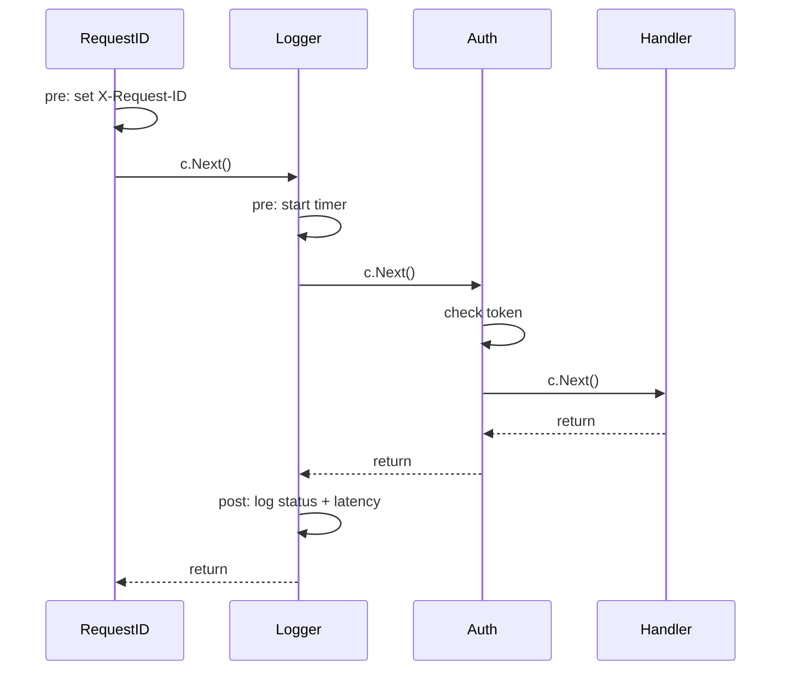

# Gin Middleware

> [!abstract] What this is
> How Gin's middleware chain works: middleware and handlers are the same type (`gin.HandlerFunc`) stored in one slice per route, **`c.Next()`** runs the rest of the chain (code before it is "pre", after it is "post"), **`c.Abort()`** stops later handlers but not the current one, and **ordering** follows registration (global → group → route). Covers the built-ins (**Logger**, **Recovery**), writing auth, request-ID, timing, rate-limit and timeout middleware, gin-contrib (CORS, gzip, timeout), and adapting `net/http` middleware. The decision this helps with: getting order, abort semantics and per-request state right.

---

## Why It Matters

- Middleware is where authentication, logging, metrics, tracing, panics and CORS live. Mistakes here are silent: a missing `return` after `Abort`, auth registered after the route, or a timeout middleware that leaves handlers running.

---

## The Chain



- A route's **handler chain** = engine middleware + group middleware (outer to inner) + route handlers, combined at **registration time**. Middleware added with `r.Use()` **after** routes are registered doesn't apply to them.
- The context keeps an **index**; `c.Next()` increments it and runs the following handlers, then returns control to the caller: code after `c.Next()` runs on the way out (status, latency, response size available via `c.Writer`).
- If a middleware doesn't call `c.Next()`, Gin still proceeds to the next handler after it returns (unless aborted): `c.Next()` is needed only to run code *after* the rest of the chain.
- **`c.Abort()`** sets the index past the end so **later** handlers don't run; the current function continues, so `return` right after. `c.AbortWithStatusJSON(code, body)` aborts and writes a response.

```go
func Auth(verifier TokenVerifier) gin.HandlerFunc {
    return func(c *gin.Context) {
        token, ok := strings.CutPrefix(c.GetHeader("Authorization"), "Bearer ")
        if !ok {
            c.AbortWithStatusJSON(http.StatusUnauthorized, problem("missing token"))
            return                                                 // Abort doesn't return for you
        }
        claims, err := verifier.Verify(c.Request.Context(), token)
        if err != nil {
            c.AbortWithStatusJSON(http.StatusUnauthorized, problem("invalid token"))
            return
        }
        c.Set("user_id", claims.Subject)                           // for Gin handlers
        ctx := WithPrincipal(c.Request.Context(), claims)          // for non-Gin layers
        c.Request = c.Request.WithContext(ctx)
        c.Next()
    }
}
```

---

## Built-in Middleware

| Middleware | Notes |
|---|---|
| **`gin.Logger()`** / `LoggerWithConfig` | Text access log; in production prefer a structured `slog` middleware (skip paths like `/healthz`; 1.12 can skip query strings, which may contain secrets) ([[06 - Gin Production]]) |
| **`gin.Recovery()`** / `CustomRecovery` | Recovers panics in the handler goroutine, logs the stack, returns 500; since 1.12 ignores `http.ErrAbortHandler`. Doesn't cover goroutines you start ([[06 - Go Errors and Panics]]) |
| `gin.BasicAuth` | Simple basic auth (internal tools only) |
| `gin.WrapH` / `gin.WrapF` | Use `net/http` handlers as Gin handlers |

- **Order** for a typical API (outermost first): `Recovery` → request ID → tracing → structured logging/metrics → CORS → rate limiting → body size limit → auth (on protected groups) → handlers. Recovery must be first so it catches panics from everything after it; logging should see the final status.

---

## Common Middleware

### Request ID and logging context

```go
func RequestID() gin.HandlerFunc {
    return func(c *gin.Context) {
        id := c.GetHeader("X-Request-ID")
        if id == "" || len(id) > 64 {
            id = uuid.NewString()                 // Go 1.27 also has a stdlib uuid package
        }
        c.Writer.Header().Set("X-Request-ID", id)
        logger := slog.Default().With("request_id", id)
        c.Request = c.Request.WithContext(WithLogger(c.Request.Context(), logger))
        c.Next()
    }
}
```

### Metrics with route templates

```go
func Metrics(hist *prometheus.HistogramVec) gin.HandlerFunc {
    return func(c *gin.Context) {
        start := time.Now()
        c.Next()
        route := c.FullPath()                     // "/orders/:id"; "" for 404s
        if route == "" {
            route = "unmatched"
        }
        hist.WithLabelValues(c.Request.Method, route, strconv.Itoa(c.Writer.Status())).
            Observe(time.Since(start).Seconds())
    }
}
```

### Timeouts

- `gin-contrib/timeout` wraps the handler with a deadline and returns 503 on expiry, but it runs the handler in **another goroutine** with a buffered writer: the handler keeps running after the timeout unless it respects the context, and some response features (streaming, `c.Writer` assumptions) behave differently.
- Simpler and safer: a middleware that sets a deadline on the request context, and handlers/clients that honour it:

```go
func Deadline(d time.Duration) gin.HandlerFunc {
    return func(c *gin.Context) {
        ctx, cancel := context.WithTimeout(c.Request.Context(), d)
        defer cancel()
        c.Request = c.Request.WithContext(ctx)
        c.Next()
    }
}
```

- Server-level timeouts still apply ([[01 - Go net-http Server Model]]).

### Others

| Concern | Option |
|---|---|
| CORS | `gin-contrib/cors` with explicit origins; must run before auth so preflights succeed |
| Compression | `gin-contrib/gzip` (skip streaming endpoints) |
| Rate limiting | `golang.org/x/time/rate` per key in a middleware, or Redis-backed for fleets; 429 + `Retry-After` |
| Body size | `c.Request.Body = http.MaxBytesReader(c.Writer, c.Request.Body, limit)` |
| Tracing | `otelgin.Middleware("orders")` ([[06 - Gin Production]]) |

### Adapting net/http middleware

```go
func FromStd(mw func(http.Handler) http.Handler) gin.HandlerFunc {
    return func(c *gin.Context) {
        called := false
        mw(http.HandlerFunc(func(w http.ResponseWriter, r *http.Request) {
            called = true
            c.Request = r                         // keep any context changes made by the middleware
            c.Next()
        })).ServeHTTP(c.Writer, c.Request)
        if !called {
            c.Abort()                             // middleware short-circuited (e.g. wrote 401)
        }
    }
}
```

---

## Failure Modes

| Failure | What happens | Mitigation |
|---|---|---|
| **No `return` after `Abort`** | Handler code continues; double writes | `AbortWith...; return` |
| **`r.Use()` after registering routes** | Middleware silently missing on those routes | Register middleware first; test with a route inventory |
| **Recovery not outermost** | Panics in earlier middleware crash the request handling path | `Recovery()` first |
| **Auth on the engine but public routes needed** | Health checks/login blocked | Auth on groups, public routes outside |
| **Timeout middleware without context-aware handlers** | Work continues after 503; resource buildup | Context deadlines honoured downstream |
| **Logging raw query strings** | Tokens and PII in logs | Skip/redact queries |
| **Values only in `c.Set`** | Non-Gin layers can't see them | Also put them in `c.Request.Context()` |
| **Heavy work in middleware for every route** | Latency for all requests | Apply at group level |

---

## Interview Lines

> [!tip] Say it like this
> - "Middleware and handlers form one slice per route; `c.Next()` runs the rest of the chain and returns, so code after it is post-processing with the final status available."
> - "`c.Abort()` only stops later handlers; the current function keeps going, so I always return right after aborting."
> - "Chains are assembled at registration, so middleware must be registered before the routes it should cover, with Recovery outermost."
> - "Request-scoped values go into `c.Request.Context()` as well as `c.Set`, so service layers that don't know Gin can read them."
> - "For timeouts I set a deadline on the request context and make handlers honour it, rather than running handlers in a separate goroutine."

## Related Notes

- [[02 - Gin Architecture Routing and Context]] · [[04 - Gin Binding Validation and Errors]] · [[06 - Gin Production]] · [[01 - Go net-http Server Model]]
- [[07 - FastAPI Security and Middleware]] · [[04 - Spring MVC Request Lifecycle]] · [[Languages/README]]
