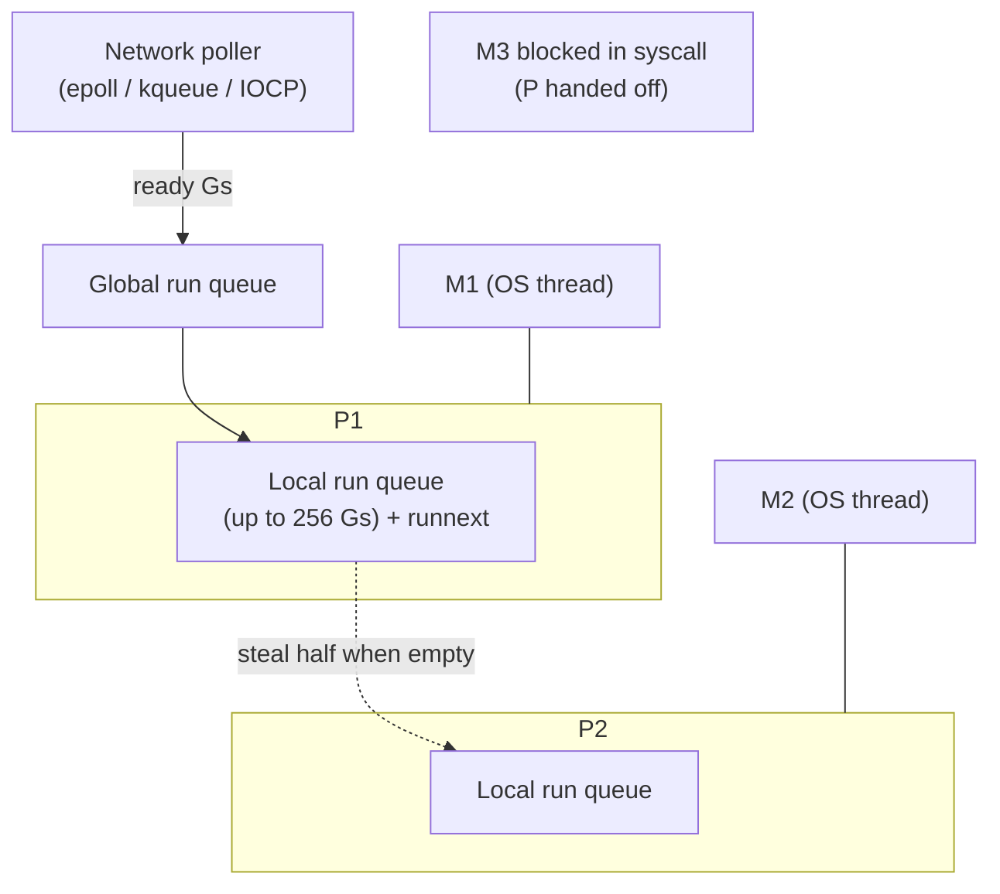
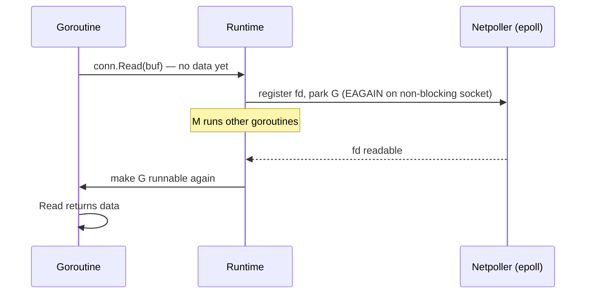

# Go Runtime and the GMP Scheduler

> [!abstract] What this is
> How Go runs goroutines: the **G-M-P model** (goroutines, OS threads, logical processors), **local and global run queues**, **work stealing**, the **network poller** that lets blocking-looking I/O park goroutines instead of threads, what happens on **blocking syscalls** and cgo calls (handoff of the P), **preemption** (cooperative plus asynchronous since 1.14), goroutine stacks, and **`GOMAXPROCS`** (container-aware since 1.25). The decision this helps with: reasoning about Go concurrency performance, CPU usage in containers, and why a Go server handles 100k connections with plain blocking code.

---

## Why It Matters

- "How does Go's scheduler work?" and "why are goroutines cheap?" are standard Go interview questions; the follow-ups (syscalls, preemption, `GOMAXPROCS` in Kubernetes) separate users from people who understand the runtime.
- The model explains production behaviour: thread count explosions from blocking syscalls or cgo, CPU throttling with a wrong `GOMAXPROCS`, latency from long-running goroutines before 1.14.

---

## The Pieces

| | What | Count |
|---|---|---|
| **G** (goroutine) | A function plus its stack (starts at 2 KB, grows/shrinks), status, scheduling info | Up to millions |
| **M** (machine) | An **OS thread** executing Go code | Grows as needed (default cap 10,000: `debug.SetMaxThreads`) |
| **P** (processor) | A scheduling context: **local run queue**, memory cache (mcache), timers; an M must hold a P to run Go code | **`GOMAXPROCS`** |

- **`GOMAXPROCS`** = number of Ps = maximum number of goroutines **executing Go code simultaneously**. Threads blocked in syscalls don't count.

---

## Scheduling

1. `go f()` creates a G and puts it in the current P's **`runnext`** slot (it runs soon, good for producer/consumer handoffs) or local queue.
2. An M with a P runs Gs from its local queue. Every 61 schedule ticks it checks the **global queue** for fairness.
3. If the local queue is empty: check the global queue, the **network poller**, then **steal half** of another P's queue (**work stealing**).
4. A G stops running when it **blocks** (channel, mutex, `select`, sleep, network I/O), **yields**, finishes, or is **preempted**.

- Goroutine switches happen in user space: saving a few registers, no kernel involvement. That's why switching costs tens to hundreds of nanoseconds, versus microseconds for OS thread context switches.

### Network I/O: the netpoller

- Sockets are non-blocking under the hood. A `Read` that would block **parks the goroutine** and registers the fd with epoll/kqueue/IOCP; the thread keeps running other goroutines.
- This is why Go servers use **one goroutine per connection** with simple blocking code and still handle 100k+ connections ([[01 - Go net-http Server Model]]). Java's virtual threads adopted the same idea ([[05 - Java Platform and Virtual Threads]]).

### Blocking syscalls and cgo

- File I/O (on most platforms), some DNS lookups, and **cgo calls** block the OS thread. When an M enters a blocking syscall, the runtime (via `sysmon`) **detaches its P** and hands it to another M (creating one if needed) so Go code keeps running.
- Consequence: many concurrent blocking syscalls or cgo calls → **many OS threads** (memory, scheduler overhead, hitting the 10,000 thread limit → crash). Bound concurrency for file and cgo work with semaphores or worker pools.
- `runtime.LockOSThread` pins a goroutine to its thread (needed for some C libraries, OS-thread-local state); use sparingly.

---

## Preemption

| Kind | Since | How |
|---|---|---|
| **Cooperative** | Always | At function prologues (stack-growth check), blocking operations, `runtime.Gosched()` |
| **Asynchronous** | **1.14** | `sysmon` notices a G running > **10 ms** and sends a signal (`SIGURG` on Unix); the G is stopped at a safe point |

- Before 1.14 a tight loop without function calls (`for { i++ }`) could starve other goroutines and block GC stop-the-world phases indefinitely. Now it's preempted.
- `sysmon` is a background thread (no P) that also retakes Ps from long syscalls, polls the network if nobody else did, and triggers forced GCs.
- Signal-based preemption interrupts syscalls with `EINTR`: Go handles it, but cgo libraries sometimes don't (set `GODEBUG=asyncpreemptoff=1` only as a diagnostic).

---

## Goroutine Stacks

- Each goroutine starts with a small stack (**2 KB**), **grown by copying** to a larger contiguous stack when the function prologue detects it's needed, and shrunk during GC when mostly unused.
- So a million idle goroutines cost roughly 2–8 GB less than a million threads would; the main cost is their stack memory and anything they hold.
- Deep recursion grows the stack up to a max (1 GB on 64-bit by default) then crashes with `goroutine stack exceeds limit` ([[02 - Go Memory and Escape Analysis]]).

---

## GOMAXPROCS

| Version | Default |
|---|---|
| 1.5–1.24 | Number of logical CPUs visible (`runtime.NumCPU()`), **ignoring container limits** |
| **1.25+** | On Linux, the **cgroup CPU bandwidth limit** (the Kubernetes CPU *limit*, rounded up) if lower than the CPU count; **updated periodically** if limits or CPU counts change. CPU *requests* are ignored |

- Pre-1.25, a Go service in a pod limited to 2 CPUs on a 64-core node ran 64 Ps: heavy **CFS throttling** and tail latency. The fix was `uber-go/automaxprocs`; on 1.25+ the runtime does it itself.
- Setting `GOMAXPROCS` (env or `runtime.GOMAXPROCS`) disables the automatic behaviour; `runtime.SetDefaultGOMAXPROCS()` restores it. GODEBUG `containermaxprocs=0` / `updatemaxprocs=0` turn the features off.
- No CPU limit → GOMAXPROCS = node CPU count; consider setting it explicitly to the CPU request if you run without limits ([[13 - Go in Containers and Production]]).

---

## Observing the Scheduler

| Tool | Shows |
|---|---|
| `GODEBUG=schedtrace=1000[,scheddetail=1]` | Periodic dump of Ps, Ms, queue lengths |
| `runtime.NumGoroutine()`, `/sched/goroutines` metrics (1.26 adds per-state counts) | Goroutine counts, leaks |
| **Execution tracer** (`go tool trace`, flight recorder 1.25) | Per-goroutine scheduling, blocking, syscalls, GC ([[12 - Go Diagnostics pprof and Tracing]]) |
| Goroutine profile / `goroutineleak` profile (1.27) | Where goroutines are blocked; leaked ones |
| Block and mutex profiles | Contention |

---

## Failure Modes

| Failure | What happens | Mitigation |
|---|---|---|
| **GOMAXPROCS above CPU limit (pre-1.25 or manual)** | CFS throttling, latency spikes | Go 1.25+ default; don't override blindly |
| **Many blocking syscalls / cgo calls** | Thread explosion, memory, crash at 10k threads | Bound concurrency; avoid cgo on hot paths |
| **Unbounded goroutine creation** | Memory growth, scheduler overhead, downstream overload | Worker pools, semaphores, `errgroup.SetLimit` ([[08 - Go Concurrency Patterns and Context]]) |
| **Goroutine leaks** | Memory grows, goroutine count climbs | Context cancellation; leak profile; `goleak` in tests |
| **CPU-heavy goroutines starving latency-sensitive ones** | p99 latency rises | Limit CPU work concurrency; separate services |
| **`LockOSThread` misuse** | Threads pinned, fewer available for others | Only where a C library requires it |

---

## Interview Lines

> [!tip] Say it like this
> - "Go multiplexes goroutines (G) onto OS threads (M) through logical processors (P); each P has a local run queue, and idle Ps steal half of another P's work."
> - "Network I/O looks blocking but parks the goroutine on the netpoller, so a thread never waits on a socket; that's why one goroutine per connection scales."
> - "Blocking syscalls and cgo calls do block the thread, so the runtime hands the P to another thread; lots of them means lots of threads."
> - "Since 1.14 goroutines running over 10 ms are preempted asynchronously with a signal, so tight loops can't starve the scheduler or the GC."
> - "Since 1.25 GOMAXPROCS follows the container's CPU limit and updates if it changes; before that you needed automaxprocs to avoid throttling."

## Related Notes

- [[02 - Go Memory and Escape Analysis]] · [[03 - Go Garbage Collector]] · [[07 - Go Concurrency Primitives]] · [[12 - Go Diagnostics pprof and Tracing]] · [[13 - Go in Containers and Production]]
- [[05 - Java Platform and Virtual Threads]] · [[05 - asyncio Internals]] · [[01 - Concurrency Models Compared]] · [[Languages/README]]
