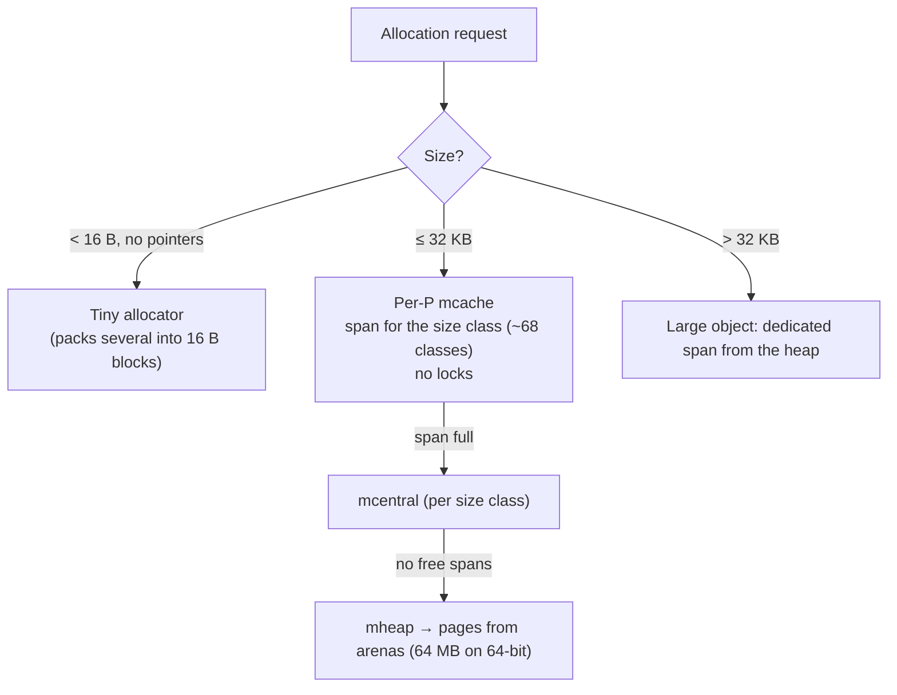

# Go Memory and Escape Analysis

> [!abstract] What this is
> Where Go values live and what they cost: **stack vs heap**, the compiler's **escape analysis** (and how to read `-gcflags=-m`), the runtime **allocator** (size classes, per-P caches, spans, arenas, the tiny allocator), **struct layout, alignment and padding**, pointers vs values for performance, `sync.Pool`, and how memory shows up in the OS (RSS, returning memory). The decision this helps with: writing allocation-light hot paths and explaining a Go service's memory profile. GC behaviour is in [[03 - Go Garbage Collector]].

---

## Why It Matters

- In Go, **allocation rate drives GC cost**: fewer heap allocations on hot paths means less GC CPU and lower latency. The biggest Go performance wins in services usually come from removing allocations, not from micro-tuning.
- Escape analysis is why the same code allocates or doesn't depending on small changes (returning a pointer, storing in an interface, capturing in a closure).

---

## Stack vs Heap

| | Stack | Heap |
|---|---|---|
| Owner | One goroutine | Shared, managed by the GC |
| Allocation cost | Bump the stack pointer: essentially free | Allocator call (fast, but not free) + later GC work |
| Freed | When the function returns | When the GC finds it unreachable |
| Decided by | **The compiler** (escape analysis), not by `new` vs `&T{}` vs `make` | Same |

- Go has no `malloc`/`free` choice for you: `new(T)`, `&T{}` and `make` may all land on the stack if the compiler proves the value doesn't outlive the function.

### What makes a value escape

| Pattern | Why |
|---|---|
| Returning a pointer to a local (`return &u`) | Outlives the frame |
| Storing a pointer in a heap object, global, or channel | Reachable from elsewhere |
| **Assigning to an interface** (`var x any = v`, `fmt.Println(v)`) | Interface holds a pointer to a copy, often heap-allocated (small values like small ints avoid it) |
| Closures capturing variables that outlive the call (goroutines, returned funcs) | Captured variables move to the heap |
| Slices/maps/buffers whose size isn't known at compile time or is large | Can't fit a fixed stack frame (1.26 puts more variable-size slice backing stores on the stack) |
| Values too large for the stack (big arrays) | Size limits |
| Calling through interfaces/function values with pointer args the compiler can't analyse | Conservative escape |

```bash
go build -gcflags='-m' ./...          # "moved to heap: u", "escapes to heap", "does not escape"
go build -gcflags='-m -m' ./pkg       # reasons, more detail
go test -bench . -benchmem            # allocs/op per benchmark
```

```go
// Escapes: caller gets a pointer to a heap object
func NewUser(name string) *User { return &User{Name: name} }

// Doesn't escape: caller provides the storage
func (u *User) Init(name string) { u.Name = name }

// fmt boxes args into interfaces → allocations on hot paths
log.Printf("user %d", id)          // allocates
// structured loggers with typed attrs avoid most of it:
logger.LogAttrs(ctx, slog.LevelInfo, "user", slog.Int("id", id))
```

- Escape analysis is per-function plus **inlining**: if a small constructor is inlined into the caller, its `&T{}` may stay on the caller's stack. Inlining budgets change between versions; measure.

---

## The Allocator



- Modelled on **TCMalloc**: objects ≤ 32 KB are rounded up to one of ~68 **size classes**; each P has an **mcache** of spans per class, so most allocations take no lock.
- Spans are also split by "has pointers / no pointers" (**noscan** spans): pointer-free objects (e.g. `[]byte`, `[]int64`) cost the GC nothing to scan.
- Rounding to size classes wastes some memory (a 33-byte object takes a 48-byte slot).
- **1.27** compiles small allocations (< 80 bytes) to size-specialised allocation routines: up to 30% cheaper for those, ~1% overall in allocation-heavy programs.

### Returning memory to the OS

- The runtime's **scavenger** returns unused pages to the OS gradually (`madvise`), paced towards the memory limit; RSS lags behind heap drops.
- `GOMEMLIMIT` makes the scavenger and GC work harder near the limit ([[03 - Go Garbage Collector]]).
- `runtime/metrics` and `GODEBUG=gctrace=1` show heap in use, released and total; `/memory/classes/...` metrics break RSS down.

---

## Struct Layout and Alignment

```go
type Bad struct {        // 24 bytes on 64-bit
    a bool               // 1 + 7 padding
    b int64              // 8
    c bool               // 1 + 7 padding
}

type Good struct {       // 16 bytes
    b int64              // 8
    a bool               // 1
    c bool               // 1 + 6 padding
}
```

- Fields are aligned to their size (up to 8 bytes on 64-bit); the compiler **doesn't reorder fields**. Order from largest to smallest alignment to cut padding (`fieldalignment` analyzer in `golang.org/x/tools`).
- Matters for types with millions of instances (cache entries, events in memory) and for cache-line behaviour.
- **False sharing**: two frequently written fields used by different goroutines on the same 64-byte cache line slow each other down; pad hot counters apart (or use per-P sharding).
- `unsafe.Sizeof`, `unsafe.Alignof`, `unsafe.Offsetof` to inspect.

---

## Values vs Pointers

| Pass / store by value | By pointer |
|---|---|
| Small structs (a few words), immutable data | Large structs, or the callee must modify it |
| Stays on the stack more often; no aliasing | Shares one copy; may force heap allocation |
| Slices of values `[]T`: contiguous, fewer pointers for the GC to scan, cache-friendly | `[]*T`: one allocation per element, pointer chasing, more GC scan work |

- Prefer `[]T` over `[]*T` for collections of small structs unless elements need identity or are shared.
- Pointer-free data (no strings/slices/pointers inside) is invisible to GC scanning: large lookup tables as arrays of plain structs are cheap for the GC.
- Method receivers: value vs pointer is also about semantics and method sets ([[04 - Go Types Interfaces and Embedding]]).

---

## Reducing Allocations

| Technique | Example |
|---|---|
| **Pre-size** slices and maps | `make([]T, 0, n)`, `make(map[K]V, n)` |
| **Reuse buffers** | `buf = buf[:0]`; pass `[]byte` dst parameters (`strconv.AppendInt`, `AppendFormat`) |
| **`sync.Pool`** for short-lived temporary objects | `bytes.Buffer`s, encoders; reset before `Put`; pooled objects may be dropped at any GC |
| **`strings.Builder` / `bytes.Buffer`** | Instead of `+=` in loops |
| Avoid interface boxing and `fmt` on hot paths | `strconv`, typed `slog` attrs |
| Avoid `string(bytes)`/`[]byte(str)` copies | Keep one representation; compiler optimises some map lookups `m[string(b)]` |
| Streaming instead of loading whole payloads | `json.Decoder`, `io.Copy` |

```go
var bufPool = sync.Pool{New: func() any { return new(bytes.Buffer) }}

func render(w io.Writer, v Report) error {
    buf := bufPool.Get().(*bytes.Buffer)
    buf.Reset()
    defer bufPool.Put(buf)              // don't Put huge buffers back (cap them) or memory sticks around
    if err := encode(buf, v); err != nil {
        return err
    }
    _, err := w.Write(buf.Bytes())
    return err
}
```

- Measure with `-benchmem`, heap profiles (`alloc_space`, `alloc_objects`) and `go build -gcflags=-m` before and after ([[11 - Go Testing and Benchmarks]], [[12 - Go Diagnostics pprof and Tracing]]).

---

## Failure Modes

| Failure | What happens | Mitigation |
|---|---|---|
| **Allocation-heavy hot paths** | High GC CPU, latency | Profile `alloc_objects`; reuse, pre-size, avoid boxing |
| **`[]*T` for millions of small items** | Many allocations, slow GC scans | `[]T`, pointer-free structs |
| **Poorly ordered struct fields** | Wasted memory at scale | Order by alignment; `fieldalignment` |
| **`sync.Pool` holding huge buffers** | Memory retained | Cap sizes before `Put` |
| **Using `sync.Pool` for long-lived objects/connections** | Objects dropped at GC; leaks or reconnect storms | Real pools for connections; `sync.Pool` only for temporaries |
| **Small subslice of a big buffer kept** | Whole backing array retained | Copy what you keep ([[05 - Go Slices Maps and Strings Internals]]) |
| **False sharing on hot counters** | Poor multi-core scaling | Pad or shard counters |

---

## Interview Lines

> [!tip] Say it like this
> - "The compiler decides stack versus heap through escape analysis; returning a pointer, storing in an interface or capturing in a goroutine usually moves a value to the heap, and `-gcflags=-m` shows why."
> - "Heap allocation rate is what drives GC cost in Go, so hot-path optimisation is mostly about removing allocations: pre-sizing, reusing buffers, avoiding interface boxing."
> - "The allocator is TCMalloc-style: size classes, per-P caches with no locks, and separate no-pointer spans that the GC never scans."
> - "Struct fields aren't reordered, so I order them by alignment to cut padding when there are millions of instances."
> - "`sync.Pool` is for short-lived temporaries; its contents can be dropped at any GC."

## Related Notes

- [[03 - Go Garbage Collector]] · [[05 - Go Slices Maps and Strings Internals]] · [[04 - Go Types Interfaces and Embedding]] · [[12 - Go Diagnostics pprof and Tracing]]
- [[03 - JVM Memory Layout]] · [[02 - Python Memory Management and GC]] · [[02 - Memory and GC Compared]] · [[Languages/README]]
