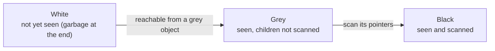

# Go Garbage Collector

> [!abstract] What this is
> How Go reclaims memory: a **concurrent, non-moving, non-generational tri-colour mark-sweep** collector with **write barriers**, very short stop-the-world phases, **pacing** controlled by **`GOGC`** and the soft memory limit **`GOMEMLIMIT`** (1.19), **mark assist** (allocating goroutines pay for GC), and the **Green Tea** collector (experiment in 1.25, **default in 1.26**) that scans small objects page-by-page for better locality. Also finalizers vs `runtime.AddCleanup`, weak pointers, reading `gctrace`, and tuning in containers. The decision this helps with: setting `GOGC`/`GOMEMLIMIT` sensibly and diagnosing GC CPU or OOMs.

---

## Why It Matters

- Go's GC trades throughput for low latency: pauses are typically well under a millisecond, but it can consume a large share of CPU in allocation-heavy services, and with the wrong settings a container OOMs or the GC thrashes near a memory limit.
- It's deliberately simple to tune (two knobs), and interviewers ask how those knobs interact.

---

## The Design

| Property | Go | Contrast |
|---|---|---|
| **Concurrent** | Marking runs alongside the program on ~25% of GOMAXPROCS plus assists | JVM G1/ZGC also concurrent ([[04 - Java Garbage Collectors]]) |
| **Non-moving** | Objects never relocate (no compaction) | JVM collectors compact; Go relies on size-class allocation to limit fragmentation |
| **Non-generational** | Whole heap marked each cycle | JVM and CPython are generational; Go keeps many objects on the stack via escape analysis instead ([[02 - Go Memory and Escape Analysis]]) |
| **Precise** | Knows exactly which words are pointers | Pointer-free memory isn't scanned |

### Tri-colour marking



1. **Sweep termination / mark start**: brief **stop-the-world** (STW) to enable the write barrier; roots (stacks, globals) start grey.
2. **Concurrent mark**: GC workers and **mark assists** scan grey objects, turning them black and their referents grey. The **write barrier** (a hybrid Dijkstra/Yuasa barrier) records pointer writes so the program can't hide a live object from the collector. Goroutine stacks are scanned one at a time (each goroutine paused briefly).
3. **Mark termination**: brief STW to finish.
4. **Concurrent sweep**: white objects' slots become free, lazily, as spans are reused.

- STW phases are usually **tens to hundreds of microseconds**. Latency impact comes more from **GC CPU** (25% of Ps busy with marking) and **mark assists** slowing allocating goroutines.

### Green Tea (1.26 default)

- The classic marker follows pointers object by object across the heap: poor memory locality, lots of cache misses.
- **Green Tea** works on **spans/pages of small objects**: it queues pages rather than individual objects and scans objects within a page together, improving locality and multi-core scalability; on newer amd64 CPUs (Ice Lake / Zen 4+) it uses vector instructions for scanning.
- Reported: **10–40% less GC overhead** in GC-heavy programs (+~10% more with vector instructions). Opt-out in 1.26: `GOEXPERIMENT=nogreenteagc` (expected to be removed in 1.27).

---

## Pacing: GOGC and GOMEMLIMIT

```
next GC target ≈ live heap after last GC × (1 + GOGC/100)  (+ GC roots: stacks, globals)
GOGC=100 (default): heap may grow to ~2× the live heap before the next cycle
```

| Knob | Effect | Typical use |
|---|---|---|
| **`GOGC`** (default 100) | Higher → fewer GCs, more memory; lower → more GCs, less memory; `off` disables proportional triggering | Trade CPU for memory |
| **`GOMEMLIMIT`** (1.19) | **Soft** limit on total Go-managed memory (heap + stacks + runtime); the GC runs more often as usage approaches it, and the scavenger returns memory to the OS | Containers: set to ~**90%** of the memory limit |
| `debug.SetGCPercent`, `debug.SetMemoryLimit` | Runtime equivalents | Dynamic tuning |

- **Container recipe**: `GOMEMLIMIT` ≈ 90% of the pod memory limit (leave room for non-Go memory: cgo, mmap, thread stacks of OS threads), keep `GOGC=100`. For services with a small live heap but bursty garbage, `GOGC=off` + `GOMEMLIMIT` lets the heap use available memory and collect only when needed.
- **Death spiral**: if the live heap itself approaches `GOMEMLIMIT`, the GC runs continuously. Go caps GC CPU to ~50% in this situation, so the program slows down instead of hanging, but it will still OOM if live data exceeds the container limit. `GOMEMLIMIT` is not a fix for a leak.
- **Mark assist**: if a goroutine allocates faster than background marking progresses, it must do marking work proportional to its allocation before continuing: GC pressure shows up as **latency on allocating goroutines**.

---

## Reading gctrace

```bash
GODEBUG=gctrace=1 ./server
gc 42 @12.345s 3%: 0.020+1.8+0.031 ms clock, 0.16+0.95/3.4/0.12+0.25 ms cpu, 410->418->205 MB, 420 MB goal, 0 MB stacks, 0 MB globals, 8 P
```

| Field | Meaning |
|---|---|
| `3%` | Share of CPU used by GC since program start |
| `0.020+1.8+0.031 ms clock` | STW sweep termination + **concurrent mark** + STW mark termination |
| `0.95/3.4/0.12` (cpu) | Assist / background / idle GC CPU |
| `410->418->205 MB` | Heap at start, at end of mark, **live heap** after |
| `420 MB goal` | Target set by GOGC/GOMEMLIMIT |

- Watch: GC frequency, live heap trend (growth = leak), GC CPU %, high **assist** time. Export `runtime/metrics` (`/gc/cycles`, `/gc/heap/live:bytes`, `/cpu/classes/gc/...`) to Prometheus.
- Profile **allocations** (`alloc_space`/`alloc_objects` heap profiles) to reduce GC work at the source ([[12 - Go Diagnostics pprof and Tracing]]).

---

## Finalizers, Cleanups and Weak Pointers

| API | Since | Notes |
|---|---|---|
| `runtime.SetFinalizer(obj, f)` | Old | Runs `f` once after `obj` becomes unreachable; resurrects the object; one per object; cycles with finalizers never collected; easy to misuse |
| **`runtime.AddCleanup(ptr, f, arg)`** | **1.24** | Preferred: multiple per object, doesn't resurrect, works with cycles as long as `arg` doesn't reference `ptr`; cleanups run concurrently since 1.25 |
| **`weak.Pointer[T]`** | 1.24 | Weak references for caches and canonicalisation (with `unique`) |

- Never rely on finalizers/cleanups for **closing resources** (files, connections): GC timing is unpredictable. Use `defer Close()`; cleanups are a safety net. `GODEBUG=checkfinalizers=1` (1.25) diagnoses misuse.

---

## Failure Modes

| Failure | What happens | Mitigation |
|---|---|---|
| **No `GOMEMLIMIT` in a container** | Heap grows to 2× live with GOGC=100, OOM kill during spikes | `GOMEMLIMIT` ≈ 90% of the limit |
| **`GOMEMLIMIT` at or below the live heap** | GC thrashing, CPU burn, still OOM | Size the container for live data; fix leaks |
| **High allocation rate** | GC CPU and mark-assist latency | Reduce allocations ([[02 - Go Memory and Escape Analysis]]) |
| **Huge pointer-heavy heaps** | Long concurrent marks, high GC CPU | Pointer-free layouts, `[]T` over `[]*T`, off-heap or external caches |
| **Finalizers for resource cleanup** | Leaked fds/connections | `defer Close()`; `AddCleanup` only as a backstop |
| **Calling `runtime.GC()` in production code** | STW cycles on demand, wasted CPU | Let the pacer work |
| **GOGC lowered to "save memory" in a CPU-bound service** | GC CPU explodes | Use `GOMEMLIMIT` instead |

---

## Interview Lines

> [!tip] Say it like this
> - "Go's GC is a concurrent, non-moving, non-generational tri-colour mark-sweep with a write barrier; stop-the-world phases are typically well under a millisecond."
> - "The cost shows up as GC CPU and mark assists: goroutines that allocate fast have to help with marking, so reducing allocations is the main lever."
> - "`GOGC` sets how much the heap grows relative to the live heap before the next cycle; `GOMEMLIMIT`, since 1.19, is a soft cap that makes the GC work harder near the limit, so in containers I set it to about 90% of the memory limit."
> - "Since 1.26 the default is Green Tea, which scans small objects page by page for better locality, cutting GC overhead by 10 to 40% in GC-heavy programs."
> - "Resources are closed with `defer`, not finalizers; `runtime.AddCleanup` from 1.24 is the safer backstop."

## Related Notes

- [[02 - Go Memory and Escape Analysis]] · [[01 - Go Runtime and the GMP Scheduler]] · [[12 - Go Diagnostics pprof and Tracing]] · [[13 - Go in Containers and Production]]
- [[04 - Java Garbage Collectors]] · [[02 - Python Memory Management and GC]] · [[02 - Memory and GC Compared]] · [[Languages/README]]
