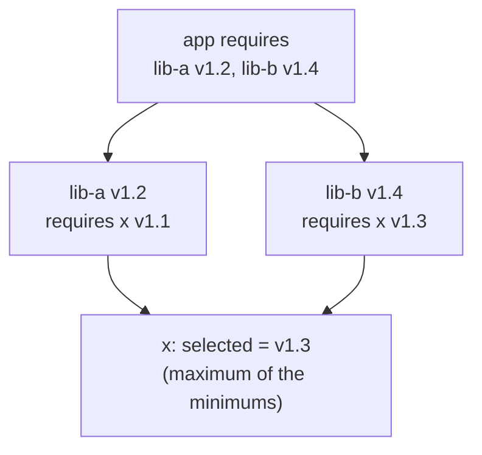

# Go Modules Build and Tooling

> [!abstract] What this is
> How Go code is organised, versioned and built: **modules** (`go.mod`, `go.sum`), **semantic import versioning** (`/v2` paths), **Minimal Version Selection**, the module proxy and checksum database, `replace`/`exclude`/`retract`, workspaces, private modules, the **`go` and `toolchain` lines**, `tool` directives (1.24), the toolchain commands (`build`, `vet`, the rebuilt **`go fix`** modernizers (1.26), `govulncheck`), and **builds**: static binaries, cross-compilation, build tags, `-ldflags`, `-trimpath`, PGO, and the cost of **cgo**. The decision this helps with: managing dependencies predictably and producing small, reproducible binaries. Equivalents: [[14 - Java Build and Dependencies]], [[11 - Python Packaging and Environments]].

---

## Why It Matters

- Go's dependency model is deliberately different from Maven/npm: no "latest compatible" resolution, so builds are reproducible without a lockfile. Knowing **MVS** explains why upgrading one dependency doesn't silently upgrade others.
- A static Go binary in a `scratch`/distroless image is one of Go's biggest operational advantages; cgo quietly removes it.

---

## Modules

```
module github.com/acme/orders          // module path = import path prefix

go 1.26                                 // minimum Go version; also selects language semantics and GODEBUG defaults
toolchain go1.27.1                      // preferred toolchain when this module is the main module

require (
    github.com/jackc/pgx/v5 v5.7.4
    golang.org/x/sync v0.12.0
)

require golang.org/x/text v0.22.0 // indirect

tool golang.org/x/tools/cmd/stringer    // 1.24: tool dependencies, run with `go tool stringer`
```

- **`go.sum`** records cryptographic hashes of every module version used; commit it. It's verified against the public **checksum database** (`sum.golang.org`) on first download.
- **Module proxy** (`GOPROXY=https://proxy.golang.org,direct` by default) caches immutable module versions; companies run Athens/Artifactory proxies.
- **Private modules**: `GOPRIVATE=github.com/acme/*` skips the public proxy and checksum DB for those paths; configure git credentials.
- `go mod tidy` adds missing and removes unused requirements (1.27 also normalises `go.mod` into one direct and one indirect `require` block); run it in CI and fail on diffs.

### Semantic import versioning

- `v0.x` / `v1.x` live at the module path; **`v2+` must change the import path**: `github.com/jackc/pgx/v5`. Two major versions of one module can coexist in a build because they're different import paths.
- Breaking changes need a new major version (and path); within a major version, the **Go 1-style compatibility expectation** applies to modules too.
- `retract` in `go.mod` marks bad published versions so `go get` avoids them.

### Minimal Version Selection



- Each module states the **minimum** versions it needs; the build uses, for each module, the **highest of those minimums**, never a newer one just because it exists.
- Consequences: builds are **reproducible from `go.mod` alone** (no lockfile needed), upgrades happen only when someone asks (`go get x@v1.4`, `go get -u ./...`), and the result is the oldest version set that satisfies everyone.
- Inspect: `go list -m all`, `go mod graph`, `go mod why -m x`.

### replace, exclude, workspaces

- `replace example.com/x => ../x` (local development) or `=> example.com/fork v1.2.3` (patched fork). Only the **main module's** replaces apply; libraries' replaces are ignored.
- **Workspaces** (`go.work`, 1.18) combine several local modules for development without `replace` edits; usually not committed for apps.

---

## The go and toolchain Lines

- `go 1.26` = minimum version required; with `GOTOOLCHAIN=auto` (default), an older local Go downloads the required toolchain automatically.
- The `go` line also selects **language semantics** (1.22 loop variables) and **`GODEBUG` defaults**: bumping it is a behaviour change, review it separately ([[00 - Go Version History]]).
- Since 1.26, `go mod init` writes `go 1.(N-1).0` so new modules stay buildable with the previous supported release.

---

## Tooling

| Command | Use |
|---|---|
| `gofmt` / `go fmt` | Canonical formatting (non-negotiable in Go codebases) |
| **`go vet`** | Correctness checks: printf misuse, copied locks, lost `cancel`, unreachable code, `waitgroup` misuse (1.25), `hostport` (1.25), `%w` with pointer-to-error (1.27); `go test` runs a subset (incl. `stdversion` in 1.27) |
| **`go fix`** (rebuilt in 1.26) | **Modernizers**: automated rewrites to current idioms and APIs (`min`/`max`, `slices`, `range` over int, `atomictypes`, ...); `//go:fix inline` lets library authors migrate callers automatically |
| `staticcheck`, `golangci-lint` | Wider linting (bugs, style, performance) |
| **`govulncheck`** | Reports known vulnerabilities **reachable** from your code, not just present in `go.mod` |
| `go doc` | Docs in the terminal (1.27: `pkg@version`, examples with `-ex`) |
| `go generate` | Run generators (`stringer`, `sqlc`, mocks) declared in `//go:generate` comments |
| `go tool <name>` | Run tools declared with `tool` directives (1.24) at pinned versions |

---

## Building

```bash
# Static, reproducible, stripped Linux binary
CGO_ENABLED=0 GOOS=linux GOARCH=amd64 \
  go build -trimpath -ldflags="-s -w -X main.version=${GIT_SHA}" -o bin/orders ./cmd/orders

# Cross-compile for ARM (e.g. Graviton) from any machine
CGO_ENABLED=0 GOOS=linux GOARCH=arm64 go build -o bin/orders-arm64 ./cmd/orders

# Profile-guided optimisation: put a CPU profile at ./cmd/orders/default.pgo
go build -pgo=auto ./cmd/orders
```

| Flag / feature | Effect |
|---|---|
| `CGO_ENABLED=0` | Pure-Go binary: statically linked, runs on `scratch`/distroless, trivial cross-compilation |
| `GOOS` / `GOARCH` | Cross-compilation targets, no extra toolchain needed without cgo |
| `-trimpath` | Remove local paths from binaries: reproducible builds, no leaking build-machine paths |
| `-ldflags="-s -w"` | Strip symbol table/DWARF: smaller binary (but no debug info for delve) |
| `-ldflags="-X pkg.var=value"` | Inject version/commit at build time (or read `runtime/debug.ReadBuildInfo()`, which includes VCS info automatically) |
| Build tags `//go:build linux && !race` | Platform- or feature-specific files |
| **PGO** (GA 1.21) | Uses a production CPU profile (`default.pgo`) to guide inlining and devirtualisation: typically 2–14% faster |
| `-race` | Race-detector build (tests, staging) ([[07 - Go Concurrency Primitives]]) |
| `GOAMD64=v3` | Target newer x86-64 instruction sets |

### cgo costs

| Cost | Detail |
|---|---|
| No static binary by default | Links against libc; needs a matching runtime image (glibc vs musl) |
| Cross-compilation | Needs a C cross-compiler per target |
| Call overhead | Each Go→C call costs tens of nanoseconds (1.26 cut baseline overhead ~30%), and blocking C calls hold an OS thread ([[01 - Go Runtime and the GMP Scheduler]]) |
| Tooling and safety | C memory bugs, harder profiling, slower builds |

- Common accidental cgo: `net` package DNS resolver (pure-Go resolver used when `CGO_ENABLED=0` or `GODEBUG=netdns=go`), `os/user`, SQLite drivers (`mattn/go-sqlite3`; pure-Go alternatives exist). Prefer pure-Go libraries for services.

---

## Supply-Chain Hygiene

- `go.sum` + checksum DB protect integrity; **`govulncheck`** in CI for reachable vulnerabilities; Dependabot/Renovate for updates.
- Minimal dependency trees are idiomatic in Go: the standard library covers HTTP, JSON, crypto, testing, profiling.
- SBOMs from the binary's embedded build info (`go version -m binary`, syft/cyclonedx-gomod).

---

## Failure Modes

| Failure | What happens | Mitigation |
|---|---|---|
| **Uncommitted or stale `go.sum`** | Verification failures, non-reproducible builds | Commit `go.sum`; `go mod tidy` check in CI |
| **Breaking change without a major version** | Downstream breakages | `/v2` path for breaking changes; `retract` mistakes |
| **`replace` in a library expecting it to apply downstream** | Ignored for consumers | Release fixed versions; replaces only in main modules |
| **Bumping the `go` line casually** | Semantics/GODEBUG changes | Separate, reviewed change |
| **Accidental cgo** | Binary needs libc; breaks on `scratch` | `CGO_ENABLED=0` in builds; pure-Go deps |
| **Private modules through the public proxy** | Fetch failures or leaked module names | `GOPRIVATE` / `GONOSUMDB` |
| **`-s -w` everywhere** | No symbols for debugging crashes | Keep unstripped builds/debug artefacts for prod binaries |
| **Ignoring `govulncheck`** | Exploitable vulnerabilities shipped | Run in CI, fail on reachable findings |

---

## Interview Lines

> [!tip] Say it like this
> - "Go modules use Minimal Version Selection: each module declares minimums and the build takes the highest minimum per dependency, so builds are reproducible from `go.mod` and `go.sum` without a lockfile."
> - "Major versions 2 and up change the import path, so different majors can coexist in one build."
> - "The `go` line is both the minimum toolchain and the language-semantics switch, so bumping it is a reviewed change."
> - "I build with `CGO_ENABLED=0`, `-trimpath` and a version stamp for a static binary on distroless, use PGO from production profiles, and run `vet`, `govulncheck` and 1.26's `go fix` modernizers in CI."
> - "cgo costs static linking, easy cross-compilation and thread usage, so I avoid it in services."

## Related Notes

- [[00 - Go Version History]] · [[11 - Go Testing and Benchmarks]] · [[13 - Go in Containers and Production]]
- [[14 - Java Build and Dependencies]] · [[11 - Python Packaging and Environments]] · [[05 - Compilation and Startup Compared]] · [[Languages/README]]
