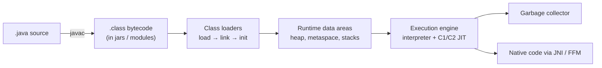
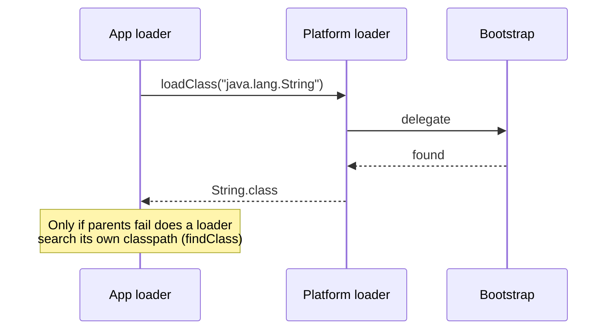
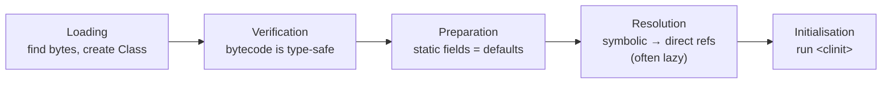

# JVM Architecture and Class Loading

> [!abstract] What this is
> How a `.java` file becomes running code: compilation to **bytecode**, the **class loader** hierarchy and parent delegation, the **load → link → initialise** sequence, and the **execution engine** (interpreter, JIT, GC) that runs it. The decision this helps with: diagnosing `ClassNotFoundException` vs `NoClassDefFoundError`, classpath conflicts, metaspace leaks from redeploys, and slow startup.

---

## Why It Matters

- Many "it works locally but not in prod" bugs are class-loading bugs: two versions of a library on the classpath, a class initialiser that threw once, a shaded jar that shadows another.
- Frameworks (Spring, Hibernate, Mockito, agents) rely on class loading and bytecode generation; knowing the mechanism explains their startup cost and their failure messages.
- The architecture is also the map for the rest of the Java notes: JIT ([[02 - JIT Compilation and AOT]]), memory areas ([[03 - JVM Memory Layout]]), GC ([[04 - Java Garbage Collectors]]).

---

## The Big Picture



- **`javac`** compiles source to **bytecode**: a portable, stack-based instruction set (`iload`, `invokevirtual`, `getfield` ...) plus a **constant pool** of symbolic references (class names, method signatures, literals).
- The JVM does **not** load everything at startup. Classes load **lazily**, on first active use.
- Bytecode starts in the **interpreter**; hot methods are compiled to native code by the **JIT**. This is why Java has a warm-up curve.
- `javac --release N` targets an older JDK API and class-file version; running a class built for a newer version fails with **`UnsupportedClassVersionError`**.

### Bytecode in one example

```java
int add(int a, int b) { return a + b; }
```

```
iload_1      // push a
iload_2      // push b
iadd         // pop two, push sum
ireturn
```

- `javap -c -v Foo.class` disassembles a class; useful for checking what lambdas, string concatenation (`invokedynamic` since 9) or records actually compile to.

---

## Class Loaders

A **class loader** turns a binary name (`com.acme.Order`) into a `Class` object. A class's runtime identity is **(class loader, fully-qualified name)**: the same class loaded by two loaders is two different types.

| Loader | Loads | Notes |
|---|---|---|
| **Bootstrap** | Core JDK modules (`java.base` ...) | Native, part of the JVM; shows as `null` from `getClassLoader()` |
| **Platform** (was Extension before 9) | Other JDK modules (`java.sql`, ...) | Parent of the app loader |
| **Application / System** | The classpath and module path | Loads your code and libraries |
| **Custom** | Whatever you implement | App servers, plugin systems, Spring Boot's fat-jar `LaunchedClassLoader`, hot-reload tools |

### Parent delegation



- A loader first asks its **parent**; only if the parent can't find the class does it look itself.
- Why: core classes can't be replaced by a rogue `java.lang.String` on the classpath, and each class is loaded once per hierarchy.
- **Child-first** loaders invert this on purpose (servlet containers for webapp classes, some plugin systems) so each app can bring its own library versions. This is where "same class, different loader" `ClassCastException`s come from: `com.acme.Foo cannot be cast to com.acme.Foo`.
- **Thread context class loader** (`Thread.currentThread().getContextClassLoader()`): lets framework code loaded by a parent loader find classes in a child (JDBC drivers, `ServiceLoader`, JNDI).

### Classpath vs module path

- **Classpath**: a flat list of jars; the **first** matching class wins. Two versions of a library means silent shadowing ("jar hell").
- **Module path (JPMS, Java 9)**: modules declare `requires` and `exports` in `module-info.java`; split packages and missing dependencies fail at startup instead of at runtime. Most applications still run on the classpath; the JDK itself is modular.
- Since 16/17 the JDK's internals are **strongly encapsulated**: reflective access to `sun.*` / non-exported packages fails unless opened with `--add-opens`.

---

## Load → Link → Initialise



| Phase | What happens | What can go wrong |
|---|---|---|
| **Loading** | Loader finds the bytes (jar, network, generated) and defines a `Class` | `ClassNotFoundException` (explicit lookup), `NoClassDefFoundError` (was present at compile time, missing at run time) |
| **Verification** | Checks bytecode is well-formed and type-safe (stack map frames) | `VerifyError`, usually from broken bytecode generation or mismatched library versions |
| **Preparation** | Allocates static fields with default values (`0`, `null`) | — |
| **Resolution** | Turns constant-pool symbolic references into direct references, usually lazily on first use | `NoSuchMethodError`, `NoSuchFieldError`, `IncompatibleClassChangeError`: compiled against one version of a library, running with another |
| **Initialisation** | Runs static initialisers and static field assignments (`<clinit>`), once, under a lock | `ExceptionInInitializerError` the first time; every later use gives **`NoClassDefFoundError: Could not initialize class X`** |

### When a class is initialised

- First `new`, static method call, non-constant static field access, reflection (`Class.forName` with init), subclass initialisation, or being the main class.
- **Not** on: referencing `Foo.class`, declaring a variable of type `Foo`, reading a compile-time `static final` constant (inlined by `javac`).
- Initialisation is **thread-safe**: the JVM holds an init lock. This is why the **holder-class idiom** gives a lazy, lock-free singleton:

```java
public final class Config {
    private Config() {}
    private static class Holder {            // not initialised until getInstance()
        static final Config INSTANCE = new Config();
    }
    public static Config getInstance() { return Holder.INSTANCE; }
}
```

- Two classes whose static initialisers wait on each other from different threads can **deadlock** during initialisation; the thread dump shows threads stuck in `<clinit>`.

### The two errors people mix up

| | `ClassNotFoundException` | `NoClassDefFoundError` |
|---|---|---|
| Type | Checked exception | `Error` (linkage) |
| Thrown by | Explicit lookups: `Class.forName`, `loadClass` | The JVM resolving a reference in already-compiled code |
| Usual cause | Wrong name, missing jar, wrong loader | Jar missing at runtime, **or** an earlier static-initialiser failure ("Could not initialize class") |
| First move | Check the classpath and which loader is asking | Search logs for the first `ExceptionInInitializerError` |

---

## Runtime Data Areas

| Area | Per | Holds | Detail in |
|---|---|---|---|
| **Heap** | JVM | Objects and arrays | [[03 - JVM Memory Layout]] |
| **Metaspace** | JVM (native memory) | Class metadata, method bytecode, constant pools | [[03 - JVM Memory Layout]] |
| **Code cache** | JVM | JIT-compiled native code | [[02 - JIT Compilation and AOT]] |
| **JVM stack** | Thread | Frames: local variables array + operand stack + reference to the constant pool | [[03 - JVM Memory Layout]] |
| **PC register** | Thread | Current bytecode instruction | — |
| **Native stack** | Thread | Frames of native (JNI) code | — |

- Classes are **unloaded** only when their **class loader** becomes unreachable, along with every class it loaded and every instance of those classes. One stray reference (a `ThreadLocal`, a static cache, a registered JDBC driver, a running thread) pins the whole loader: the classic **metaspace leak on redeploy**.

---

## Execution Engine

- **Interpreter**: executes bytecode directly; starts instantly, runs slowly.
- **JIT compilers** (C1 and C2 in HotSpot, or Graal): compile hot methods to optimised native code using runtime profiles; can **deoptimise** back to the interpreter when assumptions break. Covered in [[02 - JIT Compilation and AOT]].
- **Garbage collector**: reclaims heap; runs concurrently or in pauses at **safepoints**. Covered in [[04 - Java Garbage Collectors]].
- **Native interface**: JNI, and the **Foreign Function & Memory API** (final in 22) as its safer replacement.

### Method dispatch, briefly

| Bytecode | Used for |
|---|---|
| `invokestatic` | Static methods |
| `invokespecial` | Constructors, `private` methods, `super.` calls |
| `invokevirtual` | Normal instance methods (vtable dispatch) |
| `invokeinterface` | Interface methods (itable dispatch) |
| `invokedynamic` | Lambdas, string concatenation (9+), records' `toString/equals/hashCode`, pattern-matching `switch`; linked at runtime by a bootstrap method |

- Virtual calls look expensive, but the JIT usually **devirtualises** them using the observed receiver types (monomorphic/bimorphic inline caches) and then inlines.

---

## Startup Cost and What Speeds It Up

- Startup = load + verify + initialise thousands of classes + interpret until the JIT catches up. Spring Boot apps load tens of thousands of classes.
- **Class Data Sharing (CDS / AppCDS)**: a pre-parsed archive of class metadata, mapped at startup and shared between JVMs. The default CDS archive for JDK classes ships with the JDK; AppCDS covers your classes too.
- **AOT cache (Project Leyden, 24+)**: records loaded and linked classes (24) and method profiles (25) from a training run, so later runs start and warm up faster. See [[02 - JIT Compilation and AOT]].
- **GraalVM native image**: closed-world AOT compilation, no class loading at runtime; fastest startup, at the cost of dynamic features.

---

## Diagnostics

| Need | Tool |
|---|---|
| Which classes load, from where | `-Xlog:class+load=info` (or `-verbose:class`) |
| Unloading | `-Xlog:class+unload` |
| Class histogram / metaspace usage | `jcmd <pid> GC.class_histogram`, `jcmd <pid> VM.metaspace` |
| Loader hierarchy and counts | `jcmd <pid> VM.classloader_stats`, `VM.classloaders` |
| Which jar a class came from | `Foo.class.getProtectionDomain().getCodeSource().getLocation()` |
| Duplicate/conflicting dependencies | `mvn dependency:tree`, `gradle dependencies` ([[14 - Java Build and Dependencies]]) |

---

## Failure Modes

| Failure | What happens | Mitigation |
|---|---|---|
| **Dependency version conflict** | `NoSuchMethodError` at runtime though it compiled | Inspect the dependency tree; align with a BOM; enforce convergence |
| **Static initialiser throws** | First call: `ExceptionInInitializerError`; afterwards: `NoClassDefFoundError: Could not initialize class` | Keep `<clinit>` trivial; find the first error in logs |
| **Same class, two loaders** | `ClassCastException: X cannot be cast to X` | Make shared types load from a common parent; avoid duplicating API jars in plugins |
| **Classloader leak on redeploy** | Metaspace grows each redeploy until `OutOfMemoryError: Metaspace` | Remove `ThreadLocal`s, stop threads, deregister drivers on shutdown; prefer restarting the process |
| **Init-order deadlock** | Threads stuck in `<clinit>` of two classes | Avoid cross-class dependencies in static initialisers |
| **Reflective access to JDK internals** | `InaccessibleObjectException` after upgrading to 17+ | Upgrade the library; `--add-opens` as a temporary bridge |
| **Bytecode too new** | `UnsupportedClassVersionError` | Build with `--release` matching the runtime |

---

## Interview Lines

> [!tip] Say it like this
> - "Classes load lazily through a delegation hierarchy (bootstrap, platform, application), and a class's identity is its name plus its loader."
> - "Loading is followed by verification, preparation, resolution and initialisation; initialisation runs `<clinit>` once under a lock, which is why the holder idiom is a safe lazy singleton."
> - "`ClassNotFoundException` is an explicit lookup failing; `NoClassDefFoundError` is the JVM failing to resolve a reference, often because a static initialiser already threw."
> - "`NoSuchMethodError` almost always means we compiled against one version of a library and run with another."
> - "Classes unload only when their loader is unreachable, so one leaked reference after a redeploy leaks the whole app's metaspace."

## Related Notes

- [[00 - Java Version History]] · [[02 - JIT Compilation and AOT]] · [[03 - JVM Memory Layout]] · [[09 - Java Reflection Annotations and Proxies]] · [[12 - JVM Diagnostics and Profiling]]
- [[LLD/Concurrency/03 - Java Memory Model]] · [[Languages/README]]
