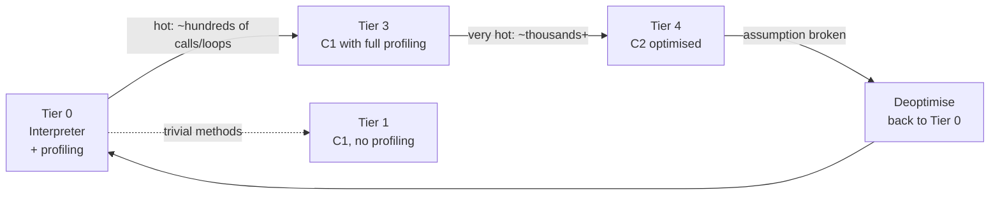

# JIT Compilation and AOT

> [!abstract] What this is
> How HotSpot turns bytecode into fast native code at runtime: the **interpreter**, **tiered compilation** with C1 and C2, the optimisations that matter (**inlining**, **escape analysis**, devirtualisation, loop optimisations), **deoptimisation**, and the **ahead-of-time** options (CDS, Leyden AOT caches, GraalVM native image). The decision this helps with: explaining warm-up and latency after deploys, writing benchmarks that mean something, and choosing between JIT, AOT cache and native image.

---

## Why It Matters

- A freshly started JVM is slow: it interprets, then compiles. The first minutes after a deploy show **higher latency and CPU**, which matters for autoscaling, canaries and serverless.
- The JIT optimises for what the code **actually does**, using profiles. That is why Java's peak performance is good, why micro-benchmarks lie without warm-up, and why a rare code path can suddenly make things slower (deoptimisation).
- Startup has become a first-class concern (containers, scale-to-zero); since JDK 24 the JDK has built-in AOT features, and Spring Boot supports native images.

---

## Tiered Compilation



| Tier | Compiler | Purpose |
|---|---|---|
| **0** | Interpreter | Runs everything first; collects invocation and back-edge (loop) counters |
| **1–3** | **C1** (client compiler) | Fast compilation, light optimisation; tier 3 inserts profiling (branch frequencies, receiver types) |
| **4** | **C2** (server compiler) | Slow, aggressive, profile-guided optimisation; peak performance |

- **On-stack replacement (OSR)**: a long-running loop can switch from interpreted to compiled code in the middle of the method, without waiting for the next call.
- Compilation runs on **background compiler threads**; the application keeps running interpreted meanwhile. In a container with 1–2 CPUs, compiler threads compete with application threads during warm-up.
- Compiled code lives in the **code cache** (segmented: non-method, profiled, non-profiled). If it fills up, compilation stops: "CodeCache is full. Compiler has been disabled." and performance falls off a cliff.
- **Graal JIT** can replace C2 (in GraalVM distributions); same idea, written in Java, different optimisation strengths.

---

## The Optimisations That Matter

| Optimisation | What it does | Why you care |
|---|---|---|
| **Inlining** | Copies a callee's body into the caller | The "mother of all optimisations": removes call overhead and lets other optimisations see across methods. Small methods (getters, lambdas) are effectively free |
| **Devirtualisation** | Uses observed receiver types to turn a virtual/interface call into a direct call (with a type guard) | Interfaces cost nothing when a call site sees one or two types (**monomorphic/bimorphic**); **megamorphic** sites (3+ types) stay virtual and block inlining |
| **Escape analysis** | Proves an object never leaves the method/thread | **Scalar replacement** (fields become locals, no heap allocation) and **lock elision** (removes uncontended locks on non-escaping objects) |
| **Loop optimisations** | Unrolling, range-check elimination, loop-invariant hoisting, vectorisation (SIMD) | Tight array loops approach C speed |
| **Intrinsics** | Hand-written native code for known methods | `System.arraycopy`, `String.equals`, `Math`, CRC32, AES, `Arrays.fill` use CPU instructions directly |
| **Dead code / null-check elimination** | Removes branches the profile says never run, using implicit null checks via signals | Fast common path; uncommon traps handle the rest |

### Speculation and deoptimisation

- C2 compiles **speculatively**: "this branch has never been taken", "this call site only ever sees `ArrayList`", "this class has no subclasses" (class hierarchy analysis).
- When a speculation fails (a new subclass loads, a cold branch runs, a new receiver type appears), the JVM hits an **uncommon trap**, **deoptimises** the method back to the interpreter, and recompiles later with the new profile.
- Occasional deopts are normal. Repeated deopt/recompile cycles show up as CPU spikes and latency jitter; `-Xlog:deoptimization=debug` or JFR "Deoptimization" events reveal them.

```java
// Escape analysis: Point never escapes, so no allocation happens after C2 compiles this
long distanceSquared(int x, int y) {
    var p = new Point(x, y);          // scalar-replaced: p.x, p.y become locals
    return (long) p.x() * p.x() + (long) p.y() * p.y();
}
record Point(int x, int y) {}
```

---

## Warm-Up in Practice

- **Symptoms**: high p99 and CPU for the first seconds to minutes after start; autoscaler adds instances that are themselves slow; canary looks worse than baseline.
- **Mitigations**:
    - Send **warm-up traffic** (or replay requests) before marking the instance ready; tie readiness probes to it.
    - Give enough CPU during startup (in Kubernetes, avoid tight CPU limits at startup; consider startup CPU boost).
    - Use an **AOT cache** (JDK 24+) or CDS to cut class loading and get profiles early.
    - For extreme cases: native image, or CRaC (checkpoint/restore of a warmed JVM, see [[14 - Spring Boot Performance and Native]]).

### Benchmarking without lying

- Use **JMH**, not `System.nanoTime()` loops: it handles warm-up iterations, forks, dead-code elimination (`Blackhole`), and constant folding.
- Without these, the JIT may delete the code being measured, or the benchmark measures the interpreter.

---

## Ahead-of-Time Options

| Option | What it is | Startup | Peak perf | Trade-offs |
|---|---|---|---|---|
| **Plain JIT** | Default HotSpot | Slowest | Best (profile-guided) | Warm-up curve |
| **CDS / AppCDS** | Archive of parsed class metadata, memory-mapped and shareable across JVMs | Faster (class loading) | Same | Archive must match JDK + classpath |
| **AOT cache (Leyden, JDK 24+)** | Training run records loaded+linked classes (24), method profiles (25), later compiled code; `-XX:AOTCache=app.aot` | Much faster start and warm-up | Same as JIT | Training run must be representative; cache tied to JDK build and classpath |
| **GraalVM native image** | Closed-world AOT compile to a standalone executable | Milliseconds | Lower peak than C2 without PGO (PGO closes much of the gap) | Reflection, proxies, resources need metadata; long builds; different GC options; harder debugging |
| **CRaC** | Checkpoint a warmed JVM process, restore it later | Milliseconds, already warm | Same as JIT | Linux only, must close/reopen files and sockets around checkpoint, secrets in the snapshot |

### Leyden AOT cache flow (JDK 25)

```bash
# 1. Training run: record classes and profiles while exercising the app
java -XX:AOTCacheOutput=app.aot -jar app.jar   # run representative traffic, then exit

# 2. Production runs use the cache
java -XX:AOTCache=app.aot -jar app.jar
```

- JDK 24 needed a separate record/create step; JDK 25 (JEP 514) made it a single training command and added method profiling (JEP 515). Later JDKs extend the cache further.

### Native image: the closed-world assumption

- The build performs **points-to analysis** from `main` and compiles only reachable code. Anything dynamic (reflection, dynamic proxies, `Class.forName`, resources, serialisation) must be declared in **reachability metadata**, or it is missing at runtime.
- Frameworks generate that metadata: Spring Boot's **AOT processing** precomputes bean definitions and emits hints ([[14 - Spring Boot Performance and Native]]).
- Good fit: CLIs, serverless functions, scale-to-zero services, sidecars. Poor fit: long-running high-throughput services where C2 peak performance and mature GC/diagnostics matter more.

---

## Useful Flags and Tools

| Need | Flag / tool |
|---|---|
| See what gets compiled | `-XX:+PrintCompilation` |
| Inlining decisions | `-XX:+UnlockDiagnosticVMOptions -XX:+PrintInlining` |
| Code cache size / usage | `-XX:ReservedCodeCacheSize=`, `jcmd <pid> Compiler.codecache` |
| Compiler threads | `-XX:CICompilerCount=` |
| Deopt events | JFR (`jdk.Deoptimization`), `-Xlog:deoptimization` |
| Detailed JIT analysis | JITWatch on `-XX:+LogCompilation` output |
| Disable tiers (rarely) | `-XX:TieredStopAtLevel=1` (C1 only: faster start, lower peak; sometimes used for short-lived tools) |

---

## Failure Modes

| Failure | What happens | Mitigation |
|---|---|---|
| **Cold JVM takes traffic** | Latency spike after each deploy or scale-out | Warm-up before readiness; AOT cache; CPU headroom at start |
| **Code cache full** | JIT disabled, gradual slowdown | Raise `ReservedCodeCacheSize`; check for excessive generated classes |
| **Megamorphic hot call site** | No inlining, slower hot path | Reduce the number of implementations at that site, or split the call site |
| **Deopt storms** | CPU spikes, jitter | Find the trap reason in JFR; avoid code paths that keep invalidating assumptions |
| **Naive micro-benchmark** | Results measure the interpreter or dead code | JMH with warm-up, forks, `Blackhole` |
| **Native image missing reflection metadata** | `ClassNotFoundException` / missing bean only in the native binary | Use framework AOT hints, the tracing agent, and test the native build in CI |
| **Stale AOT cache** | Cache ignored or rejected after JDK/classpath change | Regenerate the cache in the build pipeline for each release |

---

## Interview Lines

> [!tip] Say it like this
> - "HotSpot interprets first, compiles hot methods with C1 while profiling, then recompiles the hottest ones with C2 using those profiles."
> - "C2 speculates based on what it has seen; when an assumption breaks it deoptimises back to the interpreter and recompiles."
> - "Inlining is what makes small methods and interfaces free, as long as the call site is monomorphic or bimorphic."
> - "Escape analysis can remove allocations and locks for objects that never leave a method."
> - "For startup I'd try the JDK's AOT cache first, which keeps the JIT's peak performance; native image is for when milliseconds of startup or a small footprint matter more than peak throughput."

## Related Notes

- [[01 - JVM Architecture and Class Loading]] · [[03 - JVM Memory Layout]] · [[12 - JVM Diagnostics and Profiling]] · [[13 - Java in Containers and Production Tuning]]
- [[14 - Spring Boot Performance and Native]] · [[Languages/README]]
