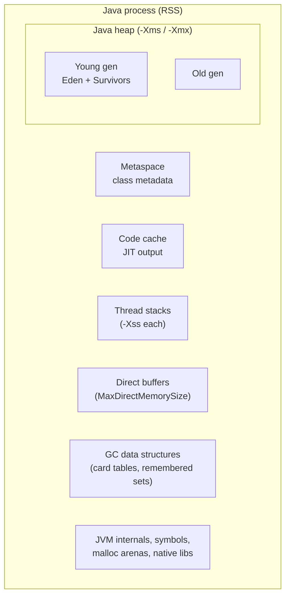
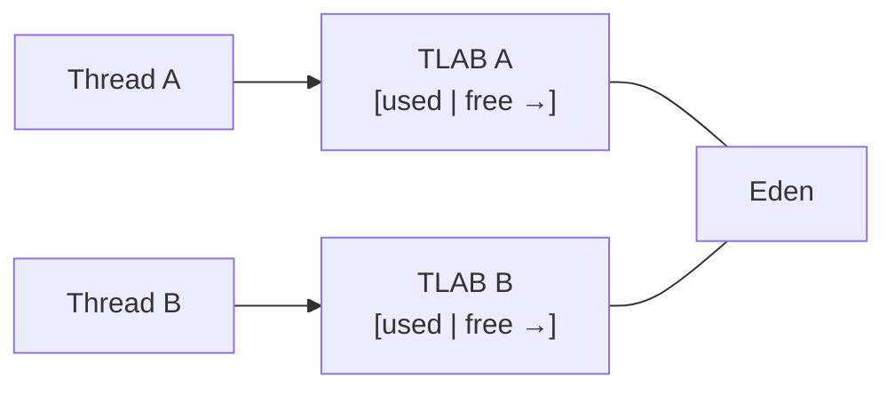

# JVM Memory Layout

> [!abstract] What this is
> Where a Java process's memory goes: the **heap** and its generations, **TLAB** allocation, **metaspace**, **thread stacks**, the **code cache**, **direct (off-heap) memory**, and the **object layout** (headers, compressed oops, compact headers in 25). The decision this helps with: sizing a JVM in a container, reading an `OutOfMemoryError` correctly, and explaining why RSS is much bigger than `-Xmx`.

---

## Why It Matters

- "The pod is OOMKilled but the heap is only 60% full" is a native-memory question: the heap is one of several regions.
- Each `OutOfMemoryError` message names a different region with a different fix; treating them all as "raise `-Xmx`" often makes it worse.
- Object layout explains memory per object (why a `HashMap<Integer, Integer>` entry costs ~50+ bytes) and the value of compact headers and primitives.

---

## The Process Memory Map



| Region | Holds | Limit flag | OOM message |
|---|---|---|---|
| **Heap** | All objects and arrays | `-Xmx`, `-XX:MaxRAMPercentage` | `Java heap space`, `GC overhead limit exceeded` (Parallel GC) |
| **Metaspace** | Class metadata, bytecode, constant pools | `-XX:MaxMetaspaceSize` (unbounded by default) | `Metaspace` |
| **Compressed class space** | Class pointers' targets when compressed class pointers are on | `-XX:CompressedClassSpaceSize` | `Compressed class space` |
| **Code cache** | JIT-compiled code | `-XX:ReservedCodeCacheSize` | No OOM; JIT disables itself |
| **Thread stacks** | One per platform thread | `-Xss` (default 1 MB on 64-bit Linux, reserved; committed as used) | `unable to create native thread` |
| **Direct memory** | `ByteBuffer.allocateDirect`, Netty pools, NIO | `-XX:MaxDirectMemorySize` (defaults to ≈ max heap) | `Direct buffer memory` |
| **Native / other** | GC structures, symbol table, JNI libraries, glibc arenas | Not bounded by the JVM | Kernel OOM kill, no Java error |

- **RSS ≈ heap + metaspace + code cache + (threads × stack used) + direct + GC overhead + native**. A safe container rule of thumb: heap at **~50–75%** of the memory limit, the rest for everything else ([[13 - Java in Containers and Production Tuning]]).
- **Native Memory Tracking** shows the breakdown: start with `-XX:NativeMemoryTracking=summary`, then `jcmd <pid> VM.native_memory summary`.

---

## The Heap and Generations

The **weak generational hypothesis**: most objects die young. So the heap is split, and the young part is collected often and cheaply.

| Space | Role |
|---|---|
| **Eden** | New objects are allocated here |
| **Survivor (S0/S1)** | Objects that survived a young GC are copied here, back and forth; each survival increments their **age** |
| **Old (tenured)** | Objects promoted after surviving enough young GCs (tenuring threshold) or too big for survivors |
| **Humongous regions (G1)** | Objects ≥ half a region (e.g. big arrays) allocated directly in contiguous old regions |

- G1 and generational ZGC split the heap into **regions** rather than fixed contiguous spaces; each region plays a role (eden, survivor, old, humongous) dynamically. See [[04 - Java Garbage Collectors]].
- A **young GC** copies live objects out of eden: its cost is proportional to **live** objects, not garbage. Allocating lots of short-lived objects is cheap; keeping many medium-lived ones (caches, session state) is what hurts.
- **Premature promotion**: if survivors overflow, medium-lived objects get promoted to old gen and only die there, causing more expensive old/mixed collections.

### Allocation: TLABs and bump-the-pointer



- Each thread gets a **Thread-Local Allocation Buffer** in eden. Allocation is a pointer bump inside it: a few instructions, no locking.
- When a TLAB fills, the thread grabs a new one (a CAS on eden). Very large objects bypass the TLAB.
- This is why `new` in Java is often cheaper than `malloc`, and why escape analysis removing an allocation matters less than people expect, but still matters under high allocation rates.

---

## Metaspace

- Replaced **PermGen** in Java 8. Lives in **native memory**, grows on demand, **unbounded by default**.
- Holds one set of metadata per loaded class; freed only when the **class loader** dies ([[01 - JVM Architecture and Class Loading]]).
- Grows with: frameworks generating classes (proxies, Hibernate, lambdas' hidden classes), Groovy/scripting, redeploys in app servers.
- Set `-XX:MaxMetaspaceSize` in containers so a leak produces a clear `OutOfMemoryError: Metaspace` instead of a silent kernel OOM kill.

---

## Thread Stacks

- Each **platform thread** has a fixed-size stack (reserved `-Xss`, committed as it is used) holding frames: locals, operand stack, return address.
- Deep recursion → **`StackOverflowError`**. Too many threads → **`OutOfMemoryError: unable to create native thread`** (OS limits, `ulimit -u`, pids cgroup limit, or memory).
- **Virtual threads** store their stack as **heap objects** (stack chunks) when unmounted, so a million of them cost heap, not native stacks ([[05 - Java Platform and Virtual Threads]]).

---

## Direct and Off-Heap Memory

- `ByteBuffer.allocateDirect` memory lives outside the heap, avoiding a copy for socket and file I/O. Netty, Kafka clients, gRPC and many databases drivers use it heavily.
- Freed when the owning `ByteBuffer` object is GC'd (via a cleaner), so a large heap with rare GCs can hold a lot of dead direct memory.
- **FFM API** (`Arena`, `MemorySegment`, final in 22) gives deterministic off-heap allocation and freeing: `try (Arena arena = Arena.ofConfined()) { ... }`.
- Memory-mapped files (`FileChannel.map`) count toward RSS as page cache pages are touched.

---

## Object Layout

```
 64-bit HotSpot, compressed oops (typical before compact headers)

 +----------------------+----------------+------------------+---------+
 | mark word (8 bytes)  | class ptr (4)  | fields ...       | padding |
 +----------------------+----------------+------------------+---------+
   hash, GC age,          compressed       ordered by size    to 8-byte
   lock state             klass pointer    to reduce gaps     alignment
```

| Part | Size | Holds |
|---|---|---|
| **Mark word** | 8 bytes | Identity hash, GC age, lock bits |
| **Class pointer** | 4 bytes compressed (8 without) | Pointer to class metadata |
| **Array length** | 4 bytes (arrays only) | Length |
| **Fields** | Primitives by size, references 4 bytes with compressed oops | Reordered by the JVM to minimise padding |
| **Padding** | To a multiple of 8 bytes | — |

- **Header**: 12 bytes classically (mark + compressed class pointer), so `new Object()` is **16 bytes** after padding.
- **Compact object headers**: mark word and class pointer merged into **8 bytes**. Experimental in 24, product feature in **25** (JEP 519, opt-in with `-XX:+UseCompactObjectHeaders`), **on by default in 27** (disable with `-XX:-UseCompactObjectHeaders`). Reported results: roughly 10–20% less heap and less GC work for object-heavy apps.
- **Compressed oops**: with heaps below ~32 GB, references are 32-bit offsets scaled by 8, so references take 4 bytes instead of 8. Crossing ~32 GB turns them off and **every reference doubles**; a 33 GB heap can hold less than a 31 GB one.
- **Boxing cost**: an `Integer` is 16 bytes plus a 4-byte reference to it; `int` is 4. `HashMap<Integer,Integer>` pays a `Node` (≈32 bytes) + two boxes per entry. Primitive collections (fastutil, Eclipse Collections) or arrays fix this; Project **Valhalla** value classes aim to fix it in the language.
- Measure, don't guess: **JOL** (`org.openjdk.jol`) prints real layouts and sizes.

```java
// JOL: print the real layout of an object
System.out.println(ClassLayout.parseClass(Order.class).toPrintable());
```

---

## Reading OOMs

| Message | Likely cause | First move |
|---|---|---|
| `Java heap space` | Leak (growing collection, cache without bound) or heap too small for the live set | Heap dump (`-XX:+HeapDumpOnOutOfMemoryError`), dominator tree in Eclipse MAT |
| `GC overhead limit exceeded` | Live set nearly fills the heap; GC runs constantly for little gain | Same as above |
| `Metaspace` | Class loader leak, unbounded class generation | `jcmd VM.classloader_stats`, `GC.class_histogram`; check redeploys and proxies |
| `Direct buffer memory` | Direct buffers not released, or limit too low for Netty pools | Track `BufferPoolMXBean`; fix leaks; size `MaxDirectMemorySize` |
| `unable to create native thread` | Thread leak or OS/cgroup limits | Thread dump count by name; fix unbounded pools; check `pids.max` |
| `Requested array size exceeds VM limit` | Array near `Integer.MAX_VALUE` | Usually a bug in size computation |
| Pod OOMKilled, no Java error | Native memory over the container limit | NMT summary; lower heap %, cap metaspace/direct, check thread count and glibc arenas (`MALLOC_ARENA_MAX`) |

- More on dumps and tooling in [[12 - JVM Diagnostics and Profiling]].

---

## Failure Modes

| Failure | What happens | Mitigation |
|---|---|---|
| **Heap set to the container limit** | Native regions push RSS over the limit; kernel OOM kill | Heap at ~50–75% via `MaxRAMPercentage`; NMT to size the rest |
| **Heap just over 32 GB** | Compressed oops off; effective capacity drops | Stay below ~31 GB, or go well above |
| **Unbounded cache in the heap** | Old gen fills; long GCs; OOM | Bounded caches (Caffeine) with size/TTL; measure retained size |
| **Medium-lived objects** | Premature promotion, expensive old collections | Shorten lifetimes or make them truly long-lived; tune young gen / let G1 adapt |
| **Many platform threads** | Native memory and scheduler overhead | Bounded pools or virtual threads |
| **Direct memory held by garbage** | Off-heap grows while heap looks fine | Pool buffers; set `MaxDirectMemorySize`; release explicitly with FFM arenas |

---

## Interview Lines

> [!tip] Say it like this
> - "The heap is only part of the process: metaspace, code cache, thread stacks, direct buffers and GC structures all live outside `-Xmx`, which is why I size the heap at well under the container limit."
> - "Allocation goes into thread-local buffers in eden by bumping a pointer, and a young GC's cost depends on what survives, not on how much garbage there is."
> - "Under 32 GB the JVM uses compressed 4-byte references; just above it, references double, so a 33 GB heap can hold less than a 31 GB one."
> - "An object has a 12-byte header classically, or 8 with compact headers (opt-in in 25, default in 27), which is why boxed collections are so expensive."
> - "Each OOM message names a region; I read it before touching `-Xmx`."

## Related Notes

- [[01 - JVM Architecture and Class Loading]] · [[04 - Java Garbage Collectors]] · [[05 - Java Platform and Virtual Threads]] · [[12 - JVM Diagnostics and Profiling]] · [[13 - Java in Containers and Production Tuning]]
- [[Languages/README]]
