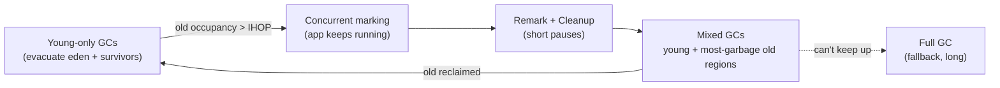

# Java Garbage Collectors

> [!abstract] What this is
> How the JVM reclaims memory and how to choose and tune a collector: reachability and **GC roots**, **mark / sweep / compact / copy**, **safepoints** and stop-the-world pauses, and the production collectors (**Serial, Parallel, G1, generational ZGC, Shenandoah**). The decision this helps with: picking a GC for a latency or throughput target, reading GC logs, and fixing long pauses or GC thrashing.

---

## Why It Matters

- GC is the most common source of Java tail latency: a 500 ms pause is a 500 ms p99.
- Choosing the wrong collector (or letting the JVM pick Serial in a tiny container) is a one-line fix with a large effect.
- "Explain how G1 works" and "when would you use ZGC?" are standard senior Java questions.

---

## Fundamentals

### Reachability

- An object is **live** if it is reachable from a **GC root**: local variables and operand stacks of live threads, static fields, JNI references, monitors held, and a few JVM internals.
- Everything else is garbage, including cycles. No reference counting.
- Reference types change reachability: **soft** (cleared under memory pressure; poor man's cache), **weak** (cleared at next GC; `WeakHashMap`), **phantom** (post-mortem cleanup; `Cleaner`). `finalize()` is deprecated for removal: never use it.

### The building blocks

| Technique | How | Cost / property |
|---|---|---|
| **Mark** | Trace from roots, mark reachable objects | Proportional to live objects |
| **Sweep** | Free unmarked memory into free lists | Fragmentation |
| **Compact** | Slide live objects together | No fragmentation; must update all references |
| **Copy (evacuate)** | Copy live objects to an empty space | Proportional to live; needs spare space; compacts for free |

- **Generational collection** applies copying to the young generation (mostly dead, cheap to copy the few survivors) and mark-compact or region evacuation to the old generation ([[03 - JVM Memory Layout]]).
- To collect young without scanning old, the GC tracks **old → young references** with a **card table** / **remembered sets**, maintained by **write barriers** (small code the JIT inserts on every reference store).

### Safepoints and stop-the-world

- Some GC phases need all application threads stopped at a **safepoint**: a point where every thread's stack and references are known.
- **Time-to-safepoint** counts too: a thread in a long counted loop without a safepoint poll can delay everyone. Modern JVMs poll in loops (loop strip mining), but it still shows up.
- **Concurrent** collectors do most work while the application runs, and use **barriers** to keep a consistent view: write barriers (SATB in G1/Shenandoah), load barriers (ZGC, Shenandoah).

---

## The Collectors

| Collector | Flag | Design | Pauses | Best for |
|---|---|---|---|---|
| **Serial** | `-XX:+UseSerialGC` | Single-threaded, stop-the-world, generational | Long, proportional to heap | Tiny heaps, 1 CPU, CLIs |
| **Parallel** | `-XX:+UseParallelGC` | Multi-threaded stop-the-world, generational | Long-ish, but short total GC time | **Throughput** batch jobs, where pauses don't matter |
| **G1** (default since 9) | `-XX:+UseG1GC` | Regions, concurrent marking, incremental evacuation, pause-time target | Tens to a few hundred ms; target `MaxGCPauseMillis=200` | **General-purpose** services, heaps from ~1 GB up to tens of GB |
| **ZGC** (generational, default mode since 23) | `-XX:+UseZGC` | Concurrent marking **and relocation**, coloured pointers, load barriers | **Sub-millisecond**, independent of heap size | Latency-sensitive services, large heaps (to multi-TB) |
| **Shenandoah** (generational mode product in 25) | `-XX:+UseShenandoahGC` | Concurrent compaction, load-reference barriers | Low ms, independent of heap size | Low-latency alternative to ZGC; available in most OpenJDK builds (not Oracle's) |
| **Epsilon** | `-XX:+UseEpsilonGC` | Allocates, never collects | None | Benchmarks, very short-lived jobs |

- CMS was removed in **Java 14**. Non-generational ZGC was removed in **24** (generational became default in 23).
- **Ergonomics**: up to **JDK 26** (so including the 25 LTS), without a flag the JVM picks G1 only on "server-class" machines (≥ 2 CPUs and ≥ 1792 MB) and silently picks **Serial** otherwise, which is common in small containers and CI runners. **JDK 27** (JEP 523) makes G1 the default in all environments. On 25 and earlier, set the collector explicitly.

---

## G1 in Depth



- Heap divided into equal **regions** (1–32 MB, chosen from heap size). Each region is eden, survivor, old, or humongous.
- **Young GC**: stop-the-world, parallel evacuation of eden and survivor regions into new survivor/old regions.
- **Concurrent marking** starts when old occupancy crosses the **IHOP** (initiating heap occupancy, adaptive by default) and finds how much garbage each old region holds.
- **Mixed GCs** then evacuate young regions plus the old regions with the **most garbage first** ("Garbage-First"), sized to fit the pause target.
- **Pause target** (`-XX:MaxGCPauseMillis`, default 200 ms): G1 sizes the young generation and number of old regions per GC to try to meet it. Lower targets mean more frequent, smaller GCs and lower throughput.
- **Humongous objects** (≥ half a region) go straight to contiguous old regions; lots of large short-lived arrays fragment the heap and trigger extra GCs. Fix by larger regions (`-XX:G1HeapRegionSize`) or smaller buffers.
- **Full GC** is the failure path ("to-space exhausted", evacuation failure): the whole heap compacted stop-the-world. Seeing it regularly means the heap is too small or marking starts too late.

## ZGC in Depth

- Almost everything is concurrent: marking, **relocation** (moving objects) and reference fixing. Pauses are only for root scanning hand-offs, typically **well under 1 ms**, and don't grow with heap size.
- **Coloured pointers**: metadata bits in each reference record its GC state; a **load barrier** on every reference read checks the colour and, if needed, fixes the pointer (heals it) to the object's new location.
- **Generational** (21 opt-in, default in 23): separate young and old collections, giving much better throughput and lower allocation-stall risk than the original single-generation ZGC.
- Costs: some throughput (barriers on loads), more CPU used concurrently, and it needs **headroom**: if the application allocates faster than ZGC can collect, threads hit **allocation stalls**, which are effectively pauses.
- Tuning is mostly: set `-Xmx` with headroom, and maybe `-XX:SoftMaxHeapSize`. Few other knobs.

---

## Choosing a Collector

| Situation | Pick | Why |
|---|---|---|
| Typical web service, heap 1–32 GB, p99 in the 100 ms range is fine | **G1** | Good balance, default, well understood |
| Latency SLO in single-digit ms, or heap ≥ ~32 GB | **Generational ZGC** | Pauses don't scale with heap |
| Same, on a distribution with Shenandoah, or smaller heaps | **Shenandoah** | Similar goals, different trade-offs |
| Batch / ETL / offline, maximise work per CPU | **Parallel** | Highest throughput, pauses irrelevant |
| < 2 CPUs, small heap, short-lived tool | **Serial** | Lowest overhead |

- Measure with production-like traffic. Look at **p99/p999 latency, throughput, CPU, and RSS** together; low-pause collectors trade throughput and memory for latency.

---

## Tuning That Actually Matters

1. **Pick the collector explicitly** (on JDK ≤ 26, don't let ergonomics pick Serial in a small container).
2. **Size the heap**: `-Xms` = `-Xmx` for services (no resize pauses); in containers use `-XX:MaxRAMPercentage` ([[13 - Java in Containers and Production Tuning]]).
3. **Reduce allocation and live set** before tuning flags: fewer temporary objects on hot paths, bounded caches, no giant humongous arrays.
4. For G1: adjust `MaxGCPauseMillis` only with evidence; avoid fixing young gen size (`-Xmn`) since it disables pause-time adaptation.
5. Leave **CPU headroom** for concurrent GC threads; low-pause GCs need spare cores.
6. Never call `System.gc()` from application code (or disable with `-XX:+DisableExplicitGC` if a library does).

---

## Reading GC Logs

```bash
-Xlog:gc*:file=/var/log/app/gc.log:time,uptime,level,tags:filecount=5,filesize=20m
```

```
[12.345s][info][gc] GC(42) Pause Young (Normal) (G1 Evacuation Pause) 812M->204M(2048M) 18.432ms
[98.101s][info][gc] GC(97) Pause Full (G1 Compaction Pause) 1990M->1850M(2048M) 2875.112ms
```

- First line: healthy young GC, 812 MB → 204 MB in 18 ms.
- Second line: a **Full GC** that freed almost nothing (1990 → 1850 MB of 2048): the live set is close to the heap size. More heap or less live data is the fix, not GC flags.
- What to look for: pause times vs SLO, GC frequency, **heap after GC** trending up (leak), Full GCs, `to-space exhausted`, humongous allocations, ZGC "Allocation Stall".
- Tools: GCeasy, GCViewer, JFR GC events, JDK Mission Control.

---

## Failure Modes

| Failure | What happens | Mitigation |
|---|---|---|
| **Serial GC chosen in a small container** (JDK ≤ 26) | Long pauses as heap grows | Set the GC explicitly; give the container ≥ 2 CPUs; JDK 27 defaults to G1 everywhere |
| **Live set near heap size** | Back-to-back GCs, Full GCs, `GC overhead` OOM | Bigger heap or smaller live set; find the leak with a heap dump |
| **Allocation rate spikes** | Frequent young GCs, premature promotion | Reduce allocation on hot paths; pool large buffers |
| **Humongous allocations (G1)** | Fragmentation, unexpected GCs | Bigger regions or smaller arrays/buffers |
| **ZGC allocation stalls** | Latency spikes despite "sub-ms pauses" | More heap headroom and CPU for GC threads |
| **Long time-to-safepoint** | Pauses longer than the GC work | `-Xlog:safepoint`; find hot loops or JNI calls blocking safepoints |
| **Swapping or CPU throttling** | Pauses explode | No swap for JVMs; CPU limits that fit GC threads |
| **`finalize()` / soft-reference caches** | Unpredictable retention and slow GCs | `Cleaner` / try-with-resources; real caches with explicit bounds |

---

## Interview Lines

> [!tip] Say it like this
> - "Objects are live if they're reachable from GC roots; young collections copy the few survivors, so their cost tracks live data, not garbage."
> - "G1 splits the heap into regions, marks concurrently, then evacuates the old regions with the most garbage first within a pause target."
> - "ZGC does marking and relocation concurrently using coloured pointers and load barriers, so pauses stay under a millisecond regardless of heap size, at some cost in throughput and headroom."
> - "I choose by goal: Parallel for throughput, G1 by default, generational ZGC when tail latency or very large heaps matter."
> - "Before touching flags I check heap-after-GC in the logs: if the live set is close to the heap, no tuning will help."

## Related Notes

- [[03 - JVM Memory Layout]] · [[12 - JVM Diagnostics and Profiling]] · [[13 - Java in Containers and Production Tuning]] · [[00 - Java Version History]]
- [[LLD/Concurrency/12 - Confinement and Immutability]] · [[Languages/README]]
