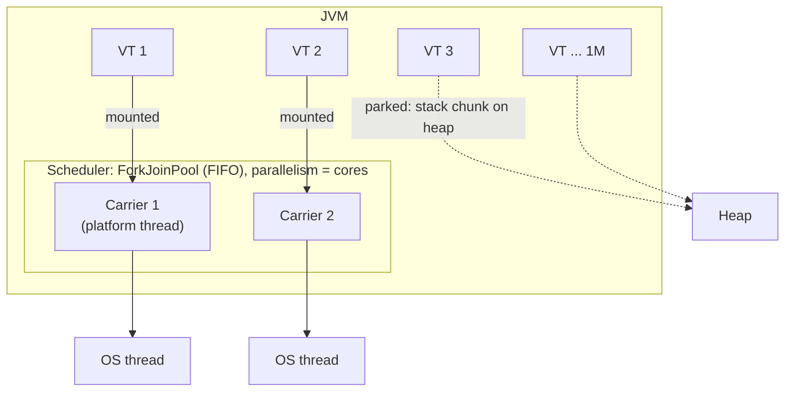

# Java Platform and Virtual Threads

> [!abstract] What this is
> How Java threads map onto the OS: **platform threads** (1:1 with kernel threads) and **virtual threads** (M:N, mounted on **carrier** threads by a JVM scheduler, final in **21**). Covers mounting and unmounting, **pinning** and its fix in **24**, what virtual threads do and don't speed up, **structured concurrency** and **scoped values** (final in **25**). The decision this helps with: when to switch a service to virtual threads, and what breaks when you do. API-level usage and examples are in [[LLD/Concurrency/15 - Virtual Threads]]; this note is the runtime view.

---

## Why It Matters

- Thread-per-request with platform threads caps a service at a few thousand concurrent requests (memory and context switching). Async/reactive code removed the cap at the cost of readability. Virtual threads give back simple blocking code at async-level concurrency.
- The trade-offs are real: pinning, `ThreadLocal` bloat, unbounded concurrency hitting downstream pools, and no speed-up for CPU-bound work. Interviewers ask about exactly these.

---

## Platform Threads

- A `java.lang.Thread` created the classic way is a thin wrapper around an **OS thread**: the kernel schedules it, it has a fixed native stack (`-Xss`, ~1 MB reserved), and creation costs tens of microseconds.
- Blocking (socket read, `sleep`, lock wait) parks the **OS thread**. With 200 Tomcat threads and 200 requests waiting on a slow database, request 201 queues, even though the CPU is idle.
- Practical ceiling: thousands of threads per JVM, not millions. That ceiling is why thread pools exist ([[LLD/Concurrency/08 - Executors and Thread Pools]]).

## Virtual Threads (JEP 444, final in 21)



- A **virtual thread** is a `Thread` whose stack lives on the **heap** as stack-chunk objects while it isn't running. Creating one costs about as much as a small object; millions are fine.
- The JVM's scheduler (a work-stealing `ForkJoinPool`, by default one carrier per core) **mounts** a virtual thread on a **carrier** platform thread to run it.
- When the virtual thread blocks on a JDK operation that supports it (socket I/O, `LockSupport.park`, `ReentrantLock`, `BlockingQueue`, `Thread.sleep`, and since 24 `synchronized` and `Object.wait`), it **unmounts**: its frames are copied to the heap and the carrier picks up another virtual thread. When the I/O is ready (via the JDK's internal poller on epoll/kqueue/IOCP), it is rescheduled.
- Net effect: blocking code, but the OS thread never blocks. This is the same idea as Go's goroutines with the network poller ([[01 - Go Runtime and the GMP Scheduler]]).

```java
try (var executor = Executors.newVirtualThreadPerTaskExecutor()) {
    for (var order : orders) {
        executor.submit(() -> paymentClient.charge(order)); // blocking HTTP call, cheap to block
    }
} // close() waits for all tasks
```

| | Platform thread | Virtual thread |
|---|---|---|
| Scheduling | OS kernel, preemptive | JVM, cooperative at blocking points; OS schedules the carriers |
| Stack | Native, fixed reservation | Heap, grows and shrinks |
| Cost to create | ~µs and ~1 MB reserved | ~a few hundred bytes to KB |
| How many | Thousands | Millions |
| Pool them? | Yes | **No**: create one per task |
| Good for | CPU-bound work, long-lived workers | I/O-bound concurrent tasks (requests, fan-out calls) |

### What virtual threads do not do

- They don't make code faster. They increase **throughput** when the bottleneck is threads waiting on I/O. CPU-bound work still runs on N cores.
- They aren't **time-sliced**: a virtual thread doing a long CPU loop holds its carrier until it blocks. Lots of CPU-heavy virtual threads starve the others. Use a bounded platform pool for CPU work.
- They don't remove downstream limits. 10,000 virtual threads hitting a 20-connection Hikari pool means 9,980 waiting for a connection. Limit concurrency with a **`Semaphore`** around the scarce resource, not with a thread pool.

---

## Pinning

A virtual thread is **pinned** when it can't unmount while blocking, so it holds its carrier (and an OS thread) for the duration.

| Cause | Status |
|---|---|
| Blocking inside **`synchronized`** (or `Object.wait`) | Pinned in 21–23; **fixed in 24** (JEP 491): monitors are now tracked per virtual thread |
| Blocking inside a **native method / JNI / FFM upcall** | Still pins |
| Blocking in a class initialiser (`<clinit>`) or while resolving symbolic references | Still pins (rarely matters) |
| File I/O on some platforms | Doesn't unmount; the JVM **temporarily adds a carrier** to compensate (up to a max) |

- On 21: replace `synchronized` around blocking I/O with `ReentrantLock`, or upgrade. Many libraries (JDBC drivers, HTTP clients) did exactly that during 2023–2024.
- Detection: JFR event **`jdk.VirtualThreadPinned`** (on by default with a threshold). The old `-Djdk.tracePinnedThreads` flag was removed in 24.
- Symptom when pinning is widespread: throughput collapses to "number of cores" concurrent requests, a deadlock-like stall if all carriers are pinned waiting on something that needs a carrier.

---

## ThreadLocal and Scoped Values

- `ThreadLocal` works on virtual threads, but each of a million threads gets its own copy. Caching expensive objects in a `ThreadLocal` (a classic trick with pooled platform threads) becomes a memory problem and a cache miss every time.
- **Scoped values** (JEP 506, **final in 25**): immutable values bound for the duration of a call, inherited by child tasks in a structured scope, automatically gone afterwards. Cheaper and safer for request context (user, trace id, tenant).

```java
static final ScopedValue<User> CURRENT_USER = ScopedValue.newInstance();

ScopedValue.where(CURRENT_USER, user).run(() -> handle(request));
// inside handle(): CURRENT_USER.get()
```

| | `ThreadLocal` | `ScopedValue` |
|---|---|---|
| Mutable | Yes (`set`) | No, rebind in a nested scope |
| Lifetime | Until removed or thread dies (leak risk in pools) | The `run`/`call` scope only |
| Inheritance | Copy into child threads (`InheritableThreadLocal`), expensive | Shared with structured child tasks at no cost |
| Pick when | Legacy APIs, per-thread mutable caches with pooled threads | Request context, especially with virtual threads |

---

## Structured Concurrency

- **`StructuredTaskScope`** treats a group of concurrent subtasks as one unit: fork them, join them, and if one fails the others are cancelled; the scope can't exit until all are done. No leaked threads, clear error propagation, thread dumps show the parent/child tree.
- Status: **still preview as of JDK 27**. First preview in 21 (JEP 453); API reshaped in 25 (JEP 505, fifth preview) to `StructuredTaskScope.open(...)` with `Joiner` policies; sixth preview in 26 (JEP 525, timeout and joiner refinements); seventh in 27 (JEP 533). Treat it as preview: don't depend on it in production code unless you accept `--enable-preview`.
- Stable alternative today: an `ExecutorService` per request with try-with-resources plus explicit cancellation, or `CompletableFuture` ([[LLD/Concurrency/11 - CompletableFuture]]).

```java
// Preview API shape in Java 25
try (var scope = StructuredTaskScope.open()) {        // default: fail if any subtask fails
    var user  = scope.fork(() -> userService.find(id));
    var order = scope.fork(() -> orderService.latest(id));
    scope.join();                                     // waits; cancels siblings on failure
    return new Profile(user.get(), order.get());
}
```

---

## Adopting Virtual Threads in a Service

1. Be on **24+** (ideally the 25 LTS) so `synchronized` no longer pins; otherwise audit libraries.
2. Turn it on at the framework level: Spring Boot `spring.threads.virtual.enabled=true` (Tomcat and `@Async` executors use virtual threads), Jetty/Helidon/Quarkus equivalents ([[04 - Spring MVC Request Lifecycle]]).
3. Remove thread pools used only to limit blocking concurrency; replace with **semaphores** or connection-pool limits at the real bottleneck.
4. Review `ThreadLocal` usage (MDC logging, security context, caches); prefer scoped values for new code.
5. Watch JFR pinning events, carrier utilisation, connection-pool wait times and heap (stack chunks live there).

### Diagnostics

- Thread dumps that include virtual threads: `jcmd <pid> Thread.dump_to_file -format=json dump.json` (the classic `jstack` shows only platform threads).
- JFR events: `jdk.VirtualThreadStart/End`, `jdk.VirtualThreadPinned`, `jdk.VirtualThreadSubmitFailed`.
- Scheduler size: `-Djdk.virtualThreadScheduler.parallelism=N` (rarely needed).

---

## Failure Modes

| Failure | What happens | Mitigation |
|---|---|---|
| **Pinning (pre-24 `synchronized`, JNI)** | Carriers blocked; throughput drops to ~core count | Upgrade to 24+; `ReentrantLock` around blocking calls; JFR pinned events |
| **Unbounded fan-out** | Downstream DB/API overwhelmed; pool timeouts | `Semaphore` or bulkhead around the scarce resource |
| **CPU-bound work on virtual threads** | Other virtual threads starve; latency spikes | Run CPU work on a bounded platform pool |
| **Pooling virtual threads** | Recreates the old limit and keeps `ThreadLocal`s alive | One virtual thread per task |
| **Heavy `ThreadLocal` caches** | Memory grows with thread count; no reuse | Shared, thread-safe caches; scoped values for context |
| **Relying on preview structured concurrency** | API changes between releases | Use final APIs in production |
| **Expecting faster CPU work** | No gain; maybe a small loss | Use virtual threads only where threads wait |

---

## Interview Lines

> [!tip] Say it like this
> - "Platform threads are 1:1 with OS threads; virtual threads are M:N, mounted on a small pool of carriers and unmounted to the heap whenever they block."
> - "They raise throughput for I/O-bound work by making blocking cheap; they don't make CPU work faster, and they aren't time-sliced."
> - "Pinning is when a virtual thread can't unmount; `synchronized` caused it until Java 24, native frames still do."
> - "Don't pool virtual threads; limit concurrency with a semaphore at the real bottleneck, like the connection pool."
> - "For request context I'd use scoped values, final in 25, instead of `ThreadLocal`, which gets expensive with millions of threads."

## Related Notes

- [[LLD/Concurrency/15 - Virtual Threads]] · [[LLD/Concurrency/01 - Threads and Lifecycle]] · [[LLD/Concurrency/08 - Executors and Thread Pools]] · [[LLD/Concurrency/12 - Confinement and Immutability]]
- [[03 - JVM Memory Layout]] · [[04 - Spring MVC Request Lifecycle]] · [[01 - Concurrency Models Compared]] · [[Languages/README]]
