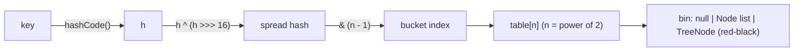

# Java Collections Internals

> [!abstract] What this is
> How the core collections work underneath: **`HashMap`** (hash spreading, buckets, resizing, treeification), **`ConcurrentHashMap`** (CAS + per-bin locking), **`ArrayList`** growth, **`LinkedHashMap`** and LRU caches, `TreeMap`, `ArrayDeque`, `PriorityQueue`, immutable collections, and the iteration traps. The decision this helps with: choosing a collection by its real costs and explaining `HashMap` internals, which is the single most asked Java internals question. Interface-level choice and API design are in [[LLD/Foundations/06 - Collections]]; concurrent collections from a usage angle in [[LLD/Concurrency/07 - Concurrent Collections]].

---

## Why It Matters

- "How does `HashMap` work?", "what happens when two keys collide?", "why is `ConcurrentHashMap` faster than `synchronizedMap`?" are standard questions.
- Real bugs come from these internals: mutable keys lost in a map, `ConcurrentModificationException`, a recursive `computeIfAbsent` hanging, memory blown by boxed entries.

---

## HashMap



### Structure

- An array `table` of **bins**, length always a **power of two** (default 16, allocated lazily on first `put`).
- Index = `spread(hashCode) & (n - 1)`. The spread `h ^ (h >>> 16)` mixes high bits into low bits, because with a mask only the low bits pick the bucket.
- Each bin is `null`, a **linked list of `Node`s** (hash, key, value, next), or a **tree** of `TreeNode`s.
- `null` key allowed (goes to bucket 0); `null` values allowed.

### `put` and collisions

1. Compute bucket. Empty → place a new node.
2. Otherwise walk the bin: if a node has the same hash **and** `equals` the key, replace the value.
3. Else append to the list (tail insertion since Java 8).
4. If a list reaches **8** nodes (`TREEIFY_THRESHOLD`) and the table has at least **64** buckets, convert the bin to a **red-black tree** (O(log n) lookups). If the table is smaller, **resize** instead. A tree shrinks back to a list at **6**.
5. If `size > capacity × loadFactor` (default **0.75**), **resize**.

- Treeification defends against bad hash functions and hash-flooding attacks. Tree ordering uses the hash, then `Comparable` if keys implement it, then a tie-breaker.

### Resize

- Doubles the table and **redistributes** each bin. Because `n` doubles, each node either stays at index `i` or moves to `i + oldN`, decided by one bit of the hash: lists are split into "lo" and "hi" lists, preserving order.
- O(n) work, done on the `put` that triggers it: a latency spike for big maps. Pre-size when the size is known: `HashMap.newHashMap(expected)` (Java 19) computes the capacity for you; `new HashMap<>(expected)` doesn't account for load factor.
- Java 7's head-insertion resize could create a **cycle** under unsynchronised concurrent use (infinite loop at 100% CPU). Java 8 fixed the loop, but concurrent writes still lose data. `HashMap` is not thread-safe, ever.

### Complexity

| Operation | Average | Worst |
|---|---|---|
| `get` / `put` / `remove` | O(1) | O(log n) with treeified bins (O(n) on Java 7) |
| Iteration | O(capacity + size) | — |

### The `equals`/`hashCode` contract

- Equal objects **must** have equal hash codes; unequal objects should usually differ.
- Override both or neither. Override only `equals` → equal keys land in different buckets and `get` misses.
- **Mutable keys**: changing a field used in `hashCode` after insertion strands the entry in the wrong bucket; `get` and `remove` fail, the entry leaks. Use immutable keys (records, `String`).

`HashSet` is a `HashMap` with a dummy value; everything above applies.

---

## ConcurrentHashMap

| | `Hashtable` / `Collections.synchronizedMap` | `ConcurrentHashMap` (Java 8+) |
|---|---|---|
| Locking | One lock for the whole map | **CAS** to insert into an empty bin; **`synchronized` on the bin's head node** otherwise |
| Reads | Locked | **Lock-free** (volatile reads of the table and nodes) |
| Iteration | Fail-fast, must lock externally | **Weakly consistent**: never throws CME, may or may not show concurrent updates |
| `null` keys/values | `synchronizedMap` allows | **Not allowed** (a `null` from `get` must mean "absent") |
| Resize | Single-threaded | **Cooperative**: threads that touch the map during a resize help move bins (forwarding nodes) |

- Java 7 used **segments** (16 lock stripes); Java 8 replaced them with per-bin locking, so concurrency scales with the number of bins.
- `size()` is backed by striped counters (like `LongAdder`), so it's cheap but only an estimate under concurrent updates; `mappingCount()` returns a `long`.
- **Atomic compound operations**: `computeIfAbsent`, `compute`, `merge`, `putIfAbsent`. Use these, never `if (!map.containsKey(k)) map.put(k, v)` (check-then-act race, [[LLD/Concurrency/02 - Race Conditions and Shared State]]).

```java
// Correct: atomic per key
counts.merge(word, 1L, Long::sum);
cache.computeIfAbsent(key, k -> expensiveLoad(k));
```

- Traps in `compute*`: the function runs **while holding the bin lock**. Keep it short; never do I/O in it; never modify **the same map** inside it (recursive `computeIfAbsent` can deadlock or throw `IllegalStateException: Recursive update`).
- For a real cache (size bounds, expiry, async loading), use **Caffeine**, not a hand-rolled `ConcurrentHashMap`.

---

## ArrayList and Friends

| Collection | Structure | Key costs | Pick when |
|---|---|---|---|
| **`ArrayList`** | Resizable array; grows by **1.5×** (`old + old >> 1`), default capacity 10 allocated on first add | `get` O(1), add amortised O(1), insert/remove in middle O(n) | Default list |
| **`LinkedList`** | Doubly linked nodes | `get(i)` O(n), ~24+ bytes per node, poor cache locality | Almost never; use `ArrayDeque` for queues |
| **`ArrayDeque`** | Circular array | O(1) at both ends, no nulls | Stacks and queues (replace `Stack` and `LinkedList`) |
| **`PriorityQueue`** | Binary heap in an array | `offer`/`poll` O(log n), `peek` O(1), iteration **not** in order | Top-k, schedulers, Dijkstra |
| **`TreeMap` / `TreeSet`** | Red-black tree | O(log n); sorted; `floorKey`, `ceilingKey`, `subMap` | Ordered keys, range queries |
| **`LinkedHashMap`** | `HashMap` + doubly linked list through entries | Same as `HashMap`, a bit more memory | Predictable iteration order; LRU |
| **`EnumMap` / `EnumSet`** | Array / bit vector indexed by ordinal | Fastest, compact | Keys are enums |
| **`CopyOnWriteArrayList`** | Copies the array on every write | Writes O(n), reads lock-free | Read-mostly listener lists |

### LRU cache with LinkedHashMap

```java
class Lru<K, V> extends LinkedHashMap<K, V> {
    private final int max;
    Lru(int max) { super(16, 0.75f, true); this.max = max; }   // true = access order
    @Override protected boolean removeEldestEntry(Map.Entry<K, V> e) { return size() > max; }
}
```

- Not thread-safe: in access-order mode even `get` mutates the structure. Wrap or use Caffeine.

### Sequenced collections (21)

- `SequencedCollection` / `SequencedMap`: `getFirst()`, `getLast()`, `addFirst`, `reversed()`, `pollFirstEntry()` on `List`, `Deque`, `LinkedHashSet`, `LinkedHashMap`, `TreeMap`. Replaces `list.get(list.size() - 1)` and iterator tricks.

---

## Immutable and Unmodifiable Collections

| Created by | Mutable? | Nulls | Notes |
|---|---|---|---|
| `List.of`, `Set.of`, `Map.of` (9) | No, truly immutable | **Throw NPE** on null elements and on `contains(null)` | `Set.of`/`Map.of` throw on duplicates; iteration order deliberately randomised per JVM run |
| `List.copyOf` (10) | No | No nulls | Returns the same instance if already immutable |
| `Collections.unmodifiableList(x)` | **A view**: changes to `x` show through | Allowed | Not a defensive copy |
| `Arrays.asList(arr)` | Fixed size; `set` allowed, `add` throws | Allowed | Writes through to the array |
| `stream.toList()` (16) | Unmodifiable | Allowed | vs `Collectors.toList()`: mutable `ArrayList` in practice, not guaranteed |

---

## Iteration Traps

- **Fail-fast iterators**: `ArrayList`, `HashMap` etc. keep a `modCount`; structural modification during iteration (other than through the iterator) throws **`ConcurrentModificationException`**, best effort. It's a bug detector, not a thread-safety mechanism.

```java
for (var o : orders) if (o.cancelled()) orders.remove(o);   // CME
orders.removeIf(Order::cancelled);                           // correct
```

- Iterating `map.keySet()` then calling `map.get(k)` does two lookups; iterate `entrySet()` or use `forEach((k, v) -> ...)`.
- `list.remove(int)` vs `list.remove(Object)`: `List<Integer>.remove(1)` removes **index 1**, not the value 1.
- `HashMap` iteration order is unspecified and changes with capacity; never depend on it (tests that pass by accident).

## Memory Costs (compressed oops, approx.)

| Item | Bytes |
|---|---|
| `HashMap.Node` | 32 (+ key and value objects) |
| `Integer` box | 16 |
| `ArrayList` slot | 4 (reference) + the element |
| `int[]` element | 4 |

- A `HashMap<Integer,Integer>` with 1M entries is ~80+ MB; an `int[]`-backed primitive map (fastutil, Eclipse Collections, Agrona) is a fraction. See [[03 - JVM Memory Layout]].

---

## Failure Modes

| Failure | What happens | Mitigation |
|---|---|---|
| **`equals` without `hashCode`** | Duplicate keys, lookups miss | Override both; use records |
| **Mutable key changed after insert** | Entry unreachable; memory leak | Immutable keys |
| **`HashMap` shared across threads** | Lost updates, corrupted state (infinite loop on Java 7) | `ConcurrentHashMap` or confinement |
| **Check-then-act on `ConcurrentHashMap`** | Race: double computation, overwrite | `computeIfAbsent`, `merge`, `putIfAbsent` |
| **Slow or recursive `computeIfAbsent`** | Bin lock held; contention, deadlock, `Recursive update` | Short pure functions; no same-map updates; Caffeine for loading caches |
| **Modifying while iterating** | `ConcurrentModificationException` | `removeIf`, iterator `remove`, or collect then modify |
| **Huge map not pre-sized** | Repeated resizes, latency spikes | `HashMap.newHashMap(n)` |
| **Poor `hashCode`** (e.g. constant) | All keys in one bin; O(log n) or worse | Use `Objects.hash` / records; test distribution |
| **`List.of(...).contains(null)`** | NPE | Know which collections are null-hostile |

---

## Interview Lines

> [!tip] Say it like this
> - "`HashMap` is a power-of-two array of bins; the hash is spread and masked to pick a bin, collisions chain in a list, and a bin with eight entries becomes a red-black tree once the table has 64 buckets."
> - "It resizes by doubling at 75% load, and each entry either stays put or moves by the old capacity, decided by one hash bit."
> - "`ConcurrentHashMap` uses CAS for empty bins and locks only the bin's head node otherwise, so reads are lock-free and writes to different bins don't contend; that's also why it rejects nulls."
> - "The function in `computeIfAbsent` runs under the bin lock, so it must be fast and must not touch the same map."
> - "Equal objects must have equal hash codes, and keys must not change while they're in a map."

## Related Notes

- [[LLD/Foundations/06 - Collections]] · [[LLD/Concurrency/07 - Concurrent Collections]] · [[LLD/Concurrency/06 - Atomics and CAS]]
- [[03 - JVM Memory Layout]] · [[06 - Modern Java Language Features]] · [[08 - Java Streams Optional and Functional Style]] · [[Languages/README]]
