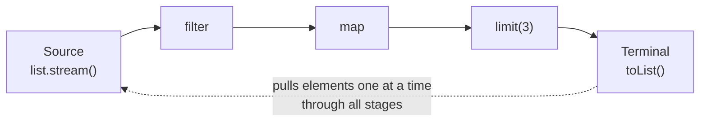

# Java Streams Optional and Functional Style

> [!abstract] What this is
> How streams actually execute (**lazy pipelines**, **fused stages**, **short-circuiting**, stateful operations), the **collectors** that matter and their traps, **parallel streams** and when they hurt, **gatherers** (final in **24**), the rules for **`Optional`**, and functional-style limits in Java (effectively final captures, checked exceptions in lambdas). The decision this helps with: when a stream is clearer than a loop, and how to avoid the classic stream bugs in production code.

---

## Why It Matters

- Streams are everywhere in modern Java code, and so are their bugs: `toMap` throwing on duplicate keys, `peek` that never runs, parallel streams starving the common pool, `Optional.get()` used as a null check.
- Interviewers use streams to test whether you understand laziness and evaluation order, not whether you remember method names.

---

## How a Stream Executes



- **Intermediate operations** (`filter`, `map`, `flatMap`, `sorted`, `distinct`, `limit`) only build a pipeline. **Nothing runs** until a **terminal operation** (`toList`, `collect`, `forEach`, `reduce`, `findFirst`, `anyMatch`, `count`).
- Stages are **fused**: each element goes through `filter → map → ...` before the next element is read (vertical, not horizontal processing). No intermediate collections.
- **Short-circuiting** operations (`limit`, `findFirst`, `anyMatch`, `takeWhile`) stop pulling from the source early, so infinite streams (`Stream.iterate`, `generate`) are fine with them.
- **Stateful** operations (`sorted`, `distinct`) must see the whole input (or a lot of it) before emitting: they break the "one element at a time" model and buffer.
- A stream is **single-use**: a second terminal operation throws `IllegalStateException`.

```java
List<String> names = orders.stream()
        .filter(o -> o.total().compareTo(THRESHOLD) > 0)
        .map(Order::customerName)
        .distinct()
        .limit(10)
        .toList();                 // Java 16: unmodifiable list
```

### Evaluation-order traps

- `peek` is for debugging only. Since Java 9, `count()` can skip the pipeline entirely when the size is known from the source, so `peek` (and `map`) side effects may **never run**.
- Lambdas in a stream should be **side-effect free**. Mutating an external `ArrayList` from `forEach` is a bug waiting for `parallel()`; collect instead.

---

## Collectors That Matter

| Collector | Result | Trap |
|---|---|---|
| `toList()` (stream method, 16) | Unmodifiable `List` | Mutation throws `UnsupportedOperationException` |
| `Collectors.toList()` | Mutable in practice (`ArrayList`), not guaranteed | Don't rely on mutability; use `toCollection(ArrayList::new)` if you need it |
| `toMap(k, v)` | `HashMap` | **Throws `IllegalStateException` on duplicate keys**; **NPE on null values** |
| `toMap(k, v, merge, LinkedHashMap::new)` | Your map type, merge function for duplicates | — |
| `groupingBy(classifier)` | `Map<K, List<T>>` | Null classifier result → NPE |
| `groupingBy(f, counting())` / `summingLong` / `mapping` | Downstream aggregation | — |
| `partitioningBy(pred)` | `Map<Boolean, List<T>>` with both keys present | — |
| `joining(", ")` | `String` | — |
| `teeing(c1, c2, merger)` (12) | Two collectors in one pass | — |

```java
Map<String, Long> ordersPerCustomer = orders.stream()
        .collect(Collectors.groupingBy(Order::customerId, Collectors.counting()));

Map<String, Order> latestById = orders.stream()
        .collect(Collectors.toMap(Order::id, o -> o,
                (a, b) -> a.createdAt().isAfter(b.createdAt()) ? a : b));   // handle duplicates
```

### Primitive streams

- `IntStream`, `LongStream`, `DoubleStream` avoid boxing: `mapToLong(Order::cents).sum()` instead of `map(...).reduce(0L, Long::sum)`. On large data the difference is large ([[03 - JVM Memory Layout]]).

## Gatherers (24)

- `Stream.gather(Gatherer)` adds **custom intermediate operations**, the missing counterpart of `collect`. Built-ins in `Gatherers`: `windowFixed`, `windowSliding`, `fold`, `scan`, and `mapConcurrent(n, f)` (runs `f` on virtual threads with at most `n` in flight, preserving order).

```java
List<List<Event>> batches = events.stream().gather(Gatherers.windowFixed(100)).toList();

List<Price> prices = skus.stream()
        .gather(Gatherers.mapConcurrent(16, pricingClient::fetch))  // bounded concurrent I/O
        .toList();
```

---

## Parallel Streams

- `parallelStream()` splits the source with a `Spliterator` and runs chunks on the **common `ForkJoinPool`** (size = cores − 1), shared by the whole JVM ([[LLD/Concurrency/14 - Fork Join and Parallel Streams]]).

| Helps when | Hurts when |
|---|---|
| Large data (≥ ~10k elements per core), CPU-bound per-element work | Small collections: splitting overhead dominates |
| Source splits well: arrays, `ArrayList`, `IntStream.range` | Poor splitting: `LinkedList`, `Stream.iterate`, I/O-backed sources |
| Stateless, associative operations | Ordered stateful ops (`sorted`, `limit`, `findFirst` on ordered streams) |
| Batch jobs with the machine to themselves | **Request-handling servers**: all requests share the common pool; one slow parallel stream starves the rest |
| | **Blocking I/O inside** the stream: common pool threads block (use `mapConcurrent` or an executor) |

- In a web service, default to sequential streams. Parallelism for requests comes from handling many requests at once.

---

## Optional

`Optional<T>` is a **return type** that says "this may be absent", forcing the caller to decide.

| Do | Don't |
|---|---|
| Return `Optional` from finders: `Optional<User> findById(id)` | Use it for fields, parameters or collection elements |
| `orElse(default)` for cheap constants, `orElseGet(() -> compute())` for expensive defaults | `orElse(expensiveCall())`: the argument is **always evaluated** |
| `orElseThrow(() -> new NotFound(id))` | `opt.get()` without checking (use `orElseThrow()` if you must) |
| `map`, `flatMap`, `filter`, `ifPresentOrElse` | `if (opt.isPresent()) { opt.get() ... }` everywhere |
| Return an empty collection instead of `Optional<List<T>>` | Return `null` from a method declared to return `Optional` |

```java
String city = userRepo.findById(id)
        .map(User::address)
        .map(Address::city)
        .orElse("unknown");
```

- Not `Serializable`; an allocation per call (often removed by escape analysis). `OptionalInt`/`OptionalLong` for primitives.

---

## Functional Style Limits in Java

- **Effectively final captures**: lambdas capture values, not variables; you can't reassign a captured local. Counting with `int[] counter = {0}` or `AtomicInteger` inside a stream is a smell; use `count()` or a collector.
- **Checked exceptions** don't fit `Function`/`Supplier`. Options: wrap in an unchecked exception at the boundary, write a small `ThrowingFunction` adapter, or use a loop. Don't swallow ([[LLD/Foundations/01 - Exception Handling]]).
- **Method references**: `Order::total` (unbound instance), `this::validate` (bound), `Order::new` (constructor). They compile to `invokedynamic` + `LambdaMetafactory` ([[01 - JVM Architecture and Class Loading]]).
- **Debuggability**: stack traces through streams are deep and noisy. For complex multi-step logic with early exits and error handling, a loop is often clearer.

### Stream or loop?

| Prefer a stream | Prefer a loop |
|---|---|
| Transform/filter/aggregate a collection into a new value | Early `return`/`break` with complex conditions |
| Grouping, partitioning, joining | Checked exceptions on each element |
| Declarative pipelines that read top to bottom | Updating several local accumulators at once |
| | Hot paths where you've measured lambda/boxing overhead |

---

## Failure Modes

| Failure | What happens | Mitigation |
|---|---|---|
| **`toMap` with duplicate keys** | `IllegalStateException` in production data | Pass a merge function; or `groupingBy` |
| **`toMap` with null values** | `NullPointerException` | Filter nulls or collect manually |
| **Side effects in `peek`/`map`** | Silently skipped (`count()`), or racy in parallel | Pure lambdas; side effects only in terminal `forEach` |
| **Reusing a stream** | `IllegalStateException` | Create a new stream from the source (`Supplier<Stream<T>>`) |
| **Parallel streams in a server** | Common pool contention; latency spikes | Sequential by default; dedicated executor if needed |
| **Blocking I/O in a parallel stream** | Common pool threads blocked JVM-wide | `Gatherers.mapConcurrent` or virtual-thread executor |
| **`Optional.get()` on empty** | `NoSuchElementException` | `orElseThrow` with a meaningful exception |
| **`orElse(expensive())`** | Expensive call runs even when present | `orElseGet` |
| **Mutating a `toList()` result** | `UnsupportedOperationException` | `toCollection(ArrayList::new)` |

---

## Interview Lines

> [!tip] Say it like this
> - "Streams are lazy: intermediate operations build a pipeline, and the terminal operation pulls elements one at a time through the fused stages."
> - "`toMap` throws on duplicate keys and on null values, so in production I always pass a merge function or use `groupingBy`."
> - "Parallel streams run on the shared common ForkJoinPool, so I don't use them in request handling, and never with blocking I/O."
> - "`Optional` is for return values; `orElse` always evaluates its argument, `orElseGet` doesn't."
> - "Java 24's gatherers add custom intermediate operations, including `mapConcurrent` for bounded concurrent calls on virtual threads."

## Related Notes

- [[07 - Java Collections Internals]] · [[06 - Modern Java Language Features]] · [[05 - Java Platform and Virtual Threads]]
- [[LLD/Concurrency/14 - Fork Join and Parallel Streams]] · [[LLD/Foundations/06 - Collections]] · [[LLD/Foundations/01 - Exception Handling]] · [[Languages/README]]
