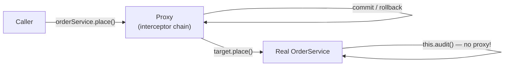

# Java Reflection Annotations and Proxies

> [!abstract] What this is
> The runtime metaprogramming that frameworks are built on: **reflection** (inspecting and invoking classes at runtime, and what it costs), **method handles**, **annotations** (retention, processing at compile time vs runtime), **dynamic proxies** (JDK interface proxies vs subclass proxies with CGLIB/ByteBuddy), and **bytecode generation and agents**. The decision this helps with: understanding why Spring, Hibernate, Mockito and Jackson behave the way they do, and debugging "my annotation does nothing" problems.

---

## Why It Matters

- Spring's `@Transactional`, `@Async`, `@Cacheable`, Hibernate's lazy loading, Mockito mocks and Jackson's mapping all use reflection, proxies or generated bytecode. Their best-known failure modes (self-invocation, final classes, private methods) follow directly from how proxies work ([[03 - Spring AOP and Proxies]]).
- Strong encapsulation (16/17) and native image (closed world) both restrict reflection, which is why upgrades and native builds break frameworks.

---

## Reflection

```java
Class<?> type = Class.forName("com.acme.Order");
Object order = type.getDeclaredConstructor().newInstance();
Method m = type.getMethod("total");
Object total = m.invoke(order);

Field f = type.getDeclaredField("status");
f.setAccessible(true);                  // bypass private: allowed for your own code on the classpath
f.set(order, "PAID");
```

- `Class` is the entry point: `getDeclaredFields/Methods/Constructors` (all, including private, this class only) vs `getFields/Methods` (public, including inherited).
- **Generic types are erased** at runtime, but declarations keep them: `field.getGenericType()` returns a `ParameterizedType` for `List<Order>`. That's how Jackson and Spring resolve generics (`TypeReference`, `ResolvableType`) ([[LLD/Foundations/05 - Generics]]).
- **Records** expose components via `getRecordComponents()`; **sealed** types via `getPermittedSubclasses()`.

### Costs

| Cost | Detail |
|---|---|
| **Lookup** | `getMethod`/`getDeclaredField` search and copy; **cache** the `Method`/`Field` objects |
| **Invocation** | Since **18** (JEP 416), core reflection is implemented on **method handles**; once warm, `Method.invoke` is close to a direct call, but boxing of arguments and return values remains |
| **Checks** | Access checks on each call unless `setAccessible(true)` |
| **Optimisation** | Reflective call sites are harder for the JIT to inline than direct calls |
| **Startup** | Frameworks scanning thousands of classes reflectively is a big part of startup time; Spring AOT and native image precompute it ([[14 - Spring Boot Performance and Native]]) |

### Method handles and `VarHandle`

- `MethodHandles.lookup().findVirtual(...)` returns a `MethodHandle`: a typed, directly invocable reference, checked once at lookup. When stored in a `static final` field, the JIT can inline through it like a normal call.
- `VarHandle` (9) gives atomic and ordered access to fields and array elements (`compareAndSet`, `getAcquire`), the supported replacement for `sun.misc.Unsafe` ([[LLD/Concurrency/06 - Atomics and CAS]]).

### Strong encapsulation

- Since **16/17**, reflective access to non-exported JDK internals (`setAccessible` on `java.lang.String.value`, etc.) throws `InaccessibleObjectException`. Libraries must use public APIs, or the app opens packages explicitly: `--add-opens java.base/java.lang=ALL-UNNAMED`. Treat `--add-opens` as technical debt.
- Inside your own code on the classpath, `setAccessible` still works.

---

## Annotations

```java
@Retention(RetentionPolicy.RUNTIME)
@Target(ElementType.METHOD)
public @interface Audited {
    String action();
}
```

| Retention | Kept in | Readable at runtime | Used by |
|---|---|---|---|
| `SOURCE` | Source only | No | Compiler and annotation processors (`@Override`, Lombok) |
| `CLASS` (default) | Class file | No (bytecode tools can read it) | Bytecode tools, some static analysers |
| `RUNTIME` | Class file + loaded `Class` | **Yes**, via reflection | Spring, JPA, Jackson, JUnit, validation |

- An annotation is **just metadata**; it does nothing by itself. Something must read it: a compiler plugin, an annotation processor at build time, or framework code at runtime (often wrapping the object in a proxy).
- A custom annotation missing `@Retention(RUNTIME)` is invisible to reflection: the classic "my annotation is ignored" bug.
- **Meta-annotations and composition**: Spring treats annotations on annotations as inherited (`@RestController` is `@Controller` + `@ResponseBody`; `@SpringBootApplication` bundles three). This is a Spring convention (`MergedAnnotations`), not a Java feature; plain reflection doesn't see through it.
- `@Inherited` only applies to **class** annotations from superclasses, not interfaces or methods.

### Compile-time processing

- **Annotation processors** (`javax.annotation.processing`) run inside `javac` and generate new source files: MapStruct mappers, Dagger and Micronaut DI, JPA metamodels, `record-builder`, AutoValue.
- **Lombok** is different: it modifies the compiler's AST through internal APIs, which is why it needs updates for new JDKs. Records cover many of its uses ([[06 - Modern Java Language Features]]).
- Compile-time generation means no runtime reflection: faster startup, errors at build time, native-image friendly. This is the Micronaut/Quarkus/Dagger approach vs Spring's runtime one (Spring narrows the gap with AOT).

---

## Dynamic Proxies

A **proxy** is an object that stands in for the real one and intercepts calls: transactions, security checks, caching, lazy loading, remote calls, mocks.



### JDK proxies vs subclass proxies

| | JDK dynamic proxy (`java.lang.reflect.Proxy`) | Subclass proxy (CGLIB, ByteBuddy) |
|---|---|---|
| How | Generates a class implementing the **interfaces**; every call goes to an `InvocationHandler` | Generates a **subclass** of the target class and overrides methods |
| Needs | An interface | A non-`final` class with an accessible constructor |
| Can't intercept | Methods not on the interface | `final`, `private`, `static` methods; `final` classes |
| Type of the proxy | Only the interfaces: casting to the concrete class fails | The class itself (and its interfaces) |
| Used by | Spring when configured for interfaces, Java RMI-style clients, simple decorators | **Spring Boot default** (`proxyTargetClass=true`), Hibernate lazy proxies, Mockito (ByteBuddy) |

```java
interface PaymentClient { Receipt charge(Order o); }

PaymentClient timed = (PaymentClient) Proxy.newProxyInstance(
        PaymentClient.class.getClassLoader(),
        new Class<?>[] { PaymentClient.class },
        (proxy, method, args) -> {
            long start = System.nanoTime();
            try { return method.invoke(realClient, args); }
            finally { metrics.record(method.getName(), System.nanoTime() - start); }
        });
```

- Note the trap in the handler: `method.invoke` wraps exceptions in `InvocationTargetException`; a real handler must unwrap and rethrow `getCause()`, or callers see the wrong exception type.

### Why proxies explain framework "bugs"

| Symptom | Cause |
|---|---|
| `@Transactional` method called from **the same class** doesn't start a transaction | **Self-invocation**: `this.method()` calls the target directly, bypassing the proxy |
| Annotation on a **`private`** or **`final`** method has no effect | Subclass proxies can't override them |
| `ClassCastException` to the implementation class | JDK proxy implements only the interfaces |
| Hibernate entity `getClass()` is `Order$HibernateProxy$...` and `equals` fails | Lazy-loading subclass proxy; compare with `instanceof` and IDs ([[07 - Spring Data JPA and Hibernate]]) |
| `final` Kotlin/Java class can't be a Spring bean with AOP | Subclassing impossible (Kotlin uses the `all-open` plugin) |

---

## Bytecode Generation and Agents

| Mechanism | What it does | Used by |
|---|---|---|
| **ByteBuddy / ASM / CGLIB** | Generate or rewrite classes at runtime | Mockito, Hibernate, Spring (repackaged CGLIB), many APM agents |
| **Class-File API** (final in **24**) | JDK's own API to parse, generate and transform class files, tracking the current class-file version | Replacing ASM inside the JDK; libraries migrating gradually |
| **Hidden classes** (15) | Classes not discoverable by name, unloadable independently; defined via `Lookup.defineHiddenClass` | Lambdas, framework-generated proxies |
| **Java agents** (`-javaagent`, `Instrumentation`) | Transform classes as they load (or retransform loaded ones) | OpenTelemetry Java agent, APM tools, profilers, coverage (JaCoCo) |

- Dynamically **attaching** agents to a running JVM now prints warnings (21, JEP 451) and is planned to be disabled by default; pass agents on the command line.
- Generated classes live in **metaspace**; generating them per request or per instance is a metaspace leak ([[03 - JVM Memory Layout]]).

---

## Failure Modes

| Failure | What happens | Mitigation |
|---|---|---|
| **Annotation without `RUNTIME` retention** | Framework never sees it | `@Retention(RUNTIME)` and the right `@Target` |
| **Self-invocation through a proxy** | Transaction/cache/async silently skipped | Call through another bean; restructure; `TransactionTemplate` |
| **Advice on private/final methods** | Silently ignored | Public, non-final methods on proxied beans |
| **`InvocationTargetException` not unwrapped** | Callers get the wrong exception type | Rethrow `getCause()` in handlers |
| **Uncached reflection on hot paths** | CPU overhead, allocation | Cache `Method`/`MethodHandle` in `static final` fields |
| **Reflective access to JDK internals** | `InaccessibleObjectException` on 17+ | Upgrade libraries; `--add-opens` as a temporary bridge |
| **Runtime class generation per call** | Metaspace growth, OOM | Generate once and cache |
| **Native image without reflection metadata** | Missing classes/methods at runtime | Framework AOT hints, reachability metadata |

---

## Interview Lines

> [!tip] Say it like this
> - "An annotation is just metadata; it only does something if a compiler, processor or framework reads it, and runtime frameworks need `RUNTIME` retention."
> - "JDK dynamic proxies implement interfaces and forward to an `InvocationHandler`; CGLIB or ByteBuddy generate a subclass, so they can't intercept final or private methods."
> - "Self-invocation bypasses the proxy, which is why `@Transactional` on a method called from the same class does nothing."
> - "Since Java 18 reflection runs on method handles, so it's reasonably fast once warm, but I still cache lookups and prefer method handles on hot paths."
> - "Compile-time generation, as in Micronaut, Dagger or MapStruct, trades runtime flexibility for faster startup and earlier errors."

## Related Notes

- [[01 - JVM Architecture and Class Loading]] · [[06 - Modern Java Language Features]] · [[03 - Spring AOP and Proxies]] · [[01 - Spring IoC and Bean Lifecycle]]
- [[LLD/Foundations/05 - Generics]] · [[LLD/Foundations/07 - Dependency Injection and Layering]] · [[Languages/README]]
