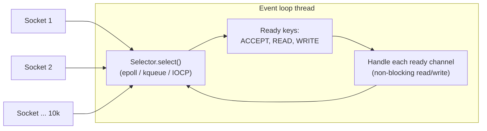

# Java IO NIO and Networking

> [!abstract] What this is
> How Java talks to files and the network: classic **blocking streams**, **NIO** buffers, channels and **selectors** (the basis of Netty), zero-copy and memory-mapped files, sockets and their **timeouts**, and the standard **`HttpClient`** (11, HTTP/2; HTTP/3 in 26). Also how virtual threads change the blocking-vs-non-blocking trade-off. The decision this helps with: choosing an I/O model for a service, and avoiding the hung-thread and leaked-connection bugs that come from missing timeouts and unclosed resources.

---

## Why It Matters

- The most common production hang in Java is a socket read with **no timeout**: the thread waits forever and the pool slowly drains.
- Netty, Tomcat's NIO connector, WebFlux, Kafka and gRPC all sit on NIO selectors. Knowing the model explains event loops and why blocking them is fatal ([[05 - Spring WebFlux and Reactive]]).
- Virtual threads ([[05 - Java Platform and Virtual Threads]]) make blocking I/O scale, which changes when non-blocking code is worth its complexity.

---

## Classic Blocking IO (java.io)

| Abstraction | For | Notes |
|---|---|---|
| `InputStream` / `OutputStream` | Bytes | `read()` blocks until data, EOF or error |
| `Reader` / `Writer` | Characters | Always pass a `Charset` (default UTF-8 since 18) |
| `Buffered*` wrappers | Fewer syscalls | Unbuffered `read()` per byte is a syscall per byte |
| `Files` (NIO.2, 7) | Path-based file ops | `Files.readString`, `lines`, `newBufferedReader`, `walk`, atomic `move` |

```java
try (var in = Files.newBufferedReader(path, StandardCharsets.UTF_8)) {
    String line;
    while ((line = in.readLine()) != null) process(line);
}   // closed even on exceptions
```

- **Always use try-with-resources**. Leaked file handles hit `Too many open files`; leaked sockets hold connections and server-side resources.
- `Files.lines`/`Files.walk` return streams holding an open handle: close them (try-with-resources).
- `Files.readAllBytes` on a large file loads it all into the heap; stream it instead.

---

## NIO: Buffers, Channels, Selectors

### Buffers

```java
ByteBuffer buf = ByteBuffer.allocate(8192);   // heap; allocateDirect for off-heap
channel.read(buf);   // write mode: position advances
buf.flip();          // switch to read mode: limit = position, position = 0
while (buf.hasRemaining()) out.write(buf);
buf.clear();         // back to write mode (or compact() to keep unread bytes)
```

- `position`, `limit`, `capacity`; forgetting `flip()` is the classic NIO bug.
- **Direct buffers** avoid a copy between the JVM heap and the kernel, but are slow to allocate and freed only when GC'd: pool them (Netty does) ([[03 - JVM Memory Layout]]).

### Selectors: one thread, many connections



- Channels in **non-blocking mode** register with a `Selector`; `select()` asks the OS which ones are ready (epoll on Linux) and the thread services only those.
- This is the **reactor pattern**: a few threads handle thousands of connections. Netty wraps it with pipelines, pooled buffers and a native epoll transport; Tomcat's NIO connector uses it to accept and read requests, then hands work to worker threads ([[04 - Spring MVC Request Lifecycle]]).
- The rule that follows: **never block an event-loop thread**. A blocking JDBC call or `Thread.sleep` on a Netty loop stalls every connection on that loop.

### Zero-copy and memory mapping

- `FileChannel.transferTo(socketChannel)` uses `sendfile` on Linux: file → socket without copying through user space. Used by Kafka and static file servers.
- `FileChannel.map` gives a `MappedByteBuffer` backed by the page cache: fast random access to big files; counts toward RSS as pages are touched. FFM's `MemorySegment` (22) is the modern API, with deterministic unmapping via `Arena`.

---

## Choosing an I/O Model

| Model | How | Pick when | Cost |
|---|---|---|---|
| **Blocking + platform thread per connection** | Classic Tomcat / `ServerSocket` | Moderate concurrency (hundreds) | Threads cap concurrency |
| **Blocking + virtual threads** (21+) | Same code; JDK sockets unmount the virtual thread while waiting | High concurrency with simple, imperative code | Pinning edge cases; downstream limits still apply |
| **Non-blocking event loop** (Netty, WebFlux, Vert.x) | Selectors + callbacks/reactive streams | Proxies, gateways, streaming, very high connection counts, backpressure | Harder code, debugging, and every library must be non-blocking |

- The JDK's socket implementation was rewritten (`NioSocketImpl`, 13) so blocking socket calls on virtual threads park the virtual thread and use the JDK poller underneath. That's why blocking I/O on virtual threads costs little.

---

## Sockets and Timeouts

| Timeout | What it bounds | Default |
|---|---|---|
| **Connect timeout** | TCP handshake | Often **infinite** or OS-level (can be minutes) |
| **Read (socket) timeout** | Time waiting for the **next** bytes (`setSoTimeout`) | **Infinite** |
| **Request / overall timeout** | The whole exchange | Depends on the client; often none |
| **Pool acquire timeout** | Waiting for a free connection | Client-specific |

- A read timeout is **per read**, not per request: a server trickling one byte every 29 s never trips a 30 s read timeout. Set an overall deadline too.
- Set all of them on **every** outbound client: HTTP, JDBC (`socketTimeout`, `connectTimeout`), Redis, Kafka. Missing timeouts turn a slow dependency into a full outage ([[11 - Spring HTTP Clients Resilience and Messaging]]).
- **Keep-alive and pooling**: reuse connections; TLS handshakes are expensive. Too-long idle connections get cut by load balancers/NAT (connection reset on first use); keep client idle timeout below the LB's.

---

## The JDK HttpClient (11)

```java
HttpClient client = HttpClient.newBuilder()          // build once, reuse: it owns the connection pool
        .connectTimeout(Duration.ofSeconds(2))
        .version(HttpClient.Version.HTTP_2)
        .executor(Executors.newVirtualThreadPerTaskExecutor())
        .build();

HttpRequest request = HttpRequest.newBuilder(URI.create("https://api.example.com/orders/42"))
        .timeout(Duration.ofSeconds(5))               // whole-response timeout
        .header("Accept", "application/json")
        .GET().build();

HttpResponse<String> resp = client.send(request, HttpResponse.BodyHandlers.ofString());
// async: client.sendAsync(request, BodyHandlers.ofString()).thenApply(HttpResponse::body)
```

- Supports HTTP/1.1, **HTTP/2** (multiplexing, falls back automatically), WebSockets, sync and async (`CompletableFuture`) APIs. **HTTP/3** support was added in **26** (JEP 517), opt-in per client/request.
- `HttpClient` is `AutoCloseable` since 21; create one per application (or per downstream), not per request.
- No built-in retries or circuit breaking; Spring's `RestClient` can use it as its transport, and resilience comes from Resilience4j or the framework.
- Alternatives: Apache HttpClient 5 (mature, rich pooling config), OkHttp, Netty-based Reactor Netty (WebClient). Pick one and configure timeouts and pool sizes explicitly.

---

## Failure Modes

| Failure | What happens | Mitigation |
|---|---|---|
| **No read/connect timeout** | Threads hang forever on a dead peer; pool exhausted | Set connect, read and overall timeouts on every client |
| **Leaked streams/sockets** | `Too many open files`; connection pool starvation | try-with-resources; consume or close response bodies |
| **New HTTP client per request** | No connection reuse, TLS handshake each time, ephemeral port exhaustion | One shared client per downstream |
| **Blocking on an event loop** | All connections on that loop stall | Offload to a worker pool; use non-blocking drivers |
| **Forgetting `flip()`** | Writes nothing or garbage | Learn the buffer modes; prefer higher-level APIs |
| **Reading a huge file into memory** | Heap OOM | Stream, or `transferTo` / mmap |
| **Idle connection cut by LB/NAT** | `Connection reset` on first request after idle | Client idle timeout < LB timeout; validate or retry idempotent calls |
| **Unbuffered byte-at-a-time IO** | Syscall per byte, high CPU | Buffered streams/channels |

---

## Interview Lines

> [!tip] Say it like this
> - "Classic IO blocks a thread per connection; NIO lets one thread multiplex thousands of non-blocking channels through a selector backed by epoll, which is how Netty and Tomcat's NIO connector work."
> - "With virtual threads, blocking socket calls park the virtual thread instead of the OS thread, so simple blocking code scales again and reactive is mostly for streaming and backpressure."
> - "A read timeout is per read, not per request, so I set connect, read and overall timeouts on every client."
> - "I create one `HttpClient` and reuse it, because it owns the connection pool and TLS sessions."
> - "Zero-copy `transferTo` uses `sendfile`, which is part of why Kafka serves data so efficiently."

## Related Notes

- [[05 - Java Platform and Virtual Threads]] · [[03 - JVM Memory Layout]] · [[12 - JVM Diagnostics and Profiling]]
- [[04 - Spring MVC Request Lifecycle]] · [[05 - Spring WebFlux and Reactive]] · [[11 - Spring HTTP Clients Resilience and Messaging]] · [[Languages/README]]
