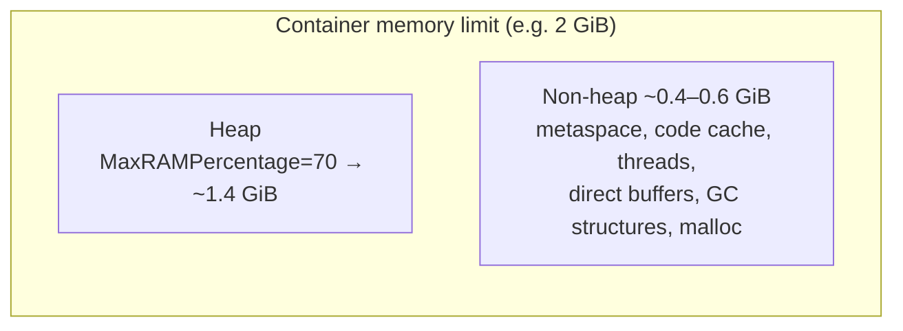
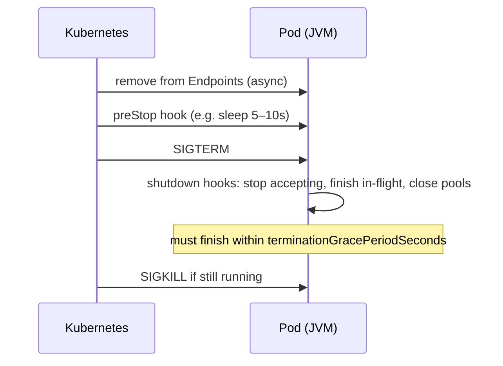

# Java in Containers and Production Tuning

> [!abstract] What this is
> Running the JVM well in Docker and Kubernetes: **container awareness** (cgroup memory and CPU limits), **heap sizing** relative to the container limit, **CPU limits** vs GC and JIT threads, **startup** and readiness, **graceful shutdown**, image choices, and the short list of **flags that matter**. The decision this helps with: setting memory/CPU requests and limits and JVM flags so a service is neither OOMKilled nor throttled, and starts and stops cleanly.

---

## Why It Matters

- The most common Java-on-Kubernetes incidents are configuration, not code: OOMKills from native memory, latency from CPU throttling, slow starts tripping liveness probes, and dropped requests on deploy.
- Defaults are conservative: the default max heap is only **25%** of the container memory.

---

## Container Awareness

- Since **JDK 10** (backported to 8u191), the JVM reads **cgroup** limits instead of host totals; **cgroup v2** support since **15** (backported to 11 and 8 updates). On by default (`-XX:+UseContainerSupport`).
- **Memory**: the container limit becomes "physical memory" for ergonomics.
- **CPU**: `Runtime.availableProcessors()` comes from the **CPU limit (quota)**, rounded up. Since **JDK 19** (and backported to 17/11 updates), **CPU shares / Kubernetes requests are ignored**: with no CPU limit, the JVM sees all host cores.
- `availableProcessors()` drives GC thread counts, JIT compiler threads, `ForkJoinPool.commonPool` size, the virtual-thread scheduler and many libraries' pool sizes. Override with **`-XX:ActiveProcessorCount=N`** when the computed value is wrong for you.
- Check what the JVM sees: `java -XX:+PrintFlagsFinal -version | grep -E "MaxHeapSize|ActiveProcessorCount"` or `-Xlog:os+container=info`.

---

## Memory Sizing



| Setting | Use |
|---|---|
| `-XX:MaxRAMPercentage=60..75` | Heap as a share of the container limit (default **25**). Lower end for apps with many threads, Netty direct buffers or large metaspace |
| `-XX:InitialRAMPercentage` = same | Avoid heap resizing; or `-Xms` = `-Xmx` |
| `-Xmx` (absolute) | When you prefer explicit numbers; then it must be changed with the limit |
| `-XX:MaxMetaspaceSize` | Cap so leaks fail clearly instead of OOMKill |
| `-XX:MaxDirectMemorySize` | Cap Netty/NIO off-heap |
| `-Xss` | Lower (e.g. 512k) if thousands of platform threads |
| `MALLOC_ARENA_MAX=2` (env) | Limit glibc malloc arena growth with many threads |

- **Requests = limits for memory** in Kubernetes. The JVM sizes itself from the limit; if the node is overcommitted and the pod uses more than its request, it can be evicted.
- Size from measurement: run under load with NMT (`-XX:NativeMemoryTracking=summary`), observe RSS vs heap, leave 10–20% headroom ([[03 - JVM Memory Layout]], [[12 - JVM Diagnostics and Profiling]]).
- An OOMKill (exit code **137**, no Java error) means **RSS > limit**: native memory, not the heap.

---

## CPU Limits and Throttling

- Kubernetes CPU limits are enforced by **CFS quota** per 100 ms period. A JVM with 4 CPU limit that bursts to 16 threads for GC, JIT and request work uses its quota in 25 ms and is **throttled** for 75 ms: latency spikes that look like GC pauses.
- Watch `container_cpu_cfs_throttled_periods_total` / `throttled_seconds`.
- Options:
    - Set CPU **requests** for scheduling and **no CPU limit** (or a generous one) for latency-sensitive services, if the platform allows.
    - Keep `ActiveProcessorCount` aligned with the limit so GC/JIT thread counts don't oversubscribe.
    - Give at least **2 CPUs** to JVM services: one core is shared by application, GC and JIT threads.
- Startup needs more CPU than steady state (class loading, JIT). Kubernetes **in-place resize** / startup CPU boost tools help; otherwise tight limits make startup slow.

---

## GC Choice in Containers

- **JDK ≤ 26**: with < 2 CPUs or < 1792 MB the JVM silently picks **Serial GC**. Set the collector explicitly (`-XX:+UseG1GC` or ZGC). **JDK 27** defaults to G1 everywhere ([[04 - Java Garbage Collectors]]).
- Low-pause collectors (ZGC, Shenandoah) need spare CPU for concurrent GC threads; under tight CPU limits they degrade into allocation stalls.
- **Compact object headers** (opt-in on 25 with `-XX:+UseCompactObjectHeaders`, default in 27) cut heap usage for object-heavy services.

---

## Startup, Readiness and Liveness

| Probe | Purpose | Java-specific advice |
|---|---|---|
| **Startup probe** | Give slow starts time before liveness kicks in | Generous: JVM + framework startup + warm-up |
| **Readiness** | Take traffic only when ready | Ready after dependencies are reachable and (optionally) warm-up is done |
| **Liveness** | Restart a dead process | Cheap, local check; **not** dependent on DB/downstreams; timeout longer than worst GC pause |

- A liveness probe that calls the database restarts every pod when the database blips: a self-inflicted outage.
- Faster startup options: **CDS / AOT cache** (JDK 24+, [[02 - JIT Compilation and AOT]]), lazy initialisation, fewer classes, native image or CRaC ([[14 - Spring Boot Performance and Native]]).

---

## Graceful Shutdown



- The JVM runs **shutdown hooks** on SIGTERM; frameworks use them (Spring Boot `server.shutdown=graceful` with `spring.lifecycle.timeout-per-shutdown-phase`).
- Endpoint removal and SIGTERM race: a short **preStop sleep** keeps the pod serving while load balancers stop routing to it.
- The JVM must be **PID 1's direct child or PID 1 itself** and receive the signal: use exec-form `ENTRYPOINT ["java", ...]`, not a shell script that swallows SIGTERM (or `exec java ...` in the script).
- Consumers (Kafka, queues) must stop polling, finish/commit in-flight messages and leave the group cleanly.

---

## Images

| Choice | Notes |
|---|---|
| **JRE-only base** (Temurin JRE, distroless Java) | Smaller, fewer CVEs than a full JDK; may lack `jcmd` |
| **`jlink` custom runtime** | Only the modules you need (`jdeps --print-module-deps`); add `jdk.jcmd`, `jdk.jfr` for diagnostics |
| **Alpine (musl)** | Small, but musl differences (DNS, malloc behaviour, native libs); use builds made for musl |
| **Layered jars** | Dependencies in a separate layer from app classes: faster pushes and pulls (Spring Boot layers) |
| **Non-root user, read-only filesystem** | Security baseline; give a writable volume for `/tmp`, dumps and JFR |

---

## Flags That Matter

```bash
JAVA_TOOL_OPTIONS="
  -XX:MaxRAMPercentage=70 -XX:InitialRAMPercentage=70
  -XX:+UseG1GC                                   # explicit on ≤ 26 (or -XX:+UseZGC)
  -XX:MaxMetaspaceSize=256m
  -XX:+HeapDumpOnOutOfMemoryError -XX:HeapDumpPath=/dumps
  -XX:+ExitOnOutOfMemoryError
  -Xlog:gc*:file=/logs/gc.log:time,uptime:filecount=5,filesize=20m
  -XX:StartFlightRecording=maxage=6h,maxsize=500m,dumponexit=true,filename=/dumps/
  -XX:NativeMemoryTracking=summary               # small overhead; enable when investigating or always if acceptable
"
```

- Everything else (young gen sizes, tenuring thresholds, survivor ratios) should stay at defaults unless measurements say otherwise.
- `JAVA_TOOL_OPTIONS` is picked up by any JVM in the container (and printed on start); `JDK_JAVA_OPTIONS` only by the `java` launcher.

---

## Failure Modes

| Failure | What happens | Mitigation |
|---|---|---|
| **Default 25% heap** | Wasted memory or premature heap OOM | `MaxRAMPercentage` 60–75 |
| **Heap ≈ container limit** | OOMKilled (137) by native usage | Leave room for non-heap; measure with NMT |
| **No CPU limit, huge node** | JVM sizes pools/GC threads for 64+ cores | `ActiveProcessorCount`, or a CPU limit |
| **Tight CPU limit** | CFS throttling; latency spikes; slow startup | Fewer threads, bigger limit, no limit with requests |
| **Serial GC in small pods (≤ 26)** | Long pauses | Set GC explicitly; ≥ 2 CPUs |
| **Liveness depends on downstreams** | Mass restarts during dependency outages | Local liveness; dependencies in readiness only |
| **Shell entrypoint swallows SIGTERM** | No graceful shutdown; killed after grace period | Exec form or `exec java` |
| **No preStop delay** | 502s during deploys | Short preStop sleep + graceful shutdown |
| **Dumps written to container FS** | Lost on restart, or fill ephemeral storage | Dedicated volume with size limits |

---

## Interview Lines

> [!tip] Say it like this
> - "The JVM is container-aware: it sizes from the cgroup memory limit and the CPU quota, but its default heap is only 25% of the limit, so I set `MaxRAMPercentage` to around 70 and leave the rest for metaspace, threads and direct memory."
> - "An OOMKill with exit code 137 and no Java error means native memory pushed RSS over the limit, not the heap."
> - "CPU limits are enforced per 100 ms period, so a JVM bursting GC and JIT threads gets throttled; I watch throttling metrics and align `ActiveProcessorCount`."
> - "Liveness must be local; checking the database in liveness turns a database blip into a restart storm."
> - "For graceful shutdown: preStop sleep, SIGTERM reaching the JVM, the framework draining in-flight requests within the grace period."

## Related Notes

- [[03 - JVM Memory Layout]] · [[04 - Java Garbage Collectors]] · [[02 - JIT Compilation and AOT]] · [[12 - JVM Diagnostics and Profiling]] · [[14 - Java Build and Dependencies]]
- [[14 - Spring Boot Performance and Native]] · [[Languages/README]]
