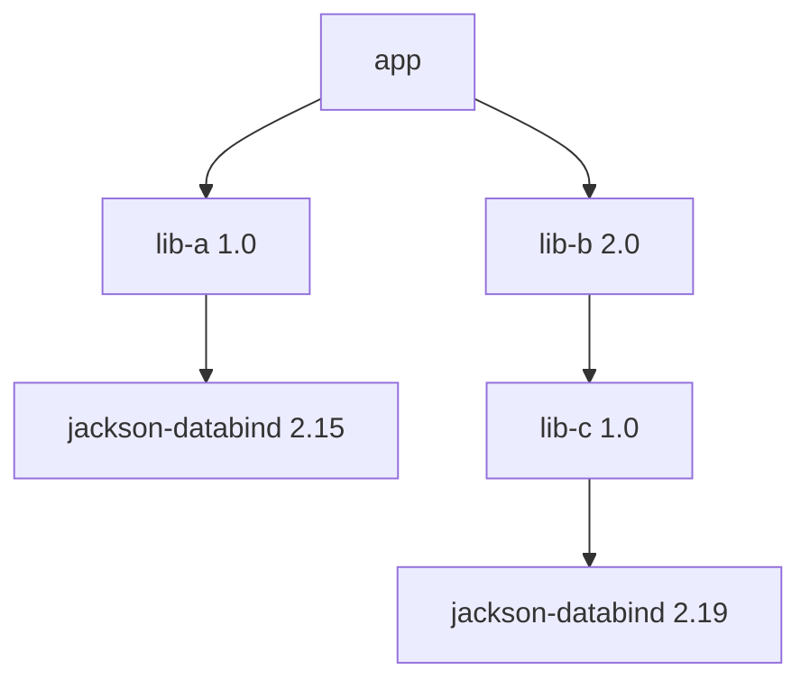

# Java Build and Dependencies

> [!abstract] What this is
> How Java projects are built and how their dependencies are resolved: **Maven** (lifecycle, scopes, nearest-wins resolution, `dependencyManagement`) vs **Gradle** (task graph, configurations, highest-version-wins, caches), **BOMs** and platforms, version conflicts and how to diagnose them, **reproducible builds**, packaging (fat jars, shading, layered jars), and supply-chain hygiene (lockfiles, SBOMs, vulnerability scanning). The decision this helps with: picking a build tool, and fixing the `NoSuchMethodError` caused by two versions of the same library.

---

## Why It Matters

- Most "works on my machine" and post-upgrade runtime errors (`NoSuchMethodError`, `ClassNotFoundException`, `NoClassDefFoundError`) are dependency-resolution problems ([[01 - JVM Architecture and Class Loading]]).
- A typical Spring Boot service has 150+ transitive dependencies. Knowing how versions get picked, and how to pin them, is everyday work and a security requirement.

## Versions (Oct 2026)

- **Maven 3.10** is the current stable line; **Maven 4.0** is at release candidates (rc-7 in Sep 2026), adding a new POM model version, a separate "build POM" vs "consumer POM", and better multi-module support.
- **Gradle 9.x** (9.0 in 2025, 9.8 in Sep 2026): **configuration cache** as the preferred mode, Kotlin DSL as default, Java 17+ needed to run Gradle itself.
- Use the **wrapper** (`mvnw`, `gradlew`) so every developer and CI agent uses the same tool version.

---

## Maven vs Gradle

| | Maven | Gradle |
|---|---|---|
| Model | Fixed **lifecycle** (`validate → compile → test → package → verify → install → deploy`) with plugins bound to phases | **Task graph**; tasks declare inputs/outputs |
| Config | XML POM, declarative, convention-heavy | Kotlin/Groovy DSL, programmable |
| Conflict resolution | **Nearest wins** in the dependency tree (then first declared) | **Highest version wins** across the graph (unless constrained) |
| Incremental / caching | Limited (some plugins, extensions such as build caches) | Up-to-date checks, **build cache** (local/remote), configuration cache |
| Speed on large builds | Slower | Usually faster, especially incremental and with remote cache |
| Learning curve | Low; every Maven build looks alike | Higher; builds can become custom programs |
| Pick when | Standard services, teams valuing predictability | Large multi-module repos, Android, custom build logic, build speed matters |

---

## Dependency Scopes

| Maven scope | Gradle configuration | On compile classpath | On runtime classpath | In consumers |
|---|---|---|---|---|
| `compile` (default) | `implementation` / `api` | Yes | Yes | Gradle: only `api` leaks to consumers' compile classpath |
| `provided` | `compileOnly` | Yes | No (container supplies it) | No |
| `runtime` | `runtimeOnly` | No | Yes (JDBC drivers) | Runtime only |
| `test` | `testImplementation` | Tests only | Tests only | No |
| `optional` | (feature variants) | Yes | Yes | No |

- Gradle's `implementation` vs `api` split keeps internal dependencies off consumers' compile classpath, so changing them doesn't recompile downstream modules.

---

## How Versions Get Picked



- **Maven (nearest wins)**: `jackson-databind 2.15` is at depth 2, `2.19` at depth 3 → **2.15 wins**. If `lib-c` uses an API added in 2.17: **`NoSuchMethodError` at runtime**, though everything compiled.
- **Gradle (highest wins)**: **2.19** wins. Safer by default, but a transitive upgrade can still break `lib-a` if 2.19 removed something it used.
- Neither tool fails the build on a conflict by default.

### Taking control

| Technique | Maven | Gradle |
|---|---|---|
| **Pin a version** for transitive deps | `<dependencyManagement>` | `constraints { }`, `strictly` versions |
| **Import a BOM** | `<scope>import</scope><type>pom</type>` in `dependencyManagement` | `implementation(platform("..."))` |
| **Exclude** a transitive dep | `<exclusions>` | `exclude(group, module)` |
| **Fail on conflicts** | `maven-enforcer-plugin` with `dependencyConvergence`, `requireUpperBoundDeps` | `failOnVersionConflict()` |
| **Inspect** | `mvn dependency:tree -Dverbose`, `dependency:analyze` | `gradle dependencies`, `dependencyInsight --dependency jackson-databind` |
| **Lock** | Pin everything via `dependencyManagement` (no native lockfile) | **Dependency locking** (`gradle.lockfile`) |
| **Central versions** | Properties + parent POM | **Version catalogs** (`libs.versions.toml`) |

### BOMs

- A **BOM** (bill of materials) is a POM listing tested-together versions: `spring-boot-dependencies`, `jackson-bom`, `netty-bom`, the AWS SDK BOM. Import it and declare dependencies **without versions**.
- Spring Boot's parent/BOM manages hundreds of versions; overriding one (`<jackson.version>`) is possible but steps outside the tested set.
- Order matters in Maven: the **first imported BOM wins** for a given artifact.

```xml
<dependencyManagement>
  <dependencies>
    <dependency>
      <groupId>org.springframework.boot</groupId>
      <artifactId>spring-boot-dependencies</artifactId>
      <version>${spring-boot.version}</version>
      <type>pom</type>
      <scope>import</scope>
    </dependency>
  </dependencies>
</dependencyManagement>
```

---

## Packaging

| Format | What | Trade-offs |
|---|---|---|
| **Thin jar + classpath** | App classes only; libraries alongside | Needs a launcher/classpath; good for layered images |
| **Spring Boot executable jar** | Nested jars + a custom class loader (`JarLauncher`) | One file; extract (`java -Djarmode=tools -jar app.jar extract`) for faster startup and CDS/AOT cache use |
| **Shaded / uber jar** (Shade plugin, Shadow) | All classes merged into one jar | Duplicate files clash (`META-INF/services` must be merged); **relocate** packages to avoid conflicts with the host's versions |
| **Layered jars / Jib / buildpacks** | Dependencies, snapshot deps, app code in separate image layers | Only the app layer changes on most deploys |
| **jlink runtime** | Custom minimal JRE | Needs modular awareness for best results ([[13 - Java in Containers and Production Tuning]]) |
| **Native image** | Platform-specific executable | Long builds; closed world ([[02 - JIT Compilation and AOT]]) |

- **Shading with relocation** is how libraries (and agents) ship a private copy of, say, Guava without clashing with the application's version.

---

## Reproducible and Correct Builds

- **Target the runtime**: `maven.compiler.release` / Gradle `options.release` = the deployed Java version, so the compiler checks API usage against that JDK, not just bytecode level ([[00 - Java Version History]]).
- **Toolchains**: build with a specific JDK regardless of the one running Maven/Gradle.
- **Reproducible builds**: fixed timestamps (`project.build.outputTimestamp` in Maven; `isPreserveFileTimestamps = false`, `isReproducibleFileOrder = true` in Gradle), pinned plugin versions, no `SNAPSHOT` or dynamic versions (`1.+`, `LATEST`) in releases.
- **Wrapper and plugin versions pinned**; verify the wrapper's checksum (`distributionSha256Sum`).
- CI: `mvn -B verify` / `./gradlew build --no-daemon` (or with the daemon and a remote cache), offline-capable via a repository manager (Nexus, Artifactory) that proxies Maven Central.

---

## Supply-Chain Hygiene

- **Scan dependencies** for known CVEs (OWASP Dependency-Check, Snyk, GitHub Dependabot, Trivy on images); fail on critical issues in CI.
- **SBOMs** (CycloneDX or SPDX plugins for Maven/Gradle) record exactly what shipped; needed for incident response ("are we affected by the next Log4Shell?").
- **Dependency verification**: Gradle's `verification-metadata.xml` checks checksums/signatures; Maven can verify PGP signatures with plugins.
- Restrict repositories to a trusted proxy; beware **dependency confusion** (internal artifact names published publicly) and typosquatted group IDs.
- Automate updates (Renovate, Dependabot) in small batches with tests, rather than rare big-bang upgrades.

---

## Failure Modes

| Failure | What happens | Mitigation |
|---|---|---|
| **Nearest-wins picks an old version** | `NoSuchMethodError` at runtime | `dependency:tree -Dverbose`; pin via `dependencyManagement`; enforcer `requireUpperBoundDeps` |
| **Two artifacts with the same classes** (e.g. `javax` vs `jakarta`, `log4j` bridges) | Random class wins; odd runtime behaviour | Exclusions; enforcer `banDuplicateClasses` |
| **Overriding a BOM-managed version** | Untested combination | Upgrade the whole BOM when possible |
| **Dynamic or SNAPSHOT versions in releases** | Non-reproducible builds | Pinned versions; Gradle locking |
| **Compiling with a newer JDK without `--release`** | Runs on CI, `NoSuchMethodError` on older runtime | `release` = deployed version; toolchains |
| **Shaded jar without relocation** | Conflicts with the app's copy of the library | Relocate packages; merge service files |
| **Unscanned dependencies** | Known CVEs shipped to prod | Scanning + SBOM in CI |
| **Fat jar run without extraction** | Slower startup; no CDS/AOT cache benefit | Extract or layer the jar |

---

## Interview Lines

> [!tip] Say it like this
> - "Maven resolves conflicts by nearest wins, Gradle by highest version, and neither fails by default, so I add convergence checks and pin versions with a BOM."
> - "`NoSuchMethodError` after an upgrade means we compiled against one version and run another; `dependency:tree -Dverbose` or `dependencyInsight` shows which one won and why."
> - "I import BOMs like Spring Boot's and declare dependencies without versions, so the versions are a tested set."
> - "I compile with `--release` set to the runtime JDK, and keep releases reproducible: wrapper, pinned plugins, no dynamic versions."
> - "Every build produces an SBOM and runs a vulnerability scan, so 'are we affected?' is a query, not an investigation."

## Related Notes

- [[01 - JVM Architecture and Class Loading]] · [[00 - Java Version History]] · [[13 - Java in Containers and Production Tuning]]
- [[02 - Spring Boot Auto-Configuration and Config]] · [[Languages/README]]
