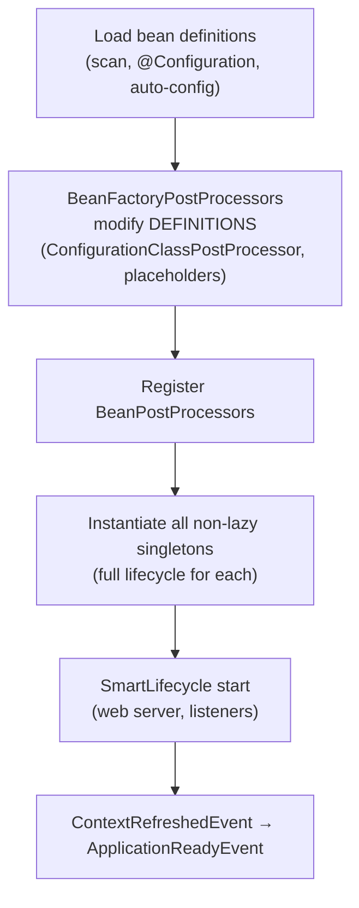
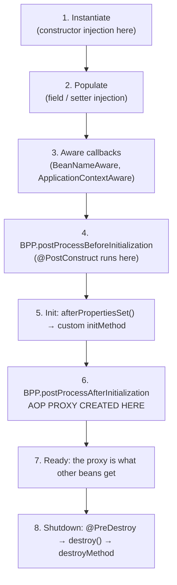

# Spring IoC and Bean Lifecycle

> [!abstract] What this is
> How the Spring container works: **bean definitions**, `BeanFactory` vs `ApplicationContext`, the **refresh** sequence, the full **bean lifecycle** (instantiate → inject → aware → post-processors → init → ready → destroy), **scopes** and the prototype-in-singleton trap, injection resolution (`@Primary`, `@Qualifier`, collections), **circular dependencies**, `@Configuration` proxying, and startup hooks. The decision this helps with: understanding why a bean is missing, duplicated, not proxied, or initialised in the wrong order. DI as a design idea is in [[LLD/Foundations/07 - Dependency Injection and Layering]].

---

## Why It Matters

- Every Spring "magic" behaviour (transactions, security, caching, config binding) is implemented by **post-processors** during the bean lifecycle. Knowing where in the lifecycle proxies are created explains most "annotation doesn't work" bugs ([[03 - Spring AOP and Proxies]]).
- "Walk me through the bean lifecycle" and "how does Spring resolve circular dependencies?" are classic senior questions.

---

## Container Basics

- A **bean** is an object whose creation, wiring and lifecycle the container manages.
- A **`BeanDefinition`** is the recipe: class or factory method, scope, constructor args, properties, init/destroy methods, lazy flag, primary flag. Definitions come from component scanning (`@Component`, `@Service`, ...), `@Bean` methods, auto-configuration, XML, or programmatic registration (`BeanRegistrar`, Framework 7).
- **`BeanFactory`**: the core DI container. **`ApplicationContext`**: `BeanFactory` + events, message sources, resource loading, environment/profiles, and **eager singleton creation at startup**. Applications always use an `ApplicationContext`.

### The refresh sequence (simplified)



- **`BeanFactoryPostProcessor`** works on **definitions** before any bean exists (e.g. parsing `@Configuration` classes, resolving `${...}`).
- **`BeanPostProcessor`** works on **instances** as each bean is created (e.g. `@Autowired` injection, `@PostConstruct`, creating AOP proxies).

---

## The Bean Lifecycle



| Step | Hook | Notes |
|---|---|---|
| Instantiate | Constructor | Prefer **constructor injection**: final fields, no partially built objects, easy tests |
| Populate | `@Autowired` fields/setters | Field injection hides dependencies; avoid outside tests |
| Init | `@PostConstruct`, `InitializingBean`, `@Bean(initMethod)` | Runs on the **raw target**, before the proxy exists: `@Transactional` methods called from `@PostConstruct` get **no transaction** |
| Proxy | `postProcessAfterInitialization` | `AbstractAutoProxyCreator` wraps the bean if any advisor applies (transactions, caching, security, async) |
| Ready | `SmartInitializingSingleton`, `ApplicationReadyEvent` | Use these for work that needs the fully proxied context |
| Destroy | `@PreDestroy`, `DisposableBean`, `destroyMethod` (inferred `close`/`shutdown` for `@Bean`) | **Not called for prototype beans** |

- Startup work that needs transactions or other beans' proxies: `ApplicationRunner`/`CommandLineRunner` or an `@EventListener(ApplicationReadyEvent.class)`, not `@PostConstruct`.

---

## Scopes

| Scope | One instance per | Notes |
|---|---|---|
| **singleton** (default) | Container | Must be **thread-safe**: shared by all requests. Stateless services; no per-request fields |
| **prototype** | Injection / lookup | Container doesn't manage destruction |
| **request** | HTTP request | Web only; injected via a scoped proxy |
| **session** | HTTP session | Avoid in horizontally scaled services unless sessions are shared |
| **application** | `ServletContext` | Rare |

### The prototype-in-singleton trap

- Injecting a prototype (or request-scoped) bean into a singleton injects **one instance, once**, at singleton creation.
- Fixes: inject **`ObjectProvider<T>`** and call `getObject()` per use; or a **scoped proxy** (`@Scope(value = "request", proxyMode = TARGET_CLASS)`), which Spring uses automatically for `@RequestScope`; or `@Lookup` methods.

```java
@Service
class ReportService {
    private final ObjectProvider<ReportBuilder> builders;   // prototype
    ReportService(ObjectProvider<ReportBuilder> builders) { this.builders = builders; }
    Report build(Query q) { return builders.getObject().with(q).build(); }  // new builder each call
}
```

---

## Injection Resolution

- By **type** first. If several candidates: **`@Primary`** wins; **`@Qualifier("name")`** picks one; otherwise the parameter name is matched against bean names; otherwise `NoUniqueBeanDefinitionException`.
- Inject **all** implementations: `List<PaymentProvider>` (ordered by `@Order`/`Ordered`) or `Map<String, PaymentProvider>` keyed by bean name: a clean strategy-pattern registry.
- Optional dependencies: `Optional<T>`, `ObjectProvider<T>.getIfAvailable()`, or `@Autowired(required = false)`.
- Generics are part of the type: `Repository<Order>` and `Repository<User>` are distinct candidates.
- Missing bean → `NoSuchBeanDefinitionException`; Boot's **failure analyzer** prints a readable explanation, and the **conditions report** (`--debug`) says why an auto-configured bean wasn't created ([[02 - Spring Boot Auto-Configuration and Config]]).

---

## Circular Dependencies

- **Constructor** cycles (A needs B in its constructor, B needs A) can't be built: `BeanCurrentlyInCreationException`.
- **Field/setter** cycles can be resolved: Spring exposes an **early reference** to the half-built singleton through its three-level singleton cache (singletons → early singleton objects → singleton factories). The factory step exists so the early reference can already be the **proxy** if AOP applies.
- Since **Boot 2.6**, circular references are **prohibited by default** (`spring.main.allow-circular-references=false`). Treat a cycle as a design smell: extract the shared logic into a third bean, use events, or inject `ObjectProvider`/`@Lazy` as a last resort.

---

## @Configuration and @Bean

```java
@Configuration                       // proxyBeanMethods = true by default ("full" mode)
class ClientsConfig {
    @Bean RestClient paymentsClient() { return RestClient.builder().baseUrl("...").build(); }
    @Bean PaymentGateway gateway() { return new PaymentGateway(paymentsClient()); } // returns the SAME singleton
}
```

- In **full mode**, the `@Configuration` class is **CGLIB-subclassed** so calling another `@Bean` method returns the container's singleton, not a new object.
- **Lite mode** (`@Configuration(proxyBeanMethods = false)` or `@Bean` in a `@Component`): no subclass, faster startup, native-friendly; inter-bean calls create **new instances**, so inject dependencies as method parameters instead. Boot's own auto-configurations use lite mode.
- `@Bean` methods for `BeanFactoryPostProcessor`s should be **`static`**, so they don't force early creation of the configuration class.

---

## Lazy Initialisation and Startup

- `spring.main.lazy-initialization=true` (or `@Lazy`) creates beans on first use: faster startup, but configuration errors surface on the first request instead of at boot, and the first requests are slower. Good for dev/tests; use carefully in production.
- **`SmartLifecycle`** with `phase` controls start/stop ordering of components like the web server, message listeners and schedulers; on shutdown, phases stop in reverse.
- **Application events**: `@EventListener` for in-process decoupling; `@TransactionalEventListener(phase = AFTER_COMMIT)` to act only after the transaction commits (e.g. publishing to Kafka) ([[06 - Spring Transactions]]).

---

## Failure Modes

| Failure | What happens | Mitigation |
|---|---|---|
| **State in a singleton** | Data leaks between concurrent requests | Stateless singletons; state in method locals or request scope |
| **Prototype injected into singleton** | Same instance reused forever | `ObjectProvider`, scoped proxy |
| **`@Transactional` work in `@PostConstruct`** | No transaction (proxy not yet created) | `ApplicationRunner` / `ApplicationReadyEvent` |
| **Circular dependency** | Startup failure on Boot 2.6+ | Redesign; extract a third bean |
| **Several candidates for a type** | `NoUniqueBeanDefinitionException` | `@Primary`, `@Qualifier`, or inject a `List` |
| **Lite-mode inter-bean calls** | Duplicate instances (two pools, two clients) | Method-parameter injection |
| **Lazy init in production** | Errors and latency on first request | Eager init; lazy only for measured startup wins |
| **Field injection everywhere** | Hidden dependencies, hard tests | Constructor injection |

---

## Interview Lines

> [!tip] Say it like this
> - "Bean factory post-processors change definitions before beans exist; bean post-processors change instances as they're created, and that's where AOP proxies are made, after `@PostConstruct`."
> - "Because the proxy is created after init, `@Transactional` calls from `@PostConstruct` run without a transaction; I use an `ApplicationReadyEvent` listener instead."
> - "Singletons are shared across threads, so they must be stateless; a prototype injected into a singleton is created only once unless I use `ObjectProvider` or a scoped proxy."
> - "Spring can break setter-injection cycles with early references, but Boot forbids cycles by default since 2.6, and I treat them as a design problem."
> - "Full-mode `@Configuration` classes are CGLIB-proxied so inter-bean calls return singletons; Boot's auto-configs use lite mode for startup speed."

## Related Notes

- [[02 - Spring Boot Auto-Configuration and Config]] · [[03 - Spring AOP and Proxies]] · [[06 - Spring Transactions]]
- [[09 - Java Reflection Annotations and Proxies]] · [[LLD/Foundations/07 - Dependency Injection and Layering]] · [[Languages/README]]
