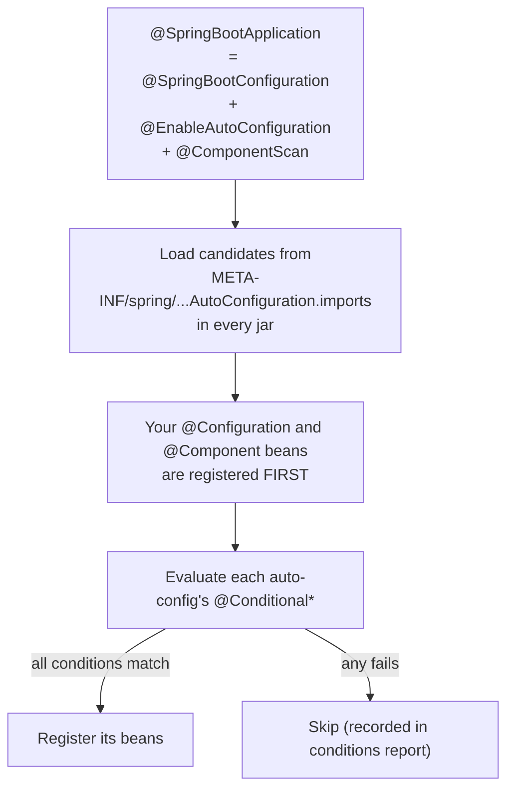

# Spring Boot Auto-Configuration and Config

> [!abstract] What this is
> How Boot decides which beans to create (**auto-configuration** driven by **conditions** on the classpath, existing beans and properties), what **starters** are (and how Boot 4 modularised them), how **externalised configuration** works (property sources and their **precedence**, relaxed binding, profiles, `spring.config.import`), and type-safe binding with **`@ConfigurationProperties`**. The decision this helps with: overriding a default cleanly, debugging "why is this bean (not) here?", and knowing which value of a property wins.

---

## Why It Matters

- Most Boot behaviour is auto-configured. When it does the wrong thing, the fix is almost never to fight it; it's to define your own bean (Boot backs off) or set a property.
- "Which config value wins?" is a real production question when environment variables, config files, Kubernetes ConfigMaps and command-line args all set the same key.

---

## How Auto-Configuration Works



- `@EnableAutoConfiguration` imports every class listed in **`META-INF/spring/org.springframework.boot.autoconfigure.AutoConfiguration.imports`** across the classpath (since 2.7; the old `spring.factories` mechanism for auto-config was removed in 3.0).
- Auto-configurations are processed **after** user configuration, so `@ConditionalOnMissingBean` can see your beans and back off.
- Ordering between auto-configs: `@AutoConfiguration(before = ..., after = ...)`.

### Conditions

| Condition | Matches when | Typical use |
|---|---|---|
| `@ConditionalOnClass` / `OnMissingClass` | A class is (not) on the classpath | "Configure Jackson if Jackson is present" |
| `@ConditionalOnBean` / **`OnMissingBean`** | A bean of a type exists / doesn't | **Back off** if the user defined their own |
| `@ConditionalOnProperty` | A property has a value (with `matchIfMissing`) | Feature flags: `management.tracing.enabled` |
| `@ConditionalOnWebApplication` | Servlet or reactive web app | MVC vs WebFlux config |
| `@ConditionalOnResource`, `OnExpression`, `OnCloudPlatform`, `OnThreading` | Resource exists, SpEL, platform, virtual threads enabled | Niche |

```java
@AutoConfiguration
@ConditionalOnClass(PaymentClient.class)
@EnableConfigurationProperties(PaymentProperties.class)
public class PaymentAutoConfiguration {
    @Bean
    @ConditionalOnMissingBean                 // user's own PaymentClient bean wins
    PaymentClient paymentClient(PaymentProperties props, RestClient.Builder builder) {
        return new PaymentClient(builder.baseUrl(props.baseUrl().toString()).build(), props.timeout());
    }
}
```

### Debugging

- Run with **`--debug`** (or `debug=true`): prints the **conditions evaluation report**: positive matches, negative matches with the failing condition, exclusions.
- Actuator **`/actuator/conditions`** shows the same at runtime; **`/actuator/beans`** lists beans and dependencies; **`/actuator/configprops`** and **`/actuator/env`** show bound properties and their sources (secured, values sanitised).
- Exclude an auto-config: `@SpringBootApplication(exclude = DataSourceAutoConfiguration.class)` or `spring.autoconfigure.exclude`.

---

## Starters and Boot 4 Modularisation

- A **starter** is a dependency-only artifact pulling a coherent set of libraries plus the auto-configuration for them (`spring-boot-starter-web` → Spring MVC, Tomcat, Jackson).
- Until 3.x, all auto-configurations lived in one big `spring-boot-autoconfigure` jar, guarded by `@ConditionalOnClass`.
- **Boot 4** splits it into **focused modules** (one per technology, e.g. web MVC, JDBC, JPA, Kafka), each with its own starter. Effects: smaller classpaths, fewer condition evaluations, clearer dependencies. Migration trap: if a module isn't on the classpath, its auto-configuration simply isn't there. "Classic" starters bundle the old all-in-one behaviour to ease upgrades.
- **Custom starters** for shared company concerns (logging format, security defaults, clients): an `-autoconfigure` module with `@AutoConfiguration` classes + `AutoConfiguration.imports`, and a starter that depends on it. Always back off with `@ConditionalOnMissingBean`.

---

## Externalised Configuration

### Precedence (highest wins, simplified)

| # | Source |
|---|---|
| 1 | Test properties (`@TestPropertySource`, `@SpringBootTest(properties=...)`) |
| 2 | **Command-line arguments** (`--server.port=9000`) |
| 3 | `SPRING_APPLICATION_JSON` |
| 4 | JVM system properties (`-D...`) |
| 5 | **OS environment variables** |
| 6 | Config files outside the jar: `application-{profile}.yml`, then `application.yml` |
| 7 | Config files inside the jar: `application-{profile}.yml`, then `application.yml` |
| 8 | `@PropertySource` on configuration classes |
| 9 | Default properties (`SpringApplication.setDefaultProperties`) |

- Profile-specific files beat non-profile files at the same location; **external** beats **packaged**.
- Kubernetes: ConfigMaps/Secrets arrive as environment variables or mounted files; for files use **`spring.config.import=optional:configtree:/etc/config/`** (each file name becomes a key).
- `spring.config.import` (2.4) also pulls from Vault, Consul or AWS Parameter Store/Secrets Manager via the relevant integrations.

### Relaxed binding

- `payment.retry-timeout`, `payment.retryTimeout` and env var **`PAYMENT_RETRYTIMEOUT`** (dots → underscores, dashes removed, uppercase) bind to the same property.
- Lists from env use numeric segments: `PAYMENT_HOSTS_0=a`, `PAYMENT_HOSTS_1=b` bind to `payment.hosts[0]`, `payment.hosts[1]`.

### Profiles

- `spring.profiles.active=prod`; files `application-prod.yml`; multi-document YAML with `spring.config.activate.on-profile: prod`.
- **Profile groups**: `spring.profiles.group.prod=prod-db,prod-observability`.
- Keep profiles for **environment differences** (endpoints, sizes), not for feature toggles or code branches; `@Profile` on beans makes behaviour diverge between environments in untested ways.

---

## @ConfigurationProperties

```java
@ConfigurationProperties(prefix = "payment")
@Validated
public record PaymentProperties(
        @NotNull URI baseUrl,
        @DefaultValue("2s") Duration timeout,          // "500ms", "2s", "1m"
        @DefaultValue("3") @Min(0) int maxRetries,
        @DefaultValue("10MB") DataSize maxPayload) {}
```

```yaml
payment:
  base-url: https://payments.internal
  timeout: 1500ms
  max-retries: 2
```

| | `@ConfigurationProperties` | `@Value("${...}")` |
|---|---|---|
| Type safety | Whole typed object; records with constructor binding | One value |
| Validation | `@Validated` + Bean Validation: **fails at startup** | Manual |
| Relaxed binding | Full | Limited |
| Metadata / IDE completion | Yes (annotation processor `spring-boot-configuration-processor`) | No |
| Pick when | Any group of related settings | One-off values, SpEL |

- Register with `@EnableConfigurationProperties(...)` or `@ConfigurationPropertiesScan`.
- Validate at startup so a bad deploy fails fast instead of on the first request.

### Secrets

- Never commit secrets in `application.yml`. Inject them from the platform (Kubernetes Secrets, Vault, cloud secret managers) via env vars or `configtree`, and keep them out of logs; Actuator sanitises known key patterns (`password`, `secret`, `token`, `key`), and `/env` should not be exposed publicly ([[12 - Spring Observability]]).

---

## Failure Modes

| Failure | What happens | Mitigation |
|---|---|---|
| **Fighting auto-config with exclusions and hacks** | Brittle config, upgrade breakage | Define your own bean (Boot backs off) or set properties |
| **Auto-config silently not applied** | Bean missing; unexpected defaults | `--debug` conditions report; check the module/starter is present (Boot 4) |
| **Same key set in several places** | Surprising value wins | Know the precedence; inspect `/actuator/env` for the source |
| **Typo in a property name** | Silently ignored | `@ConfigurationProperties` + validation; configuration processor metadata |
| **Custom starter without `@ConditionalOnMissingBean`** | Duplicate or conflicting beans in apps | Always allow back-off |
| **Profile-specific beans** | Prod code path untested | Profiles for values, not behaviour |
| **Secrets in config files or exposed `/env`** | Credential leak | Secret stores; secure and limit Actuator endpoints |

---

## Interview Lines

> [!tip] Say it like this
> - "Auto-configuration is just conditional `@Configuration` classes listed in `AutoConfiguration.imports`; they run after mine, so `@ConditionalOnMissingBean` lets my own bean win."
> - "To see why a bean exists or doesn't, I run with `--debug` and read the conditions report, or hit `/actuator/conditions`."
> - "Command-line args beat environment variables, which beat external config files, which beat the ones packaged in the jar; profile-specific files beat the base file."
> - "I bind groups of settings to validated `@ConfigurationProperties` records, so a bad value fails the deploy at startup."
> - "Boot 4 split auto-configuration into per-technology modules, so a missing starter now means the auto-config isn't even on the classpath."

## Related Notes

- [[00 - Spring Boot Version History]] · [[01 - Spring IoC and Bean Lifecycle]] · [[12 - Spring Observability]] · [[13 - Spring Boot Testing]]
- [[14 - Java Build and Dependencies]] · [[Languages/README]]
