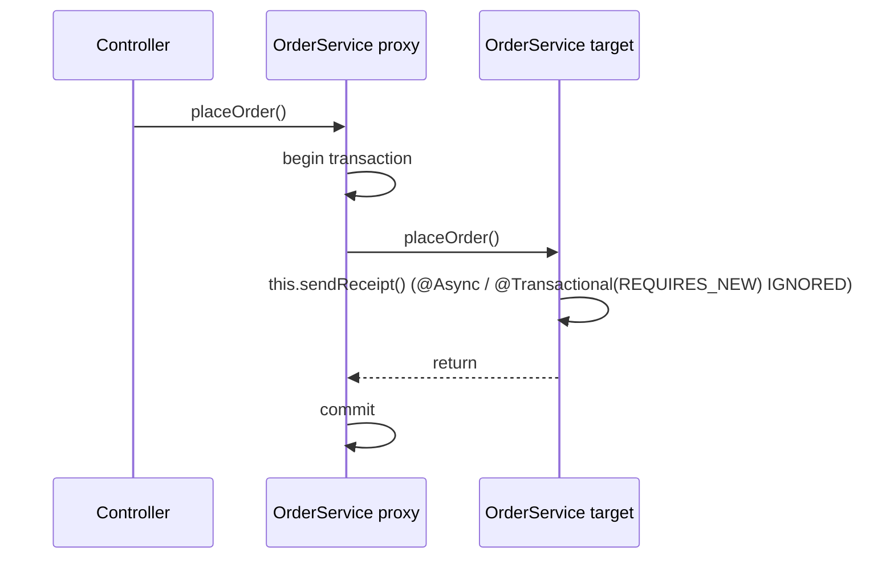

# Spring AOP and Proxies

> [!abstract] What this is
> How Spring applies cross-cutting behaviour (**transactions, caching, async, security, retries, metrics**) by wrapping beans in **proxies**: the AOP vocabulary, JDK vs CGLIB proxies in Spring, when proxies are created, advice **ordering**, and the rules that make annotations silently do nothing: **self-invocation**, non-public/final methods, beans not managed by Spring, and calls during initialisation. The decision this helps with: predicting whether `@Transactional`, `@Async`, `@Cacheable` or `@Retryable` will actually apply, and fixing it when it doesn't. Proxy mechanics at the JDK level are in [[09 - Java Reflection Annotations and Proxies]].

---

## Why It Matters

- "Why doesn't my `@Transactional` work?" is the single most common Spring production bug and interview question. The answer is almost always "the call didn't go through the proxy".
- Ordering between proxies (retry outside or inside the transaction? cache before or after security?) changes correctness.

---

## Vocabulary

| Term | Meaning in Spring |
|---|---|
| **Aspect** | A module of cross-cutting logic (`@Aspect` class) |
| **Join point** | A point where advice can run; in Spring AOP, **only method execution on a Spring bean** |
| **Pointcut** | An expression selecting join points: `execution(* com.acme..*Service.*(..))`, `@annotation(Audited)` |
| **Advice** | What runs: `@Before`, `@AfterReturning`, `@AfterThrowing`, `@After`, **`@Around`** |
| **Advisor** | Pointcut + advice; framework features (transactions, caching) register advisors |
| **Weaving** | Applying aspects: Spring AOP weaves **at runtime with proxies**; AspectJ weaves **bytecode** at compile/load time |

```java
@Aspect
@Component
class TimingAspect {
    @Around("@annotation(com.acme.Timed)")
    Object time(ProceedingJoinPoint pjp) throws Throwable {
        long start = System.nanoTime();
        try { return pjp.proceed(); }                     // forget proceed() and the method never runs
        finally { metrics.record(pjp.getSignature().toShortString(), System.nanoTime() - start); }
    }
}
```

---

## How Spring Creates Proxies

- An **auto-proxy creator** (a `BeanPostProcessor`) checks each bean after initialisation; if any advisor's pointcut matches one of its methods, it returns a **proxy** instead of the bean ([[01 - Spring IoC and Bean Lifecycle]]).
- Other beans receive the **proxy**. The proxy runs the **interceptor chain** (e.g. transaction interceptor, cache interceptor) and finally calls the **target** object.

| | JDK dynamic proxy | CGLIB subclass proxy |
|---|---|---|
| Used when | `proxyTargetClass=false` and the bean implements an interface | **Spring Boot default** (`spring.aop.proxy-target-class=true`) |
| Proxy type | Implements the bean's interfaces | Subclass of the bean's class |
| Injecting by concrete class | Fails | Works |
| Can't advise | Methods not on the interface | `final` methods, `final` classes, `private` methods, `static` methods |

- With CGLIB, the target class's constructor may run for the proxy instance too (Spring uses Objenesis to avoid it in most cases). Since Spring 6, CGLIB proxies also intercept `protected` and package-private methods, but `private` and `final` ones are still invisible.

---

## Why Annotations Silently Don't Apply



| Cause | Example | Fix |
|---|---|---|
| **Self-invocation** | `placeOrder()` calls `this.audit()` annotated with `@Transactional(propagation = REQUIRES_NEW)` | Move `audit()` to another bean; or use `TransactionTemplate`; or inject the bean into itself lazily (`@Lazy` self-reference); or AspectJ weaving |
| **`private` / `final` / `static` method** | `@Transactional private void save()` | Make it a public (non-final) method on a bean |
| **`final` class** (Kotlin default) | Kotlin services without `all-open` plugin | `kotlin-spring` plugin opens annotated classes |
| **Object not a Spring bean** | `new OrderService()` | Get it from the container |
| **Called during initialisation** | From `@PostConstruct` or a constructor | `ApplicationReadyEvent` / `ApplicationRunner` |
| **Feature not enabled** | `@Async` without `@EnableAsync`, `@Cacheable` without `@EnableCaching`, `@Retryable` without `@EnableResilientMethods` | Enable it (Boot auto-enables transactions, not async/caching/scheduling) |
| **Exception type** | Checked exception thrown from `@Transactional` | Rollback happens only for unchecked by default: `rollbackFor = Exception.class` ([[06 - Spring Transactions]]) |
| **Exception swallowed** | `catch (Exception e) { log... }` inside the transactional method | The proxy never sees it; rethrow or mark rollback-only |

---

## The Proxy-Based Features

### @Transactional

- `TransactionInterceptor` opens/joins a transaction before the call and commits or rolls back after, according to propagation and rollback rules ([[06 - Spring Transactions]]).

### @Async

- Runs the method on a `TaskExecutor`; requires `@EnableAsync`. Boot auto-configures a `ThreadPoolTaskExecutor`, or virtual threads with `spring.threads.virtual.enabled=true`.
- Return `void`, `CompletableFuture<T>` or `Future`. Exceptions from `void` methods are **lost** unless an `AsyncUncaughtExceptionHandler` is set.
- Context (security context, MDC, trace) doesn't follow by default; Boot **4.1** adds context propagation for `@Async`. On earlier versions use a `TaskDecorator`.
- The default executor's queue can be unbounded; size it, or the app queues work forever under load.

### @Cacheable

- Checks the cache before calling; stores the result after. Keys from parameters by default (`SimpleKeyGenerator`); use `key = "#id"` explicitly.
- Same self-invocation rule. `@CacheEvict`/`@CachePut` for invalidation. Caching `null` and unbounded in-memory caches are common bugs; use Caffeine with size/TTL or Redis ([[07 - Spring Data JPA and Hibernate]] for the second-level cache alternative).

### @Retryable and @ConcurrencyLimit (Framework 7)

- Core-framework resilience annotations enabled by `@EnableResilientMethods`: retry with backoff and jitter, and limit concurrent invocations (useful with virtual threads). Same proxy rules apply. Resilience4j remains the fuller option (circuit breakers, rate limiters) ([[11 - Spring HTTP Clients Resilience and Messaging]]).

### Method security

- `@PreAuthorize("hasRole('ADMIN')")` with `@EnableMethodSecurity`: an interceptor checks before the call. Self-invocation **bypasses security checks**, which is a security bug, not just a functional one ([[09 - Spring Security]]).

---

## Ordering Advice

- When several advisors apply to one method, their **order** decides nesting: lower `@Order` value = **outer**.
- Common choices:
    - **Retry outside the transaction**: each attempt gets a fresh transaction. Retry inside a transaction that already failed is useless (the transaction is rollback-only, the persistence context may be dirty).
    - **Security outermost**: don't start transactions or hit caches for unauthorised callers.
    - **Cache outside the transaction**: a cache hit shouldn't open a transaction.
- Transaction ordering is set with `@EnableTransactionManagement(order = ...)`; custom aspects with `@Order`.

---

## Spring AOP vs AspectJ

| | Spring AOP (proxies) | AspectJ weaving |
|---|---|---|
| Join points | Public/protected/package method execution on beans, through the proxy | Any method (incl. private), constructors, field access, self-calls |
| Setup | Nothing extra | Compile-time weaver or load-time weaving agent |
| Self-invocation | Not intercepted | Intercepted |
| Pick when | Almost always | You truly need self-invocation or non-bean objects advised, and accept the build/runtime complexity |

---

## Failure Modes

| Failure | What happens | Mitigation |
|---|---|---|
| **Self-invocation** | Transaction/cache/async/security silently skipped | Call through another bean; `TransactionTemplate` |
| **Annotation on private/final method** | Ignored | Public non-final methods on beans |
| **`@Async` void method throws** | Exception lost | `AsyncUncaughtExceptionHandler`, or return `CompletableFuture` |
| **Unbounded async executor queue** | Memory growth, delayed work | Configure pool and queue limits |
| **Retry inside the transaction** | Retries fail the same way | Order retry outside the transaction |
| **Self-call to a `@PreAuthorize` method** | Authorisation skipped | Security checks at the entry bean; tests for denied access |
| **`@Around` without `proceed()`** | Method never runs | Always call (or deliberately skip) `proceed()` |
| **Injecting by concrete class with JDK proxies** | `BeanNotOfRequiredTypeException` | Inject the interface, or use CGLIB (Boot default) |

---

## Interview Lines

> [!tip] Say it like this
> - "Spring AOP works by handing other beans a proxy; the proxy runs interceptors like the transaction interceptor and then calls the real object."
> - "Self-invocation goes straight to `this`, not the proxy, so `@Transactional`, `@Async` or `@Cacheable` on the called method is ignored."
> - "Boot uses CGLIB subclass proxies by default, so private and final methods can't be advised."
> - "Proxies are created after `@PostConstruct`, so calls during initialisation aren't advised either."
> - "Order matters: I put retries outside the transaction so each attempt gets a fresh one, and security outermost."

## Related Notes

- [[01 - Spring IoC and Bean Lifecycle]] · [[06 - Spring Transactions]] · [[09 - Spring Security]] · [[11 - Spring HTTP Clients Resilience and Messaging]]
- [[09 - Java Reflection Annotations and Proxies]] · [[LLD/Patterns/Structural/Decorator]] · [[Languages/README]]
