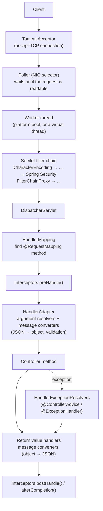

# Spring MVC Request Lifecycle

> [!abstract] What this is
> The path of an HTTP request through a Spring Boot servlet app: the embedded **Tomcat** connector and thread pool, the **servlet filter chain** (including Spring Security), the **`DispatcherServlet`** (handler mapping, interceptors, argument resolvers, **message converters**, exception resolvers), and the response. Also **thread sizing**, **virtual threads**, async request handling, and where to put cross-cutting logic (filter vs interceptor vs aspect). The decision this helps with: diagnosing slow or rejected requests, sizing Tomcat, and putting logic at the right layer.

---

## Why It Matters

- "What happens when a request hits a Spring Boot app?" is a standard question, and the answer explains real incidents: thread pool exhaustion, requests queued in the accept backlog, a filter that runs twice, an exception handler that never fires.
- Since Boot 3.2, turning on virtual threads changes the threading model with one property; knowing the old model shows what changes.

---

## The Full Path

1. **Tomcat** (NIO connector) accepts the connection, and its poller waits on the socket with a selector ([[11 - Java IO NIO and Networking]]). When a request is readable, a **worker thread** handles it end to end.
2. **Filters** (`jakarta.servlet.Filter`) run in order around the whole servlet: encoding, request logging, tracing, CORS, and Spring Security's **`FilterChainProxy`** (registered through `DelegatingFilterProxy`) ([[09 - Spring Security]]).
3. The **`DispatcherServlet`** asks its **`HandlerMapping`s** which handler matches (path, method, headers, `consumes`/`produces`, API version in Framework 7).
4. **`HandlerInterceptor.preHandle`** runs (can stop the request by returning `false`).
5. The **`HandlerAdapter`** resolves method arguments: `@PathVariable`, `@RequestParam`, `@RequestHeader`, and `@RequestBody` via an **`HttpMessageConverter`** (Jackson 3 in Boot 4), followed by `@Valid` validation.
6. The controller runs, usually calling services wrapped in transactional proxies ([[03 - Spring AOP and Proxies]]).
7. **Return value handlers** write the result: `@ResponseBody`/`@RestController` → message converter → JSON; `ResponseEntity` sets status and headers.
8. On exceptions, **`HandlerExceptionResolver`s** map them to responses, including `@ExceptionHandler` methods in `@ControllerAdvice` and Problem Details ([[10 - Spring Validation Errors and API Design]]).
9. `postHandle` (not called on exceptions) and `afterCompletion` (always) run; filters unwind; the worker thread returns to the pool.

---

## Filter vs Interceptor vs Aspect

| | Servlet `Filter` | `HandlerInterceptor` | AOP aspect |
|---|---|---|---|
| Sees | Raw request/response, **every** request (static files, errors, actuator) | Requests dispatched to a **handler**, knows which controller method | Method calls on beans |
| Runs | Before/after `DispatcherServlet` | Inside `DispatcherServlet` | Around bean methods, any layer |
| Can change request body | Yes (wrap the request) | No | No |
| Spring Security | Implemented here | — | Method security |
| Pick when | Auth, tracing, logging, CORS, compression, request IDs | Per-handler concerns that need the handler (e.g. annotation on the controller method) | Business-layer concerns: transactions, metrics on services |

- Make filters extend **`OncePerRequestFilter`**; otherwise they can run again on error dispatches and async dispatches.
- Filter order: `@Order` or `FilterRegistrationBean.setOrder`. Spring Security's chain sits at a fixed order (`SecurityProperties.DEFAULT_FILTER_ORDER`); place tracing/request-id filters before it so failed auth is still traced.

---

## Threading and Sizing (Tomcat)

| Property | Default | Meaning |
|---|---|---|
| `server.tomcat.threads.max` | 200 | Max worker threads = max concurrent requests in progress |
| `server.tomcat.threads.min-spare` | 10 | Always-alive workers |
| `server.tomcat.max-connections` | 8192 | Connections the connector will hold open (keep-alive included) |
| `server.tomcat.accept-count` | 100 | OS backlog once `max-connections` is reached; beyond it connections are refused |
| `server.tomcat.connection-timeout` | Not set by Boot (Tomcat's own default applies); set it explicitly | Wait for the request line after connect |
| `server.tomcat.keep-alive-timeout` | = connection timeout | Idle keep-alive time |

- With platform threads, **concurrency = worker threads**. Throughput ≈ threads / average latency (Little's law). 200 threads and 500 ms average latency = ~400 req/s max; when a downstream slows to 5 s, the same pool handles 40 req/s and the rest queue.
- When all workers are busy, new requests wait (connections up to `max-connections`, then the accept backlog), so clients see **latency, then timeouts**, not errors from the app.
- The **database pool** is usually the real limit: 200 Tomcat threads over a 10-connection Hikari pool means 190 threads waiting in `getConnection` ([[08 - Spring Database Connections and Migrations]]).

### Virtual threads

- `spring.threads.virtual.enabled=true` (Boot 3.2+, Java 21+): Tomcat runs each request on a **new virtual thread**; `@Async`, scheduling and several clients also switch to virtual threads.
- Effect: blocking calls no longer hold OS threads, so thread count stops being the concurrency cap. The cap moves to the **real resources**: DB pool size, downstream rate limits, memory. Add explicit limits (pool sizes, `@ConcurrencyLimit` in Framework 7, bulkheads).
- Use Java 24+ (no `synchronized` pinning) ideally; check `ThreadLocal`-heavy libraries ([[05 - Java Platform and Virtual Threads]]).

### Async request handling

| Return type | What happens | Pick when |
|---|---|---|
| `Callable<T>` | Runs on an MVC task executor; the container thread is released | Long work with platform threads |
| `DeferredResult<T>` / `CompletableFuture<T>` | Completed later by any thread | Waiting on events, messages, async clients |
| `SseEmitter` / `ResponseBodyEmitter` | Stream events | Server-sent events, LLM token streams |
| `StreamingResponseBody` | Write directly to the output stream | Large downloads |

- Set `spring.mvc.async.request-timeout`; async dispatches re-enter filters (another reason for `OncePerRequestFilter`).
- With virtual threads, plain blocking controller code is usually simpler than `Callable`/`DeferredResult` for the same effect; streaming still needs emitters.

---

## Servers

| Server | Notes |
|---|---|
| **Tomcat** | Default; mature; NIO connector; HTTP/2 with `server.http2.enabled` |
| **Jetty** | Alternative servlet container; good HTTP/2 and WebSocket support |
| **Undertow** | **Dropped in Boot 4** (not Servlet 6.1 compatible) |
| **Netty (Reactor Netty)** | For WebFlux, not MVC ([[05 - Spring WebFlux and Reactive]]) |

---

## Graceful Shutdown

- `server.shutdown=graceful` (default since Boot 3.4) stops accepting new requests and waits for in-flight ones up to `spring.lifecycle.timeout-per-shutdown-phase` (default 30 s).
- Pair with a Kubernetes **preStop** sleep and a grace period longer than the timeout ([[13 - Java in Containers and Production Tuning]]).

---

## Failure Modes

| Failure | What happens | Mitigation |
|---|---|---|
| **Slow downstream, platform threads** | All 200 workers blocked; requests queue; timeouts | Client timeouts, bulkheads, circuit breakers; or virtual threads plus real limits |
| **Tomcat threads ≫ DB pool** | Threads wait in `getConnection` | Size together; time out pool acquisition |
| **Virtual threads without limits** | Downstream overwhelmed | Pool limits, `@ConcurrencyLimit`, rate limiting |
| **Filter not `OncePerRequestFilter`** | Runs twice on error/async dispatch | Extend `OncePerRequestFilter` |
| **Logic in `postHandle` expecting to run on errors** | Skipped on exceptions | `afterCompletion` or a filter |
| **Reading the request body in a filter** | Controller sees an empty body | `ContentCachingRequestWrapper` |
| **Missing exception mapping** | 500 with a stack trace or a generic error page | `@ControllerAdvice` with Problem Details |
| **No async timeout** | Hung `DeferredResult`s pile up | `spring.mvc.async.request-timeout` |

---

## Interview Lines

> [!tip] Say it like this
> - "Tomcat accepts the connection and a worker thread carries the request through the servlet filters, including Spring Security, into the `DispatcherServlet`, which finds the handler, runs interceptors, converts the body with message converters and validates it, calls the controller and writes the response."
> - "Filters see every request and can wrap it; interceptors see only dispatched handlers and know the target method; aspects work at the bean-method level."
> - "With 200 platform threads, a downstream that slows from 50 ms to 5 s cuts throughput a hundredfold; the fix is timeouts and bulkheads, or virtual threads with explicit resource limits."
> - "With virtual threads the thread count stops being the cap, so the connection pool and downstream limits become the real ones."
> - "I extend `OncePerRequestFilter`, because error and async dispatches go through the filter chain again."

## Related Notes

- [[03 - Spring AOP and Proxies]] · [[05 - Spring WebFlux and Reactive]] · [[09 - Spring Security]] · [[10 - Spring Validation Errors and API Design]] · [[08 - Spring Database Connections and Migrations]]
- [[05 - Java Platform and Virtual Threads]] · [[11 - Java IO NIO and Networking]] · [[03 - Web Server Models Compared]] · [[Languages/README]]
