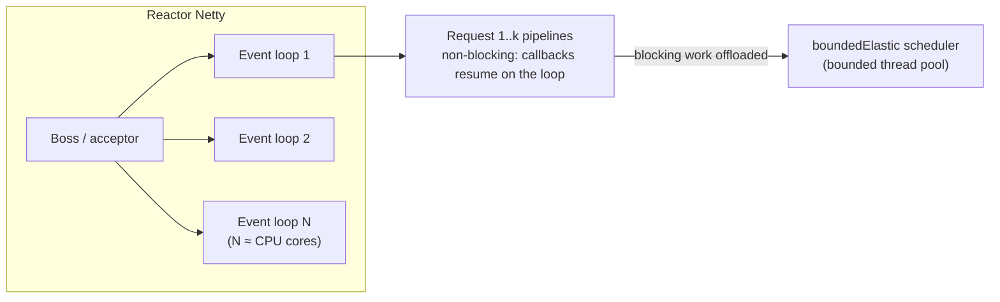

# Spring WebFlux and Reactive

> [!abstract] What this is
> Spring's non-blocking web stack: **Reactor Netty** event loops, **Project Reactor** (`Mono`, `Flux`, operators, **backpressure**, schedulers), how a WebFlux request flows, the **golden rule of never blocking the event loop**, the reactive data stack (WebClient, R2DBC), context propagation, and when reactive is worth its cost now that **virtual threads** exist. The decision this helps with: choosing MVC or WebFlux for a service, and finding the blocking call that froze a reactive app.

---

## Why It Matters

- Reactive code is common in gateways (Spring Cloud Gateway), streaming APIs and older high-concurrency services; interviewers probe whether you understand the threading model or just the operator names.
- One blocking call on an event-loop thread stalls every request on that loop. It is the reactive equivalent of the FastAPI "blocking call in `async def`" outage ([[02 - FastAPI Request Lifecycle and Sync vs Async]]).

---

## The Threading Model



- A handful of **event-loop threads** (≈ cores) serve all connections. Each request is a chain of operators; when it waits on I/O (DB, HTTP), **no thread waits**: the operation registers a callback and the loop moves on ([[11 - Java IO NIO and Networking]]).
- Throughput comes from never idling threads, so the model only works if **every** step is non-blocking: web client, database driver, cache client, logging appenders.

| | Spring MVC (platform threads) | Spring MVC + virtual threads | Spring WebFlux |
|---|---|---|---|
| Server | Tomcat / Jetty | Tomcat / Jetty | Reactor Netty (or servlet containers in async mode) |
| Threads | Pool of ~200 | One virtual thread per request | ~cores event loops |
| Code style | Imperative, blocking | Imperative, blocking | Reactive operators (`Mono`/`Flux`) or Kotlin coroutines |
| Blocking a thread | Costs one of 200 | Cheap | **Stalls all requests on that loop** |
| Backpressure | No | No | **Yes** (Reactive Streams) |
| Debugging | Normal stack traces | Normal | Fragmented traces; needs tooling |

---

## Project Reactor in Brief

- **`Mono<T>`**: 0..1 element. **`Flux<T>`**: 0..N elements. Both are **lazy**: nothing happens until something **subscribes** (WebFlux subscribes to what your controller returns).
- **Assembly vs execution**: building the chain is cheap; execution starts on subscribe, and each subscriber re-executes the chain (a `Mono` wrapping an HTTP call makes the call **once per subscription**: `cache()` or `share()` to reuse).

```java
@GetMapping("/orders/{id}")
Mono<OrderView> order(@PathVariable String id) {
    return orderRepo.findById(id)                                         // R2DBC: non-blocking
            .switchIfEmpty(Mono.error(new OrderNotFound(id)))
            .flatMap(o -> pricing.price(o)                                // WebClient call
                    .timeout(Duration.ofSeconds(2))
                    .retryWhen(Retry.backoff(2, Duration.ofMillis(100)))
                    .map(p -> OrderView.of(o, p)));
}
```

| Operator | Use | Trap |
|---|---|---|
| `map` | Synchronous transform | Don't call blocking code in it |
| `flatMap` | Async step returning a publisher; **concurrent, unordered** for `Flux` | Unbounded concurrency by default (256): pass a concurrency argument |
| `concatMap` | Async step, sequential, ordered | Slower |
| `zip` / `Mono.when` | Combine parallel calls | One empty source makes `zip` empty |
| `timeout`, `retryWhen`, `onErrorResume` | Resilience | Retry re-subscribes: the whole upstream is re-executed |
| `subscribeOn` / `publishOn` | Choose the scheduler for subscription / downstream | Confusing them is the classic bug |

### Backpressure

- Reactive Streams lets a subscriber **request(n)** items; the publisher must not send more. A slow client streaming from a `Flux` slows the source instead of buffering unboundedly.
- Operators like `onBackpressureBuffer(max)`, `onBackpressureDrop`, `limitRate` decide what happens when the producer can't be slowed (hot sources: Kafka, sensors).
- Backpressure is the real technical advantage over virtual threads for **streaming** pipelines.

---

## Never Block the Event Loop

| Blocking culprit | Non-blocking replacement |
|---|---|
| JDBC / JPA | **R2DBC** (Postgres, MySQL, etc.), or offload to `boundedElastic` |
| `RestTemplate` / blocking HTTP clients | **`WebClient`** (or HTTP interface clients on `WebClient`) |
| `Thread.sleep`, `.block()` | `Mono.delay`, compose instead of blocking |
| Synchronous file I/O, some logging appenders | Offload; async appenders |
| `synchronized` sections waiting on I/O | Redesign; non-blocking coordination |

```java
// When a blocking library is unavoidable: isolate it on a bounded pool
Mono<Report> report = Mono.fromCallable(() -> legacyClient.fetch(id))   // blocking
        .subscribeOn(Schedulers.boundedElastic());                       // not on the event loop
```

- **`.block()`** inside a reactive pipeline on a Netty thread throws `IllegalStateException` ("block()/blockFirst() are blocking, which is not supported in thread reactor-http-nio-...") in many cases; elsewhere it silently ties up the loop.
- **BlockHound** (a Java agent) detects blocking calls on non-blocking threads in tests: run it in CI for reactive services.

---

## Context, Errors and Observability

- **`ThreadLocal`s don't work**: a request hops threads. Reactor's **`Context`** carries per-request data (security context, trace id); Micrometer's **context-propagation** library bridges Context ↔ ThreadLocal (MDC, tracing) with `Hooks.enableAutomaticContextPropagation()` (Boot enables it with tracing).
- Errors are **signals**, not exceptions on the stack; handle with `onErrorResume`/`onErrorMap`, and in WebFlux with `@ExceptionHandler` or `WebExceptionHandler`. An error not handled in a `subscribe()` you wrote yourself is just logged ("operator called default onErrorDropped").
- Stack traces show operator internals; `checkpoint("description")` or `ReactorDebugAgent` adds assembly information.
- Reactive transactions: `@Transactional` works with `ReactiveTransactionManager` (R2DBC), or `TransactionalOperator` programmatically ([[06 - Spring Transactions]]).

---

## When It's Worth It

| Use WebFlux when | Stay on MVC (+ virtual threads) when |
|---|---|
| Streaming: SSE, WebSockets, long-lived connections, LLM token streams with backpressure | Typical CRUD/REST services on JDBC/JPA |
| API gateways and proxies (Spring Cloud Gateway) | Team is more productive with imperative code |
| Composing many concurrent remote calls per request with backpressure | Libraries you rely on are blocking (JPA, many SDKs) |
| Already reactive end to end (R2DBC, reactive Kafka, reactive Redis) | You want normal stack traces and debugging |

- Since virtual threads (Java 21, Boot 3.2), the "need many concurrent requests" argument for reactive mostly disappears; **streaming and backpressure** remain its strongest reasons.
- `WebClient` is fine to use from MVC apps too, but `RestClient` is simpler when you don't need streaming ([[11 - Spring HTTP Clients Resilience and Messaging]]).

---

## Failure Modes

| Failure | What happens | Mitigation |
|---|---|---|
| **Blocking call on an event loop** | All requests on that loop stall; latency spikes | Non-blocking drivers; `boundedElastic`; BlockHound in tests |
| **Nothing subscribes** | Code "runs" but nothing happens (e.g. a `Mono` returned from a `void` method) | Return publishers to the framework; don't drop them |
| **Re-subscription re-executes** | Duplicate HTTP calls/inserts (retries, multiple subscribers) | `cache()`/`share()`; idempotent operations |
| **Unbounded `flatMap`** | Hundreds of concurrent downstream calls | `flatMap(f, concurrency)` |
| **Lost MDC / security context** | Logs without trace ids; auth missing in callbacks | Reactor `Context` + automatic context propagation |
| **Mixed JPA + WebFlux** | Blocking hidden in a reactive app | R2DBC, or MVC + virtual threads |
| **Swallowed errors** | Failures only in logs | Handle error signals explicitly |

---

## Interview Lines

> [!tip] Say it like this
> - "WebFlux runs on a few Netty event-loop threads; a request is a chain of non-blocking operators, so one blocking call stalls every request on that loop."
> - "`Mono` and `Flux` are lazy: nothing happens until subscription, and each subscription re-executes the chain, which matters for retries and duplicate calls."
> - "When I must call a blocking library, I wrap it in `fromCallable` and `subscribeOn(boundedElastic())`, and run BlockHound in tests."
> - "With virtual threads, MVC handles high concurrency with simple blocking code; I'd pick WebFlux for streaming, gateways and end-to-end backpressure."
> - "`ThreadLocal`s don't follow reactive pipelines, so trace and security context travel in the Reactor `Context` with context propagation."

## Related Notes

- [[04 - Spring MVC Request Lifecycle]] · [[06 - Spring Transactions]] · [[11 - Spring HTTP Clients Resilience and Messaging]]
- [[05 - Java Platform and Virtual Threads]] · [[11 - Java IO NIO and Networking]] · [[03 - Web Server Models Compared]] · [[Languages/README]]
