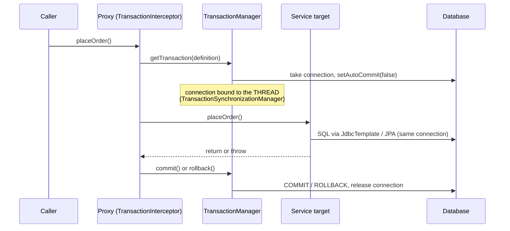

# Spring Transactions

> [!abstract] What this is
> How Spring manages database transactions: the **`@Transactional`** proxy and `PlatformTransactionManager`, **propagation** (`REQUIRED`, `REQUIRES_NEW`, `NESTED`, ...), **isolation** levels and database defaults, **rollback rules** (checked vs unchecked), `readOnly`, timeouts, **programmatic** transactions with `TransactionTemplate`, transaction-bound events, and how to draw **transaction boundaries** around remote calls. The decision this helps with: getting atomicity right, and explaining `UnexpectedRollbackException`, missing rollbacks and long-held locks. Database-side isolation anomalies are covered in [[17 - Consistency Time and Consensus]] and the HLD database notes.

---

## Why It Matters

- Transaction bugs corrupt data quietly: a checked exception that commits half an order, a "separate" audit transaction that isn't separate, a remote call inside a transaction holding row locks for 30 seconds.
- `@Transactional` is a proxy feature, so everything in [[03 - Spring AOP and Proxies]] applies: self-invocation and private methods silently get no transaction.

---

## How It Works



- The transaction manager (`JpaTransactionManager`, `DataSourceTransactionManager`, `JtaTransactionManager`, or reactive ones) binds the connection/`EntityManager` to the **current thread**. Every repository call on that thread joins it.
- Consequence: work handed to **another thread** (`@Async`, `CompletableFuture.supplyAsync`, parallel streams) runs **outside** the transaction.
- With JPA, the commit **flushes** the persistence context first, so SQL often runs at commit time, not where you called `save` ([[07 - Spring Data JPA and Hibernate]]).

---

## Propagation

| Propagation | Existing transaction | No transaction | Use |
|---|---|---|---|
| **`REQUIRED`** (default) | Join it | Start one | Almost everything |
| **`REQUIRES_NEW`** | **Suspend** it, start an independent one (new connection) | Start one | Audit/outbox records that must commit even if the caller rolls back |
| **`NESTED`** | Savepoint inside it; inner rollback returns to the savepoint | Start one | Partial rollback in batch work; JDBC (`DataSourceTransactionManager`) only, not JPA |
| `SUPPORTS` | Join | Run without | Read helpers |
| `MANDATORY` | Join | **Throw** | Enforce "must be called inside a transaction" |
| `NOT_SUPPORTED` | Suspend; run without | Run without | Long non-transactional work |
| `NEVER` | **Throw** | Run without | Rare |

### The rollback-only trap

```java
@Transactional
public void placeOrder(Order o) {
    orders.save(o);
    try {
        loyalty.award(o);            // @Transactional (REQUIRED) — joins this transaction, throws
    } catch (LoyaltyException e) {
        log.warn("loyalty failed");  // swallowed... but the shared transaction is now rollback-only
    }
}   // commit → UnexpectedRollbackException: Transaction silently rolled back because it has been marked as rollback-only
```

- With `REQUIRED`, inner and outer share **one physical transaction**. When the inner proxy sees an exception, it marks the transaction **rollback-only**; catching it outside doesn't undo that.
- Fixes: make the inner call `REQUIRES_NEW` (truly independent), don't make the inner method transactional, or let the exception propagate.
- `REQUIRES_NEW` needs a **second connection** while the first is held: under load with a small pool this can **deadlock the pool** (every thread holds one connection and waits for another). Size the pool for it or avoid it in hot paths.

---

## Isolation

| Level | Prevents | Default in |
|---|---|---|
| `READ_UNCOMMITTED` | — | Rarely used |
| **`READ_COMMITTED`** | Dirty reads | **PostgreSQL**, Oracle, SQL Server |
| **`REPEATABLE_READ`** | + non-repeatable reads (Postgres: snapshot; MySQL: also most phantoms) | **MySQL InnoDB** |
| `SERIALIZABLE` | + phantoms and write skew | Use for critical invariants; expect serialization failures to retry |

- `@Transactional(isolation = ...)` sets it per transaction; `Isolation.DEFAULT` uses the database's.
- Lost updates under `READ_COMMITTED` (read-modify-write of a balance) are prevented with **optimistic locking** (`@Version`), `SELECT ... FOR UPDATE`, or atomic SQL (`UPDATE ... SET balance = balance - ?`) ([[07 - Spring Data JPA and Hibernate]]).
- Serializable/snapshot failures must be **retried** with a fresh transaction (retry outside the transaction boundary).

---

## Rollback Rules

- Default: roll back on **`RuntimeException` and `Error`**; **commit** on checked exceptions. A legacy method throwing `IOException` commits whatever it wrote.
- Override: `@Transactional(rollbackFor = Exception.class)`, or `noRollbackFor = ...`.
- Programmatic: `TransactionAspectSupport.currentTransactionStatus().setRollbackOnly()`.
- Exceptions **swallowed** inside the method never reach the proxy: no rollback.

## readOnly and Timeouts

- `@Transactional(readOnly = true)`: hint to the driver/database; with Hibernate, flush mode becomes manual and **dirty checking is skipped** (less CPU and memory for big reads). Can drive **read-replica routing** ([[08 - Spring Database Connections and Migrations]]). Class-level `readOnly = true` with write methods overriding it is a common pattern.
- `timeout = 5` (seconds): the transaction is marked to fail if exceeded (enforced at statement boundaries / via JDBC query timeouts). Combine with database `statement_timeout` / `lock_timeout`.

---

## Programmatic Transactions

```java
@Service
class TransferService {
    private final TransactionTemplate tx;
    TransferService(PlatformTransactionManager tm) {
        this.tx = new TransactionTemplate(tm);
        tx.setTimeout(5);
    }
    Receipt transfer(TransferCommand cmd) {
        var quote = fxClient.quote(cmd);                          // remote call OUTSIDE the transaction
        return tx.execute(status -> {
            accounts.debit(cmd.from(), quote.sourceAmount());
            accounts.credit(cmd.to(), quote.targetAmount());
            return receipts.save(Receipt.of(cmd, quote));
        });
    }
}
```

- Use `TransactionTemplate` when the boundary is **narrower than a method**, to avoid self-invocation issues, or to control retries explicitly.

---

## Transaction Boundaries and Side Effects

- Keep transactions **short**: no remote HTTP calls, message sends or user interaction inside them. A slow downstream holds row locks and a pooled connection for its full duration.
- **Dual writes** (DB commit + Kafka publish) can't be made atomic with a local transaction. Options:
    - **`@TransactionalEventListener(phase = AFTER_COMMIT)`**: publish only after commit (still lost if the process dies between commit and publish).
    - **Transactional outbox**: write the event to an outbox table in the same transaction; a relay publishes it (at-least-once; consumers idempotent) ([[LLD/Foundations/11 - Idempotency and Retries]]).
- Distributed transactions (XA/JTA) across services are almost never the answer; use sagas and idempotency.

---

## Failure Modes

| Failure | What happens | Mitigation |
|---|---|---|
| **Self-invocation / private method** | No transaction at all | Call through another bean; `TransactionTemplate` |
| **Checked exception** | Partial commit | `rollbackFor = Exception.class` |
| **Caught exception from a joined inner transaction** | `UnexpectedRollbackException` at commit | `REQUIRES_NEW` for independence, or let it propagate |
| **`REQUIRES_NEW` under load** | Pool deadlock (each thread needs two connections) | Pool sizing; avoid in hot paths |
| **Remote call inside a transaction** | Long locks, pool exhaustion | Calls outside; narrow `TransactionTemplate` |
| **Work on another thread** | Runs without the transaction | Keep transactional work on the calling thread |
| **Lost updates** | Concurrent writes overwrite each other | `@Version`, `FOR UPDATE`, atomic SQL |
| **Publish before commit** | Consumers see events for rolled-back data | `AFTER_COMMIT` listeners or outbox |
| **Retrying inside the failed transaction** | Same failure; rollback-only | Retry around the transaction |

---

## Interview Lines

> [!tip] Say it like this
> - "`@Transactional` is a proxy that asks the transaction manager for a transaction and binds the connection to the current thread, so repository calls on that thread join it and work on other threads doesn't."
> - "By default it rolls back on unchecked exceptions and commits on checked ones."
> - "With `REQUIRED`, an inner failure marks the shared transaction rollback-only, so catching it outside still ends in `UnexpectedRollbackException`; `REQUIRES_NEW` gives a truly independent transaction but needs a second connection."
> - "I keep remote calls out of transactions and use an outbox or after-commit listeners for events."
> - "Postgres defaults to read committed, so I prevent lost updates with optimistic locking or `SELECT FOR UPDATE`."

## Related Notes

- [[03 - Spring AOP and Proxies]] · [[07 - Spring Data JPA and Hibernate]] · [[08 - Spring Database Connections and Migrations]] · [[01 - Spring IoC and Bean Lifecycle]]
- [[17 - Consistency Time and Consensus]] · [[LLD/Foundations/11 - Idempotency and Retries]] · [[Languages/README]]
