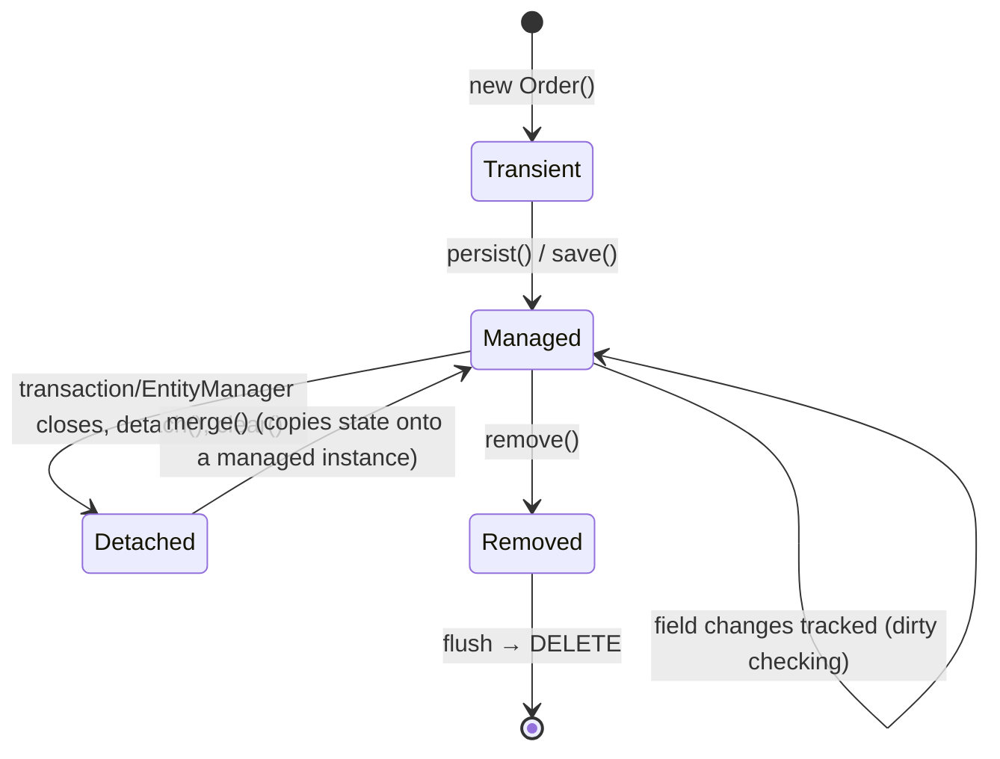

# Spring Data JPA and Hibernate

> [!abstract] What this is
> How JPA with Hibernate (Hibernate 7 / JPA 3.2 on Boot 4) actually talks to the database: the **persistence context** (identity map and first-level cache), **entity states**, **dirty checking** and **flush**, **lazy loading** and proxies, the **N+1** problem and its fixes, **open-session-in-view**, ID generation and **batching**, **optimistic and pessimistic locking**, and Spring Data repositories. The decision this helps with: writing JPA code that issues the SQL you expect, and recognising when to drop to SQL or DTO projections.

---

## Why It Matters

- JPA hides SQL, which is exactly why it causes performance incidents: 1 query in the code, 1,001 in production (N+1); a "read-only" endpoint that writes because an entity was modified; a `LazyInitializationException` after a refactor.
- Interviewers ask about N+1, lazy loading, dirty checking and optimistic locking more than any other persistence topic.

---

## The Persistence Context



- The **`EntityManager`**'s persistence context is a **map from (entity type, id) to one managed instance** for the duration of a transaction (Spring binds it to the transaction).
- **First-level cache / identity map**: `findById(42)` twice in a transaction returns the same object and hits the DB once.
- **Dirty checking**: at **flush**, Hibernate compares each managed entity with its loaded snapshot and issues `UPDATE`s for changes. No `save()` needed for managed entities; calling `save()` on them is redundant.
- **Flush** happens before commit, before queries that might be affected (flush mode `AUTO`), or on explicit `flush()`. So SQL errors (constraint violations) often surface **at commit**, not where `save` was called.
- Memory: every managed entity plus its snapshot stays in the context until the transaction ends. Batch jobs must `flush()` + `clear()` periodically, or use `readOnly` transactions / stateless sessions.

---

## Fetching and Lazy Loading

| Association | JPA default fetch | Recommendation |
|---|---|---|
| `@ManyToOne`, `@OneToOne` | **EAGER** | Set **`LAZY`** explicitly |
| `@OneToMany`, `@ManyToMany` | LAZY | Keep LAZY |

- A lazy association is a **proxy** (single-valued, a Hibernate-generated subclass) or a **persistent collection** wrapper. Touching it runs a query, but only while the persistence context is open.
- Outside a transaction → **`LazyInitializationException`**. Fix by fetching what the use case needs **inside** the transaction (fetch join, entity graph, DTO), not by making things eager.
- Proxies mean `entity.getClass()` may be `Order$HibernateProxy$...`; implement `equals` with `instanceof` and IDs ([[09 - Java Reflection Annotations and Proxies]]).

### The N+1 problem

```java
List<Order> orders = orderRepo.findByStatus(PENDING);   // 1 query
for (Order o : orders) o.getCustomer().getName();       // +N queries, one per customer proxy
```

| Fix | How | Notes |
|---|---|---|
| **Fetch join** | `@Query("select o from Order o join fetch o.customer where o.status = :s")` | One query; careful with collections (row multiplication) |
| **Entity graph** | `@EntityGraph(attributePaths = "customer")` on the repository method | Declarative per use case |
| **Batch fetching** | `spring.jpa.properties.hibernate.default_batch_fetch_size=50` | Turns N queries into N/50 `IN (...)` queries; a good global default |
| **DTO projection** | `select new com.acme.OrderRow(o.id, c.name) from Order o join o.customer c` or interface/record projections | No entities, no dirty checking, exactly the columns needed: best for reads |

- Detect it: enable SQL logging or statistics in tests (`hibernate.generate_statistics`), assert query counts, or use tools like datasource-proxy.
- **Collection fetch joins + pagination**: Hibernate can't paginate in SQL when a collection is fetch-joined; it loads everything and paginates **in memory** (with a warning). Paginate IDs first, then fetch by IDs.
- Fetch-joining two `List` (bag) collections at once throws `MultipleBagFetchException`; use `Set`, separate queries, or batch fetching.

### Open session in view (OSIV)

- Boot enables `spring.jpa.open-in-view=true` by default (and logs a warning): the `EntityManager` stays open for the **whole web request**, so lazy loading works in controllers and JSON serialisation.
- Cost: hidden queries during serialisation, a DB connection held for the entire request (including slow rendering and client I/O), N+1 in templates.
- Recommended: **`spring.jpa.open-in-view=false`**, fetch explicitly in services, return DTOs.

---

## IDs and Batching

| Strategy | Behaviour | Batching inserts |
|---|---|---|
| `IDENTITY` (auto-increment) | DB generates on insert; Hibernate must insert immediately to learn the ID | **Disables JDBC insert batching** |
| **`SEQUENCE`** with pooled optimiser (`allocationSize = 50`) | Hibernate reserves blocks of IDs | **Batching works**; preferred for Postgres/Oracle |
| UUID (v7 for index locality) | Generated in the app | Batching works; time-ordered UUIDs avoid random index inserts |

```properties
spring.jpa.properties.hibernate.jdbc.batch_size=50
spring.jpa.properties.hibernate.order_inserts=true
spring.jpa.properties.hibernate.order_updates=true
```

- `saveAll` of 10,000 entities with `IDENTITY` = 10,000 round trips. For bulk loads, consider JDBC batch (`JdbcClient`/`JdbcTemplate.batchUpdate`) or `COPY`.
- **Bulk JPQL** (`update Order o set o.status = ...`) bypasses the persistence context: managed entities become stale; clear the context afterwards (`@Modifying(clearAutomatically = true)`).

---

## Locking

| | Optimistic (`@Version`) | Pessimistic (`@Lock(PESSIMISTIC_WRITE)`) |
|---|---|---|
| How | Version column checked in `UPDATE ... WHERE id = ? AND version = ?`; 0 rows → `OptimisticLockException` | `SELECT ... FOR UPDATE`: other writers wait |
| Cost | No locks held; conflicts detected at write | Locks held until commit; deadlock risk |
| Pick when | Conflicts are rare (most web apps); long user think-time between read and write | Conflicts are frequent and retries are expensive (inventory decrement, seat booking hot rows) |
| On conflict | Retry the whole transaction or report to the user | Waiters proceed in turn; set lock timeouts |

```java
@Entity
class Account {
    @Id Long id;
    @Version long version;          // optimistic locking
    BigDecimal balance;
}

interface AccountRepo extends JpaRepository<Account, Long> {
    @Lock(LockModeType.PESSIMISTIC_WRITE)
    @QueryHints(@QueryHint(name = "jakarta.persistence.lock.timeout", value = "2000"))
    Optional<Account> findWithLockById(Long id);
}
```

- For simple counters, an atomic `UPDATE ... SET stock = stock - 1 WHERE id = ? AND stock > 0` beats both.

---

## Spring Data Repositories

- `JpaRepository<T, ID>` gives CRUD, paging and sorting; **derived queries** from method names (`findByStatusAndCreatedAtAfter`), `@Query` for JPQL/native SQL, **projections** (interfaces, records/DTOs), `Specification`s or Querydsl for dynamic queries.
- `save()` calls `persist` for new entities and **`merge`** otherwise. "New" is detected by a null ID (or version); with app-assigned IDs every `save` does a `SELECT` first unless the entity implements `Persistable`.
- Derived query names that grow beyond two or three conditions are a sign to write `@Query` or a projection.
- `Page<T>` runs an extra **count query**; use `Slice<T>` or keyset pagination for large tables.

### Entity design rules

- Don't use **records** as entities (immutable, final) ([[06 - Modern Java Language Features]]); records are ideal for projections.
- `equals`/`hashCode`: based on a business key or on the ID with care (null before persist); never all fields; never include lazy associations. `toString` must not touch lazy associations.
- Bidirectional associations: keep both sides in sync with helper methods; the owning side (`mappedBy` on the other) is what gets written.
- `CascadeType.REMOVE` / `orphanRemoval` on large collections loads everything to delete it.

---

## When Not to Use JPA

| Use JPA for | Prefer `JdbcClient` / jOOQ / SQL for |
|---|---|
| Aggregates with rich write logic | Reporting and analytical queries |
| CRUD-heavy domains | Bulk loads and batch updates |
| Optimistic locking and dirty checking | Complex SQL (window functions, CTEs) |
| | Hot read paths where you want exact SQL |

- Mixing is normal: JPA for writes, SQL/DTO projections for reads ([[08 - Spring Database Connections and Migrations]]).

---

## Failure Modes

| Failure | What happens | Mitigation |
|---|---|---|
| **N+1 queries** | Latency grows with result size | Fetch joins, entity graphs, batch fetching, DTOs; query-count tests |
| **EAGER `@ManyToOne` default** | Unwanted joins/queries everywhere | `fetch = LAZY` on all to-one associations |
| **`LazyInitializationException`** | Errors outside transactions | Fetch per use case inside the service; DTOs |
| **OSIV on** | Hidden queries, connections held per request | `open-in-view=false` |
| **Accidental update** | Modifying a managed entity in a "read" path writes it | `readOnly` transactions; DTOs for reads |
| **`IDENTITY` + `saveAll`** | No batching; thousands of round trips | `SEQUENCE` pooled IDs; JDBC batch for bulk |
| **Collection fetch join with pagination** | In-memory pagination of whole table | Two-step: page IDs, then fetch |
| **Huge persistence context in batch jobs** | Memory growth, slow flushes | `flush()` + `clear()` every N items |
| **Lost updates** | Concurrent edits overwrite | `@Version` |
| **`toString`/`equals` touching lazy fields** | Surprise queries, exceptions, infinite recursion | Simple ID-based methods |

---

## Interview Lines

> [!tip] Say it like this
> - "The persistence context is an identity map per transaction; at flush Hibernate dirty-checks managed entities against their snapshots, so I don't call `save` on managed entities."
> - "N+1 comes from lazy associations touched in a loop; I fix it with fetch joins or entity graphs per use case, batch fetching globally, and DTO projections for reads."
> - "I turn off open-session-in-view and make every to-one association lazy."
> - "`IDENTITY` IDs disable insert batching, so for Postgres I use sequences with a pooled optimiser."
> - "Optimistic locking with `@Version` for rare conflicts, `SELECT FOR UPDATE` for hot rows, and plain atomic SQL for counters."

## Related Notes

- [[06 - Spring Transactions]] · [[08 - Spring Database Connections and Migrations]] · [[04 - Spring MVC Request Lifecycle]]
- [[09 - Java Reflection Annotations and Proxies]] · [[LLD/Foundations/03 - Object Modelling]] · [[Languages/README]]
