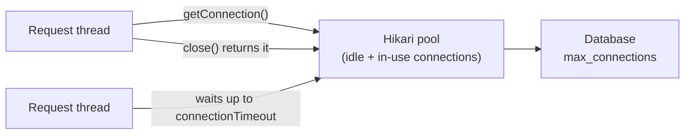

# Spring Database Connections and Migrations

> [!abstract] What this is
> The plumbing between a Spring Boot service and its database: **HikariCP** (how the pool works, the settings that matter, how to size it across instances), timeouts and leak detection, choosing between **`JdbcClient`/`JdbcTemplate`, JPA and jOOQ**, schema **migrations** with **Flyway** or **Liquibase** (and zero-downtime expand/contract changes), and **read-replica routing**. The decision this helps with: sizing pools so the database survives scale-out, and shipping schema changes without downtime.

---

## Why It Matters

- "Connection is not available, request timed out after 30000ms" is one of the most common Spring production errors. Its causes (pool too small, slow queries, leaks, transactions holding connections during remote calls) are all diagnosable.
- Autoscaling multiplies pools: 40 pods × 20 connections = 800 connections against a database configured for 500.
- Schema migrations are where deploys turn into outages: locking `ALTER TABLE`s, code and schema out of sync during rolling deploys.

---

## HikariCP



- Boot's default pool. A **fixed-size** pool works best: `minimumIdle` = `maximumPoolSize` (Hikari's default) avoids churn.
- `getConnection()` hands out an idle connection or **waits** up to `connectionTimeout`; then throws `SQLTransientConnectionException`.
- `close()` on a pooled connection returns it to the pool (resets autocommit, isolation, read-only state).

| Setting (`spring.datasource.hikari.*`) | Default | Guidance |
|---|---|---|
| `maximum-pool-size` | 10 | Size from DB capacity, not thread count (below) |
| `minimum-idle` | = max | Leave equal |
| `connection-timeout` | 30 s | Lower (1–5 s) so overload fails fast instead of piling up requests |
| `max-lifetime` | 30 min | A bit **shorter** than any DB/proxy/firewall connection limit |
| `keepalive-time` | — | Set (e.g. 2–5 min) so idle connections aren't silently dropped by NAT/LB |
| `idle-timeout` | 10 min | Only applies when `minimum-idle` < max |
| `leak-detection-threshold` | off | e.g. 30–60 s in non-prod (or prod with care): logs the stack of code holding a connection too long |

- Boot 4.1 adds **lazy DataSource connections** support, so a transaction doesn't take a physical connection until the first statement.
- Also set **driver-level** timeouts (Postgres `socketTimeout`, `connectTimeout`) and **database-level** `statement_timeout` / `lock_timeout` / `idle_in_transaction_session_timeout`: the pool timeout only bounds the wait *for* a connection.

### Sizing

- More connections ≠ more throughput. A database does real work on roughly **cores × 2 (+ effective disk spindles)** concurrent queries; beyond that, connections queue inside the database with context switching and lock contention. A pool of **10–30 per instance** is typical.
- Total across the fleet must fit: **instances × pool size (+ migrations, jobs, admin) ≤ database `max_connections`** with headroom. Plan for **max autoscaled replicas**, not the usual count.
- For many small instances or serverless, put a **connection pooler** in front (PgBouncer in transaction mode, RDS Proxy): thousands of client connections over a few hundred server connections. Transaction-mode pooling breaks session state (prepared statements in some driver modes, `SET` session variables, advisory locks).
- Thread pools vs connection pools: 200 Tomcat threads (or unbounded virtual threads) over 10 connections is fine **if** queries are fast and requests hold connections briefly; keep remote calls out of transactions ([[06 - Spring Transactions]], [[04 - Spring MVC Request Lifecycle]]).

### Diagnosing pool exhaustion

- Metrics (Micrometer): `hikaricp.connections.active`, `.pending`, `.acquire` time, `.usage` time ([[12 - Spring Observability]]).
- High **usage** time → slow queries or long transactions (remote calls inside, OSIV). High **pending** with low usage → pool too small for load.
- Thread dumps show request threads parked in `HikariPool.getConnection` ([[12 - JVM Diagnostics and Profiling]]).

---

## Choosing a Data Access API

| API | Style | Pick when |
|---|---|---|
| **`JdbcClient`** (Boot 3.2+) / `JdbcTemplate` | SQL strings, row mappers, fluent API | Simple, explicit SQL; batch work; reporting |
| **Spring Data JDBC** | Aggregates without lazy loading, persistence context or dirty checking | DDD-style aggregates with simpler semantics than JPA |
| **JPA / Hibernate** | ORM with persistence context | Rich domain writes, optimistic locking ([[07 - Spring Data JPA and Hibernate]]) |
| **jOOQ** | Type-safe SQL DSL generated from the schema | Complex SQL with compile-time checking |
| **R2DBC** | Reactive, non-blocking | WebFlux end to end ([[05 - Spring WebFlux and Reactive]]) |

```java
List<OrderRow> rows = jdbc.sql("""
        select id, total, created_at from orders
        where customer_id = :customerId and created_at > :since
        order by created_at desc limit 50
        """)
        .param("customerId", customerId)                // bound parameter, never concatenated
        .param("since", since)
        .query(OrderRow.class)                          // maps columns to record components
        .list();
```

---

## Migrations: Flyway vs Liquibase

| | Flyway | Liquibase |
|---|---|---|
| Format | Versioned SQL files (`V3__add_status.sql`), Java migrations | Changelogs in XML/YAML/JSON/SQL with changesets |
| Model | Linear version history | Changesets with ids, contexts, preconditions |
| Rollback | Write a new forward migration (undo is a paid feature) | Rollback blocks supported |
| Pick when | Teams comfortable with SQL; simplicity | Many DB vendors, generated diffs, rollback requirements |

- Boot runs them **at startup** when the library is on the classpath (`spring.flyway.*`, `spring.liquibase.*`), before JPA initialises. Both take a **lock** in the database so only one instance migrates.
- In production consider running migrations as a **separate job** (Kubernetes Job / init step in the pipeline) so app pods don't race, slow down startup or need DDL privileges. The app then validates (`spring.flyway.validate-on-migrate`) or just starts.
- Never edit an applied migration (checksum mismatch → startup failure); always add a new one.
- Turn off `spring.jpa.hibernate.ddl-auto` in anything but throwaway environments (`validate` or `none`).

### Zero-downtime schema changes (expand / contract)

During a rolling deploy, **old and new code run against the same schema**. Every migration must be compatible with both.

| Change | Safe sequence |
|---|---|
| Add a column | Add nullable (or with a default that doesn't rewrite the table) → deploy code that writes it → backfill in batches → add `NOT NULL` constraint (validated separately) |
| Rename a column | Add new column → write both → backfill → read new → stop writing old → drop old (several releases) |
| Drop a column | Stop reading/writing it in code first → deploy → drop in a later release |
| Add an index (Postgres) | `CREATE INDEX CONCURRENTLY` (outside a transaction: Flyway needs a non-transactional migration) |
| Change a type | New column + backfill, as with rename |

- Set `lock_timeout` in migrations: an `ALTER TABLE` waiting for a lock blocks every query queued behind it.
- Backfills: batched updates with pauses, not one huge `UPDATE` that bloats WAL and holds locks.

---

## Read Replicas

```java
class ReplicaRoutingDataSource extends AbstractRoutingDataSource {
    @Override protected Object determineCurrentLookupKey() {
        return TransactionSynchronizationManager.isCurrentTransactionReadOnly() ? "replica" : "primary";
    }
}
// Wrap it in LazyConnectionDataSourceProxy so the connection is fetched AFTER
// the transaction's read-only flag is known.
```

- Route `@Transactional(readOnly = true)` work to replicas, writes to the primary.
- **Replication lag**: a user who just wrote may not see the change on a replica. Read-your-writes paths (right after an update, or for a short window per user) must go to the primary.
- Alternatives: separate `DataSource` beans per role, or a proxy that routes (pgpool, ProxySQL, Aurora reader endpoints).

---

## Failure Modes

| Failure | What happens | Mitigation |
|---|---|---|
| **Pool exhaustion** | Requests time out waiting for connections | Short transactions, no remote calls inside, OSIV off, right pool size, short `connection-timeout` |
| **Fleet exceeds `max_connections`** | New pods fail to connect during scale-out | Budget instances × pool size; PgBouncer/RDS Proxy |
| **Connections silently dropped by NAT/LB** | Errors on first use after idle | `keepalive-time`, `max-lifetime` below infrastructure limits |
| **Leaked connections** | Pool drains over hours | try-with-resources; `leak-detection-threshold` |
| **No statement timeouts** | Runaway queries hold connections | `statement_timeout`, query timeouts |
| **Migrations run by every pod** | Startup races, slow boots, DDL rights in app | Dedicated migration job |
| **Locking DDL during traffic** | Outage while `ALTER` waits/holds locks | Expand/contract; `CONCURRENTLY`; `lock_timeout` |
| **Edited applied migration** | Checksum validation fails on startup | New migrations only |
| **`ddl-auto=update` in prod** | Unreviewed schema changes | `validate`/`none`; migrations only |
| **Reading from a lagging replica** | Users don't see their own writes | Primary for read-your-writes paths |

---

## Interview Lines

> [!tip] Say it like this
> - "Hikari is a fixed-size pool; a database only runs a few concurrent queries per core efficiently, so I keep pools around 10–30 and make sure instances times pool size fits `max_connections` at maximum scale."
> - "Pool exhaustion is usually long-held connections: slow queries, remote calls in transactions, open-session-in-view; Hikari's usage and pending metrics tell me which."
> - "I set a short connection timeout, a max lifetime below any network idle limit, keepalives, and database statement and lock timeouts."
> - "Schema changes go expand then contract, because old and new code run side by side during a rolling deploy; indexes are created concurrently."
> - "Read-only transactions can route to replicas, except read-your-writes paths, because of replication lag."

## Related Notes

- [[06 - Spring Transactions]] · [[07 - Spring Data JPA and Hibernate]] · [[04 - Spring MVC Request Lifecycle]] · [[12 - Spring Observability]]
- [[12 - JVM Diagnostics and Profiling]] · [[Languages/README]]
